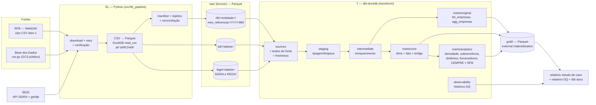
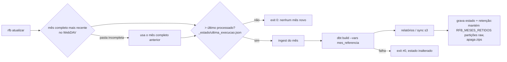

# ARCHITECTURE — Pipeline RFB/CNPJ (dbt + DuckDB + Parquet)

> **Para quem:** quem mantém, revisa ou estende o pipeline · **Quando ler:** para entender as camadas, os contratos,
> a estratégia de qualidade e o que veio do MVP original.

> Documento vivo. Decisões não triviais estão em [docs/adr/](docs/adr/README.md). Escopo original × adições:
> [§11](#11-escopo-original--adaptado--adição). Produto e personas: [PRODUCT.md](PRODUCT.md). Como rodar:
> [docs/operacao.md](docs/operacao.md). Conceitos de negócio: [docs/conceitos.md](docs/conceitos.md).

## 1. Visão geral

ELT em quatro estágios. A extração/carga (EL) é Python; toda transformação (T) é dbt sobre DuckDB, lendo
e escrevendo Parquet. Nenhum dado "vive" só dentro do banco: o arquivo `.duckdb` é descartável e pode ser
recriado a partir dos Parquet.



Mapeamento com a arquitetura medalhão citada no original (notebook 3): `raw/` = bronze; staging +
intermediate + `bh_empresas`/core = silver; `agg_empresas` + análises = gold.

## 2. Stack

| Peça | Escolha | Versão alvo | Motivo (ver ADR) |
|---|---|---|---|
| Linguagem/ambiente | Python via `uv` | 3.12 | reprodutível, lockfile ([ADR-0001](docs/adr/0001-duckdb-dbt-parquet.md)) |
| Motor de consulta | DuckDB | ≥ 1.5 | colunar, lê/escreve Parquet e S3, latin-1 nativo no `read_csv` |
| Transformação | dbt-core + dbt-duckdb | 1.12 / 1.11 (o que o resolver aceitar junto) | modelos SQL versionados, testes, docs, linhagem |
| Pacotes dbt | `dbt_utils`, `dbt_expectations` (metaplane), `dbt_audit_helper` (opcional) | últimos compatíveis | testes genéricos prontos ([ADR-0009](docs/adr/0009-estrategia-testes.md)) |
| Testes Python | pytest (+ `httpx.MockTransport`, `moto[server]`) | — | ingestão e storage sem rede real |
| Lint | sqlfluff (templater dbt/jinja) + ruff | — | padrão de estilo SQL/Python |
| Armazenamento | FS local (`RAIZ_DADOS`) ou S3/Tigris | — | local-first ([ADR-0007](docs/adr/0007-armazenamento-local-s3.md)) |

## 3. Estrutura do repositório

```
.
├── PRODUCT.md  ARCHITECTURE.md  README.md  CHANGELOG.md
├── pyproject.toml  uv.lock  Makefile  .env.example  .sqlfluff  .pre-commit-config.yaml
├── src/rfb_pipeline/           # EL em Python (pacote instalável, CLI `rfb`)
│   ├── configuracao.py               # RAIZ_DADOS, mês de referência, URLs, limiares
│   ├── esquemas.py              # colunas/nomes de cada arquivo RFB e BD (contrato raw)
│   ├── cliente_rfb.py           # listagem WebDAV, detecção do último mês, download c/ retry
│   ├── basedosdados.py         # download das tabelas BD
│   ├── conversao.py              # zip → CSV → Parquet (DuckDB), rejeitos, escrita atômica
│   ├── manifesto.py             # manifesto JSON por execução (checksums, contagens)
│   ├── armazenamento.py              # local vs s3/Tigris (secret DuckDB, sync boto3)
│   ├── publicacao.py                 # publicação opcional do gold no MotherDuck (ADR-0016)
│   ├── report.py               # relatório do estudo de caso e de DQ (Markdown)
│   └── cli.py                  # rfb ingerir | sync | pipeline | report
├── scripts/gerar_fixtures.py     # gera fixtures sintéticas no formato RFB/BD
├── tests/                      # pytest: unit/ e integration/
│   └── fixtures/               # (gerado) zips/csv.gz sintéticos
├── transform/                  # PROJETO dbt
│   ├── dbt_project.yml  profiles.yml  packages.yml
│   ├── models/
│   │   ├── staging/rfb/  staging/basedosdados/
│   │   ├── intermediate/
│   │   ├── marts/original/     # bh_empresas, agg_empresas
│   │   ├── marts/core/         # dims, fato, bridge            (adição)
│   │   ├── marts/analytics/     # marts analíticos              (adição)
│   │   ├── observability/    # histórico e resumo de DQ      (adição)
│   │   ├── audit/            # tradução literal do SQL original (paridade; efêmero)
│   │   └── docs/             # doc blocks: definições curtas dos conceitos (docs/conceitos.md)
│   ├── seeds/  macros/  tests/ (singulares)  analyses/ (estudo de caso, cenários de uso, regras de negócio e
│   │                                                     golden/: golden queries, ADR-0023)
├── dados/ (gitignored)          # RAIZ_DADOS padrão
│   ├── raw/rfb/<entidade>/mes_referencia=YYYY-MM/*.parquet
│   ├── raw/bd/<tabela>/*.parquet
│   ├── raw/ibge/<tabela>/*.parquet   # SIDRA e REGIC (incremento enriquecimento_ibge)
│   ├── raw/_rejeitos/  _manifestos/  _baixados/ (cache de zips)
│   ├── gold/<modelo>.parquet
│   └── warehouse.duckdb
└── docs/  adr/  guia-dbt/  uso/  referencia/  relatorios/  historico/  conceitos.md  operacao.md
```

## 4. EL — Ingestão (Python)

### 4.1 Fontes

| Fonte | Local | Arquivos |
|---|---|---|
| RFB CNPJ | WebDAV público `https://arquivos.receitafederal.gov.br/public.php/webdav/` (usuário = token do share `YggdBLfdninEJX9`, senha vazia), pastas `YYYY-MM/` | `Empresas{0..9}.zip`, `Estabelecimentos{0..9}.zip`, `Simples.zip`, `Cnaes.zip`, `Municipios.zip`, `Naturezas.zip`, `Motivos.zip`, `Paises.zip`, `Qualificacoes.zip` (**não** `Socios*`) |
| Base dos Dados | API `https://basedosdados.org/api/tables/downloadTable?p=<b64 dataset>&q=<b64 tabela>&d=<b64 "true">&s=<b64 "free">` (gzip, grátis até 100 MB; ADR-0015) | `br_bd_diretorios_brasil/municipio`, `br_bd_diretorios_brasil/cnae_2`, `br_ibge_populacao/municipio`, `br_ibge_pib/municipio`; **incremento enriquecimento BD (ADR-0015):** `br_ibge_censo_2022/municipio`, `br_geobr_mapas/regiao_metropolitana_2017`, `br_bd_vizinhanca/municipio` |
| IBGE (**incremento enriquecimento IBGE**, [ADR-0022](docs/adr/0022-enriquecimento-fontes-gratuitas-ibge.md)) | API SIDRA `https://apisidra.ibge.gov.br/values/...` (≤ 50.000 valores por requisição; CEMPRE fatiado e retomável) e planilhas da REGIC 2018 em `https://geoftp.ibge.gov.br/` | SIDRA 9528 (CEMPRE: categorias CNAE e município × classe, 4 variáveis, ano mais recente), SIDRA 10295 (renda per capita do Censo 2022), REGIC 2018 (hierarquia, ligações, atração); gratuitas, sem conta nem chave |

A URL antiga do original (`/dados/cnpj/dados_abertos_cnpj/2025-02/`) retorna 404 e o mês 2025-02 não está
mais publicado — ver [ADR-0003](docs/adr/0003-fonte-rfb-webdav.md).

### 4.2 Contrato da camada raw

- Um diretório por entidade, particionado Hive por `mes_referencia=YYYY-MM` (RFB). BD não tem partição.
- **Todas as colunas de dados como `VARCHAR`** (schema-on-read; a tipagem é responsabilidade do staging).
- Nomes de colunas RFB = os headers do notebook 1 original em minúsculas (continuidade/rastreabilidade):
  - `empresas`: `cnpj_raiz, razao_social, natureza_jur, qualificacao_resp, capital_soc, porte, ente_fed_resp`
  - `estabelecimentos`: `cnpj_raiz, cnpj_ordem, cnpj_dv, ind_matriz_filial, nome_fantasia, situacao, dat_situacao, mot_situacao, cidade_exterior, pais, dat_inicio_atividade, cnae_principal, cnaes_secundarios, tip_logradouro, logradouro, num_logradouro, compl_logradouro, bairro, cep, uf, municipio, ddd1, tel1, ddd2, tel2, ddd_fax, fax, email, sit_especial, dat_sit_especial`
  - `simples` (adição): `cnpj_raiz, opcao_simples, dat_opcao_simples, dat_exclusao_simples, opcao_mei, dat_opcao_mei, dat_exclusao_mei`
  - domínios (`cnaes, municipios, naturezas, motivos, paises, qualificacoes`): `codigo, descricao`
  - BD: colunas do CSV como vêm (header presente).
- Colunas técnicas adicionadas a toda tabela raw: `_arquivo_origem VARCHAR`, `_mes_referencia VARCHAR`
  (RFB), `_data_referencia DATE` (RFB; data embutida no nome interno do arquivo, ex. `D60912` → 2026-09-12),
  `_ingerido_em TIMESTAMP`.
- Leitura CSV RFB: `delim=';'`, `quote='"'`, `escape='"'`, `header=false`, `encoding='latin-1'`,
  `all_varchar`, colunas nomeadas explicitamente, `store_rejects=true`. Replica as opções do Spark do
  original (escape `"` por causa de `\"` em razões sociais; campos multilinha).
- Campo `""` (vazio entre aspas) é gravado como NULL (padrão do DuckDB); o staging trata vazio e NULL igual.
- Escrita atômica: grava em diretório temporário e renomeia; nunca deixa Parquet parcial.
- Rejeitos do parser → `raw/_rejeitos/<entidade>/mes_referencia=.../*.parquet`. Se a taxa de rejeito
  exceder `RFB_MAX_TAXA_REJEITO` (padrão `0.0001`), a ingestão falha (gate de qualidade na borda).
- **Idempotência:** o manifesto guarda tamanho/sha256 de cada zip e contagens por entidade; reexecutar o
  mesmo mês com os mesmos zips não reprocessa (a menos que `--force`).

### 4.3 Manifesto (`_manifestos/<mes>.json`)

```json
{"mes_referencia": "2026-09", "data_referencia": "2026-09-12", "iniciado_em": "...", "concluido_em": "...",
 "arquivos": [{"nome": "Empresas0.zip", "bytes": 0, "sha256": "...", "entidade": "empresas",
               "linhas_lidas": 0, "linhas_rejeitadas": 0, "parquet": ["..."]}],
 "entidades": {"empresas": {"linhas": 0, "rejeitadas": 0}}, "versao_pipeline": "x.y.z"}
```

### 4.4 Erros e resiliência

| Cenário | Tratamento |
|---|---|
| Rede/timeout/5xx | Backoff exponencial entre tentativas (também após tentativas com progresso); download retoma via `Range` + `If-Range` (ETag/Last-Modified); encerra após 3 falhas seguidas sem progresso (`tentativas`), `RFB_MAX_RETOMADAS` (50) falhas no total ou `RFB_TEMPO_LIMITE_TOTAL_S` (3600 s), com mensagem citando arquivo e URL; PROPFIND usa o mesmo retry; exit 1 sem traceback |
| Tamanho baixado ≠ `getcontentlength` do WebDAV | apaga o arquivo e falha (sem conversão) |
| Zip corrompido | falha antes de converter; nada é escrito em `raw/` |
| Mês inexistente | erro explícito listando os meses disponíveis |
| Taxa de rejeito acima do limiar | falha; rejeitos ficam gravados para auditoria |
| Credenciais S3 ausentes com `RAIZ_DADOS=s3://` | falha imediata com mensagem indicando as variáveis faltantes (também no dbt: o profile `s3` não tem padrão para `AWS_*`) |
| Mês incompleto (faltam `Empresas0–9`, `Estabelecimentos0–9`, `Simples` ou um dos 6 domínios) | sem `--mes` usa o mais recente completo (avisa o ignorado); com `--mes` falha listando os faltantes; `--permitir-incompleto` aceita (usado no `make ci`) |
| Segunda `rfb ingerir` simultânea | falha com "execução em andamento" (lock `RAIZ_DADOS/_estado/rfb.lock`); a limpeza de resíduos só roda com o lock |
| `_data_referencia` nula | aviso explícito por arquivo e ao fim; manifesto grava `data_referencia: null` |

### 4.5 Atualização mensal ([ADR-0012](docs/adr/0012-atualizacao-mensal.md)) — melhoria



- "Mês completo" = pasta com `Empresas0–9`, `Estabelecimentos0–9`, `Simples` e os 6 domínios.
- Histórico mensal em `gold/fct_resumo_mensal/mes_referencia=YYYY-MM/` (uma partição por mês, independente do
  `.duckdb` e da retenção do raw). O dbt grava só a partição do mês processado (`overwrite_or_ignore`) e a
  relação `fct_resumo_mensal` lê todas as partições; `sk_mes_referencia` = 1º dia do mês (`yyyymm01`, chave
  de `dim_data`). Para registrar um mês **antigo**, rode antes `dbt build --select +fct_resumo_mensal --vars
  '{mes_referencia: AAAA-MM}'` (sobrescreve o gold "corrente") e, por último, o build do mês corrente. Receitas de agendamento (cron, launchd, GitHub Actions) em `docs/operacao.md`.

## 5. T — Projeto dbt (`transform/`)

### 5.1 Camadas, materializações e convenções

| Camada | Pasta | Materialização padrão | Convenção de nome | Grão |
|---|---|---|---|---|
| Fontes | `models/staging/*/_*__sources.yml` | — (external_location Parquet) | `source('rfb','empresas')` | arquivo raw |
| Staging | `models/staging/<fonte>/` | `view` | `stg_<fonte>__<entidade>` | 1:1 com a fonte |
| Intermediate | `models/intermediate/` | `table` | `int_<entidade>__<verbo>` | variável |
| Original | `models/marts/original/` | `external` (Parquet em `gold/`) | nomes do original: `bh_empresas`, `agg_empresas` | estabelecimento / estrato |
| Core (adição) | `models/marts/core/` | `external` | `dim_*`, `fct_*`, `bridge_*` | estrela |
| Análises (adição) | `models/marts/analytics/` | `external` | `mart_*` | por pergunta |
| Observabilidade (adição) | `models/observability/` | `table`/`incremental` | `dq_*` | execução × teste |

- Colunas em `snake_case` minúsculo (o original usava `CNAE_principal`, `UF`; DuckDB é case-insensitive,
  mas padronizamos). Mapeamento de nomes na [§11](#mapeamento-de-nomes-de-colunas-original--port).
- Todo modelo declara `meta: {escopo: original | adicao | adaptado}` e a tag correspondente
  (`escopo_original`, `escopo_adicao`, `escopo_adaptado`) — [ADR-0006](docs/adr/0006-marcacao-escopo.md).
- Marts `original` e `core` têm **contrato** (`contract: enforced: true`) com tipos declarados.
- `external_location` das fontes e `location` dos marts derivam de `env_var('RAIZ_DADOS', '../dados')`.

### 5.2 Variáveis (`dbt_project.yml`)

| Var | Padrão | Uso |
|---|---|---|
| `mes_referencia` | `null` → maior `_mes_referencia` disponível | filtro de partição no staging RFB |
| `data_referencia` | `null` → `_data_referencia` do mês selecionado | cálculo determinístico de idade ([ADR-0004](docs/adr/0004-data-referencia-deterministica.md)) |
| `ano_populacao` | `null` → último ano disponível | join com população |
| `caso_cnae_alvo` | `'4741500'` | estudo de caso (varejo de tintas) |
| `caso_municipio` / `caso_uf` | `'FUNDÃO'` / `'ES'` | estudo de caso |
| `caso_cnaes_fornecedores` | `['2071100','4679601','4679699']` | estudo de caso |
| `raio_fornecedores_km` | `100` | mart de fornecedores próximos |

### 5.3 Modelos

O detalhe de cada modelo e de cada coluna (descrição, grão, chaves, testes, origem, linhagem) está no
[dicionário de dados](docs/referencia/dicionario-dados.md), gerado dos YAMLs do dbt, com o diagrama do
[modelo estrela](docs/referencia/dicionario-dados.md#modelo-estrela). Os YAMLs são a fonte; este resumo só diz o
papel de cada camada.

| Camada | Modelos | Papel |
|---|---|---|
| Staging | `stg_rfb__*` (empresas, estabelecimentos, simples e os domínios cnaes, municípios, naturezas, motivos); `stg_bd__*` (municípios, cnaes, população, PIB; **incremento enriquecimento BD:** Censo 2022, regiões metropolitanas, vizinhança); `stg_ibge__*` (**incremento enriquecimento IBGE:** CEMPRE por classe e total, renda, REGIC hierarquia, ligações e atração) | tipagem e limpeza, sem joins; `cnpj_completo` montado das três partes; datas `YYYYMMDD` → `DATE`; **descarta** `email`, `ddd*`, `tel*`, `fax` ([ADR-0008](docs/adr/0008-minimizacao-dados-pessoais.md)) |
| Intermediate | `int_municipios__conformados`, `int_estabelecimentos__enriquecidos`, `int_cnaes_secundarios__explodidos`; **incremento IBGE:** `int_regic__destinos_compras`, `int_municipios__perfil_ibge` | junções e conformação: RFB ↔ IBGE (via BD), estabelecimento × empresa × domínios com **left joins** e flags de correspondência (base do original e do core) |
| Original ([ADR-0005](docs/adr/0005-paridade-modelos-originais.md)) | `bh_empresas`, `agg_empresas`; `audit__bh_empresas_sql_original` (efêmero) | paridade com o notebook 3 (inner joins, mesmas colunas e regras). Única diferença intencional: idade relativa a `data_referencia` em vez de `now()` (`escopo: adaptado`). Um teste singular exige diferença zero entre `bh_empresas` e o SQL original traduzido |
| Core ([ADR-0013](docs/adr/0013-modelo-estrela-bi.md)) | `dim_municipio`, `dim_cnae`, `dim_natureza_juridica`, `dim_porte`, `dim_situacao_cadastral`, `dim_data`; `fct_estabelecimentos`, `fct_resumo_mensal`; `bridge_estabelecimento_cnae_secundario`, `bridge_municipio_vizinho` (incremento BD), `bridge_municipio_destino_compras` (incremento IBGE) | modelo estrela para BI: chaves `sk_*` inteiras, membro `-1` NÃO INFORMADO (e `-2` DATA INVÁLIDA em `dim_data`), hierarquias em colunas (em `dim_municipio`, região → UF → meso → micro → município e intermediária → imediata). `fct_resumo_mensal` é a série mensal particionada para o modo Import do Power BI ([guia](docs/uso/power-bi.md)) |
| Análises | `mart_concorrencia_municipio`, `mart_concorrencia_area_mercado` (incremento BD), `mart_dinamica_mercado`, `mart_sobrevivencia_coorte`, `mart_fornecedores_proximos`, `mart_emprego_setor_municipio` (incremento IBGE) | uma regra pronta por pergunta (concorrência, área de mercado, dinâmica, sobrevivência, fornecedores, CEMPRE × RFB) |
| Observabilidade | `dq_historico_testes` (tabela dos hooks, incremental), `dq_resumo_execucao` | `on-run-end` grava os `run_results` dos testes (nome, status, falhas, severidade, escopo); `store_failures` nos testes de conteúdo |
| Golden queries ([ADR-0023](docs/adr/0023-golden-queries-e-guia-para-agente.md)) | `transform/analyses/golden/gq_<camada>__<conceito>__<nn>.sql` e `docs/referencia/golden_queries/semantica.yml` | uma consulta testada por conceito × camada, com a resposta exata nas fixtures; `make golden` gera o catálogo para o [agente de consulta](docs/uso/consulta-agente.md) |

As definições curtas dos conceitos de negócio usadas nas descrições dos modelos são doc blocks do dbt
(`transform/models/docs/conceitos.md`), as mesmas que abrem cada conceito em [docs/conceitos.md](docs/conceitos.md).

### 5.4 Seeds

`dominio_porte.csv` (00/01/03/05 → rótulos), `dominio_situacao_cadastral.csv` (01 NULA, 02 ATIVA, 03
SUSPENSA, 04 INAPTA, 08 BAIXADA), `dominio_matriz_filial.csv`, `excecoes_conhecidas_municipio.csv`
(códigos RFB sem par no BD documentados no original: EXTERIOR e municípios criados após a base BD).

## 6. Qualidade de dados — estratégia

Checks antes e depois de cada etapa; catálogo completo em [docs/referencia/qualidade-dados.md](docs/referencia/qualidade-dados.md)
(gerado na Fase 3) e explicação didática no [guia dbt](docs/guia-dbt/README.md). Resumo:

| Etapa | Antes (entrada) | Depois (saída) |
|---|---|---|
| Download | mês existe; tamanho remoto conhecido | tamanho confere; zip íntegro; sha256 no manifesto |
| Conversão | encoding/delimitador fixos | taxa de rejeito ≤ limiar; contagem > 0; nº de colunas |
| Fontes (dbt) | freshness (`_ingerido_em`) | **checks do original** (unicidade/completude dos domínios, integridade natureza/CNAE/município, domínios de porte/situação, contagens plausíveis) |
| Staging | — | tipos/parse de datas, CNPJ 14 dígitos + DV válido, unicidade de `cnpj_completo`, sem datas futuras |
| Intermediate/Original | — | reconciliação de linhas (descartes do inner join quantificados), `sum(qtd_empresas) = count(bh_empresas)`, idade ∈ [0,200], paridade com SQL original, contratos, testes unitários das regras |
| Core/Análises | — | relacionamentos fato→dims, taxas ∈ [0,1], sobrevivência 1a ≥ 3a ≥ 5a, distância ≥ 0 e 0 no próprio município |

Severidade: estrutura (PK, contratos, relacionamentos no core, paridade) = `error`; anomalias de conteúdo =
`warn` com `error_if` por limiar ([ADR-0009](docs/adr/0009-estrategia-testes.md)).

## 7. Execução

Comandos, perfis do dbt (`ci`, `dev`, `s3`), fluxo S3, atualização mensal, agendamento e requisitos de máquina:
[docs/operacao.md](docs/operacao.md). O início rápido está no [README](README.md#início-rápido).

**Consumo por BI e publicação opcional (adição, [ADR-0016](docs/adr/0016-publicacao-motherduck.md)):** o `gold/` em
Parquet é o contrato; o Power BI o acessa por (1) Parquet direto, (2) `warehouse.duckdb` via ODBC (views sobre o gold;
um escritor por vez) ou (3) MotherDuck, após `rfb publicar` (desacoplado do dbt: `ATTACH 'md:<banco>'` +
`CREATE OR REPLACE TABLE … AS SELECT * FROM read_parquet(…)`, com `hive_partitioning` na série mensal; o token vem do
ambiente e nunca entra em SQL/log). Com `RAIZ_DADOS=s3://` a publicação recusa (lê gold local). Comparativo e passo a passo:
[docs/uso/power-bi.md](docs/uso/power-bi.md#como-o-power-bi-acessa-os-dados).

## 8. Segurança e privacidade

- Nenhum segredo no repositório; `.env` gitignored, `.env.example` só com nomes de variáveis.
- Sem dados de sócios; contatos (email/telefone) descartados no staging ([ADR-0008](docs/adr/0008-minimizacao-dados-pessoais.md)).
- Downloads só via HTTPS de hosts em allowlist (`arquivos.receitafederal.gov.br`, `basedosdados.org`).
- Extração de zip protegida contra path traversal (zip-slip).

## 9. Riscos e mitigação

| Risco | Impacto | Mitigação |
|---|---|---|
| RFB muda de novo o local/formato | ingestão quebra | URL/token em config; teste de contrato de colunas; erro claro |
| Volume (~7 GB zip, ~25 GB CSV, ~65 M estabelecimentos) | tempo/memória | conversão streaming por arquivo; `memory_limit`/`temp_directory` no DuckDB; staging em view, intermediate materializado; cache de zips |
| Números diferentes do original (mês diferente) | "paridade" questionada | paridade é **lógica** — teste de paridade compara com o SQL original sobre os mesmos dados |
| Modelo barato gera testes que espelham implementação | falsa segurança | fixtures com respostas conhecidas definidas na spec; revisões Opus por fase; Verifier com sensor de mutação |
| Tigris sem credenciais no ambiente | S3 não testado de verdade | moto server nos testes; teste real opcional documentado |

## 10. Índice de decisões

Ver [docs/adr/README.md](docs/adr/README.md).

## 11. Escopo: original × adaptado × adição

Marcação no código: `meta.escopo` + tag `escopo_<valor>` em cada nó dbt ([ADR-0006](docs/adr/0006-marcacao-escopo.md)).
Fonte do original: [docs/historico/referencia-original/](docs/historico/referencia-original/README.md). Mantenha a
tabela ao acrescentar ou mudar um artefato. Para listar pelo dbt:

```bash
cd transform
uv run dbt ls --select tag:escopo_original                    # ou escopo_adicao, escopo_adaptado
uv run dbt ls --select tag:incremento_enriquecimento_bd       # incremento enriquecimento BD (ADR-0015)
uv run dbt ls --select tag:incremento_enriquecimento_ibge     # incremento enriquecimento IBGE (ADR-0022)
```

Legenda: **original** = regra/artefato do MVP; **adaptado** = do MVP com mudança intencional documentada;
**adição** = novo neste port.

### Artefatos

| Artefato no port | Escopo | Origem no MVP / justificativa |
|---|---|---|
| Download dos zips RFB | adaptado | `baixar_dados_QSA-*.sh` (wget + unzip) → cliente WebDAV com retry/verificação (URL mudou, ADR-0003) |
| Conversão CSV (latin-1, `;`, escape `"`, multilinha) | original | notebook 1 (opções do `spark.read.csv`) |
| Raw em Parquet all-VARCHAR particionado por mês | adaptado | notebook 1 salvava tabela Spark com `inferSchema` (ADR-0002) |
| Tabelas BD `municipio`, `cnae_2` | original | notebook 1, seção 2 |
| Tabelas BD `populacao`, `pib`; RFB `simples`, `paises`, `qualificacoes` | adição | enriquecimento (densidade, MEI) |
| Manifesto, idempotência, limiar de rejeitos | adição | — |
| Upload para Tigris (`rfb sincronizar`) | adaptado | `subir_arquivos_tigris.py` |
| Fontes dbt com testes de unicidade/completude/integridade/domínio | original | notebooks 2.1.1, 2.1.2, 2.2, 2.3 |
| Freshness das fontes (`dbt source freshness` no `make ci`) e teste `extrato_desatualizado` (idade do extrato, `warn` fora do target `ci`) | adição | — |
| `relationships` das fontes (natureza/CNAE/município) avaliados por mês (`relacionamentos_fontes_por_mes`) | adaptado | original tinha um único mês; com meses retidos o `relationships` genérico cruzaria todos (R1-22) |
| Staging tipado | adição | original não tinha camada explícita |
| `bh_empresas` | original | notebook 3 |
| `bh_empresas.idade_atual` relativa a `data_referencia` | adaptado | notebook 3 usava `now()` (ADR-0004) |
| CPF mascarado nos nomes do gold (`bh_empresas.nome`, `mart_fornecedores_proximos.nome`): todo trecho de exatamente 11 dígitos vira `***.***.***-**` (`mascarar_cpf_no_nome`); a paridade aplica a mesma máscara no alinhamento final; teste `sem_cpf_no_nome` (error) | adaptado | a razão social do empresário individual/MEI termina com o CPF do titular (12,5 M nomes em 2026-09); o original o expunha. Decisão do usuário (ADR-0008, emenda R4-01) |
| Uma linha por `cnpj_raiz` nas Empresas (`empresa_preferida_por_raiz` no staging e na leitura da paridade) | adaptado | o extrato real de 2026-09 traz a raiz 08314885 duas vezes (uma linha "fantasma" sem razão social, natureza 0000); o SQL original duplicaria os 51 estabelecimentos dela. O teste de unicidade da fonte vira `warn` com `store_failures` (B8, `docs/historico/execucao-real-2026-10.md`) |
| Conversão de CSV com bytes 0x80–0x9F (transcodificação latin-1 → UTF-8 em Python antes do DuckDB) | adaptado | o leitor latin-1 do DuckDB recusa esses bytes, que o extrato real 2026-09 traz em 5 campos; o Spark do original os lia como latin-1 (B8) |
| `agg_empresas` | original | notebook 3 |
| Teste de paridade com SQL original | adição | — |
| Star schema (`dim_*`, `fct_estabelecimentos`, bridge) | adição | "trabalhos futuros" do notebook 5 |
| `mart_concorrencia_municipio`, `mart_sobrevivencia_coorte`, `mart_dinamica_mercado`, `mart_fornecedores_proximos` | adição | aprofundam as perguntas do notebook 0/4 |
| Análises do estudo de caso Fundão/ES (`analyses/estudo_caso_q1..q3*`, `q4_fornecedores_secundarios_uf`) | original | notebook 4 (perguntas 1–4, parametrizadas por `caso_*`) |
| Análise `estudo_caso_q4_fornecedores_resumo` (buscas por micro e mesorregião com `upper()` dos dois lados) | adaptado | o notebook 4 comparava MAIÚSCULAS (`agg_empresas`) com a grafia mista da BD e por isso sempre retornava 0 nessas buscas; a comparação corrigida muda a resposta (R3-04) |
| Análises das adições no estudo de caso (`analyses/estudo_caso_adicao_*`, `estudo_caso_parametros`) | adição | usam os 4 marts novos |
| Relatório gerado do estudo de caso (`rfb relatorio`, `src/rfb_pipeline/relatorio.py`) | adição | — |
| Testes genéricos `cnpj_dv_valido` e `data_nao_futura`, `store_failures` nos testes warn, guarda de escopo (`test_escopo_meta.py`) | adição | — |
| Endurecimento da revisão RBP: teste genérico `taxa_conversao_tipada`, checks de volume (`dbt_expectations`), contratos nos marts de analytics, `selectors.yml`, guardas de cobertura de descrições, `make ci` com unit + lint e workflow `.github/workflows/ci.yml` (não executado até o repositório ser publicado) | adição | docs/historico/revisoes/RBP.md (triagem do líder) |
| Histórico de testes (`dq_historico_testes`, `dq_resumo_execucao`) e catálogo `docs/referencia/qualidade-dados.md` | adição | — |
| Atualização mensal (`rfb atualizar`, completude do mês, retenção, estado) | adição (pedido do usuário) | original era carga estática única (notebook 0, "Observações") — ADR-0012 |
| Pipeline ponta a ponta (`rfb pipeline`/`make pipeline`), backfill de mês antigo só do resumo (P22), teste `fct_resumo_mensal_gold_corrente`, publicação no fim quando o MotherDuck está configurado, `docs/operacao.md` | adição (pedido do usuário) | ADR-0012/0016; original rodava os notebooks à mão |
| Histórico de DQ exportado para `gold/dq_historico_testes/` (Parquet por execução) | adição | RBP-12: sobrevive ao descarte do `warehouse.duckdb` |
| Série histórica `fct_resumo_mensal` particionada por mês | adição (pedido do usuário) | ADR-0012/0013 |
| Camada semântica dbt/MetricFlow: modelos semânticos, 29 métricas, *time spine* em `dim_data`, 5 *saved queries*, `make semantica`, `docs/referencia/camada-semantica.md` | adição (pedido do usuário) | ADR-0018; as medidas DAX do guia Power BI definidas uma vez, fora da ferramenta de BI |
| Dicionário de dados gerado (`docs/referencia/dicionario-dados.md`, `make dicionario`): campos de cada tabela com tipo, grão, chaves e origem; `meta.campo_leiaute` nas fontes RFB; descrição em 100 % das colunas de fontes e gold | adição (pedido do usuário 2026-10-13) | ADR-0019 |
| Regras de negócio: catálogo `docs/referencia/regras-negocio.md` (RN-01 a RN-30), checks em `analyses/regras_negocio/`, `rfb regras`/`make regras` e `docs/relatorios/regras-negocio.md`, fora do `dbt build` | adição (pedido do usuário 2026-10-13) | ADR-0020; inclui os grãos declarados sem teste (RDIC-09) |
| Modelo estrela otimizado para Power BI (`sk_*` inteiras, `dim_data`, hierarquias, fato agregada, guia + exposure) | adição (pedido do usuário) | "modelo estrela/snowflake para self-service" citado como trabalho futuro no notebook 5 — ADR-0013 |
| Grafia dos municípios: `bh_empresas`/`agg_empresas` em MAIÚSCULAS (herdada do SQL original); `dim_municipio` e os marts de analytics na grafia da Base dos Dados ("Fundão"). Para cruzar use `upper(nome_municipio)` + `sigla_uf` (ou `sk_municipio`) | adaptado | P18: a paridade com o original exige as MAIÚSCULAS; a dimensão de BI mantém o texto acentuado da fonte |
| Download da Base dos Dados pela API atual (`downloadTable`); população até 2025 e PIB até 2023 | adição · **incremento: enriquecimento BD** | pedido do usuário 2026-10-01 — ADR-0015 |
| Censo 2022 por município, regiões metropolitanas e vizinhança (raw, staging, `dim_municipio`, vizinhança conformada) | adição · **incremento: enriquecimento BD** | ADR-0015 |
| `mart_concorrencia_area_mercado` e área de mercado no relatório do estudo de caso | adição · **incremento: enriquecimento BD** | ADR-0015 |
| Fontes do IBGE direto da origem: CEMPRE (SIDRA 9528), renda do Censo 2022 (SIDRA 10295) e REGIC 2018 (geoftp); raw `raw/ibge/`, staging `stg_ibge__*`, `--renovar-ibge`; modo offline sem `ibge/` com raw vazio e aviso | adição · **Incremento: enriquecimento IBGE** | pedido do usuário 2026-10-13/14 — ADR-0022 |
| `dim_municipio`: renda per capita, valor adicionado por atividade (`ano_va`), hierarquia e índice de atração da REGIC, polo de compras e total do CEMPRE; `bridge_municipio_destino_compras` | adição · **Incremento: enriquecimento IBGE** | ADR-0022 |
| `mart_emprego_setor_municipio` (CEMPRE × RFB) e polo de compras em `mart_concorrencia_area_mercado` | adição · **Incremento: enriquecimento IBGE** | ADR-0022 |
| RN-30 (CEMPRE × RFB), métricas e consulta salva da camada semântica, conceitos da ontologia | adição · **Incremento: enriquecimento IBGE** | ADR-0022, ADR-0018, ADR-0020 |
| Seção do IBGE no relatório do caso, analyses `cenario_*` e `docs/uso/cenarios.md` | adição · **Incremento: enriquecimento IBGE** | pedido do usuário 2026-10-14 — ADR-0022 |
| Publicação opcional do gold no MotherDuck (`rfb publicar`) | adição (pedido do usuário 2026-10-01) | ADR-0016 |
| Guia de acesso do Power BI aos dados (Parquet, DuckDB local, MotherDuck) | adição (pedido do usuário) | ADR-0016 |
| Workaround Hive Metastore (`## Reconstruir tabelas Spark`) | removido | desnecessário: Parquet + DuckDB não têm metastore volátil |
| Script Pig `grep.pig` | removido | exploração manual; substituída por rejeitos do parser e fixtures com os quirks |

### Mapeamento de nomes de colunas (original → port)

| Original | Port |
|---|---|
| `CNAE_principal` | `cnae_principal` |
| `desc_CNAE_principal` | `desc_cnae_principal` |
| `grupo_CNAE_principal` | `grupo_cnae_principal` |
| `CNAEs_secundarios` | `cnaes_secundarios` |
| `UF` | `uf` |
| `CEP` | `cep` (só no staging) |
| demais | iguais |
