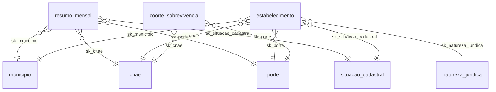

# Camada semântica (dbt + MetricFlow)

> **Adição** ao MVP original ([ADR-0018](adr/0018-camada-semantica-metricflow.md)). A camada semântica descreve, em YAML
> e no padrão do dbt/MetricFlow, **o que** se mede no modelo estrela: entidades, dimensões, métricas e consultas
> salvas. Qualquer ferramenta compatível calcula as métricas do mesmo jeito, sem reescrever a regra em DAX,
> SQL ou planilha.

## 1. Onde está e em qual padrão

Usamos o **padrão novo** de YAML da camada semântica, suportado pelo dbt-core 1.12+ e pelo dbt v2 (Fusion).
As anotações ficam **junto do modelo**, no mesmo YAML que já documenta colunas e testes:

| Arquivo | O que define |
|---|---|
| [`transform/models/marts/core/_core__models.yml`](../transform/models/marts/core/_core__models.yml) | modelos semânticos das dimensões e das duas fatos, métricas do resumo mensal e da fato detalhada, *time spine* (`dim_data`) |
| [`transform/models/marts/analytics/_analytics__models.yml`](../transform/models/marts/analytics/_analytics__models.yml) | modelo semântico e métricas de `mart_sobrevivencia_coorte` |
| [`transform/models/marts/_marts__saved_queries.yml`](../transform/models/marts/_marts__saved_queries.yml) | consultas salvas (*saved queries*) |

Elementos do padrão usados aqui:

| Chave (no modelo) | Função |
|---|---|
| `semantic_model: { enabled: true }` | transforma o modelo dbt num modelo semântico |
| `entity:` (na coluna) | chave de junção: `primary` (o grão do modelo) ou `foreign` (aponta para outra entidade) |
| `dimension:` (na coluna) | atributo para agrupar e filtrar (`categorical` ou `time`) |
| `derived_semantics.dimensions` | dimensão calculada por expressão SQL (ex.: data a partir de `sk_data`) |
| `agg_time_dimension` | dimensão de tempo padrão das métricas do modelo (vira `metric_time` nas consultas) |
| `primary_entity` | entidade do modelo quando o grão é composto (sem coluna de chave única) |
| `metrics:` | métricas `simple`, `ratio` e `derived` do próprio modelo |
| `time_spine:` | calendário diário que o MetricFlow usa para deslocamentos e janelas |

## 2. Entidades e junções



| Modelo semântico | Entidade principal | Dimensões |
|---|---|---|
| `dim_municipio` | `municipio` (`sk_municipio`) | `nome_municipio`, `sigla_uf`, `nome_uf`, `nome_regiao`, meso/microrregião, regiões intermediária e imediata, `id_municipio_ibge`, `nome_regiao_metropolitana` (incremento enriquecimento BD) |
| `dim_cnae` | `cnae` (`sk_cnae`) | códigos e descrições de seção, divisão, grupo, classe e subclasse |
| `dim_natureza_juridica` | `natureza_juridica` | código e descrição |
| `dim_porte` | `porte` | `codigo_porte`, `rotulo_porte` |
| `dim_situacao_cadastral` | `situacao_cadastral` | `codigo_situacao_cadastral`, `rotulo_situacao_cadastral` |
| `fct_resumo_mensal` | `resumo_mensal` (grão composto) | tempo `mes` (mensal), `opcao_mei` |
| `fct_estabelecimentos` | `estabelecimento` (`cnpj_completo`) | tempo `data_inicio_atividade` e `data_situacao` (diárias), `opcao_simples`, `opcao_mei`, `eh_matriz`, `eh_ativa` |
| `mart_sobrevivencia_coorte` | `coorte_sobrevivencia` (grão composto) | tempo `coorte` (anual), `uf` |

Nas consultas, a dimensão de outro modelo é acessada pela entidade: `municipio__sigla_uf`, `cnae__descricao_secao`,
`porte__rotulo_porte`. O membro `-1` (NÃO INFORMADO) de cada dimensão aparece como um valor normal.

## 3. Métricas

As métricas do resumo mensal são as **mesmas medidas DAX** do [guia Power BI](POWER_BI.md#3-medidas-dax-sugeridas),
agora definidas uma vez e fora da ferramenta de BI.

| Métrica | Tipo | Definição | Medida DAX equivalente |
|---|---|---|---|
| `qtd_estabelecimentos` | simple (sum, fotografia) | `sum(qtd_estabelecimentos)` | Qtd Estabelecimentos |
| `qtd_ativos` | simple (sum, fotografia) | `sum(qtd_ativos)` | Qtd Ativos |
| `qtd_ativos_mei` | simple (sum, fotografia) | `sum(qtd_ativos)` com filtro `opcao_mei` | Qtd Ativos MEI |
| `qtd_matrizes` | simple (sum, fotografia) | `sum(qtd_matrizes)` | Qtd Matrizes |
| `capital_social_total` | simple (sum, fotografia) | `sum(soma_capital_social_matrizes)` | Capital Social Total (R$) |
| `soma_idade_anos_ativos` | simple (sum, fotografia) | `sum(soma_idade_anos)` (numerador) | — |
| `pct_ativos` | ratio | `qtd_ativos / qtd_estabelecimentos` | % Ativos |
| `idade_media_anos` | ratio | `soma_idade_anos_ativos / qtd_ativos` | Idade Média (anos) |
| `capital_social_medio` | ratio | `capital_social_total / qtd_matrizes` | Capital Social Médio (R$) |
| `pct_mei_entre_ativos` | ratio | `qtd_ativos_mei / qtd_ativos` | % MEI entre Ativos |
| `qtd_ativos_mes_anterior` | derived | `qtd_ativos` com `offset_window: 1 month` | Qtd Ativos Mês Anterior |
| `variacao_mensal_ativos` | derived | `qtd_ativos − mês anterior` | Variação Mensal de Ativos |
| `variacao_mensal_ativos_pct` | derived | `(qtd_ativos − anterior) / anterior` | Variação Mensal de Ativos (%) |
| `aberturas` | simple (count) | estabelecimentos pela **data de início**, só com data válida | — (regra de `mart_dinamica_mercado`) |
| `encerramentos` | simple (count) | **não ativos** (`not eh_ativa`) pela **data da situação** (`agg_time_dimension` próprio), só com data válida | — (regra de `mart_dinamica_mercado`) |
| `saldo_aberturas_encerramentos` | derived | `aberturas − encerramentos` (lado sem evento conta 0) | — (`saldo` de `mart_dinamica_mercado`) |
| `elegiveis_{1,3,5}a`, `sobreviventes_{1,3,5}a` | simple (sum) | colunas de `mart_sobrevivencia_coorte` | — |
| `taxa_sobrevivencia_{1,3,5}a` | ratio | `sobreviventes / elegíveis` (soma os estratos antes de dividir) | Taxa de Sobrevivência 3a |

**Fotografia mensal (`non_additive_dimension`).** O resumo mensal é uma fotografia: somar `qtd_ativos` de vários
meses contaria o mesmo estabelecimento várias vezes (é o cuidado "Não some meses" do guia Power BI). As métricas
de contagem do resumo declaram `non_additive_dimension: { name: mes, window_agg: max }`. Num grão maior que o mês
(ano, ou sem tempo), o MetricFlow usa **o último mês** do período em vez da soma. Nas fixtures do CI,
`qtd_ativos` por ano dá 11 (o valor de 2026-09), não 21 (08 + 09). Um teste de integração impede a regressão.

**Ratios somam antes de dividir.** `idade_media_anos` e `taxa_sobrevivencia_3a` dividem somas, nunca tiram média
de médias. Por isso a taxa de um estado ou de um ano é ponderada pelo número de estabelecimentos.

## 4. Consultas salvas

| Saved query | Pergunta |
|---|---|
| `serie_mensal_ativos_por_uf` | ativos, % de ativos e idade média por mês e UF |
| `estudo_caso_fundao_tintas` | pergunta-guia do MVP: lojas de tintas (CNAE 4741500) em Fundão/ES por mês e porte |
| `dinamica_anual_por_secao_cnae` | aberturas, encerramentos e saldo por ano e seção CNAE |
| `sobrevivencia_por_coorte_e_porte` | taxas de sobrevivência a 1, 3 e 5 anos por coorte e porte |

## 5. Como usar

O CLI do MetricFlow (`mf`, pacote `dbt-metricflow`) vem nas dependências de desenvolvimento (`make setup`). Ele lê o
projeto dbt de `transform/` e consulta o DuckDB de `RAIZ_DADOS` (o mesmo `warehouse.duckdb` do pipeline).

```bash
make semantica                      # parse + mf validate-configs (inclusive contra o warehouse) + lista de métricas

cd transform
uv run mf list metrics              # métricas e dimensões disponíveis
uv run mf query --saved-query estudo_caso_fundao_tintas
uv run mf query --metrics qtd_ativos,pct_ativos --group-by metric_time__month,municipio__sigla_uf \
  --where "{{ Dimension('municipio__nome_regiao') }} = 'Sudeste'"
uv run mf query --metrics idade_media_anos --group-by metric_time__month --explain   # mostra o SQL gerado
uv run mf query --metrics aberturas,encerramentos --group-by metric_time__year --csv dinamica.csv
```

Resultado do estudo de caso nas fixtures do CI, igual ao do notebook 4 em 2026-09 (1 loja ativa, MICRO, 3,9 anos):

```text
metric_time__month    porte__rotulo_porte    qtd_estabelecimentos    qtd_ativos    idade_media_anos
2026-09-01            MICRO                                     2             1                 3.9
```

Outros consumidores:

- **Documento OSI.** O `dbt parse` grava `transform/target/osi_document.json`, a camada semântica no formato
  aberto *Open Semantic Interchange*, para ferramentas que o leem.
- **Power BI.** Continua com as medidas DAX do guia: o Power BI não lê MetricFlow diretamente. A tabela da §3 é o
  dicionário entre as duas. Use `mf query --csv` ou `--explain` para conferir um número do painel.
- **dbt Semantic Layer (dbt platform).** O mesmo YAML serve, se um dia o projeto for para a plataforma.

## 6. Garantias (testes)

- `tests/integration/test_camada_semantica.py`:
  - `mf validate-configs` sem erros, inclusive contra o warehouse;
  - métricas mensais iguais ao SQL direto no gold;
  - fotografia sem soma de meses;
  - variação mensal com o mês anterior;
  - estudo de caso de Fundão;
  - aberturas, encerramentos e saldo iguais a `mart_dinamica_mercado` por ano e por ano × seção CNAE;
  - sobrevivência somando os estratos.
- `tests/integration/test_escopo_meta.py`: modelos semânticos, métricas e *saved queries* com `meta.escopo`
  (e tag, nas *saved queries*).
- Mutações verificadas (todas reprovadas pelos testes): tirar o `non_additive_dimension`, deslocar 2 meses no lugar de 1
  e remover o `meta.escopo` de uma métrica.

## 7. Limites e cuidados

- **Densidades por população ou domicílio** (ativos por 10 mil hab., por mil domicílios) **não** viraram métricas: a
  população é atributo da dimensão e precisaria ser somada uma vez por município, o que o MetricFlow não faz numa
  métrica de outra tabela. Use `mart_concorrencia_area_mercado` (já calcula `ativos_por_mil_domicilios`) ou o DAX do
  guia Power BI.
- **CNAEs secundários** (bridge muitos-para-muitos) e **vizinhança** ficam fora da camada semântica: o MetricFlow
  não modela pontes muitos-para-muitos.
- `aberturas`, `encerramentos` e o saldo seguem a regra de `mart_dinamica_mercado`: abertura pela data de início;
  encerramento = estabelecimento **não ativo** (baixado, suspenso, inapto ou nulo, não só baixado) pela data da
  situação; data ausente ou inválida (`-1`/`-2`) não gera evento. Por ano, e por ano × qualquer dimensão do
  estabelecimento, os números são os do mart. Como o mart, olham **só o extrato corrente**: estabelecimentos que
  sumiram do cadastro não entram, e um inativo reativado deixa de contar como encerramento.
  Num período com eventos só de um lado, a métrica do outro lado sai vazia (nula) e o saldo a trata como 0
  (`coalesce` na expressão: o dbt-core 1.12.5 descarta `fill_nulls_with` nas métricas do YAML novo).
- **Bug do partial parse (dbt-core 1.12.5).** Depois de editar um YAML com métricas, o próximo comando dbt pode falhar
  com `dbt found two metrics with the name ...`. Rode `dbt parse --no-partial-parse` uma vez. Os alvos `make ci`,
  `make pipeline`, `make atualizar` e `make semantica` já fazem isso.
- **dbt v2 (Fusion).** O YAML desta camada é aceito pelo dbt v2. Por compatibilidade:
  - os `input_metrics` são sempre objetos (`{ name: ... }`);
  - as *saved queries* não usam `order_by`.

  A migração do motor continua adiada pelo ADR-0017.

## 8. Como estender

1. Métrica nova sobre um modelo que já é semântico: acrescente-a em `metrics:` do modelo, com `description`, `label`,
   `config: { meta: { escopo: adicao } }`. Contagens do resumo mensal levam o `non_additive_dimension`.
2. Dimensão nova: marque a coluna com `dimension: categorical`. Para tempo, use `dimension: time` + `granularity`,
   ou uma `derived_semantics.dimensions` com `expr`.
3. Modelo novo: `semantic_model: { enabled: true, config: { meta: { escopo: adicao } } }`, uma entidade
   `primary` (ou `primary_entity`), `foreign` para as dimensões e `agg_time_dimension`.
4. Rode `make semantica` e acrescente um caso em `test_camada_semantica.py` que compare a métrica com o SQL direto.
