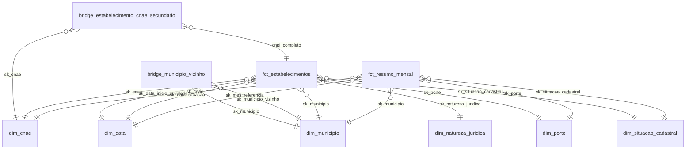

# Dicionário de dados

> Gerado por `scripts/gerar_dicionario_dados.py` a partir do manifesto e do catálogo do dbt; não edite à
> mão ([ADR-0019](adr/0019-dicionario-de-dados.md)). Para regenerar: `make dicionario` (depois do
> `make ci` ou de um `dbt build`).

Detalhe de todas as tabelas disponíveis na base, com os campos de cada uma: o que são, em que
grão, quais as chaves, onde ficam e o que cada coluna guarda. Conceitos de negócio (CNPJ, porte,
situação cadastral, CNAE...) estão em [CAMADA_SEMANTICA.md](CAMADA_SEMANTICA.md) (Parte A); as
dimensões e métricas do MetricFlow, na Parte B; os testes, em [QUALIDADE_DADOS.md](QUALIDADE_DADOS.md).

## Como ler

- **Tipo**: o `data_type` do contrato (gold e algumas fontes) ou, na falta dele, o tipo real da coluna
  no DuckDB (catálogo do dbt). As fontes raw guardam todo dado como `varchar`; a tipagem acontece no
  staging.
- **Pode ser nulo?**: lido do teste `not_null`. Sem o teste, o dicionário escreve *não testado* — não
  afirma que a coluna aceita nulos. Com o teste em `severity: warn`, escreve *em geral não*: o teste
  avisa, não barra o build, e o dado real pode ter exceções.
- **Domínio / valores aceitos**: dos testes `accepted_values`, `accepted_range`, `relationships`,
  `tamanho_exato`, `data_nao_futura` e `cnpj_dv_valido`, e das linhas das seeds de domínio. A marca
  `(warn)` indica regra que o dado pode violar (o teste só avisa).
- **Chaves únicas e grão**: a chave primária é a coluna (ou combinação) com teste de unicidade que
  está no grão. Sem esse teste, a linha *Chave primária* diz *não testada* e o grão aparece como
  *declarado, não testado*: é o que a tabela pretende, não o que um teste prova.
- **Lê de / Usada por**: as tabelas de que cada tabela é lida e as que a leem (dependências do
  manifesto do dbt; testes não contam). Ligam a cadeia raw → staging → intermediate → gold.
- **Origem**: nas fontes RFB, o nome do campo no leiaute oficial
  ([`cnpj-metadados.pdf`](https://www.gov.br/receitafederal/dados/cnpj-metadados.pdf), `meta.campo_leiaute`);
  nas fontes da Base dos Dados, a coluna no BigQuery (`meta.coluna_bigquery`); nas demais camadas, a
  linhagem declarada na descrição (*Linhagem:*) ou em `meta.linhagem`, ou a coluna raw do teste
  `taxa_conversao_tipada`.
  Coluna sem origem (—) é cópia direta ou cálculo descrito na própria descrição.
- **Chaves estrangeiras**: *testada* (teste `relationships`), *semântica* (entidade da camada
  semântica, sem teste) ou *declarada* (`meta.fk_declarada`, sem teste).
- **Chaves**: `-1` (NÃO INFORMADO) e `-2` (data inválida, só em `dim_data`) são membros das dimensões;
  um estabelecimento sem par numa dimensão fica com a chave `-1`, nunca é descartado (exceto nos marts
  `original`, que reproduzem os inner joins do MVP).
- **Escopo** (`meta.escopo`): `original` (existia no MVP Spark), `adicao` ou `adaptado`;
  **incremento** (`meta.incremento`): módulo opcional ([ADR-0015](adr/0015-enriquecimento-base-dos-dados.md)).
- **Dados pessoais**: o projeto só guarda o mínimo ([ADR-0008](adr/0008-minimizacao-dados-pessoais.md)):
  contatos (e-mail, telefones, fax) são descartados no staging e o CPF é mascarado no nome.
- O gold fica em `RAIZ_DADOS/gold` (local ou `s3://`); `AAAA-MM` é o mês de referência do extrato.

## Índice

| Camada | Tabelas | Colunas |
|---|---|---|
| [Fontes — RFB (raw)](#fontes-rfb) | 9 | 92 |
| [Fontes — Base dos Dados (raw)](#fontes-bd) | 7 | 92 |
| [Fontes — observabilidade](#fontes-obs) | 1 | 8 |
| [Seeds](#seeds) | 4 | 12 |
| [Staging](#staging) | 14 | 113 |
| [Intermediate](#intermediate) | 3 | 44 |
| [Gold — dimensões](#gold-dim) | 6 | 63 |
| [Gold — fatos](#gold-fct) | 2 | 26 |
| [Gold — pontes](#gold-bridge) | 2 | 5 |
| [Gold — marts originais](#gold-original) | 2 | 27 |
| [Gold — marts analíticos](#gold-analytics) | 5 | 67 |
| [Observabilidade](#obs) | 2 | 10 |
| **Total** | **57** | **559** |

### Fontes — RFB (raw)

Parquet raw dos dados abertos de CNPJ (todas as colunas de dado são `varchar`).

| Tabela | Uma linha por | Escopo | Colunas |
|---|---|---|---|
| [`rfb.cnaes`](#rfb-cnaes) | subclasse CNAE (`codigo`) por mês de referência | original | 6 |
| [`rfb.empresas`](#rfb-empresas) | empresa (`cnpj_raiz`) por mês de referência | original | 11 |
| [`rfb.estabelecimentos`](#rfb-estabelecimentos) | estabelecimento (`cnpj_raiz`, `cnpj_ordem`, `cnpj_dv`) por mês de referência | original | 34 |
| [`rfb.motivos`](#rfb-motivos) | motivo de situação cadastral (`codigo`) por mês de referência | original | 6 |
| [`rfb.municipios`](#rfb-municipios) | município da RFB (`codigo`) por mês de referência | original | 6 |
| [`rfb.naturezas`](#rfb-naturezas) | natureza jurídica (`codigo`) por mês de referência | original | 6 |
| [`rfb.paises`](#rfb-paises) | país (`codigo`) por mês de referência | adicao | 6 |
| [`rfb.qualificacoes`](#rfb-qualificacoes) | qualificação de responsável (`codigo`) por mês de referência | adicao | 6 |
| [`rfb.simples`](#rfb-simples) | empresa (`cnpj_raiz`) por mês de referência | adicao | 11 |

### Fontes — Base dos Dados (raw)

Parquet raw das tabelas públicas da Base dos Dados (`basedosdados`).

| Tabela | Uma linha por | Escopo | Colunas |
|---|---|---|---|
| [`basedosdados.censo_2022_municipio`](#basedosdados-censo_2022_municipio) | município IBGE (`id_municipio`) | adicao | 15 |
| [`basedosdados.cnae_2`](#basedosdados-cnae_2) | subclasse CNAE (`subclasse`) | original | 16 |
| [`basedosdados.municipio`](#basedosdados-municipio) | município IBGE (`id_municipio`) | original | 29 |
| [`basedosdados.pib`](#basedosdados-pib) | município e ano (`id_municipio`, `ano`) | adicao | 11 |
| [`basedosdados.populacao`](#basedosdados-populacao) | município e ano (`id_municipio`, `ano`) | adicao | 6 |
| [`basedosdados.regiao_metropolitana_2017`](#basedosdados-regiao_metropolitana_2017) | par município × região metropolitana (`id_municipio`, `nome_regiao_metropolitana`) | adicao | 10 |
| [`basedosdados.vizinhanca_municipio`](#basedosdados-vizinhanca_municipio) | par de municípios vizinhos por ano de malha, como publicado (`ano`, `id_municipio_1`, `id_municipio_2`); pode repetir o par e trazer autopares, e a ponte bridge_municipio_vizinho deduplica e simetriza | adicao | 5 |

### Fontes — observabilidade

Tabela mantida pelos hooks `on-run-start`/`on-run-end` (não é modelo).

| Tabela | Uma linha por | Escopo | Colunas |
|---|---|---|---|
| [`observabilidade.dq_historico_testes`](#observabilidade-dq_historico_testes) | teste executado em uma execução do dbt (`invocation_id`, `nome_teste`) | adicao | 8 |

### Seeds

Domínios estáticos em CSV.

| Tabela | Uma linha por | Escopo | Colunas |
|---|---|---|---|
| [`dominio_matriz_filial`](#dominio_matriz_filial) | código do indicador matriz/filial (`codigo`) | adicao | 3 |
| [`dominio_porte`](#dominio_porte) | código de porte (`codigo`) | adicao | 3 |
| [`dominio_situacao_cadastral`](#dominio_situacao_cadastral) | código de situação cadastral (`codigo`) | adicao | 3 |
| [`excecoes_conhecidas_municipio`](#excecoes_conhecidas_municipio) | código de município da RFB sem par na Base dos Dados (`codigo`) | adicao | 3 |

### Staging

Views com tipagem, limpeza e minimização de dados pessoais.

| Tabela | Uma linha por | Escopo | Colunas |
|---|---|---|---|
| [`stg_bd__censo_2022_municipio`](#stg_bd__censo_2022_municipio) | município IBGE (`id_municipio`) | adicao | 13 |
| [`stg_bd__cnaes`](#stg_bd__cnaes) | subclasse CNAE (`subclasse`) | adicao | 10 |
| [`stg_bd__municipios`](#stg_bd__municipios) | município IBGE (`id_municipio`) | adicao | 16 |
| [`stg_bd__pib`](#stg_bd__pib) | município e ano (`id_municipio`, `ano`) | adicao | 9 |
| [`stg_bd__populacao`](#stg_bd__populacao) | município e ano (`id_municipio`, `ano`) | adicao | 4 |
| [`stg_bd__regioes_metropolitanas`](#stg_bd__regioes_metropolitanas) | município IBGE (`id_municipio`) | adicao | 7 |
| [`stg_bd__vizinhanca`](#stg_bd__vizinhanca) | par de municípios vizinhos por ano de malha, como publicado (`ano`, `id_municipio_1`, `id_municipio_2`); pode repetir o par e trazer autopares, e a ponte bridge_municipio_vizinho deduplica e simetriza | adicao | 3 |
| [`stg_rfb__cnaes`](#stg_rfb__cnaes) | subclasse CNAE (`codigo`) | adicao | 2 |
| [`stg_rfb__empresas`](#stg_rfb__empresas) | empresa (`cnpj_raiz`) do mês selecionado | adicao | 9 |
| [`stg_rfb__estabelecimentos`](#stg_rfb__estabelecimentos) | estabelecimento (`cnpj_completo`) do mês selecionado | adicao | 27 |
| [`stg_rfb__motivos`](#stg_rfb__motivos) | motivo de situação cadastral (`codigo`) | adicao | 2 |
| [`stg_rfb__municipios`](#stg_rfb__municipios) | município da RFB (`codigo`) | adicao | 2 |
| [`stg_rfb__naturezas`](#stg_rfb__naturezas) | natureza jurídica (`codigo`) | adicao | 2 |
| [`stg_rfb__simples`](#stg_rfb__simples) | empresa (`cnpj_raiz`) do mês selecionado | adicao | 7 |

### Intermediate

Tabelas de junção e conformação entre o staging e o gold.

| Tabela | Uma linha por | Escopo | Colunas |
|---|---|---|---|
| [`int_cnaes_secundarios__explodidos`](#int_cnaes_secundarios__explodidos) | estabelecimento e CNAE secundário (`cnpj_completo`, `codigo_cnae_secundario`) | adicao | 2 |
| [`int_estabelecimentos__enriquecidos`](#int_estabelecimentos__enriquecidos) | estabelecimento (`cnpj_completo`) do mês selecionado | adicao | 21 |
| [`int_municipios__conformados`](#int_municipios__conformados) | município IBGE (`sk_municipio`) | adicao | 21 |

### Gold — dimensões

Dimensões do modelo estrela (ADR-0013), com membros `-1`/`-2`.

| Tabela | Uma linha por | Escopo | Colunas |
|---|---|---|---|
| [`dim_cnae`](#dim_cnae) | subclasse CNAE (`sk_cnae`), mais o membro `-1` | adicao | 11 |
| [`dim_data`](#dim_data) | dia do calendário (`sk_data`), mais os membros `-1` e `-2` | adicao | 11 |
| [`dim_municipio`](#dim_municipio) | município (`sk_municipio`), mais o membro `-1` | adicao | 30 |
| [`dim_natureza_juridica`](#dim_natureza_juridica) | natureza jurídica (`sk_natureza_juridica`), mais o membro `-1` | adicao | 3 |
| [`dim_porte`](#dim_porte) | porte da empresa (`sk_porte`), mais o membro `-1` | adicao | 4 |
| [`dim_situacao_cadastral`](#dim_situacao_cadastral) | situação cadastral (`sk_situacao_cadastral`), mais o membro `-1` | adicao | 4 |

### Gold — fatos

Fatos do modelo estrela.

| Tabela | Uma linha por | Escopo | Colunas |
|---|---|---|---|
| [`fct_estabelecimentos`](#fct_estabelecimentos) | estabelecimento (`cnpj_completo`) | adicao | 14 |
| [`fct_resumo_mensal`](#fct_resumo_mensal) | mês × município × CNAE × porte × situação cadastral × opção MEI (`mes_referencia`, `sk_municipio`, `sk_cnae`, `sk_porte`, `sk_situacao_cadastral`, `opcao_mei`) | adicao | 12 |

### Gold — pontes

Relações muitos-para-muitos opcionais no BI.

| Tabela | Uma linha por | Escopo | Colunas |
|---|---|---|---|
| [`bridge_estabelecimento_cnae_secundario`](#bridge_estabelecimento_cnae_secundario) | estabelecimento e CNAE secundário (`cnpj_completo`, `codigo_cnae_secundario`) | adicao | 3 |
| [`bridge_municipio_vizinho`](#bridge_municipio_vizinho) | par de municípios vizinhos do ano mais recente, nos dois sentidos (`sk_municipio`, `sk_municipio_vizinho`) | adicao | 2 |

### Gold — marts originais

`bh_empresas` e `agg_empresas`, com paridade ao MVP Spark (ADR-0005).

| Tabela | Uma linha por | Escopo | Colunas |
|---|---|---|---|
| [`agg_empresas`](#agg_empresas) | combinação das 10 dimensões do original (`municipio`, `microrregiao_municipio`, `mesorregiao_municipio`, `uf`, `cnae_principal`, `desc_cnae_principal`, `grupo_cnae_principal`, `natureza_juridica`, `porte`, `situacao`) | original | 12 |
| [`bh_empresas`](#bh_empresas) | estabelecimento (`cnpj_completo`) com par em todos os domínios (inner joins do original) | original | 15 |

### Gold — marts analíticos

Marts de análise (concorrência, dinâmica, sobrevivência, fornecedores).

| Tabela | Uma linha por | Escopo | Colunas |
|---|---|---|---|
| [`mart_concorrencia_area_mercado`](#mart_concorrencia_area_mercado) | CNAE principal × município (`sk_cnae`, `sk_municipio`), incluindo os vazios de mercado | adicao | 21 |
| [`mart_concorrencia_municipio`](#mart_concorrencia_municipio) | CNAE principal × município (`cnae_principal`, `sk_municipio`) | adicao | 11 |
| [`mart_dinamica_mercado`](#mart_dinamica_mercado) | ano × CNAE principal × município (`ano`, `sk_cnae`, `sk_municipio`) | adicao | 10 |
| [`mart_fornecedores_proximos`](#mart_fornecedores_proximos) | estabelecimento fornecedor (`cnpj_completo`) | adicao | 9 |
| [`mart_sobrevivencia_coorte`](#mart_sobrevivencia_coorte) | coorte × CNAE principal × porte × UF (`ano_coorte`, `sk_cnae`, `sk_porte`, `uf`) | adicao | 16 |

### Observabilidade

Modelos de acompanhamento dos testes e do teste de paridade.

| Tabela | Uma linha por | Escopo | Colunas |
|---|---|---|---|
| [`audit__bh_empresas_sql_original`](#audit__bh_empresas_sql_original) | — | adicao | 0 |
| [`dq_resumo_execucao`](#dq_resumo_execucao) | execução do dbt (`invocation_id`) | adicao | 10 |

### Modelo estrela

Chaves estrangeiras entre fatos, pontes e dimensões do gold (cada linha: muitos para um; o rótulo é
a coluna da tabela de origem). Inclui as FKs testadas, as da camada semântica e as declaradas em
`meta.fk_declarada`; a coluna *Chaves estrangeiras* de cada tabela diz de qual tipo é cada uma.

## Fontes — RFB (raw)

#### `rfb.cnaes`

Tabela de domínio: código e descrição de cada subclasse CNAE segundo a RFB (notebook 2.1.1). A Base dos Dados traz uma versão mais rica (`basedosdados.cnae_2`).

| Atributo | Valor |
|---|---|
| Grão | Uma linha por subclasse CNAE (`codigo`) por mês de referência. |
| Chave primária (testada) | `codigo` + `_mes_referencia` |
| Outras chaves únicas | — |
| Chaves estrangeiras | — |
| Lê de | arquivos dos dados abertos de CNPJ da RFB (ingestão) |
| Usada por | [`stg_rfb__cnaes`](#stg_rfb__cnaes) |
| Materialização | Parquet raw (leitura direta, `external_location`) |
| Localização | `raw/rfb/cnaes/mes_referencia=*/*.parquet` (relativo a `RAIZ_DADOS`) |
| Escopo | `original` ([ADR-0006](adr/0006-marcacao-escopo.md)) |
| Incremento | — |
| Contrato aplicado | não |
| Colunas | 6 |

| Coluna | Tipo | Descrição | Pode ser nulo? | Domínio / valores aceitos | Origem | Observações |
|---|---|---|---|---|---|---|
| `codigo` | `varchar` | Código da subclasse CNAE (7 dígitos). | não (`not_null`) | — | leiaute RFB: **CÓDIGO** | — |
| `descricao` | `varchar` | Descrição textual da atividade econômica. | não testado | — | leiaute RFB: **DESCRIÇÃO** | — |
| `_data_referencia` | `date` | Data do extrato (token `Dyymmdd` do nome interno do arquivo); base do cálculo de idade (`data_referencia()`). Não pode ser nula: um NULL zeraria `idade_atual` em silêncio (teste `not_null`, `error`). | não (`not_null`) | — | coluna técnica da ingestão | — |
| `_arquivo_origem` | `varchar` | Nome do arquivo de origem (zip da RFB ou csv.gz da Base dos Dados) de onde a linha foi convertida. Coluna técnica da ingestão. | não testado | — | coluna técnica da ingestão | — |
| `_mes_referencia` | `varchar` | Mês de referência da pasta do extrato (`AAAA-MM`), partição `mes_referencia=` do Parquet raw. Coluna técnica da ingestão. | não testado | — | coluna técnica da ingestão | — |
| `_ingerido_em` | `timestamp` | Instante (UTC) em que a ingestão converteu a linha para Parquet; base do `freshness` da fonte. Coluna técnica da ingestão. | não testado | — | coluna técnica da ingestão | — |

#### `rfb.empresas`

Uma linha por empresa (CNPJ raiz, 8 primeiros dígitos). Notebook original: 1 (carga) e 2.2 (qualidade). Fonte: `Empresas{0..9}.zip`.

| Atributo | Valor |
|---|---|
| Grão | Uma linha por empresa (`cnpj_raiz`) por mês de referência. |
| Chave primária (testada) | `cnpj_raiz` + `_mes_referencia` (teste `warn`) |
| Outras chaves únicas | — |
| Chaves estrangeiras | — |
| Lê de | arquivos dos dados abertos de CNPJ da RFB (ingestão) |
| Usada por | [`audit__bh_empresas_sql_original`](#audit__bh_empresas_sql_original), [`stg_rfb__empresas`](#stg_rfb__empresas) |
| Materialização | Parquet raw (leitura direta, `external_location`) |
| Localização | `raw/rfb/empresas/mes_referencia=*/*.parquet` (relativo a `RAIZ_DADOS`) |
| Escopo | `original` ([ADR-0006](adr/0006-marcacao-escopo.md)) |
| Incremento | — |
| Contrato aplicado | não |
| Colunas | 11 |

| Coluna | Tipo | Descrição | Pode ser nulo? | Domínio / valores aceitos | Origem | Observações |
|---|---|---|---|---|---|---|
| `cnpj_raiz` | `varchar` | 8 primeiros dígitos do CNPJ; identifica a empresa (não o estabelecimento). | não (`not_null`) | — | leiaute RFB: **CNPJ BÁSICO** | — |
| `razao_social` | `varchar` | Razão social (nome oficial/jurídico) da empresa. | não testado | — | leiaute RFB: **RAZÃO SOCIAL / NOME EMPRESARIAL** | — |
| `natureza_jur` | `varchar` | Código da natureza jurídica (FK para `naturezas.codigo`). | não testado | — | leiaute RFB: **NATUREZA JURÍDICA** | — |
| `qualificacao_resp` | `varchar` | Código de qualificação do responsável pela empresa perante a RFB. | não testado | — | leiaute RFB: **QUALIFICAÇÃO DO RESPONSÁVEL** | — |
| `capital_soc` | `varchar` | Capital social declarado, formato RFB (vírgula decimal), ex. `1000,50`. | não testado | — | leiaute RFB: **CAPITAL SOCIAL DA EMPRESA** | — |
| `porte` | `varchar` | Código de porte da empresa: `00` não informado, `01` micro, `03` pequena, `05` demais (metadados RFB). Pode vir vazio (raw grava `""` → NULL). | não testado | valores: `00`, `01`, `03`, `05` (onde `porte is not null`) | leiaute RFB: **PORTE DA EMPRESA** | — |
| `ente_fed_resp` | `varchar` | Ente federativo responsável, preenchido só para órgãos/autarquias públicas. | não testado | — | leiaute RFB: **ENTE FEDERATIVO RESPONSÁVEL** | — |
| `_data_referencia` | `date` | Data do extrato (token `Dyymmdd` do nome interno do arquivo); base do cálculo de idade (`data_referencia()`). Não pode ser nula: um NULL zeraria `idade_atual` em silêncio (teste `not_null`, `error`). | não (`not_null`) | — | coluna técnica da ingestão | — |
| `_arquivo_origem` | `varchar` | Nome do arquivo de origem (zip da RFB ou csv.gz da Base dos Dados) de onde a linha foi convertida. Coluna técnica da ingestão. | não testado | — | coluna técnica da ingestão | — |
| `_mes_referencia` | `varchar` | Mês de referência da pasta do extrato (`AAAA-MM`), partição `mes_referencia=` do Parquet raw. Coluna técnica da ingestão. | não testado | — | coluna técnica da ingestão | — |
| `_ingerido_em` | `timestamp` | Instante (UTC) em que a ingestão converteu a linha para Parquet; base do `freshness` da fonte. Coluna técnica da ingestão. | não testado | — | coluna técnica da ingestão | — |

#### `rfb.estabelecimentos`

Uma linha por estabelecimento (CNPJ completo: raiz + ordem + DV). Notebook original: 1 (carga) e 2.3 (qualidade). Fonte: `Estabelecimentos{0..9}.zip`.

| Atributo | Valor |
|---|---|
| Grão | Uma linha por estabelecimento (`cnpj_raiz`, `cnpj_ordem`, `cnpj_dv`) por mês de referência. |
| Chave primária (testada) | `cnpj_raiz` + `cnpj_ordem` + `cnpj_dv` + `_mes_referencia` |
| Outras chaves únicas | — |
| Chaves estrangeiras | — |
| Lê de | arquivos dos dados abertos de CNPJ da RFB (ingestão) |
| Usada por | [`audit__bh_empresas_sql_original`](#audit__bh_empresas_sql_original), [`stg_rfb__estabelecimentos`](#stg_rfb__estabelecimentos) |
| Materialização | Parquet raw (leitura direta, `external_location`) |
| Localização | `raw/rfb/estabelecimentos/mes_referencia=*/*.parquet` (relativo a `RAIZ_DADOS`) |
| Escopo | `original` ([ADR-0006](adr/0006-marcacao-escopo.md)) |
| Incremento | — |
| Contrato aplicado | não |
| Colunas | 34 |

| Coluna | Tipo | Descrição | Pode ser nulo? | Domínio / valores aceitos | Origem | Observações |
|---|---|---|---|---|---|---|
| `cnpj_raiz` | `varchar` | 8 primeiros dígitos do CNPJ (FK lógica para `empresas.cnpj_raiz`). | não (`not_null`) | — | leiaute RFB: **CNPJ BÁSICO** | — |
| `cnpj_ordem` | `varchar` | Dígitos 9-12 do CNPJ (nº de ordem do estabelecimento dentro da empresa). | não (`not_null`) | — | leiaute RFB: **CNPJ ORDEM** | — |
| `cnpj_dv` | `varchar` | Dígitos verificadores (13-14) do CNPJ. | não (`not_null`) | — | leiaute RFB: **CNPJ DV** | — |
| `ind_matriz_filial` | `varchar` | Indicador: `1` matriz, `2` filial. | não testado | — | leiaute RFB: **IDENTIFICADOR MATRIZ/FILIAL** | — |
| `nome_fantasia` | `varchar` | Nome fantasia do estabelecimento; frequentemente vazio. | não testado | — | leiaute RFB: **NOME FANTASIA** | — |
| `situacao` | `varchar` | Código da situação cadastral: `01` nula, `02` ativa, `03` suspensa, `04` inapta, `08` baixada (metadados RFB). | não testado | valores: `01`, `02`, `03`, `04`, `08` | leiaute RFB: **SITUAÇÃO CADASTRAL** | — |
| `dat_situacao` | `varchar` | Data do evento que gerou a situação atual (`YYYYMMDD`; pode ser `00000000`). | não testado | — | leiaute RFB: **DATA SITUAÇÃO CADASTRAL** | — |
| `mot_situacao` | `varchar` | Código do motivo da situação (FK para `motivos.codigo`). | não testado | — | leiaute RFB: **MOTIVO SITUAÇÃO CADASTRAL** | — |
| `cidade_exterior` | `varchar` | Cidade no exterior, preenchida só quando `pais` está preenchido. | não testado | — | leiaute RFB: **NOME DA CIDADE NO EXTERIOR** | — |
| `pais` | `varchar` | Código do país, preenchido só para estabelecimentos no exterior. | não testado | — | leiaute RFB: **PAIS** | — |
| `dat_inicio_atividade` | `varchar` | Data de início de atividade do estabelecimento (`YYYYMMDD`). | não testado | — | leiaute RFB: **DATA DE INÍCIO ATIVIDADE** | — |
| `cnae_principal` | `varchar` | Subclasse CNAE (7 dígitos) da atividade econômica principal. | não testado | — | leiaute RFB: **CNAE FISCAL PRINCIPAL** | — |
| `cnaes_secundarios` | `varchar` | Subclasses CNAE secundárias, separadas por vírgula; pode ser vazio. | não testado | — | leiaute RFB: **CNAE FISCAL SECUNDÁRIA** | — |
| `tip_logradouro` | `varchar` | Tipo de logradouro (Rua, Avenida, ...). | não testado | — | leiaute RFB: **TIPO DE LOGRADOURO** | — |
| `logradouro` | `varchar` | Nome do logradouro. | não testado | — | leiaute RFB: **LOGRADOURO** | — |
| `num_logradouro` | `varchar` | Número do logradouro. | não testado | — | leiaute RFB: **NÚMERO** | — |
| `compl_logradouro` | `varchar` | Complemento do endereço; opcional. | não testado | — | leiaute RFB: **COMPLEMENTO** | — |
| `bairro` | `varchar` | Bairro do endereço. | não testado | — | leiaute RFB: **BAIRRO** | — |
| `cep` | `varchar` | CEP do endereço. | não testado | — | leiaute RFB: **CEP** | — |
| `uf` | `varchar` | UF do endereço (sigla), conforme cadastro RFB (não usar como UF canônica; ver `stg_bd__municipios`). | não testado | — | leiaute RFB: **UF** | — |
| `municipio` | `varchar` | Código do município RFB (4 dígitos; FK para `municipios.codigo`). | não testado | — | leiaute RFB: **MUNICÍPIO** | — |
| `ddd1` | `varchar` | DDD do telefone 1. Descartado no staging (ADR-0008, minimização de dados pessoais). | não testado | — | leiaute RFB: **DDD 1** | dado pessoal / minimização ([ADR-0008](adr/0008-minimizacao-dados-pessoais.md)) |
| `tel1` | `varchar` | Telefone 1. Descartado no staging (ADR-0008). | não testado | — | leiaute RFB: **TELEFONE 1** | dado pessoal / minimização ([ADR-0008](adr/0008-minimizacao-dados-pessoais.md)) |
| `ddd2` | `varchar` | DDD do telefone 2. Descartado no staging (ADR-0008). | não testado | — | leiaute RFB: **DDD 2** | dado pessoal / minimização ([ADR-0008](adr/0008-minimizacao-dados-pessoais.md)) |
| `tel2` | `varchar` | Telefone 2. Descartado no staging (ADR-0008). | não testado | — | leiaute RFB: **TELEFONE 2** | dado pessoal / minimização ([ADR-0008](adr/0008-minimizacao-dados-pessoais.md)) |
| `ddd_fax` | `varchar` | DDD do fax. Descartado no staging (ADR-0008). | não testado | — | leiaute RFB: **DDD DO FAX** | dado pessoal / minimização ([ADR-0008](adr/0008-minimizacao-dados-pessoais.md)) |
| `fax` | `varchar` | Número do fax. Descartado no staging (ADR-0008). | não testado | — | leiaute RFB: **FAX** | dado pessoal / minimização ([ADR-0008](adr/0008-minimizacao-dados-pessoais.md)) |
| `email` | `varchar` | E-mail de contato. Descartado no staging (ADR-0008). | não testado | — | leiaute RFB: **CORREIO ELETRÔNICO** | dado pessoal / minimização ([ADR-0008](adr/0008-minimizacao-dados-pessoais.md)) |
| `sit_especial` | `varchar` | Situação especial (ex. falência, recuperação judicial); raramente preenchida. | não testado | — | leiaute RFB: **SITUAÇÃO ESPECIAL** | — |
| `dat_sit_especial` | `varchar` | Data da situação especial (`YYYYMMDD`); raramente preenchida. | não testado | — | leiaute RFB: **DATA DA SITUAÇÃO ESPECIAL** | — |
| `_data_referencia` | `date` | Data do extrato (token `Dyymmdd` do nome interno do arquivo); base do cálculo de idade (`data_referencia()`). Não pode ser nula: um NULL zeraria `idade_atual` em silêncio (teste `not_null`, `error`). | não (`not_null`) | — | coluna técnica da ingestão | — |
| `_arquivo_origem` | `varchar` | Nome do arquivo de origem (zip da RFB ou csv.gz da Base dos Dados) de onde a linha foi convertida. Coluna técnica da ingestão. | não testado | — | coluna técnica da ingestão | — |
| `_mes_referencia` | `varchar` | Mês de referência da pasta do extrato (`AAAA-MM`), partição `mes_referencia=` do Parquet raw. Coluna técnica da ingestão. | não testado | — | coluna técnica da ingestão | — |
| `_ingerido_em` | `timestamp` | Instante (UTC) em que a ingestão converteu a linha para Parquet; base do `freshness` da fonte. Coluna técnica da ingestão. | não testado | — | coluna técnica da ingestão | — |

#### `rfb.motivos`

Tabela de domínio: código e descrição de cada motivo de situação cadastral (notebook 2.1.1).

| Atributo | Valor |
|---|---|
| Grão | Uma linha por motivo de situação cadastral (`codigo`) por mês de referência. |
| Chave primária (testada) | `codigo` + `_mes_referencia` |
| Outras chaves únicas | — |
| Chaves estrangeiras | — |
| Lê de | arquivos dos dados abertos de CNPJ da RFB (ingestão) |
| Usada por | [`stg_rfb__motivos`](#stg_rfb__motivos) |
| Materialização | Parquet raw (leitura direta, `external_location`) |
| Localização | `raw/rfb/motivos/mes_referencia=*/*.parquet` (relativo a `RAIZ_DADOS`) |
| Escopo | `original` ([ADR-0006](adr/0006-marcacao-escopo.md)) |
| Incremento | — |
| Contrato aplicado | não |
| Colunas | 6 |

| Coluna | Tipo | Descrição | Pode ser nulo? | Domínio / valores aceitos | Origem | Observações |
|---|---|---|---|---|---|---|
| `codigo` | `varchar` | Código do motivo de situação cadastral. | não (`not_null`) | — | não consta do leiaute oficial | — |
| `descricao` | `varchar` | Descrição do motivo de situação cadastral. | não testado | — | não consta do leiaute oficial | — |
| `_data_referencia` | `date` | Data do extrato (token `Dyymmdd` do nome interno do arquivo); base do cálculo de idade (`data_referencia()`). Não pode ser nula: um NULL zeraria `idade_atual` em silêncio (teste `not_null`, `error`). | não (`not_null`) | — | coluna técnica da ingestão | — |
| `_arquivo_origem` | `varchar` | Nome do arquivo de origem (zip da RFB ou csv.gz da Base dos Dados) de onde a linha foi convertida. Coluna técnica da ingestão. | não testado | — | coluna técnica da ingestão | — |
| `_mes_referencia` | `varchar` | Mês de referência da pasta do extrato (`AAAA-MM`), partição `mes_referencia=` do Parquet raw. Coluna técnica da ingestão. | não testado | — | coluna técnica da ingestão | — |
| `_ingerido_em` | `timestamp` | Instante (UTC) em que a ingestão converteu a linha para Parquet; base do `freshness` da fonte. Coluna técnica da ingestão. | não testado | — | coluna técnica da ingestão | — |

#### `rfb.municipios`

Tabela de domínio: código RFB e nome de cada município (notebook 2.1.1). Não traz UF; o cruzamento com UF/região vem de `basedosdados.municipio`.

| Atributo | Valor |
|---|---|
| Grão | Uma linha por município da RFB (`codigo`) por mês de referência. |
| Chave primária (testada) | `codigo` + `_mes_referencia` |
| Outras chaves únicas | — |
| Chaves estrangeiras | — |
| Lê de | arquivos dos dados abertos de CNPJ da RFB (ingestão) |
| Usada por | [`stg_rfb__municipios`](#stg_rfb__municipios) |
| Materialização | Parquet raw (leitura direta, `external_location`) |
| Localização | `raw/rfb/municipios/mes_referencia=*/*.parquet` (relativo a `RAIZ_DADOS`) |
| Escopo | `original` ([ADR-0006](adr/0006-marcacao-escopo.md)) |
| Incremento | — |
| Contrato aplicado | não |
| Colunas | 6 |

| Coluna | Tipo | Descrição | Pode ser nulo? | Domínio / valores aceitos | Origem | Observações |
|---|---|---|---|---|---|---|
| `codigo` | `varchar` | Código do município na classificação da RFB (4 dígitos; não é o código IBGE). | não (`not_null`) | — | leiaute RFB: **CÓDIGO** | — |
| `descricao` | `varchar` | Nome do município, sem acentos, conforme grafia da RFB. | não testado | — | leiaute RFB: **DESCRIÇÃO** | — |
| `_data_referencia` | `date` | Data do extrato (token `Dyymmdd` do nome interno do arquivo); base do cálculo de idade (`data_referencia()`). Não pode ser nula: um NULL zeraria `idade_atual` em silêncio (teste `not_null`, `error`). | não (`not_null`) | — | coluna técnica da ingestão | — |
| `_arquivo_origem` | `varchar` | Nome do arquivo de origem (zip da RFB ou csv.gz da Base dos Dados) de onde a linha foi convertida. Coluna técnica da ingestão. | não testado | — | coluna técnica da ingestão | — |
| `_mes_referencia` | `varchar` | Mês de referência da pasta do extrato (`AAAA-MM`), partição `mes_referencia=` do Parquet raw. Coluna técnica da ingestão. | não testado | — | coluna técnica da ingestão | — |
| `_ingerido_em` | `timestamp` | Instante (UTC) em que a ingestão converteu a linha para Parquet; base do `freshness` da fonte. Coluna técnica da ingestão. | não testado | — | coluna técnica da ingestão | — |

#### `rfb.naturezas`

Tabela de domínio: código e descrição de cada natureza jurídica (notebook 2.1.1).

| Atributo | Valor |
|---|---|
| Grão | Uma linha por natureza jurídica (`codigo`) por mês de referência. |
| Chave primária (testada) | `codigo` + `_mes_referencia` |
| Outras chaves únicas | — |
| Chaves estrangeiras | — |
| Lê de | arquivos dos dados abertos de CNPJ da RFB (ingestão) |
| Usada por | [`audit__bh_empresas_sql_original`](#audit__bh_empresas_sql_original), [`stg_rfb__naturezas`](#stg_rfb__naturezas) |
| Materialização | Parquet raw (leitura direta, `external_location`) |
| Localização | `raw/rfb/naturezas/mes_referencia=*/*.parquet` (relativo a `RAIZ_DADOS`) |
| Escopo | `original` ([ADR-0006](adr/0006-marcacao-escopo.md)) |
| Incremento | — |
| Contrato aplicado | não |
| Colunas | 6 |

| Coluna | Tipo | Descrição | Pode ser nulo? | Domínio / valores aceitos | Origem | Observações |
|---|---|---|---|---|---|---|
| `codigo` | `varchar` | Código da natureza jurídica. | não (`not_null`) | — | leiaute RFB: **CÓDIGO** | — |
| `descricao` | `varchar` | Descrição da natureza jurídica. | não testado | — | leiaute RFB: **DESCRIÇÃO** | — |
| `_data_referencia` | `date` | Data do extrato (token `Dyymmdd` do nome interno do arquivo); base do cálculo de idade (`data_referencia()`). Não pode ser nula: um NULL zeraria `idade_atual` em silêncio (teste `not_null`, `error`). | não (`not_null`) | — | coluna técnica da ingestão | — |
| `_arquivo_origem` | `varchar` | Nome do arquivo de origem (zip da RFB ou csv.gz da Base dos Dados) de onde a linha foi convertida. Coluna técnica da ingestão. | não testado | — | coluna técnica da ingestão | — |
| `_mes_referencia` | `varchar` | Mês de referência da pasta do extrato (`AAAA-MM`), partição `mes_referencia=` do Parquet raw. Coluna técnica da ingestão. | não testado | — | coluna técnica da ingestão | — |
| `_ingerido_em` | `timestamp` | Instante (UTC) em que a ingestão converteu a linha para Parquet; base do `freshness` da fonte. Coluna técnica da ingestão. | não testado | — | coluna técnica da ingestão | — |

#### `rfb.paises`

Tabela de domínio: código e descrição de cada país (adição: não usada pelo modelo original). Fonte: `Paises.zip`.

| Atributo | Valor |
|---|---|
| Grão (declarado, não testado) | Uma linha por país (`codigo`) por mês de referência. |
| Chave primária (testada) | não testada |
| Outras chaves únicas | — |
| Chaves estrangeiras | — |
| Lê de | arquivos dos dados abertos de CNPJ da RFB (ingestão) |
| Usada por | — |
| Materialização | Parquet raw (leitura direta, `external_location`) |
| Localização | `raw/rfb/paises/mes_referencia=*/*.parquet` (relativo a `RAIZ_DADOS`) |
| Escopo | `adicao` ([ADR-0006](adr/0006-marcacao-escopo.md)) |
| Incremento | — |
| Contrato aplicado | não |
| Colunas | 6 |

| Coluna | Tipo | Descrição | Pode ser nulo? | Domínio / valores aceitos | Origem | Observações |
|---|---|---|---|---|---|---|
| `codigo` | `varchar` | Código do país segundo a tabela da RFB. | não testado | — | leiaute RFB: **CÓDIGO** | — |
| `descricao` | `varchar` | Nome do país. | não testado | — | leiaute RFB: **DESCRIÇÃO** | — |
| `_data_referencia` | `date` | Data do extrato (token `Dyymmdd` do nome interno do arquivo); base do cálculo de idade (`data_referencia()`). Não pode ser nula: um NULL zeraria `idade_atual` em silêncio (teste `not_null`, `error`). | não (`not_null`) | — | coluna técnica da ingestão | — |
| `_arquivo_origem` | `varchar` | Nome do arquivo de origem (zip da RFB ou csv.gz da Base dos Dados) de onde a linha foi convertida. Coluna técnica da ingestão. | não testado | — | coluna técnica da ingestão | — |
| `_mes_referencia` | `varchar` | Mês de referência da pasta do extrato (`AAAA-MM`), partição `mes_referencia=` do Parquet raw. Coluna técnica da ingestão. | não testado | — | coluna técnica da ingestão | — |
| `_ingerido_em` | `timestamp` | Instante (UTC) em que a ingestão converteu a linha para Parquet; base do `freshness` da fonte. Coluna técnica da ingestão. | não testado | — | coluna técnica da ingestão | — |

#### `rfb.qualificacoes`

Tabela de domínio: código e descrição de cada qualificação de responsável (adição: não usada pelo modelo original). Fonte: `Qualificacoes.zip`.

| Atributo | Valor |
|---|---|
| Grão (declarado, não testado) | Uma linha por qualificação de responsável (`codigo`) por mês de referência. |
| Chave primária (testada) | não testada |
| Outras chaves únicas | — |
| Chaves estrangeiras | — |
| Lê de | arquivos dos dados abertos de CNPJ da RFB (ingestão) |
| Usada por | — |
| Materialização | Parquet raw (leitura direta, `external_location`) |
| Localização | `raw/rfb/qualificacoes/mes_referencia=*/*.parquet` (relativo a `RAIZ_DADOS`) |
| Escopo | `adicao` ([ADR-0006](adr/0006-marcacao-escopo.md)) |
| Incremento | — |
| Contrato aplicado | não |
| Colunas | 6 |

| Coluna | Tipo | Descrição | Pode ser nulo? | Domínio / valores aceitos | Origem | Observações |
|---|---|---|---|---|---|---|
| `codigo` | `varchar` | Código de qualificação do responsável. | não testado | — | leiaute RFB: **CÓDIGO** | — |
| `descricao` | `varchar` | Descrição da qualificação do responsável. | não testado | — | leiaute RFB: **DESCRIÇÃO** | — |
| `_data_referencia` | `date` | Data do extrato (token `Dyymmdd` do nome interno do arquivo); base do cálculo de idade (`data_referencia()`). Não pode ser nula: um NULL zeraria `idade_atual` em silêncio (teste `not_null`, `error`). | não (`not_null`) | — | coluna técnica da ingestão | — |
| `_arquivo_origem` | `varchar` | Nome do arquivo de origem (zip da RFB ou csv.gz da Base dos Dados) de onde a linha foi convertida. Coluna técnica da ingestão. | não testado | — | coluna técnica da ingestão | — |
| `_mes_referencia` | `varchar` | Mês de referência da pasta do extrato (`AAAA-MM`), partição `mes_referencia=` do Parquet raw. Coluna técnica da ingestão. | não testado | — | coluna técnica da ingestão | — |
| `_ingerido_em` | `timestamp` | Instante (UTC) em que a ingestão converteu a linha para Parquet; base do `freshness` da fonte. Coluna técnica da ingestão. | não testado | — | coluna técnica da ingestão | — |

#### `rfb.simples`

Uma linha por empresa com o status de opção pelo Simples Nacional e pelo MEI (adição: não fazia parte do modelo original). Fonte: `Simples.zip`.

| Atributo | Valor |
|---|---|
| Grão (declarado, não testado) | Uma linha por empresa (`cnpj_raiz`) por mês de referência. |
| Chave primária (testada) | não testada |
| Outras chaves únicas | — |
| Chaves estrangeiras | — |
| Lê de | arquivos dos dados abertos de CNPJ da RFB (ingestão) |
| Usada por | [`stg_rfb__simples`](#stg_rfb__simples) |
| Materialização | Parquet raw (leitura direta, `external_location`) |
| Localização | `raw/rfb/simples/mes_referencia=*/*.parquet` (relativo a `RAIZ_DADOS`) |
| Escopo | `adicao` ([ADR-0006](adr/0006-marcacao-escopo.md)) |
| Incremento | — |
| Contrato aplicado | não |
| Colunas | 11 |

| Coluna | Tipo | Descrição | Pode ser nulo? | Domínio / valores aceitos | Origem | Observações |
|---|---|---|---|---|---|---|
| `cnpj_raiz` | `varchar` | 8 primeiros dígitos do CNPJ (FK lógica para `empresas.cnpj_raiz`). | não testado | — | leiaute RFB: **CNPJ BÁSICO** | — |
| `opcao_simples` | `varchar` | Opção pelo Simples Nacional: `S`/`N`. | não testado | — | leiaute RFB: **OPÇÃO PELO SIMPLES** | — |
| `dat_opcao_simples` | `varchar` | Data de opção pelo Simples (`YYYYMMDD`; `00000000` se não aplicável). | não testado | — | leiaute RFB: **DATA DE OPÇÃO PELO SIMPLES** | — |
| `dat_exclusao_simples` | `varchar` | Data de exclusão do Simples (`YYYYMMDD`; `00000000` se não aplicável). | não testado | — | leiaute RFB: **DATA DE EXCLUSÃO DO SIMPLES** | — |
| `opcao_mei` | `varchar` | Opção pelo MEI (Microempreendedor Individual): `S`/`N`. | não testado | — | leiaute RFB: **OPÇÃO PELO MEI** | — |
| `dat_opcao_mei` | `varchar` | Data de opção pelo MEI (`YYYYMMDD`; `00000000` se não aplicável). | não testado | — | leiaute RFB: **DATA DE OPÇÃO PELO MEI** | — |
| `dat_exclusao_mei` | `varchar` | Data de exclusão do MEI (`YYYYMMDD`; `00000000` se não aplicável). | não testado | — | leiaute RFB: **DATA DE EXCLUSÃO DO MEI** | — |
| `_data_referencia` | `date` | Data do extrato (token `Dyymmdd` do nome interno do arquivo); base do cálculo de idade (`data_referencia()`). Não pode ser nula: um NULL zeraria `idade_atual` em silêncio (teste `not_null`, `error`). | não (`not_null`) | — | coluna técnica da ingestão | — |
| `_arquivo_origem` | `varchar` | Nome do arquivo de origem (zip da RFB ou csv.gz da Base dos Dados) de onde a linha foi convertida. Coluna técnica da ingestão. | não testado | — | coluna técnica da ingestão | — |
| `_mes_referencia` | `varchar` | Mês de referência da pasta do extrato (`AAAA-MM`), partição `mes_referencia=` do Parquet raw. Coluna técnica da ingestão. | não testado | — | coluna técnica da ingestão | — |
| `_ingerido_em` | `timestamp` | Instante (UTC) em que a ingestão converteu a linha para Parquet; base do `freshness` da fonte. Coluna técnica da ingestão. | não testado | — | coluna técnica da ingestão | — |

## Fontes — Base dos Dados (raw)

#### `basedosdados.censo_2022_municipio`

`br_ibge_censo_2022.municipio`: Censo 2022 por município (população, domicílios, área em km², alfabetização, idade mediana, razão de sexo, índice de envelhecimento, populações indígena e quilombola). Fonte: `censo_2022_municipio.csv.gz`.

| Atributo | Valor |
|---|---|
| Grão | Uma linha por município IBGE (`id_municipio`). |
| Chave primária (testada) | `id_municipio` |
| Outras chaves únicas | — |
| Chaves estrangeiras | — |
| Lê de | Base dos Dados (ingestão) |
| Usada por | [`stg_bd__censo_2022_municipio`](#stg_bd__censo_2022_municipio) |
| Materialização | Parquet raw (leitura direta, `external_location`) |
| Localização | `raw/bd/censo_2022_municipio/*.parquet` (relativo a `RAIZ_DADOS`) |
| Escopo | `adicao` ([ADR-0006](adr/0006-marcacao-escopo.md)) |
| Incremento | `enriquecimento_bd` |
| Contrato aplicado | não |
| Colunas | 15 |

| Coluna | Tipo | Descrição | Pode ser nulo? | Domínio / valores aceitos | Origem | Observações |
|---|---|---|---|---|---|---|
| `id_municipio` | `varchar` | Código IBGE do município (FK lógica para `municipio.id_municipio`). | não testado | — | BigQuery: `basedosdados.br_ibge_censo_2022.municipio.id_municipio` | — |
| `sigla_uf` | `varchar` | Sigla da UF do município. | não testado | — | BigQuery: `basedosdados.br_ibge_censo_2022.municipio.sigla_uf` | — |
| `domicilios` | `varchar` | Domicílios (Censo 2022). | não testado | — | BigQuery: `basedosdados.br_ibge_censo_2022.municipio.domicilios` | — |
| `populacao` | `varchar` | População residente (Censo 2022). | não testado | — | BigQuery: `basedosdados.br_ibge_censo_2022.municipio.populacao` | — |
| `area` | `varchar` | Área territorial do município, em km². | não testado | — | BigQuery: `basedosdados.br_ibge_censo_2022.municipio.area` | — |
| `taxa_alfabetizacao` | `varchar` | Taxa de alfabetização (fração de 0 a 1). | não testado | — | BigQuery: `basedosdados.br_ibge_censo_2022.municipio.taxa_alfabetizacao` | — |
| `idade_mediana` | `varchar` | Idade mediana, em anos. | não testado | — | BigQuery: `basedosdados.br_ibge_censo_2022.municipio.idade_mediana` | — |
| `razao_sexo` | `varchar` | Razão de sexo (homens por 100 mulheres). | não testado | — | BigQuery: `basedosdados.br_ibge_censo_2022.municipio.razao_sexo` | — |
| `indice_envelhecimento` | `varchar` | Índice de envelhecimento (idosos por 100 jovens). | não testado | — | BigQuery: `basedosdados.br_ibge_censo_2022.municipio.indice_envelhecimento` | — |
| `populacao_indigena` | `varchar` | População indígena. | não testado | — | BigQuery: `basedosdados.br_ibge_censo_2022.municipio.populacao_indigena` | — |
| `populacao_indigena_terra_indigena` | `varchar` | População indígena residente em terras indígenas. | não testado | — | BigQuery: `basedosdados.br_ibge_censo_2022.municipio.populacao_indigena_terra_indigena` | — |
| `populacao_quilombola` | `varchar` | População quilombola. | não testado | — | BigQuery: `basedosdados.br_ibge_censo_2022.municipio.populacao_quilombola` | — |
| `populacao_quilombola_territorio_quilombola` | `varchar` | População quilombola residente em territórios quilombolas. | não testado | — | BigQuery: `basedosdados.br_ibge_censo_2022.municipio.populacao_quilombola_territorio_quilombola` | — |
| `_arquivo_origem` | `varchar` | Nome do arquivo de origem (zip da RFB ou csv.gz da Base dos Dados) de onde a linha foi convertida. Coluna técnica da ingestão. | não testado | — | coluna técnica da ingestão | — |
| `_ingerido_em` | `timestamp` | Instante (UTC) em que a ingestão converteu a linha para Parquet; base do `freshness` da fonte. Coluna técnica da ingestão. | não testado | — | coluna técnica da ingestão | — |

#### `basedosdados.cnae_2`

`br_bd_diretorios_brasil.cnae_2`: catálogo curado de CNAEs (subclasse, classe, grupo, divisão, seção) segundo a versão 2.x do IBGE (notebook 2.1.2). Fonte: `cnae_2.csv.gz`.

| Atributo | Valor |
|---|---|
| Grão (declarado, não testado) | Uma linha por subclasse CNAE (`subclasse`). |
| Chave primária (testada) | não testada |
| Outras chaves únicas | — |
| Chaves estrangeiras | — |
| Lê de | Base dos Dados (ingestão) |
| Usada por | [`audit__bh_empresas_sql_original`](#audit__bh_empresas_sql_original), [`stg_bd__cnaes`](#stg_bd__cnaes) |
| Materialização | Parquet raw (leitura direta, `external_location`) |
| Localização | `raw/bd/cnae_2/*.parquet` (relativo a `RAIZ_DADOS`) |
| Escopo | `original` ([ADR-0006](adr/0006-marcacao-escopo.md)) |
| Incremento | — |
| Contrato aplicado | não |
| Colunas | 16 |

| Coluna | Tipo | Descrição | Pode ser nulo? | Domínio / valores aceitos | Origem | Observações |
|---|---|---|---|---|---|---|
| `subclasse` | `varchar` | Subclasse CNAE (7 dígitos; FK lógica para `rfb.cnaes.codigo`). | não testado | — | BigQuery: `basedosdados.br_bd_diretorios_brasil.cnae_2.subclasse` | — |
| `descricao_subclasse` | `varchar` | Descrição da subclasse. | não testado | — | BigQuery: `basedosdados.br_bd_diretorios_brasil.cnae_2.descricao_subclasse` | — |
| `classe` | `varchar` | Código da classe (5 primeiros dígitos da subclasse). | não testado | — | BigQuery: `basedosdados.br_bd_diretorios_brasil.cnae_2.classe` | — |
| `descricao_classe` | `varchar` | Descrição da classe. | não testado | — | BigQuery: `basedosdados.br_bd_diretorios_brasil.cnae_2.descricao_classe` | — |
| `grupo` | `varchar` | Código do grupo (3 primeiros dígitos da subclasse). | não testado | — | BigQuery: `basedosdados.br_bd_diretorios_brasil.cnae_2.grupo` | — |
| `descricao_grupo` | `varchar` | Descrição do grupo. | não testado | — | BigQuery: `basedosdados.br_bd_diretorios_brasil.cnae_2.descricao_grupo` | — |
| `divisao` | `varchar` | Código da divisão (2 primeiros dígitos da subclasse). | não testado | — | BigQuery: `basedosdados.br_bd_diretorios_brasil.cnae_2.divisao` | — |
| `descricao_divisao` | `varchar` | Descrição da divisão. | não testado | — | BigQuery: `basedosdados.br_bd_diretorios_brasil.cnae_2.descricao_divisao` | — |
| `secao` | `varchar` | Letra da seção (agregado mais alto da hierarquia CNAE). | não testado | — | BigQuery: `basedosdados.br_bd_diretorios_brasil.cnae_2.secao` | — |
| `descricao_secao` | `varchar` | Descrição da seção. | não testado | — | BigQuery: `basedosdados.br_bd_diretorios_brasil.cnae_2.descricao_secao` | — |
| `indicador_cnae_2_0` | `varchar` | Indicador de presença da subclasse na CNAE 2.0. Não usado pelo projeto. | não testado | — | BigQuery: `basedosdados.br_bd_diretorios_brasil.cnae_2.indicador_cnae_2_0` | — |
| `indicador_cnae_2_1` | `varchar` | Indicador de presença da subclasse na CNAE 2.1. Não usado pelo projeto. | não testado | — | BigQuery: `basedosdados.br_bd_diretorios_brasil.cnae_2.indicador_cnae_2_1` | — |
| `indicador_cnae_2_2` | `varchar` | Indicador de presença da subclasse na CNAE 2.2. Não usado pelo projeto. | não testado | — | BigQuery: `basedosdados.br_bd_diretorios_brasil.cnae_2.indicador_cnae_2_2` | — |
| `indicador_cnae_2_3` | `varchar` | Indicador de presença da subclasse na CNAE 2.3. Não usado pelo projeto. | não testado | — | BigQuery: `basedosdados.br_bd_diretorios_brasil.cnae_2.indicador_cnae_2_3` | — |
| `_arquivo_origem` | `varchar` | Nome do arquivo de origem (zip da RFB ou csv.gz da Base dos Dados) de onde a linha foi convertida. Coluna técnica da ingestão. | não testado | — | coluna técnica da ingestão | — |
| `_ingerido_em` | `timestamp` | Instante (UTC) em que a ingestão converteu a linha para Parquet; base do `freshness` da fonte. Coluna técnica da ingestão. | não testado | — | coluna técnica da ingestão | — |

#### `basedosdados.municipio`

`br_bd_diretorios_brasil.municipio`: catálogo curado de municípios do IBGE, com ids, UF, hierarquia regional e centroide geográfico (notebook 2.1.2). Fonte: `municipio.csv.gz`.

| Atributo | Valor |
|---|---|
| Grão (declarado, não testado) | Uma linha por município IBGE (`id_municipio`). |
| Chave primária (testada) | não testada |
| Outras chaves únicas | `id_municipio_rf` (`warn`) |
| Chaves estrangeiras | — |
| Lê de | Base dos Dados (ingestão) |
| Usada por | [`audit__bh_empresas_sql_original`](#audit__bh_empresas_sql_original), [`stg_bd__municipios`](#stg_bd__municipios) |
| Materialização | Parquet raw (leitura direta, `external_location`) |
| Localização | `raw/bd/municipio/*.parquet` (relativo a `RAIZ_DADOS`) |
| Escopo | `original` ([ADR-0006](adr/0006-marcacao-escopo.md)) |
| Incremento | — |
| Contrato aplicado | não |
| Colunas | 29 |

| Coluna | Tipo | Descrição | Pode ser nulo? | Domínio / valores aceitos | Origem | Observações |
|---|---|---|---|---|---|---|
| `id_municipio` | `varchar` | Código IBGE do município (7 dígitos). | não testado | — | BigQuery: `basedosdados.br_bd_diretorios_brasil.municipio.id_municipio` | — |
| `id_municipio_rf` | `varchar` | Código do município na classificação da RFB; usado para casar com `rfb.municipios.codigo` (comparar com `lpad(4)` de ambos os lados — pode vir sem zeros à esquerda aqui). Duplicata multiplicaria linhas nos joins. | não testado | — | BigQuery: `basedosdados.br_bd_diretorios_brasil.municipio.id_municipio_rf` | — |
| `nome` | `varchar` | Nome do município, acentuado. | não testado | — | BigQuery: `basedosdados.br_bd_diretorios_brasil.municipio.nome` | — |
| `sigla_uf` | `varchar` | Sigla da UF do município. | não testado | — | BigQuery: `basedosdados.br_bd_diretorios_brasil.municipio.sigla_uf` | — |
| `nome_regiao_imediata` | `varchar` | Nome da região geográfica imediata (IBGE) do município. | não testado | — | BigQuery: `basedosdados.br_bd_diretorios_brasil.municipio.nome_regiao_imediata` | — |
| `nome_regiao_intermediaria` | `varchar` | Nome da região geográfica intermediária (IBGE) do município. | não testado | — | BigQuery: `basedosdados.br_bd_diretorios_brasil.municipio.nome_regiao_intermediaria` | — |
| `nome_microrregiao` | `varchar` | Nome da microrregião (IBGE) do município. | não testado | — | BigQuery: `basedosdados.br_bd_diretorios_brasil.municipio.nome_microrregiao` | — |
| `nome_mesorregiao` | `varchar` | Nome da mesorregião (IBGE) do município. | não testado | — | BigQuery: `basedosdados.br_bd_diretorios_brasil.municipio.nome_mesorregiao` | — |
| `centroide` | `varchar` | Centroide geográfico em WKT: `POINT(longitude latitude)`. | não testado | — | BigQuery: `basedosdados.br_bd_diretorios_brasil.municipio.centroide` | — |
| `id_municipio_6` | `varchar` | Código IBGE do município com 6 dígitos (sem o dígito verificador). Não usado pelo projeto. | não testado | — | BigQuery: `basedosdados.br_bd_diretorios_brasil.municipio.id_municipio_6` | — |
| `id_municipio_tse` | `varchar` | Código do município na classificação do TSE. Não usado pelo projeto. | não testado | — | BigQuery: `basedosdados.br_bd_diretorios_brasil.municipio.id_municipio_tse` | — |
| `id_municipio_bcb` | `varchar` | Código do município na classificação do Banco Central (BCB). Não usado pelo projeto. | não testado | — | BigQuery: `basedosdados.br_bd_diretorios_brasil.municipio.id_municipio_bcb` | — |
| `capital_uf` | `varchar` | Indica se o município é a capital da UF (`true`/`false`). Não usado pelo projeto. | não testado | — | BigQuery: `basedosdados.br_bd_diretorios_brasil.municipio.capital_uf` | — |
| `id_comarca` | `varchar` | Código da comarca judiciária do município. Não usado pelo projeto. | não testado | — | BigQuery: `basedosdados.br_bd_diretorios_brasil.municipio.id_comarca` | — |
| `id_regiao_saude` | `varchar` | Código da região de saúde do município. Não usado pelo projeto. | não testado | — | BigQuery: `basedosdados.br_bd_diretorios_brasil.municipio.id_regiao_saude` | — |
| `nome_regiao_saude` | `varchar` | Nome da região de saúde do município. Não usado pelo projeto. | não testado | — | BigQuery: `basedosdados.br_bd_diretorios_brasil.municipio.nome_regiao_saude` | — |
| `id_regiao_imediata` | `varchar` | Código IBGE da região geográfica imediata do município. | não testado | — | BigQuery: `basedosdados.br_bd_diretorios_brasil.municipio.id_regiao_imediata` | — |
| `id_regiao_intermediaria` | `varchar` | Código IBGE da região geográfica intermediária do município. | não testado | — | BigQuery: `basedosdados.br_bd_diretorios_brasil.municipio.id_regiao_intermediaria` | — |
| `id_microrregiao` | `varchar` | Código IBGE da microrregião do município. | não testado | — | BigQuery: `basedosdados.br_bd_diretorios_brasil.municipio.id_microrregiao` | — |
| `id_mesorregiao` | `varchar` | Código IBGE da mesorregião do município. | não testado | — | BigQuery: `basedosdados.br_bd_diretorios_brasil.municipio.id_mesorregiao` | — |
| `id_regiao_metropolitana` | `varchar` | Código da região metropolitana do município; vazio fora de região metropolitana. Não usado pelo projeto (ver `regiao_metropolitana_2017`). | não testado | — | BigQuery: `basedosdados.br_bd_diretorios_brasil.municipio.id_regiao_metropolitana` | — |
| `nome_regiao_metropolitana` | `varchar` | Nome da região metropolitana do município; vazio fora de região metropolitana. Não usado pelo projeto (ver `regiao_metropolitana_2017`). | não testado | — | BigQuery: `basedosdados.br_bd_diretorios_brasil.municipio.nome_regiao_metropolitana` | — |
| `ddd` | `varchar` | DDD do município. Não usado pelo projeto. | não testado | — | BigQuery: `basedosdados.br_bd_diretorios_brasil.municipio.ddd` | — |
| `id_uf` | `varchar` | Código IBGE da UF do município (2 dígitos). Não usado pelo projeto. | não testado | — | BigQuery: `basedosdados.br_bd_diretorios_brasil.municipio.id_uf` | — |
| `nome_uf` | `varchar` | Nome completo da UF do município. | não testado | — | BigQuery: `basedosdados.br_bd_diretorios_brasil.municipio.nome_uf` | — |
| `nome_regiao` | `varchar` | Nome da grande região (Norte, Nordeste, Sudeste, Sul, Centro-Oeste). | não testado | — | BigQuery: `basedosdados.br_bd_diretorios_brasil.municipio.nome_regiao` | — |
| `amazonia_legal` | `varchar` | Indica se o município pertence à Amazônia Legal (`true`/`false`). Não usado pelo projeto. | não testado | — | BigQuery: `basedosdados.br_bd_diretorios_brasil.municipio.amazonia_legal` | — |
| `_arquivo_origem` | `varchar` | Nome do arquivo de origem (zip da RFB ou csv.gz da Base dos Dados) de onde a linha foi convertida. Coluna técnica da ingestão. | não testado | — | coluna técnica da ingestão | — |
| `_ingerido_em` | `timestamp` | Instante (UTC) em que a ingestão converteu a linha para Parquet; base do `freshness` da fonte. Coluna técnica da ingestão. | não testado | — | coluna técnica da ingestão | — |

#### `basedosdados.pib`

`br_ibge_pib.municipio`: PIB municipal e seus componentes (adição: não usada pelo modelo original). Fonte: `pib.csv.gz`.

| Atributo | Valor |
|---|---|
| Grão | Uma linha por município e ano (`id_municipio`, `ano`). |
| Chave primária (testada) | `id_municipio` + `ano` |
| Outras chaves únicas | — |
| Chaves estrangeiras | — |
| Lê de | Base dos Dados (ingestão) |
| Usada por | [`stg_bd__pib`](#stg_bd__pib) |
| Materialização | Parquet raw (leitura direta, `external_location`) |
| Localização | `raw/bd/pib/*.parquet` (relativo a `RAIZ_DADOS`) |
| Escopo | `adicao` ([ADR-0006](adr/0006-marcacao-escopo.md)) |
| Incremento | — |
| Contrato aplicado | não |
| Colunas | 11 |

| Coluna | Tipo | Descrição | Pode ser nulo? | Domínio / valores aceitos | Origem | Observações |
|---|---|---|---|---|---|---|
| `id_municipio` | `varchar` | Código IBGE do município (FK lógica para `municipio.id_municipio`). | não testado | — | BigQuery: `basedosdados.br_ibge_pib.municipio.id_municipio` | — |
| `ano` | `varchar` | Ano de referência do PIB. | não testado | — | BigQuery: `basedosdados.br_ibge_pib.municipio.ano` | — |
| `pib` | `varchar` | PIB total do município no ano, em R$. | não testado | — | BigQuery: `basedosdados.br_ibge_pib.municipio.pib` | — |
| `impostos_liquidos` | `varchar` | Impostos líquidos de subsídios, em R$. | não testado | — | BigQuery: `basedosdados.br_ibge_pib.municipio.impostos_liquidos` | — |
| `va` | `varchar` | Valor adicionado total, em R$. | não testado | — | BigQuery: `basedosdados.br_ibge_pib.municipio.va` | — |
| `va_agropecuaria` | `varchar` | Valor adicionado da agropecuária, em R$. | não testado | — | BigQuery: `basedosdados.br_ibge_pib.municipio.va_agropecuaria` | — |
| `va_industria` | `varchar` | Valor adicionado da indústria, em R$. | não testado | — | BigQuery: `basedosdados.br_ibge_pib.municipio.va_industria` | — |
| `va_servicos` | `varchar` | Valor adicionado dos serviços, em R$. | não testado | — | BigQuery: `basedosdados.br_ibge_pib.municipio.va_servicos` | — |
| `va_adespss` | `varchar` | Valor adicionado da administração, defesa, educação e saúde públicas, em R$. | não testado | — | BigQuery: `basedosdados.br_ibge_pib.municipio.va_adespss` | — |
| `_arquivo_origem` | `varchar` | Nome do arquivo de origem (zip da RFB ou csv.gz da Base dos Dados) de onde a linha foi convertida. Coluna técnica da ingestão. | não testado | — | coluna técnica da ingestão | — |
| `_ingerido_em` | `timestamp` | Instante (UTC) em que a ingestão converteu a linha para Parquet; base do `freshness` da fonte. Coluna técnica da ingestão. | não testado | — | coluna técnica da ingestão | — |

#### `basedosdados.populacao`

`br_ibge_populacao.municipio`: população estimada por município e ano (adição: não usada pelo modelo original). Fonte: `populacao.csv.gz`.

| Atributo | Valor |
|---|---|
| Grão | Uma linha por município e ano (`id_municipio`, `ano`). |
| Chave primária (testada) | `id_municipio` + `ano` |
| Outras chaves únicas | — |
| Chaves estrangeiras | — |
| Lê de | Base dos Dados (ingestão) |
| Usada por | [`stg_bd__populacao`](#stg_bd__populacao) |
| Materialização | Parquet raw (leitura direta, `external_location`) |
| Localização | `raw/bd/populacao/*.parquet` (relativo a `RAIZ_DADOS`) |
| Escopo | `adicao` ([ADR-0006](adr/0006-marcacao-escopo.md)) |
| Incremento | — |
| Contrato aplicado | não |
| Colunas | 6 |

| Coluna | Tipo | Descrição | Pode ser nulo? | Domínio / valores aceitos | Origem | Observações |
|---|---|---|---|---|---|---|
| `ano` | `varchar` | Ano de referência da estimativa populacional. | não testado | — | BigQuery: `basedosdados.br_ibge_populacao.municipio.ano` | — |
| `sigla_uf` | `varchar` | Sigla da UF do município. | não testado | — | BigQuery: `basedosdados.br_ibge_populacao.municipio.sigla_uf` | — |
| `id_municipio` | `varchar` | Código IBGE do município (FK lógica para `municipio.id_municipio`). | não testado | — | BigQuery: `basedosdados.br_ibge_populacao.municipio.id_municipio` | — |
| `populacao` | `varchar` | População estimada no município e ano. | não testado | — | BigQuery: `basedosdados.br_ibge_populacao.municipio.populacao` | — |
| `_arquivo_origem` | `varchar` | Nome do arquivo de origem (zip da RFB ou csv.gz da Base dos Dados) de onde a linha foi convertida. Coluna técnica da ingestão. | não testado | — | coluna técnica da ingestão | — |
| `_ingerido_em` | `timestamp` | Instante (UTC) em que a ingestão converteu a linha para Parquet; base do `freshness` da fonte. Coluna técnica da ingestão. | não testado | — | coluna técnica da ingestão | — |

#### `basedosdados.regiao_metropolitana_2017`

`br_geobr_mapas.regiao_metropolitana_2017`: região metropolitana (ou RIDE, aglomeração, colar) de cada município, segundo o GeoBR 2017. A coluna `geometria` (WKT) existe no raw e é descartada no staging. Fonte: `regiao_metropolitana_2017.csv.gz`.

| Atributo | Valor |
|---|---|
| Grão (declarado, não testado) | Uma linha por par município × região metropolitana (`id_municipio`, `nome_regiao_metropolitana`). |
| Chave primária (testada) | não testada |
| Outras chaves únicas | — |
| Chaves estrangeiras | — |
| Lê de | Base dos Dados (ingestão) |
| Usada por | [`stg_bd__regioes_metropolitanas`](#stg_bd__regioes_metropolitanas) |
| Materialização | Parquet raw (leitura direta, `external_location`) |
| Localização | `raw/bd/regiao_metropolitana_2017/*.parquet` (relativo a `RAIZ_DADOS`) |
| Escopo | `adicao` ([ADR-0006](adr/0006-marcacao-escopo.md)) |
| Incremento | `enriquecimento_bd` |
| Contrato aplicado | não |
| Colunas | 10 |

| Coluna | Tipo | Descrição | Pode ser nulo? | Domínio / valores aceitos | Origem | Observações |
|---|---|---|---|---|---|---|
| `nome_regiao_metropolitana` | `varchar` | Nome da região metropolitana (ex.: `RM Grande Vitória`). | não testado | — | BigQuery: `basedosdados.br_geobr_mapas.regiao_metropolitana_2017.nome_regiao_metropolitana` | — |
| `tipo` | `varchar` | Tipo da unidade (`RM`, `RIDE`, `AGLO`, `CM`). | não testado | — | BigQuery: `basedosdados.br_geobr_mapas.regiao_metropolitana_2017.tipo` | — |
| `subcategoria_metropolitana` | `varchar` | Subcategoria (núcleo, colar, área de expansão...); frequentemente vazia. | não testado | — | BigQuery: `basedosdados.br_geobr_mapas.regiao_metropolitana_2017.subcategoria_metropolitana` | — |
| `id_municipio` | `varchar` | Código IBGE do município (FK lógica para `municipio.id_municipio`). Um município pode aparecer em mais de uma região. | não testado | — | BigQuery: `basedosdados.br_geobr_mapas.regiao_metropolitana_2017.id_municipio` | — |
| `sigla_uf` | `varchar` | Sigla da UF do município. | não testado | — | BigQuery: `basedosdados.br_geobr_mapas.regiao_metropolitana_2017.sigla_uf` | — |
| `legislacao` | `varchar` | Lei que instituiu a região. | não testado | — | BigQuery: `basedosdados.br_geobr_mapas.regiao_metropolitana_2017.legislacao` | — |
| `data_legislacao` | `varchar` | Data da lei (pode ser vazia). | não testado | — | BigQuery: `basedosdados.br_geobr_mapas.regiao_metropolitana_2017.data_legislacao` | — |
| `geometria` | `varchar` | Geometria em WKT (grande; não usada pelo modelo). | não testado | — | BigQuery: `basedosdados.br_geobr_mapas.regiao_metropolitana_2017.geometria` | — |
| `_arquivo_origem` | `varchar` | Nome do arquivo de origem (zip da RFB ou csv.gz da Base dos Dados) de onde a linha foi convertida. Coluna técnica da ingestão. | não testado | — | coluna técnica da ingestão | — |
| `_ingerido_em` | `timestamp` | Instante (UTC) em que a ingestão converteu a linha para Parquet; base do `freshness` da fonte. Coluna técnica da ingestão. | não testado | — | coluna técnica da ingestão | — |

#### `basedosdados.vizinhanca_municipio`

`br_bd_vizinhanca.municipio`: pares de municípios vizinhos por ano de malha. Fonte: `vizinhanca_municipio.csv.gz`.

| Atributo | Valor |
|---|---|
| Grão (declarado, não testado) | Uma linha por par de municípios vizinhos por ano de malha, como publicado (`ano`, `id_municipio_1`, `id_municipio_2`); pode repetir o par e trazer autopares, e a ponte bridge_municipio_vizinho deduplica e simetriza. |
| Chave primária (testada) | não testada |
| Outras chaves únicas | — |
| Chaves estrangeiras | — |
| Lê de | Base dos Dados (ingestão) |
| Usada por | [`stg_bd__vizinhanca`](#stg_bd__vizinhanca) |
| Materialização | Parquet raw (leitura direta, `external_location`) |
| Localização | `raw/bd/vizinhanca_municipio/*.parquet` (relativo a `RAIZ_DADOS`) |
| Escopo | `adicao` ([ADR-0006](adr/0006-marcacao-escopo.md)) |
| Incremento | `enriquecimento_bd` |
| Contrato aplicado | não |
| Colunas | 5 |

| Coluna | Tipo | Descrição | Pode ser nulo? | Domínio / valores aceitos | Origem | Observações |
|---|---|---|---|---|---|---|
| `ano` | `varchar` | Ano da malha municipal do par. | não testado | — | BigQuery: `basedosdados.br_bd_vizinhanca.municipio.ano` | — |
| `id_municipio_1` | `varchar` | Código IBGE de um município do par. | não testado | — | BigQuery: `basedosdados.br_bd_vizinhanca.municipio.id_municipio_1` | — |
| `id_municipio_2` | `varchar` | Código IBGE do município vizinho. | não testado | — | BigQuery: `basedosdados.br_bd_vizinhanca.municipio.id_municipio_2` | — |
| `_arquivo_origem` | `varchar` | Nome do arquivo de origem (zip da RFB ou csv.gz da Base dos Dados) de onde a linha foi convertida. Coluna técnica da ingestão. | não testado | — | coluna técnica da ingestão | — |
| `_ingerido_em` | `timestamp` | Instante (UTC) em que a ingestão converteu a linha para Parquet; base do `freshness` da fonte. Coluna técnica da ingestão. | não testado | — | coluna técnica da ingestão | — |

## Fontes — observabilidade

#### `observabilidade.dq_historico_testes`

Histórico acumulado dos resultados de testes dbt, uma linha por teste por execução (DQ-02). Criada por `criar_historico_testes` e alimentada por `registrar_resultados_testes`; persiste no `warehouse.duckdb`.

| Atributo | Valor |
|---|---|
| Grão (declarado, não testado) | Uma linha por teste executado em uma execução do dbt (`invocation_id`, `nome_teste`). |
| Chave primária (testada) | não testada |
| Outras chaves únicas | — |
| Chaves estrangeiras | — |
| Lê de | hooks `on-run-start`/`on-run-end` do dbt |
| Usada por | [`dq_resumo_execucao`](#dq_resumo_execucao) |
| Materialização | tabela no `warehouse.duckdb` |
| Localização | `warehouse.duckdb` (esquema `main`, em `RAIZ_DADOS`) |
| Escopo | `adicao` ([ADR-0006](adr/0006-marcacao-escopo.md)) |
| Incremento | — |
| Contrato aplicado | não |
| Colunas | 8 |

| Coluna | Tipo | Descrição | Pode ser nulo? | Domínio / valores aceitos | Origem | Observações |
|---|---|---|---|---|---|---|
| `invocation_id` | `varchar` | Identificador da execução dbt (`invocation_id`). | não testado | — | — | — |
| `executado_em` | `timestamp` | Momento do registro (fim da execução). | não testado | — | — | — |
| `nome_teste` | `varchar` | Nome do teste dbt (genérico, singular ou unitário). | não testado | — | — | — |
| `tipo_teste` | `varchar` | `test` (dados) ou `unit_test`. | não testado | — | — | — |
| `status` | `varchar` | `pass`, `warn`, `fail`, `error` ou `skipped`. | não testado | — | — | — |
| `falhas` | `bigint` | Número de linhas com falha (NULL em testes unitários e pulados). | não testado | — | — | — |
| `severidade` | `varchar` | `error` ou `warn` conforme a configuração do teste. | não testado | — | — | — |
| `escopo` | `varchar` | Escopo do teste (ADR-0006): original, adicao ou adaptado. | não testado | — | — | — |

## Seeds

#### `dominio_matriz_filial`

Domínio do indicador matriz/filial do estabelecimento. A fato usa só a flag `eh_matriz`; o seed documenta o domínio e valida `matriz_filial_codigo`.

| Atributo | Valor |
|---|---|
| Grão | Uma linha por código do indicador matriz/filial (`codigo`). |
| Chave primária (testada) | `codigo` |
| Outras chaves únicas | — |
| Chaves estrangeiras | — |
| Lê de | CSV versionado no repositório |
| Usada por | — |
| Materialização | seed (tabela no `warehouse.duckdb`) |
| Localização | CSV `transform/seeds/dominio_matriz_filial.csv` |
| Escopo | `adicao` ([ADR-0006](adr/0006-marcacao-escopo.md)) |
| Incremento | — |
| Contrato aplicado | não |
| Colunas | 3 |

| Coluna | Tipo | Descrição | Pode ser nulo? | Domínio / valores aceitos | Origem | Observações |
|---|---|---|---|---|---|---|
| `codigo` | `integer` | Código do indicador (1 matriz, 2 filial). | não (`not_null`) | — | — | — |
| `rotulo` | `varchar` | Rótulo curto (MATRIZ, FILIAL). | não testado | — | — | — |
| `descricao` | `varchar` | Descrição por extenso. | não testado | — | — | — |

Linhas da seed (2):

| `codigo` | `rotulo` | `descricao` |
|---|---|---|
| 1 | MATRIZ | Estabelecimento matriz |
| 2 | FILIAL | Estabelecimento filial |

#### `dominio_porte`

Domínio de porte da empresa (metadados RFB): `rotulo` reproduz os valores de `bh_empresas.porte`. Base de `dim_porte`.

| Atributo | Valor |
|---|---|
| Grão | Uma linha por código de porte (`codigo`). |
| Chave primária (testada) | `codigo` |
| Outras chaves únicas | — |
| Chaves estrangeiras | — |
| Lê de | CSV versionado no repositório |
| Usada por | [`dim_porte`](#dim_porte) |
| Materialização | seed (tabela no `warehouse.duckdb`) |
| Localização | CSV `transform/seeds/dominio_porte.csv` |
| Escopo | `adicao` ([ADR-0006](adr/0006-marcacao-escopo.md)) |
| Incremento | — |
| Contrato aplicado | não |
| Colunas | 3 |

| Coluna | Tipo | Descrição | Pode ser nulo? | Domínio / valores aceitos | Origem | Observações |
|---|---|---|---|---|---|---|
| `codigo` | `integer` | Código de porte da RFB (0, 1, 3, 5). | não (`not_null`) | — | — | — |
| `rotulo` | `varchar` | Rótulo curto do porte (N/A, MICRO, PEQUENA, DEMAIS). | não testado | — | — | — |
| `descricao` | `varchar` | Descrição por extenso do porte. | não testado | — | — | — |

Linhas da seed (4):

| `codigo` | `rotulo` | `descricao` |
|---|---|---|
| 0 | N/A | Não informado |
| 1 | MICRO | Microempresa |
| 3 | PEQUENA | Empresa de pequeno porte |
| 5 | DEMAIS | Demais (médio e grande porte) |

#### `dominio_situacao_cadastral`

Domínio de situação cadastral do estabelecimento (metadados RFB). Base de `dim_situacao_cadastral`.

| Atributo | Valor |
|---|---|
| Grão | Uma linha por código de situação cadastral (`codigo`). |
| Chave primária (testada) | `codigo` |
| Outras chaves únicas | — |
| Chaves estrangeiras | — |
| Lê de | CSV versionado no repositório |
| Usada por | [`dim_situacao_cadastral`](#dim_situacao_cadastral) |
| Materialização | seed (tabela no `warehouse.duckdb`) |
| Localização | CSV `transform/seeds/dominio_situacao_cadastral.csv` |
| Escopo | `adicao` ([ADR-0006](adr/0006-marcacao-escopo.md)) |
| Incremento | — |
| Contrato aplicado | não |
| Colunas | 3 |

| Coluna | Tipo | Descrição | Pode ser nulo? | Domínio / valores aceitos | Origem | Observações |
|---|---|---|---|---|---|---|
| `codigo` | `integer` | Código da situação cadastral (1, 2, 3, 4, 8). | não (`not_null`) | — | — | — |
| `rotulo` | `varchar` | Rótulo curto da situação (NULA, ATIVA, SUSPENSA, INAPTA, BAIXADA). | não testado | — | — | — |
| `descricao` | `varchar` | Descrição por extenso da situação. | não testado | — | — | — |

Linhas da seed (5):

| `codigo` | `rotulo` | `descricao` |
|---|---|---|
| 1 | NULA | Situação cadastral nula |
| 2 | ATIVA | Estabelecimento ativo |
| 3 | SUSPENSA | Estabelecimento suspenso |
| 4 | INAPTA | Estabelecimento inapto |
| 8 | BAIXADA | Estabelecimento baixado |

#### `excecoes_conhecidas_municipio`

Códigos de município da RFB sem par na Base dos Dados por motivo conhecido (exterior, município criado após a base). Aceitos por `cobertura_municipio_rfb_bd`; `excecoes_municipio_obsoletas` avisa quando a base passa a cobri-los.

| Atributo | Valor |
|---|---|
| Grão (declarado, não testado) | Uma linha por código de município da RFB sem par na Base dos Dados (`codigo`). |
| Chave primária (testada) | não testada |
| Outras chaves únicas | — |
| Chaves estrangeiras | — |
| Lê de | CSV versionado no repositório |
| Usada por | — |
| Materialização | seed (tabela no `warehouse.duckdb`) |
| Localização | CSV `transform/seeds/excecoes_conhecidas_municipio.csv` |
| Escopo | `adicao` ([ADR-0006](adr/0006-marcacao-escopo.md)) |
| Incremento | — |
| Contrato aplicado | não |
| Colunas | 3 |

| Coluna | Tipo | Descrição | Pode ser nulo? | Domínio / valores aceitos | Origem | Observações |
|---|---|---|---|---|---|---|
| `codigo` | `integer` | Código do município na classificação da RFB (4 dígitos). | não testado | — | — | — |
| `descricao` | `varchar` | Nome do município como aparece na RFB. | não testado | — | — | — |
| `motivo` | `varchar` | Motivo da exceção (não é município; criado após a base BD). | não testado | — | — | — |

Linhas da seed (2):

| `codigo` | `descricao` | `motivo` |
|---|---|---|
| 9707 | EXTERIOR | não é município |
| 1182 | BOA ESPERANCA DO NORTE | criado após a base BD |

## Staging

#### `stg_bd__censo_2022_municipio`

Censo 2022 por município, tipado: contagens `bigint`, taxas `double`; `area` vira `area_km2`. Uma linha por município.

| Atributo | Valor |
|---|---|
| Grão | Uma linha por município IBGE (`id_municipio`). |
| Chave primária (testada) | `id_municipio` |
| Outras chaves únicas | — |
| Chaves estrangeiras | — |
| Lê de | [`basedosdados.censo_2022_municipio`](#basedosdados-censo_2022_municipio) |
| Usada por | [`dim_municipio`](#dim_municipio) |
| Materialização | view dbt |
| Localização | `warehouse.duckdb` (view, esquema `main`) |
| Escopo | `adicao` ([ADR-0006](adr/0006-marcacao-escopo.md)) |
| Incremento | `enriquecimento_bd` |
| Contrato aplicado | não |
| Colunas | 13 |

| Coluna | Tipo | Descrição | Pode ser nulo? | Domínio / valores aceitos | Origem | Observações |
|---|---|---|---|---|---|---|
| `id_municipio` | `varchar` | Código IBGE do município (7 dígitos). | não (`not_null`) | tamanho exato: 7 | — | — |
| `sigla_uf` | `varchar` | Sigla da UF do município. | não testado | — | — | — |
| `domicilios` | `bigint` | Domicílios (Censo 2022). | não (`not_null`) | — | — | — |
| `populacao` | `bigint` | População residente (Censo 2022). | não (`not_null`) | — | — | — |
| `area_km2` | `double` | Área territorial em km². | não (`not_null`) | valor > `0` | — | — |
| `taxa_alfabetizacao` | `double` | Taxa de alfabetização (fração de 0 a 1). | não testado | `0` ≤ valor ≤ `1` | — | — |
| `idade_mediana` | `double` | Idade mediana, em anos. | não testado | — | — | — |
| `razao_sexo` | `double` | Razão de sexo (homens por 100 mulheres). | não testado | — | — | — |
| `indice_envelhecimento` | `double` | Índice de envelhecimento (idosos por 100 jovens). | não testado | — | — | — |
| `populacao_indigena` | `bigint` | População indígena. | não testado | — | — | — |
| `populacao_indigena_terra_indigena` | `bigint` | População indígena residente em terras indígenas. | não testado | — | — | — |
| `populacao_quilombola` | `bigint` | População quilombola. | não testado | — | — | — |
| `populacao_quilombola_territorio_quilombola` | `bigint` | População quilombola residente em territórios quilombolas. | não testado | — | — | — |

#### `stg_bd__cnaes`

CNAEs (versão 2.x) da Base dos Dados, tipado e limpo: `subclasse` e demais códigos da hierarquia com zeros à esquerda preservados (`lpad_codigo`).

| Atributo | Valor |
|---|---|
| Grão | Uma linha por subclasse CNAE (`subclasse`). |
| Chave primária (testada) | `subclasse` |
| Outras chaves únicas | — |
| Chaves estrangeiras | — |
| Lê de | [`basedosdados.cnae_2`](#basedosdados-cnae_2) |
| Usada por | [`bh_empresas`](#bh_empresas), [`dim_cnae`](#dim_cnae), [`int_estabelecimentos__enriquecidos`](#int_estabelecimentos__enriquecidos) |
| Materialização | view dbt |
| Localização | `warehouse.duckdb` (view, esquema `main`) |
| Escopo | `adicao` ([ADR-0006](adr/0006-marcacao-escopo.md)) |
| Incremento | — |
| Contrato aplicado | não |
| Colunas | 10 |

| Coluna | Tipo | Descrição | Pode ser nulo? | Domínio / valores aceitos | Origem | Observações |
|---|---|---|---|---|---|---|
| `subclasse` | `varchar` | Subclasse CNAE (7 dígitos; FK lógica para `stg_rfb__cnaes.codigo`). | não (`not_null`) | tamanho exato: 7 | — | — |
| `descricao_subclasse` | `varchar` | Descrição da subclasse. | não testado | — | — | — |
| `classe` | `varchar` | Código da classe (5 dígitos). | não testado | — | — | — |
| `descricao_classe` | `varchar` | Descrição da classe. | não testado | — | — | — |
| `grupo` | `varchar` | Código do grupo (3 dígitos). | não testado | — | — | — |
| `descricao_grupo` | `varchar` | Descrição do grupo. | não testado | — | — | — |
| `divisao` | `varchar` | Código da divisão (2 dígitos). | não testado | — | — | — |
| `descricao_divisao` | `varchar` | Descrição da divisão. | não testado | — | — | — |
| `secao` | `varchar` | Letra da seção (agregado mais alto da hierarquia CNAE). | não testado | — | — | — |
| `descricao_secao` | `varchar` | Descrição da seção. | não testado | — | — | — |

#### `stg_bd__municipios`

Municípios da Base dos Dados, tipado e limpo: ids como texto (`texto_ou_nulo`), `id_municipio_rf` com 4 dígitos (`lpad_codigo`, como o código RFB), `latitude`/`longitude` extraídos do WKT `centroide` (`POINT(longitude latitude)`).

| Atributo | Valor |
|---|---|
| Grão | Uma linha por município IBGE (`id_municipio`). |
| Chave primária (testada) | `id_municipio` |
| Outras chaves únicas | — |
| Chaves estrangeiras | — |
| Lê de | [`basedosdados.municipio`](#basedosdados-municipio) |
| Usada por | [`bh_empresas`](#bh_empresas), [`int_municipios__conformados`](#int_municipios__conformados) |
| Materialização | view dbt |
| Localização | `warehouse.duckdb` (view, esquema `main`) |
| Escopo | `adicao` ([ADR-0006](adr/0006-marcacao-escopo.md)) |
| Incremento | — |
| Contrato aplicado | não |
| Colunas | 16 |

| Coluna | Tipo | Descrição | Pode ser nulo? | Domínio / valores aceitos | Origem | Observações |
|---|---|---|---|---|---|---|
| `id_municipio` | `varchar` | Código IBGE do município (7 dígitos). | não (`not_null`) | — | — | — |
| `id_municipio_rf` | `varchar` | Código do município na classificação da RFB, 4 dígitos (o BD pode trazê-lo sem zeros à esquerda); casa direto com `stg_rfb__municipios.codigo` e `stg_rfb__estabelecimentos.municipio_rfb_codigo` (ver cobertura em `tests/cobertura_municipio_rfb_bd.sql`). | não testado | tamanho exato: 4 | — | — |
| `nome` | `varchar` | Nome do município, acentuado. | não testado | — | — | — |
| `sigla_uf` | `varchar` | Sigla da UF do município. | não testado | — | — | — |
| `nome_uf` | `varchar` | Nome completo da UF. | não testado | — | — | — |
| `nome_regiao` | `varchar` | Nome da grande região (Norte, Nordeste, Sudeste, Sul, Centro-Oeste). | não testado | — | — | — |
| `id_microrregiao` | `varchar` | Código IBGE da microrregião. | não testado | — | — | — |
| `nome_microrregiao` | `varchar` | Nome da microrregião. | não testado | — | — | — |
| `id_mesorregiao` | `varchar` | Código IBGE da mesorregião. | não testado | — | — | — |
| `nome_mesorregiao` | `varchar` | Nome da mesorregião. | não testado | — | — | — |
| `id_regiao_imediata` | `varchar` | Código IBGE da região geográfica imediata. | não testado | — | — | — |
| `nome_regiao_imediata` | `varchar` | Nome da região geográfica imediata. | não testado | — | — | — |
| `id_regiao_intermediaria` | `varchar` | Código IBGE da região geográfica intermediária. | não testado | — | — | — |
| `nome_regiao_intermediaria` | `varchar` | Nome da região geográfica intermediária. | não testado | — | — | — |
| `longitude` | `double` | Longitude do centroide do município (extraída do WKT `centroide`). | não testado | — | — | — |
| `latitude` | `double` | Latitude do centroide do município (extraída do WKT `centroide`). | não testado | — | — | — |

#### `stg_bd__pib`

PIB municipal e seus componentes (adição), tipados como `double`; `ano` inteiro.

| Atributo | Valor |
|---|---|
| Grão | Uma linha por município e ano (`id_municipio`, `ano`). |
| Chave primária (testada) | `id_municipio` + `ano` |
| Outras chaves únicas | — |
| Chaves estrangeiras | — |
| Lê de | [`basedosdados.pib`](#basedosdados-pib) |
| Usada por | [`int_municipios__conformados`](#int_municipios__conformados) |
| Materialização | view dbt |
| Localização | `warehouse.duckdb` (view, esquema `main`) |
| Escopo | `adicao` ([ADR-0006](adr/0006-marcacao-escopo.md)) |
| Incremento | — |
| Contrato aplicado | não |
| Colunas | 9 |

| Coluna | Tipo | Descrição | Pode ser nulo? | Domínio / valores aceitos | Origem | Observações |
|---|---|---|---|---|---|---|
| `id_municipio` | `varchar` | Código IBGE do município (FK lógica para `stg_bd__municipios.id_municipio`). | não (`not_null`) | — | — | — |
| `ano` | `integer` | Ano de referência do PIB. | não (`not_null`) | — | — | — |
| `pib` | `double` | PIB total do município no ano, em R$. | não testado | — | — | — |
| `impostos_liquidos` | `double` | Impostos líquidos de subsídios, em R$. | não testado | — | — | — |
| `va` | `double` | Valor adicionado total, em R$. | não testado | — | — | — |
| `va_agropecuaria` | `double` | Valor adicionado da agropecuária, em R$. | não testado | — | — | — |
| `va_industria` | `double` | Valor adicionado da indústria, em R$. | não testado | — | — | — |
| `va_servicos` | `double` | Valor adicionado dos serviços, em R$. | não testado | — | — | — |
| `va_adespss` | `double` | Valor adicionado da administração, defesa, educação e saúde públicas, em R$. | não testado | — | — | — |

#### `stg_bd__populacao`

População estimada por município e ano (adição), tipada: `ano` inteiro, `populacao` bigint.

| Atributo | Valor |
|---|---|
| Grão | Uma linha por município e ano (`id_municipio`, `ano`). |
| Chave primária (testada) | `id_municipio` + `ano` |
| Outras chaves únicas | — |
| Chaves estrangeiras | — |
| Lê de | [`basedosdados.populacao`](#basedosdados-populacao) |
| Usada por | [`int_municipios__conformados`](#int_municipios__conformados) |
| Materialização | view dbt |
| Localização | `warehouse.duckdb` (view, esquema `main`) |
| Escopo | `adicao` ([ADR-0006](adr/0006-marcacao-escopo.md)) |
| Incremento | — |
| Contrato aplicado | não |
| Colunas | 4 |

| Coluna | Tipo | Descrição | Pode ser nulo? | Domínio / valores aceitos | Origem | Observações |
|---|---|---|---|---|---|---|
| `id_municipio` | `varchar` | Código IBGE do município (FK lógica para `stg_bd__municipios.id_municipio`). | em geral não (`not_null` `warn`: pode haver exceções) | — | — | — |
| `sigla_uf` | `varchar` | Sigla da UF do município. | não testado | — | — | — |
| `ano` | `integer` | Ano de referência da estimativa populacional. | não (`not_null`) | — | — | — |
| `populacao` | `bigint` | População estimada no município e ano. | não testado | valor ≥ `1` (`warn`) | — | — |

#### `stg_bd__regioes_metropolitanas`

Região metropolitana de cada município, uma linha por município (a fonte pode listar um município em mais de uma região: fica a de tipo `RM`, depois a de menor nome). A `geometria` da fonte é descartada.

| Atributo | Valor |
|---|---|
| Grão | Uma linha por município IBGE (`id_municipio`). |
| Chave primária (testada) | `id_municipio` |
| Outras chaves únicas | — |
| Chaves estrangeiras | — |
| Lê de | [`basedosdados.regiao_metropolitana_2017`](#basedosdados-regiao_metropolitana_2017) |
| Usada por | [`dim_municipio`](#dim_municipio) |
| Materialização | view dbt |
| Localização | `warehouse.duckdb` (view, esquema `main`) |
| Escopo | `adicao` ([ADR-0006](adr/0006-marcacao-escopo.md)) |
| Incremento | `enriquecimento_bd` |
| Contrato aplicado | não |
| Colunas | 7 |

| Coluna | Tipo | Descrição | Pode ser nulo? | Domínio / valores aceitos | Origem | Observações |
|---|---|---|---|---|---|---|
| `id_municipio` | `varchar` | Código IBGE do município (7 dígitos). | não (`not_null`) | tamanho exato: 7 | — | — |
| `sigla_uf` | `varchar` | Sigla da UF do município. | não testado | — | — | — |
| `nome_regiao_metropolitana` | `varchar` | Nome da região metropolitana. | não (`not_null`) | — | — | — |
| `tipo` | `varchar` | Tipo da unidade (`RM`, `RIDE`, `AGLO`, `CM`). | não testado | — | — | — |
| `subcategoria_metropolitana` | `varchar` | Subcategoria (núcleo, colar...); frequentemente nula. | não testado | — | — | — |
| `legislacao` | `varchar` | Lei que instituiu a região. | não testado | — | — | — |
| `data_legislacao` | `date` | Data da lei; nula quando ausente. | não testado | — | — | — |

#### `stg_bd__vizinhanca`

Pares de municípios vizinhos como publicados (um sentido, possíveis duplicatas e autopares em anos antigos), com `ano` inteiro. Ano mais recente e simetria: `bridge_municipio_vizinho`.

| Atributo | Valor |
|---|---|
| Grão (declarado, não testado) | Uma linha por par de municípios vizinhos por ano de malha, como publicado (`ano`, `id_municipio_1`, `id_municipio_2`); pode repetir o par e trazer autopares, e a ponte bridge_municipio_vizinho deduplica e simetriza. |
| Chave primária (testada) | não testada |
| Outras chaves únicas | — |
| Chaves estrangeiras | — |
| Lê de | [`basedosdados.vizinhanca_municipio`](#basedosdados-vizinhanca_municipio) |
| Usada por | [`bridge_municipio_vizinho`](#bridge_municipio_vizinho) |
| Materialização | view dbt |
| Localização | `warehouse.duckdb` (view, esquema `main`) |
| Escopo | `adicao` ([ADR-0006](adr/0006-marcacao-escopo.md)) |
| Incremento | `enriquecimento_bd` |
| Contrato aplicado | não |
| Colunas | 3 |

| Coluna | Tipo | Descrição | Pode ser nulo? | Domínio / valores aceitos | Origem | Observações |
|---|---|---|---|---|---|---|
| `ano` | `integer` | Ano da malha municipal do par. | não (`not_null`) | — | — | — |
| `id_municipio_1` | `varchar` | Código IBGE de um município do par. | não (`not_null`) | — | — | — |
| `id_municipio_2` | `varchar` | Código IBGE do município vizinho. | não (`not_null`) | — | — | — |

#### `stg_rfb__cnaes`

Domínio de CNAEs (subclasse) da RFB, tipado e limpo: `codigo` com 7 dígitos (`lpad_codigo`) e `descricao` vazia convertida em NULL (`texto_ou_nulo`). Filtra pelo mês de referência (`filtro_mes_referencia`).

| Atributo | Valor |
|---|---|
| Grão | Uma linha por subclasse CNAE (`codigo`). |
| Chave primária (testada) | `codigo` |
| Outras chaves únicas | — |
| Chaves estrangeiras | — |
| Lê de | [`rfb.cnaes`](#rfb-cnaes) |
| Usada por | — |
| Materialização | view dbt |
| Localização | `warehouse.duckdb` (view, esquema `main`) |
| Escopo | `adicao` ([ADR-0006](adr/0006-marcacao-escopo.md)) |
| Incremento | — |
| Contrato aplicado | não |
| Colunas | 2 |

| Coluna | Tipo | Descrição | Pode ser nulo? | Domínio / valores aceitos | Origem | Observações |
|---|---|---|---|---|---|---|
| `codigo` | `varchar` | Subclasse CNAE, sempre com 7 dígitos. | não (`not_null`) | tamanho exato: 7 | — | — |
| `descricao` | `varchar` | Descrição da atividade econômica; NULL se vazia no raw. | não testado | — | — | — |

#### `stg_rfb__empresas`

Empresas (CNPJ raiz) da RFB, tipadas e limpas, do mês de referência selecionado (`filtro_mes_referencia`): códigos com zeros à esquerda (`lpad_codigo`), capital social em DECIMAL (`decimal_rfb`), porte inteiro e textos vazios convertidos em NULL. Uma linha por `cnpj_raiz` (adaptado, B8): uma raiz duplicada no extrato (2026-09: 08314885, com uma linha sem razão social e natureza 0000) é reduzida à linha mais informativa (`empresa_preferida_por_raiz`).

| Atributo | Valor |
|---|---|
| Grão | Uma linha por empresa (`cnpj_raiz`) do mês selecionado. |
| Chave primária (testada) | `cnpj_raiz` |
| Outras chaves únicas | — |
| Chaves estrangeiras | — |
| Lê de | [`rfb.empresas`](#rfb-empresas) |
| Usada por | [`bh_empresas`](#bh_empresas), [`int_estabelecimentos__enriquecidos`](#int_estabelecimentos__enriquecidos), [`mart_fornecedores_proximos`](#mart_fornecedores_proximos) |
| Materialização | view dbt |
| Localização | `warehouse.duckdb` (view, esquema `main`) |
| Escopo | `adicao` ([ADR-0006](adr/0006-marcacao-escopo.md)) |
| Incremento | — |
| Contrato aplicado | não |
| Colunas | 9 |

| Coluna | Tipo | Descrição | Pode ser nulo? | Domínio / valores aceitos | Origem | Observações |
|---|---|---|---|---|---|---|
| `cnpj_raiz` | `varchar` | 8 primeiros dígitos do CNPJ; identifica a empresa (não o estabelecimento). | não (`not_null`) | tamanho exato: 8 | — | — |
| `razao_social` | `varchar` | Razão social (nome oficial/jurídico) da empresa. | não testado | — | — | — |
| `natureza_juridica_codigo` | `varchar` | Código da natureza jurídica, 4 dígitos (FK lógica para `stg_rfb__naturezas.codigo`). | não testado | — | — | — |
| `qualificacao_responsavel_codigo` | `varchar` | Código de qualificação do responsável pela empresa perante a RFB, 2 dígitos. | não testado | — | — | — |
| `capital_social` | `decimal(18,2)` | Capital social declarado, DECIMAL(18,2) (`1000,50` -> 1000.50); inválido -> NULL. | não testado | — | raw: `empresas.capital_soc` | — |
| `porte_codigo` | `integer` | Código de porte: 0 não informado, 1 micro, 3 pequena, 5 demais; NULL se vazio. | não testado | valores: `0`, `1`, `3`, `5` | raw: `empresas.porte` | — |
| `ente_federativo_responsavel` | `varchar` | Ente federativo responsável, preenchido só para órgãos/autarquias públicas. | não testado | — | — | — |
| `_mes_referencia` | `varchar` | Mês de referência (`YYYY-MM`) do extrato RFB. | não testado | — | — | — |
| `_data_referencia` | `date` | Data do extrato RFB (do nome interno do arquivo, ex. `D60912` -> 2026-09-12). | não testado | — | — | — |

#### `stg_rfb__estabelecimentos`

Estabelecimentos (CNPJ completo) da RFB, tipados e limpos, do mês de referência selecionado: `cnpj_completo` com 14 dígitos, datas `YYYYMMDD` -> DATE (`0`, `00000000` e inválidas -> NULL), códigos com zeros à esquerda, CNAEs secundários como texto original e como lista. **Sem** colunas de contato (`email`, `ddd*`, `tel*`, `fax`) — ADR-0008.

| Atributo | Valor |
|---|---|
| Grão | Uma linha por estabelecimento (`cnpj_completo`) do mês selecionado. |
| Chave primária (testada) | `cnpj_completo` |
| Outras chaves únicas | — |
| Chaves estrangeiras | — |
| Lê de | [`rfb.estabelecimentos`](#rfb-estabelecimentos) |
| Usada por | [`bh_empresas`](#bh_empresas), [`dim_data`](#dim_data), [`fct_resumo_mensal`](#fct_resumo_mensal), [`int_estabelecimentos__enriquecidos`](#int_estabelecimentos__enriquecidos), [`mart_fornecedores_proximos`](#mart_fornecedores_proximos) |
| Materialização | view dbt |
| Localização | `warehouse.duckdb` (view, esquema `main`) |
| Escopo | `adicao` ([ADR-0006](adr/0006-marcacao-escopo.md)) |
| Incremento | — |
| Contrato aplicado | não |
| Colunas | 27 |

| Coluna | Tipo | Descrição | Pode ser nulo? | Domínio / valores aceitos | Origem | Observações |
|---|---|---|---|---|---|---|
| `cnpj_raiz` | `varchar` | 8 primeiros dígitos do CNPJ (FK lógica para `stg_rfb__empresas.cnpj_raiz`). | não (`not_null`) | — | — | — |
| `cnpj_ordem` | `varchar` | Número do estabelecimento (4 dígitos; `0001` = matriz, em geral). | não testado | — | — | — |
| `cnpj_dv` | `varchar` | Dígitos verificadores do CNPJ (2 dígitos). | não testado | — | — | — |
| `cnpj_completo` | `varchar` | CNPJ completo com 14 dígitos = `cnpj_raiz \|\| cnpj_ordem \|\| cnpj_dv`. | não (`not_null`) | CNPJ com DV válido (`warn`); tamanho exato: 14 | — | — |
| `matriz_filial_codigo` | `integer` | 1 = matriz, 2 = filial. | não testado | — | raw: `estabelecimentos.ind_matriz_filial` | — |
| `nome_fantasia` | `varchar` | Nome fantasia do estabelecimento; NULL se vazio. | não testado | — | — | — |
| `situacao_codigo` | `integer` | Situação cadastral: 1 nula, 2 ativa, 3 suspensa, 4 inapta, 8 baixada. | não testado | valores: `1`, `2`, `3`, `4`, `8` | raw: `estabelecimentos.situacao` | — |
| `dat_situacao` | `date` | Data da situação cadastral atual (para ativos, costuma ser a data de início). | não testado | data não futura (`warn`) | raw: `estabelecimentos.dat_situacao` | sentinelas viram NULL: `00000000`, `0` |
| `motivo_situacao_codigo` | `varchar` | Código do motivo da situação cadastral (2 dígitos; FK lógica para `stg_rfb__motivos`). | não testado | — | — | — |
| `cidade_exterior` | `varchar` | Cidade no exterior, só para estabelecimentos fora do Brasil. | não testado | — | — | — |
| `pais_codigo` | `varchar` | Código do país (3 dígitos), só para estabelecimentos no exterior. | não testado | — | — | — |
| `dat_inicio_atividade` | `date` | Data de início de atividade. Datas absurdas vêm assim da RFB (fev/2025: 4 antes de 1800, a menor 1194-08-15) e não são anuladas (a paridade com o original as mantém); o teste de faixa em `warn` as registra, sem barrar o build. O limite é 1900-01-01, o início de `dim_data`: antes dele a fato usa `sk_data = -2` (DATA INVÁLIDA). | não testado | data não futura (`warn`); valor ≥ `date '1900-01-01'` (`warn`) | raw: `estabelecimentos.dat_inicio_atividade` | sentinelas viram NULL: `00000000`, `0` |
| `cnae_principal` | `varchar` | Subclasse CNAE principal, 7 dígitos (`111301` -> `0111301`). | não testado | tamanho exato: 7 | — | — |
| `cnaes_secundarios` | `varchar` | CNAEs secundários, texto original separado por vírgula; NULL se vazio. | não testado | — | — | — |
| `cnaes_secundarios_lista` | `varchar[]` | CNAEs secundários como lista (cada item com `trim` e 7 dígitos); lista vazia se não houver. | não testado | — | — | — |
| `tipo_logradouro` | `varchar` | Tipo de logradouro (RUA, AVENIDA...). | não testado | — | — | — |
| `logradouro` | `varchar` | Nome do logradouro. | não testado | — | — | — |
| `numero` | `varchar` | Número no logradouro. | não testado | — | — | — |
| `complemento` | `varchar` | Complemento do endereço. | não testado | — | — | — |
| `bairro` | `varchar` | Bairro. | não testado | — | — | — |
| `cep` | `varchar` | CEP (8 dígitos, texto). | não testado | — | — | — |
| `uf` | `varchar` | Sigla da UF (`EX` para exterior). | não testado | — | — | — |
| `municipio_rfb_codigo` | `varchar` | Código do município na classificação da RFB, 4 dígitos (não é o código IBGE). | não testado | tamanho exato: 4 | — | — |
| `situacao_especial` | `varchar` | Situação especial (ex. recuperação judicial), quando houver. | não testado | — | — | — |
| `dat_situacao_especial` | `date` | Data da situação especial. | não testado | data não futura (`warn`) | raw: `estabelecimentos.dat_sit_especial` | sentinelas viram NULL: `00000000`, `0` |
| `_mes_referencia` | `varchar` | Mês de referência (`YYYY-MM`) do extrato RFB. | não testado | — | — | — |
| `_data_referencia` | `date` | Data do extrato RFB (do nome interno do arquivo). Base de `data_referencia()` e, portanto, de `idade_atual`; não pode ser nula (teste `not_null`, `error`). | não (`not_null`) | — | — | — |

#### `stg_rfb__motivos`

Domínio de motivos de situação cadastral da RFB, tipado e limpo: `codigo` com 2 dígitos.

| Atributo | Valor |
|---|---|
| Grão | Uma linha por motivo de situação cadastral (`codigo`). |
| Chave primária (testada) | `codigo` |
| Outras chaves únicas | — |
| Chaves estrangeiras | — |
| Lê de | [`rfb.motivos`](#rfb-motivos) |
| Usada por | — |
| Materialização | view dbt |
| Localização | `warehouse.duckdb` (view, esquema `main`) |
| Escopo | `adicao` ([ADR-0006](adr/0006-marcacao-escopo.md)) |
| Incremento | — |
| Contrato aplicado | não |
| Colunas | 2 |

| Coluna | Tipo | Descrição | Pode ser nulo? | Domínio / valores aceitos | Origem | Observações |
|---|---|---|---|---|---|---|
| `codigo` | `varchar` | Código do motivo de situação cadastral (2 dígitos). | não (`not_null`) | tamanho exato: 2 | — | — |
| `descricao` | `varchar` | Descrição do motivo de situação cadastral. | não testado | — | — | — |

#### `stg_rfb__municipios`

Domínio de municípios da RFB, tipado e limpo: `codigo` com 4 dígitos (`lpad_codigo`). Não tem UF; ver `stg_bd__municipios` para UF e georreferência.

| Atributo | Valor |
|---|---|
| Grão | Uma linha por município da RFB (`codigo`). |
| Chave primária (testada) | `codigo` |
| Outras chaves únicas | — |
| Chaves estrangeiras | — |
| Lê de | [`rfb.municipios`](#rfb-municipios) |
| Usada por | — |
| Materialização | view dbt |
| Localização | `warehouse.duckdb` (view, esquema `main`) |
| Escopo | `adicao` ([ADR-0006](adr/0006-marcacao-escopo.md)) |
| Incremento | — |
| Contrato aplicado | não |
| Colunas | 2 |

| Coluna | Tipo | Descrição | Pode ser nulo? | Domínio / valores aceitos | Origem | Observações |
|---|---|---|---|---|---|---|
| `codigo` | `varchar` | Código do município na classificação da RFB (4 dígitos; não é o código IBGE). | não (`not_null`) | tamanho exato: 4 | — | — |
| `descricao` | `varchar` | Nome do município, sem acentos. | não testado | — | — | — |

#### `stg_rfb__naturezas`

Domínio de naturezas jurídicas da RFB, tipado e limpo: `codigo` com 4 dígitos.

| Atributo | Valor |
|---|---|
| Grão | Uma linha por natureza jurídica (`codigo`). |
| Chave primária (testada) | `codigo` |
| Outras chaves únicas | — |
| Chaves estrangeiras | — |
| Lê de | [`rfb.naturezas`](#rfb-naturezas) |
| Usada por | [`bh_empresas`](#bh_empresas), [`dim_natureza_juridica`](#dim_natureza_juridica), [`int_estabelecimentos__enriquecidos`](#int_estabelecimentos__enriquecidos) |
| Materialização | view dbt |
| Localização | `warehouse.duckdb` (view, esquema `main`) |
| Escopo | `adicao` ([ADR-0006](adr/0006-marcacao-escopo.md)) |
| Incremento | — |
| Contrato aplicado | não |
| Colunas | 2 |

| Coluna | Tipo | Descrição | Pode ser nulo? | Domínio / valores aceitos | Origem | Observações |
|---|---|---|---|---|---|---|
| `codigo` | `varchar` | Código da natureza jurídica (4 dígitos). | não (`not_null`) | tamanho exato: 4 | — | — |
| `descricao` | `varchar` | Descrição da natureza jurídica. | não testado | — | — | — |

#### `stg_rfb__simples`

Status de opção pelo Simples Nacional e pelo MEI por empresa (adição). `opcao_simples` e `opcao_mei` viram booleanos (`S`/`N`); datas `00000000` viram NULL.

| Atributo | Valor |
|---|---|
| Grão | Uma linha por empresa (`cnpj_raiz`) do mês selecionado. |
| Chave primária (testada) | `cnpj_raiz` |
| Outras chaves únicas | — |
| Chaves estrangeiras | — |
| Lê de | [`rfb.simples`](#rfb-simples) |
| Usada por | [`int_estabelecimentos__enriquecidos`](#int_estabelecimentos__enriquecidos) |
| Materialização | view dbt |
| Localização | `warehouse.duckdb` (view, esquema `main`) |
| Escopo | `adicao` ([ADR-0006](adr/0006-marcacao-escopo.md)) |
| Incremento | — |
| Contrato aplicado | não |
| Colunas | 7 |

| Coluna | Tipo | Descrição | Pode ser nulo? | Domínio / valores aceitos | Origem | Observações |
|---|---|---|---|---|---|---|
| `cnpj_raiz` | `varchar` | 8 primeiros dígitos do CNPJ (FK lógica para `stg_rfb__empresas.cnpj_raiz`). | não (`not_null`) | tamanho exato: 8 | — | — |
| `opcao_simples` | `boolean` | `true` se optante pelo Simples Nacional, `false` caso contrário. | não testado | — | — | — |
| `dat_opcao_simples` | `date` | Data de opção pelo Simples; NULL se `00000000` no raw. | não testado | data não futura (`warn`) | raw: `simples.dat_opcao_simples` | sentinelas viram NULL: `00000000`, `0` |
| `dat_exclusao_simples` | `date` | Data de exclusão do Simples; NULL se `00000000` no raw. Sem `data_nao_futura`: a exclusão com efeito futuro (fim do mês ou do ano) é legítima. | não testado | — | raw: `simples.dat_exclusao_simples` | sentinelas viram NULL: `00000000`, `0` |
| `opcao_mei` | `boolean` | `true` se optante pelo MEI, `false` caso contrário. | não testado | — | — | — |
| `dat_opcao_mei` | `date` | Data de opção pelo MEI; NULL se `00000000` no raw. | não testado | data não futura (`warn`) | raw: `simples.dat_opcao_mei` | sentinelas viram NULL: `00000000`, `0` |
| `dat_exclusao_mei` | `date` | Data de exclusão do MEI; NULL se `00000000` no raw. Sem `data_nao_futura`: a exclusão com efeito futuro é legítima. | não testado | — | raw: `simples.dat_exclusao_mei` | sentinelas viram NULL: `00000000`, `0` |

## Intermediate

#### `int_cnaes_secundarios__explodidos`

Uma linha por (estabelecimento, CNAE secundário), a partir de `cnaes_secundarios_lista`.

| Atributo | Valor |
|---|---|
| Grão | Uma linha por estabelecimento e CNAE secundário (`cnpj_completo`, `codigo_cnae_secundario`). |
| Chave primária (testada) | `cnpj_completo` + `codigo_cnae_secundario` |
| Outras chaves únicas | — |
| Chaves estrangeiras | — |
| Lê de | [`int_estabelecimentos__enriquecidos`](#int_estabelecimentos__enriquecidos) |
| Usada por | [`bridge_estabelecimento_cnae_secundario`](#bridge_estabelecimento_cnae_secundario) |
| Materialização | tabela dbt |
| Localização | `warehouse.duckdb` (tabela, esquema `main`) |
| Escopo | `adicao` ([ADR-0006](adr/0006-marcacao-escopo.md)) |
| Incremento | — |
| Contrato aplicado | não |
| Colunas | 2 |

| Coluna | Tipo | Descrição | Pode ser nulo? | Domínio / valores aceitos | Origem | Observações |
|---|---|---|---|---|---|---|
| `cnpj_completo` | `varchar` | CNPJ completo do estabelecimento. | não testado | — | — | — |
| `codigo_cnae_secundario` | `varchar` | Subclasse CNAE secundária (7 dígitos). | não testado | — | — | — |

#### `int_estabelecimentos__enriquecidos`

Estabelecimentos do mês selecionado com empresa, Simples/MEI e pares nos domínios, por LEFT JOIN: nada é descartado (diferente dos inner joins de `bh_empresas`); a ausência de par vira as flags `tem_*`. Base da fato e da bridge de CNAEs secundários.

| Atributo | Valor |
|---|---|
| Grão | Uma linha por estabelecimento (`cnpj_completo`) do mês selecionado. |
| Chave primária (testada) | `cnpj_completo` |
| Outras chaves únicas | — |
| Chaves estrangeiras | `matriz_filial_codigo` → [`dominio_matriz_filial`](#dominio_matriz_filial).`codigo` (testada) |
| Lê de | [`int_municipios__conformados`](#int_municipios__conformados), [`stg_bd__cnaes`](#stg_bd__cnaes), [`stg_rfb__empresas`](#stg_rfb__empresas), [`stg_rfb__estabelecimentos`](#stg_rfb__estabelecimentos), [`stg_rfb__naturezas`](#stg_rfb__naturezas), [`stg_rfb__simples`](#stg_rfb__simples) |
| Usada por | [`fct_estabelecimentos`](#fct_estabelecimentos), [`int_cnaes_secundarios__explodidos`](#int_cnaes_secundarios__explodidos), [`mart_fornecedores_proximos`](#mart_fornecedores_proximos), [`mart_sobrevivencia_coorte`](#mart_sobrevivencia_coorte) |
| Materialização | tabela dbt |
| Localização | `warehouse.duckdb` (tabela, esquema `main`) |
| Escopo | `adicao` ([ADR-0006](adr/0006-marcacao-escopo.md)) |
| Incremento | — |
| Contrato aplicado | não |
| Colunas | 21 |

| Coluna | Tipo | Descrição | Pode ser nulo? | Domínio / valores aceitos | Origem | Observações |
|---|---|---|---|---|---|---|
| `cnpj_completo` | `varchar` | CNPJ de 14 dígitos; único por mês. | não (`not_null`) | — | — | — |
| `cnpj_raiz` | `varchar` | 8 primeiros dígitos do CNPJ (FK lógica para `stg_rfb__empresas.cnpj_raiz`). | não testado | — | — | — |
| `matriz_filial_codigo` | `integer` | Indicador matriz (1) / filial (2); validado contra o seed `dominio_matriz_filial`. | não testado | FK → [`dominio_matriz_filial`](#dominio_matriz_filial).`codigo` (onde `matriz_filial_codigo is not null`) | — | — |
| `situacao_codigo` | `integer` | Situação cadastral: 1 nula, 2 ativa, 3 suspensa, 4 inapta, 8 baixada. | não testado | — | — | — |
| `dat_inicio_atividade` | `date` | Data de início de atividade; NULL se `0`, `00000000` ou inválida no raw. | não testado | — | — | — |
| `dat_situacao` | `date` | Data da situação cadastral atual; NULL se `0`, `00000000` ou inválida no raw. | não testado | — | — | — |
| `cnae_principal` | `varchar` | Subclasse CNAE principal, 7 dígitos. | não testado | — | — | — |
| `cnaes_secundarios_lista` | `varchar[]` | CNAEs secundários como lista (cada item com 7 dígitos); lista vazia se não houver. | não testado | — | — | — |
| `municipio_rfb_codigo` | `varchar` | Código do município na classificação da RFB, 4 dígitos (não é o código IBGE). | não testado | — | — | — |
| `id_municipio_ibge` | `varchar` | Código IBGE do município pareado na Base dos Dados; NULL se `tem_municipio_bd` é falso. | não testado | — | — | — |
| `natureza_juridica_codigo` | `varchar` | Código da natureza jurídica da empresa (4 dígitos); NULL sem empresa. | não testado | — | — | — |
| `porte_codigo` | `integer` | Código de porte da empresa: 0 não informado, 1 micro, 3 pequena, 5 demais; NULL sem empresa. | não testado | — | — | — |
| `capital_social` | `decimal(18,2)` | Capital social da empresa, DECIMAL(18,2); NULL sem empresa ou se inválido no raw. | não testado | — | — | — |
| `opcao_simples` | `boolean` | `true` se a empresa é optante pelo Simples Nacional; sem registro no Simples vira `false`. | não testado | — | — | — |
| `opcao_mei` | `boolean` | `true` se a empresa é optante pelo MEI; sem registro no Simples vira `false`. | não testado | — | — | — |
| `tem_empresa` | `boolean` | Diagnóstico do LEFT JOIN. `false` se o estabelecimento não tem a empresa (`cnpj_raiz`) em `stg_rfb__empresas`. | não testado | — | — | — |
| `tem_natureza` | `boolean` | Diagnóstico do LEFT JOIN. `false` se a natureza jurídica não tem par em `stg_rfb__naturezas`. | não testado | — | — | — |
| `tem_cnae_bd` | `boolean` | Diagnóstico do LEFT JOIN. `false` se o CNAE principal não tem par em `stg_bd__cnaes`. | não testado | — | — | — |
| `tem_municipio_bd` | `boolean` | Diagnóstico do LEFT JOIN. `false` se o município RFB não tem par na Base dos Dados (exterior, município novo). | não testado | — | — | — |
| `_mes_referencia` | `varchar` | Mês de referência (`YYYY-MM`) do extrato RFB. | não testado | — | — | — |
| `_data_referencia` | `date` | Data do extrato RFB; base de `idade_anos` e de `data_referencia()`. | não testado | — | — | — |

#### `int_municipios__conformados`

Município conformado (Base dos Dados + população do `ano_populacao` + PIB do último ano), uma linha por município IBGE. Base de `dim_municipio`; não inclui o membro `-1`.

| Atributo | Valor |
|---|---|
| Grão | Uma linha por município IBGE (`sk_municipio`). |
| Chave primária (testada) | `sk_municipio` |
| Outras chaves únicas | `codigo_rfb` (`warn`) |
| Chaves estrangeiras | — |
| Lê de | [`stg_bd__municipios`](#stg_bd__municipios), [`stg_bd__pib`](#stg_bd__pib), [`stg_bd__populacao`](#stg_bd__populacao) |
| Usada por | [`dim_municipio`](#dim_municipio), [`int_estabelecimentos__enriquecidos`](#int_estabelecimentos__enriquecidos) |
| Materialização | tabela dbt |
| Localização | `warehouse.duckdb` (tabela, esquema `main`) |
| Escopo | `adicao` ([ADR-0006](adr/0006-marcacao-escopo.md)) |
| Incremento | — |
| Contrato aplicado | não |
| Colunas | 21 |

| Coluna | Tipo | Descrição | Pode ser nulo? | Domínio / valores aceitos | Origem | Observações |
|---|---|---|---|---|---|---|
| `sk_municipio` | `integer` | Código IBGE como inteiro (chave substituta determinística). | não (`not_null`) | — | — | — |
| `id_municipio_ibge` | `varchar` | Código IBGE do município (7 dígitos, texto); chave natural da Base dos Dados. | não testado | — | — | — |
| `codigo_rfb` | `varchar` | Código RFB do município; único (duplicata multiplicaria linhas da fato). | não testado | — | — | — |
| `nome_municipio` | `varchar` | Nome do município, acentuado. | não testado | — | — | — |
| `sigla_uf` | `varchar` | Sigla da UF do município. | não testado | — | — | — |
| `nome_uf` | `varchar` | Nome completo da UF. | não testado | — | — | — |
| `nome_regiao` | `varchar` | Nome da grande região (Norte, Nordeste, Sudeste, Sul, Centro-Oeste). | não testado | — | — | — |
| `id_mesorregiao` | `varchar` | Código IBGE da mesorregião. | não testado | — | — | — |
| `nome_mesorregiao` | `varchar` | Nome da mesorregião. | não testado | — | — | — |
| `id_microrregiao` | `varchar` | Código IBGE da microrregião. | não testado | — | — | — |
| `nome_microrregiao` | `varchar` | Nome da microrregião. | não testado | — | — | — |
| `id_regiao_intermediaria` | `varchar` | Código IBGE da região geográfica intermediária. | não testado | — | — | — |
| `nome_regiao_intermediaria` | `varchar` | Nome da região geográfica intermediária. | não testado | — | — | — |
| `id_regiao_imediata` | `varchar` | Código IBGE da região geográfica imediata. | não testado | — | — | — |
| `nome_regiao_imediata` | `varchar` | Nome da região geográfica imediata. | não testado | — | — | — |
| `latitude` | `double` | Latitude do centroide do município (graus decimais). | não testado | — | — | — |
| `longitude` | `double` | Longitude do centroide do município (graus decimais). | não testado | — | — | — |
| `ano_populacao` | `integer` | Ano da população usada (var `ano_populacao` ou o último ano disponível); NULL sem dado. | não testado | — | — | — |
| `populacao` | `bigint` | População estimada do município no `ano_populacao`; NULL sem dado. | não testado | — | — | — |
| `ano_pib` | `integer` | Último ano com PIB disponível; NULL sem dado. | não testado | — | — | — |
| `pib` | `double` | PIB do município (R$) em `ano_pib`; NULL sem dado. | não testado | — | — | — |

## Gold — dimensões

#### `dim_cnae`

Dimensão de CNAE (ADR-0013) com a hierarquia seção → divisão → grupo → classe → subclasse (Base dos Dados), código e descrição em colunas separadas. Membro `-1` para CNAE sem par no BD.

| Atributo | Valor |
|---|---|
| Grão | Uma linha por subclasse CNAE (`sk_cnae`), mais o membro `-1`. |
| Chave primária (testada) | `sk_cnae` |
| Outras chaves únicas | `codigo_subclasse` |
| Chaves estrangeiras | — |
| Lê de | [`stg_bd__cnaes`](#stg_bd__cnaes) |
| Usada por | [`bridge_estabelecimento_cnae_secundario`](#bridge_estabelecimento_cnae_secundario), [`fct_estabelecimentos`](#fct_estabelecimentos), [`mart_concorrencia_municipio`](#mart_concorrencia_municipio), [`mart_dinamica_mercado`](#mart_dinamica_mercado), [`mart_fornecedores_proximos`](#mart_fornecedores_proximos), [`mart_sobrevivencia_coorte`](#mart_sobrevivencia_coorte) |
| Materialização | Parquet (`external`) |
| Localização | `gold/dim_cnae.parquet` (relativo a `RAIZ_DADOS`) |
| Escopo | `adicao` ([ADR-0006](adr/0006-marcacao-escopo.md)) |
| Incremento | — |
| Contrato aplicado | sim |
| Camada semântica | entidades: `cnae` (primary, `sk_cnae`); dimensões: `codigo_secao`, `descricao_secao`, `codigo_divisao`, `descricao_divisao`, `codigo_grupo`, `descricao_grupo`, `codigo_classe`, `descricao_classe`, `codigo_subclasse`, `descricao_subclasse`; métricas: — (ver [CAMADA_SEMANTICA.md](CAMADA_SEMANTICA.md)) |
| Colunas | 11 |

| Coluna | Tipo | Descrição | Pode ser nulo? | Domínio / valores aceitos | Origem | Observações |
|---|---|---|---|---|---|---|
| `sk_cnae` | `integer` | Chave substituta inteira determinística (derivada do código natural); `-1` é o membro NÃO INFORMADO. Subclasse como inteiro. | não (`not_null`) | — | linhagem: `stg_bd__cnaes.subclasse` convertida para inteiro; `-1` fixo no membro NÃO INFORMADO | chave sentinela: `-1`; entidade semântica `cnae` (primary) |
| `codigo_secao` | `varchar` | Código da seção (letra). | não testado | — | linhagem: `stg_bd__cnaes.secao` | dimensão semântica (categorical) |
| `descricao_secao` | `varchar` | Descrição da seção CNAE (nível mais alto da hierarquia, uma letra), da Base dos Dados. | não testado | — | linhagem: `stg_bd__cnaes.descricao_secao` | dimensão semântica (categorical) |
| `codigo_divisao` | `varchar` | Código da divisão (2 dígitos). | não testado | — | linhagem: `stg_bd__cnaes.divisao` | dimensão semântica (categorical) |
| `descricao_divisao` | `varchar` | Descrição da divisão. | não testado | — | linhagem: `stg_bd__cnaes.descricao_divisao` | dimensão semântica (categorical) |
| `codigo_grupo` | `varchar` | Código do grupo (3 dígitos). | não testado | — | linhagem: `stg_bd__cnaes.grupo` | dimensão semântica (categorical) |
| `descricao_grupo` | `varchar` | Descrição do grupo CNAE (3 primeiros dígitos da subclasse), da Base dos Dados. | não testado | — | linhagem: `stg_bd__cnaes.descricao_grupo` | dimensão semântica (categorical) |
| `codigo_classe` | `varchar` | Código da classe (5 dígitos). | não testado | — | linhagem: `stg_bd__cnaes.classe` | dimensão semântica (categorical) |
| `descricao_classe` | `varchar` | Descrição da classe CNAE (5 primeiros dígitos da subclasse), da Base dos Dados. | não testado | — | linhagem: `stg_bd__cnaes.descricao_classe` | dimensão semântica (categorical) |
| `codigo_subclasse` | `varchar` | Código da subclasse (7 dígitos, com zeros à esquerda). | não (`not_null`) | — | linhagem: `stg_bd__cnaes.subclasse` | dimensão semântica (categorical) |
| `descricao_subclasse` | `varchar` | Descrição da subclasse. | não testado | — | linhagem: `stg_bd__cnaes.descricao_subclasse` | dimensão semântica (categorical) |

#### `dim_data`

Calendário (ADR-0013): uma linha por dia de 1900-01-01 até `data_referencia` (ou a maior data observada, se maior), com `sk_data = yyyymmdd`. Dimensão de papel duplo na fato (`sk_data_inicio_atividade`, `sk_data_situacao`). Membros `-1` NÃO INFORMADO (data nula) e `-2` DATA INVÁLIDA (anterior a 1900), com datas contíguas ao calendário (1899-12-31 e 1899-12-30) para que a tabela seja marcável como tabela de datas no Power BI; `ano`/`mes` ficam NULL neles.

| Atributo | Valor |
|---|---|
| Grão | Uma linha por dia do calendário (`sk_data`), mais os membros `-1` e `-2`. |
| Chave primária (testada) | `sk_data` |
| Outras chaves únicas | — |
| Chaves estrangeiras | — |
| Lê de | [`stg_rfb__estabelecimentos`](#stg_rfb__estabelecimentos) |
| Usada por | [`fct_estabelecimentos`](#fct_estabelecimentos), [`mart_dinamica_mercado`](#mart_dinamica_mercado), [`mart_sobrevivencia_coorte`](#mart_sobrevivencia_coorte) |
| Materialização | Parquet (`external`) |
| Localização | `gold/dim_data.parquet` (relativo a `RAIZ_DADOS`) |
| Escopo | `adicao` ([ADR-0006](adr/0006-marcacao-escopo.md)) |
| Incremento | — |
| Contrato aplicado | sim |
| Colunas | 11 |

| Coluna | Tipo | Descrição | Pode ser nulo? | Domínio / valores aceitos | Origem | Observações |
|---|---|---|---|---|---|---|
| `sk_data` | `integer` | Chave substituta inteira no formato yyyymmdd (ex.: 20000229); `-1` NÃO INFORMADO (data nula) e `-2` DATA INVÁLIDA (anterior a 1900). | não (`not_null`) | — | linhagem: `data` no formato yyyymmdd (ano × 10000 + mês × 100 + dia); `-1` e `-2` fixos nos membros especiais | chave sentinela: `-2`, `-1` |
| `data` | `date` | Data do calendário, nunca nula; os membros `-1` e `-2` usam 1899-12-31 e 1899-12-30. | não testado | — | linhagem: calendário gerado de `primeiro_dia_calendario` (1900-01-01) até a maior entre `data_referencia` e as maiores `dat_inicio_atividade` e `dat_situacao` de `stg_rfb__estabelecimentos` | chave sentinela: `-2`, `-1` |
| `ano` | `integer` | Ano do dia do calendário (4 dígitos, a partir de 1900). | não testado | — | linhagem: `year(data)` | — |
| `semestre` | `integer` | Semestre do ano (1 ou 2). | não testado | — | linhagem: 1 se `mes` ≤ 6, senão 2 | — |
| `trimestre` | `integer` | Trimestre do ano (1 a 4). | não testado | — | linhagem: `quarter(data)` | — |
| `mes` | `integer` | Mês do ano do dia do calendário (1 a 12). | não testado | — | linhagem: `month(data)` | — |
| `nome_mes` | `varchar` | Nome do mês em português (janeiro … dezembro). | não testado | — | linhagem: nome do mês em português, indexado por `mes` | — |
| `ano_mes` | `varchar` | Ano e mês no formato `AAAA-MM`, usado como rótulo/ordenação mensal e igual a `_mes_referencia`. | não testado | — | linhagem: `strftime(data, '%Y-%m')` | — |
| `dia` | `integer` | Dia do mês do dia do calendário (1 a 31). | não testado | — | linhagem: `day(data)` | — |
| `dia_semana_numero` | `integer` | Dia da semana ISO (1 segunda … 7 domingo), para ordenar `dia_semana` no BI. | não testado | — | linhagem: `isodow(data)` | — |
| `dia_semana` | `varchar` | Nome do dia da semana em português (segunda-feira … domingo). | não testado | — | linhagem: nome do dia em português, indexado por `dia_semana_numero` | — |

#### `dim_municipio`

Dimensão de município (ADR-0013). Chave `sk_municipio` inteira determinística, hierarquias geográficas em colunas, centroide, população e PIB. Membro `-1` "NÃO INFORMADO" para estabelecimentos sem município na Base dos Dados (exterior, município criado após a base).

| Atributo | Valor |
|---|---|
| Grão | Uma linha por município (`sk_municipio`), mais o membro `-1`. |
| Chave primária (testada) | `sk_municipio` |
| Outras chaves únicas | `codigo_rfb` (`warn`) |
| Chaves estrangeiras | — |
| Lê de | [`int_municipios__conformados`](#int_municipios__conformados), [`stg_bd__censo_2022_municipio`](#stg_bd__censo_2022_municipio), [`stg_bd__regioes_metropolitanas`](#stg_bd__regioes_metropolitanas) |
| Usada por | [`bridge_municipio_vizinho`](#bridge_municipio_vizinho), [`fct_estabelecimentos`](#fct_estabelecimentos), [`mart_concorrencia_area_mercado`](#mart_concorrencia_area_mercado), [`mart_concorrencia_municipio`](#mart_concorrencia_municipio), [`mart_dinamica_mercado`](#mart_dinamica_mercado), [`mart_fornecedores_proximos`](#mart_fornecedores_proximos), [`mart_sobrevivencia_coorte`](#mart_sobrevivencia_coorte) |
| Materialização | Parquet (`external`) |
| Localização | `gold/dim_municipio.parquet` (relativo a `RAIZ_DADOS`) |
| Escopo | `adicao` ([ADR-0006](adr/0006-marcacao-escopo.md)) |
| Incremento | — |
| Contrato aplicado | sim |
| Camada semântica | entidades: `municipio` (primary, `sk_municipio`); dimensões: `id_municipio_ibge`, `nome_municipio`, `sigla_uf`, `nome_uf`, `nome_regiao`, `nome_mesorregiao`, `nome_microrregiao`, `nome_regiao_intermediaria`, `nome_regiao_imediata`, `nome_regiao_metropolitana`; métricas: — (ver [CAMADA_SEMANTICA.md](CAMADA_SEMANTICA.md)) |
| Colunas | 30 |

| Coluna | Tipo | Descrição | Pode ser nulo? | Domínio / valores aceitos | Origem | Observações |
|---|---|---|---|---|---|---|
| `sk_municipio` | `integer` | Chave substituta inteira (código IBGE do município); `-1` é o membro NÃO INFORMADO. Determinística: não depende da ordem de carga. | não (`not_null`) | — | linhagem: `int_municipios__conformados.sk_municipio` | chave sentinela: `-1`; entidade semântica `municipio` (primary) |
| `id_municipio_ibge` | `varchar` | Código IBGE do município (7 dígitos). Linhagem: `stg_bd__municipios.id_municipio`. | não testado | — | linhagem: `stg_bd__municipios.id_municipio` | dimensão semântica (categorical) |
| `codigo_rfb` | `varchar` | Código do município na RFB (4 dígitos), usado para casar com os estabelecimentos. Linhagem: `stg_bd__municipios.id_municipio_rf`. | em geral não (`not_null` `warn`: pode haver exceções) | — | linhagem: `stg_bd__municipios.id_municipio_rf` | — |
| `nome_municipio` | `varchar` | Nome do município (acentuado, Base dos Dados). | não testado | — | linhagem: `int_municipios__conformados.nome_municipio` | dimensão semântica (categorical) |
| `sigla_uf` | `varchar` | Sigla da UF do município. | não testado | — | linhagem: `int_municipios__conformados.sigla_uf` | dimensão semântica (categorical) |
| `nome_uf` | `varchar` | Nome completo da UF do município (por exemplo, `Espírito Santo`), da Base dos Dados; `NÃO INFORMADO` no membro `-1`. | não testado | — | linhagem: `int_municipios__conformados.nome_uf` | chave sentinela: `-1`; dimensão semântica (categorical) |
| `nome_regiao` | `varchar` | Nome da grande região (Norte, Nordeste, Sudeste, Sul, Centro-Oeste). | não testado | — | linhagem: `int_municipios__conformados.nome_regiao` | dimensão semântica (categorical) |
| `id_mesorregiao` | `varchar` | Código IBGE da mesorregião. | não testado | — | linhagem: `int_municipios__conformados.id_mesorregiao` | — |
| `nome_mesorregiao` | `varchar` | Nome da mesorregião (nível da hierarquia UF → mesorregião → microrregião → município). | não testado | — | linhagem: `int_municipios__conformados.nome_mesorregiao` | dimensão semântica (categorical) |
| `id_microrregiao` | `varchar` | Código IBGE da microrregião. | não testado | — | linhagem: `int_municipios__conformados.id_microrregiao` | — |
| `nome_microrregiao` | `varchar` | Nome da microrregião. | não testado | — | linhagem: `int_municipios__conformados.nome_microrregiao` | dimensão semântica (categorical) |
| `id_regiao_intermediaria` | `varchar` | Código IBGE da região geográfica intermediária. | não testado | — | linhagem: `int_municipios__conformados.id_regiao_intermediaria` | — |
| `nome_regiao_intermediaria` | `varchar` | Nome da região geográfica intermediária (hierarquia alternativa: intermediária → imediata). | não testado | — | linhagem: `int_municipios__conformados.nome_regiao_intermediaria` | dimensão semântica (categorical) |
| `id_regiao_imediata` | `varchar` | Código IBGE da região geográfica imediata. | não testado | — | linhagem: `int_municipios__conformados.id_regiao_imediata` | — |
| `nome_regiao_imediata` | `varchar` | Nome da região geográfica imediata. | não testado | — | linhagem: `int_municipios__conformados.nome_regiao_imediata` | dimensão semântica (categorical) |
| `latitude` | `double` | Latitude do centroide do município (graus decimais). | não testado | — | linhagem: `int_municipios__conformados.latitude` | — |
| `longitude` | `double` | Longitude do centroide do município (graus decimais). | não testado | — | linhagem: `int_municipios__conformados.longitude` | — |
| `ano_populacao` | `integer` | Ano da população usada: var `ano_populacao` ou o último ano disponível. | não testado | — | linhagem: `int_municipios__conformados.ano_populacao` | — |
| `populacao` | `bigint` | População estimada do município no `ano_populacao`; NULL sem dado. | não testado | — | linhagem: `int_municipios__conformados.populacao` | — |
| `ano_pib` | `integer` | Ano do PIB usado (último ano disponível). | não testado | — | linhagem: `int_municipios__conformados.ano_pib` | — |
| `pib` | `double` | PIB do município (R$) em `ano_pib`; NULL sem dado. | não testado | — | linhagem: `int_municipios__conformados.pib` | — |
| `populacao_censo_2022` | `bigint` | População residente do Censo 2022; NULL sem dado do Censo. | não testado | — | linhagem: `stg_bd__censo_2022_municipio.populacao` | — |
| `domicilios_2022` | `bigint` | Domicílios do Censo 2022 (denominador de ativos por mil domicílios); NULL sem dado. | não testado | — | linhagem: `stg_bd__censo_2022_municipio.domicilios` | — |
| `area_km2` | `double` | Área territorial do município em km² (Censo 2022); NULL sem dado. | não testado | — | linhagem: `stg_bd__censo_2022_municipio.area_km2` | — |
| `densidade_hab_km2` | `double` | População do Censo 2022 por km² (2 casas); NULL sem Censo ou sem área, nunca zero. | não testado | — | linhagem: `stg_bd__censo_2022_municipio.populacao` ÷ `stg_bd__censo_2022_municipio.area_km2`, arredondado a 2 casas | — |
| `taxa_alfabetizacao` | `double` | Taxa de alfabetização do Censo 2022 (fração de 0 a 1). | não testado | `0` ≤ valor ≤ `1` | linhagem: `stg_bd__censo_2022_municipio.taxa_alfabetizacao` | — |
| `idade_mediana` | `double` | Idade mediana em anos (Censo 2022). | não testado | — | linhagem: `stg_bd__censo_2022_municipio.idade_mediana` | — |
| `indice_envelhecimento` | `double` | Índice de envelhecimento (idosos por 100 jovens) do Censo 2022. | não testado | — | linhagem: `stg_bd__censo_2022_municipio.indice_envelhecimento` | — |
| `razao_sexo` | `double` | Razão de sexo (homens por 100 mulheres) do Censo 2022. | não testado | — | linhagem: `stg_bd__censo_2022_municipio.razao_sexo` | — |
| `nome_regiao_metropolitana` | `varchar` | Região metropolitana do município (GeoBR 2017); `NÃO PERTENCE` quando em nenhuma; `NÃO INFORMADO` no membro -1. | não (`not_null`) | — | linhagem: `stg_bd__regioes_metropolitanas.nome_regiao_metropolitana`; `NÃO PERTENCE` quando o município não consta | dimensão semântica (categorical) |

#### `dim_natureza_juridica`

Dimensão de natureza jurídica (domínio RFB). Membro `-1` para empresa sem natureza no domínio.

| Atributo | Valor |
|---|---|
| Grão | Uma linha por natureza jurídica (`sk_natureza_juridica`), mais o membro `-1`. |
| Chave primária (testada) | `sk_natureza_juridica` |
| Outras chaves únicas | `codigo_natureza_juridica` |
| Chaves estrangeiras | — |
| Lê de | [`stg_rfb__naturezas`](#stg_rfb__naturezas) |
| Usada por | [`fct_estabelecimentos`](#fct_estabelecimentos) |
| Materialização | Parquet (`external`) |
| Localização | `gold/dim_natureza_juridica.parquet` (relativo a `RAIZ_DADOS`) |
| Escopo | `adicao` ([ADR-0006](adr/0006-marcacao-escopo.md)) |
| Incremento | — |
| Contrato aplicado | sim |
| Camada semântica | entidades: `natureza_juridica` (primary, `sk_natureza_juridica`); dimensões: `codigo_natureza_juridica`, `descricao_natureza_juridica`; métricas: — (ver [CAMADA_SEMANTICA.md](CAMADA_SEMANTICA.md)) |
| Colunas | 3 |

| Coluna | Tipo | Descrição | Pode ser nulo? | Domínio / valores aceitos | Origem | Observações |
|---|---|---|---|---|---|---|
| `sk_natureza_juridica` | `integer` | Chave substituta inteira determinística (derivada do código natural); `-1` é o membro NÃO INFORMADO. Código como inteiro. | não (`not_null`) | — | linhagem: `stg_rfb__naturezas.codigo` convertido para inteiro; `-1` fixo no membro NÃO INFORMADO | chave sentinela: `-1`; entidade semântica `natureza_juridica` (primary) |
| `codigo_natureza_juridica` | `varchar` | Código da natureza jurídica (4 dígitos). | não (`not_null`) | — | linhagem: `stg_rfb__naturezas.codigo` | dimensão semântica (categorical) |
| `descricao_natureza_juridica` | `varchar` | Descrição da natureza jurídica. | não testado | — | linhagem: `stg_rfb__naturezas.descricao` | dimensão semântica (categorical) |

#### `dim_porte`

Dimensão de porte da empresa (seed `dominio_porte`). Membro `-1` para porte vazio ou fora do domínio.

| Atributo | Valor |
|---|---|
| Grão | Uma linha por porte da empresa (`sk_porte`), mais o membro `-1`. |
| Chave primária (testada) | `sk_porte` |
| Outras chaves únicas | `codigo_porte` |
| Chaves estrangeiras | — |
| Lê de | [`dominio_porte`](#dominio_porte) |
| Usada por | [`fct_estabelecimentos`](#fct_estabelecimentos), [`mart_sobrevivencia_coorte`](#mart_sobrevivencia_coorte) |
| Materialização | Parquet (`external`) |
| Localização | `gold/dim_porte.parquet` (relativo a `RAIZ_DADOS`) |
| Escopo | `adicao` ([ADR-0006](adr/0006-marcacao-escopo.md)) |
| Incremento | — |
| Contrato aplicado | sim |
| Camada semântica | entidades: `porte` (primary, `sk_porte`); dimensões: `codigo_porte`, `rotulo_porte`; métricas: — (ver [CAMADA_SEMANTICA.md](CAMADA_SEMANTICA.md)) |
| Colunas | 4 |

| Coluna | Tipo | Descrição | Pode ser nulo? | Domínio / valores aceitos | Origem | Observações |
|---|---|---|---|---|---|---|
| `sk_porte` | `integer` | Chave substituta inteira determinística (derivada do código natural); `-1` é o membro NÃO INFORMADO. Código RFB do porte. | não (`not_null`) | valores da seed [`dominio_porte`](#dominio_porte).`codigo`: `0`, `1`, `3`, `5`, `-1` | linhagem: seed `dominio_porte.codigo`; `-1` fixo no membro NÃO INFORMADO | chave sentinela: `-1`; entidade semântica `porte` (primary) |
| `codigo_porte` | `varchar` | Código RFB do porte da empresa em texto (`0` não informado, `1` micro, `3` pequena, `5` demais; `-1` no membro NÃO INFORMADO). Chave natural, igual a `dominio_porte.codigo`. | não (`not_null`) | valores da seed [`dominio_porte`](#dominio_porte).`codigo`: `0`, `1`, `3`, `5`, `-1` | linhagem: seed `dominio_porte.codigo` como texto | chave sentinela: `-1`; dimensão semântica (categorical) |
| `rotulo_porte` | `varchar` | Rótulo curto (N/A, MICRO, PEQUENA, DEMAIS). | não testado | valores da seed [`dominio_porte`](#dominio_porte).`rotulo`: `N/A`, `MICRO`, `PEQUENA`, `DEMAIS`, `NÃO INFORMADO` | linhagem: seed `dominio_porte.rotulo` | dimensão semântica (categorical) |
| `descricao_porte` | `varchar` | Descrição por extenso. | não testado | valores da seed [`dominio_porte`](#dominio_porte).`descricao`: `Não informado`, `Microempresa`, `Empresa de pequeno porte`, `Demais (médio e grande porte)`, `NÃO INFORMADO` | linhagem: seed `dominio_porte.descricao` | — |

#### `dim_situacao_cadastral`

Dimensão de situação cadastral (seed `dominio_situacao_cadastral`). Membro `-1` para código fora do domínio.

| Atributo | Valor |
|---|---|
| Grão | Uma linha por situação cadastral (`sk_situacao_cadastral`), mais o membro `-1`. |
| Chave primária (testada) | `sk_situacao_cadastral` |
| Outras chaves únicas | `codigo_situacao_cadastral` |
| Chaves estrangeiras | — |
| Lê de | [`dominio_situacao_cadastral`](#dominio_situacao_cadastral) |
| Usada por | [`fct_estabelecimentos`](#fct_estabelecimentos) |
| Materialização | Parquet (`external`) |
| Localização | `gold/dim_situacao_cadastral.parquet` (relativo a `RAIZ_DADOS`) |
| Escopo | `adicao` ([ADR-0006](adr/0006-marcacao-escopo.md)) |
| Incremento | — |
| Contrato aplicado | sim |
| Camada semântica | entidades: `situacao_cadastral` (primary, `sk_situacao_cadastral`); dimensões: `codigo_situacao_cadastral`, `rotulo_situacao_cadastral`; métricas: — (ver [CAMADA_SEMANTICA.md](CAMADA_SEMANTICA.md)) |
| Colunas | 4 |

| Coluna | Tipo | Descrição | Pode ser nulo? | Domínio / valores aceitos | Origem | Observações |
|---|---|---|---|---|---|---|
| `sk_situacao_cadastral` | `integer` | Chave substituta inteira determinística (derivada do código natural); `-1` é o membro NÃO INFORMADO. Código RFB da situação. | não (`not_null`) | valores da seed [`dominio_situacao_cadastral`](#dominio_situacao_cadastral).`codigo`: `1`, `2`, `3`, `4`, `8`, `-1` | linhagem: seed `dominio_situacao_cadastral.codigo`; `-1` fixo no membro NÃO INFORMADO | chave sentinela: `-1`; entidade semântica `situacao_cadastral` (primary) |
| `codigo_situacao_cadastral` | `varchar` | Código RFB da situação, em texto e sem zero à esquerda (`1`, `2`, `3`, `4`, `8`; `-1` no membro NÃO INFORMADO). No raw (`estabelecimentos.situacao`) o mesmo código vem com zero à esquerda (`02` = ativa): converta ao filtrar. | não (`not_null`) | valores da seed [`dominio_situacao_cadastral`](#dominio_situacao_cadastral).`codigo`: `1`, `2`, `3`, `4`, `8`, `-1` | linhagem: seed `dominio_situacao_cadastral.codigo` como texto | chave sentinela: `-1`; dimensão semântica (categorical) |
| `rotulo_situacao_cadastral` | `varchar` | Rótulo curto (NULA, ATIVA, SUSPENSA, INAPTA, BAIXADA). | não testado | valores da seed [`dominio_situacao_cadastral`](#dominio_situacao_cadastral).`rotulo`: `NULA`, `ATIVA`, `SUSPENSA`, `INAPTA`, `BAIXADA`, `NÃO INFORMADO` | linhagem: seed `dominio_situacao_cadastral.rotulo` | dimensão semântica (categorical) |
| `descricao_situacao_cadastral` | `varchar` | Descrição por extenso. | não testado | valores da seed [`dominio_situacao_cadastral`](#dominio_situacao_cadastral).`descricao`: `Situação cadastral nula`, `Estabelecimento ativo`, `Estabelecimento suspenso`, `Estabelecimento inapto`, `Estabelecimento baixado`, `NÃO INFORMADO` | linhagem: seed `dominio_situacao_cadastral.descricao` | — |

## Gold — fatos

#### `fct_estabelecimentos`

Fato detalhada (ADR-0013): uma linha por estabelecimento (`cnpj_completo`, dimensão degenerada), só com chaves inteiras para as dimensões, flags e medidas. Sem descartes silenciosos: estabelecimento sem par numa dimensão fica com a chave `-1`. Parquet em `gold/fct_estabelecimentos.parquet`; para o Power BI use `fct_resumo_mensal` (modo Import).

| Atributo | Valor |
|---|---|
| Grão | Uma linha por estabelecimento (`cnpj_completo`). |
| Chave primária (testada) | `cnpj_completo` |
| Outras chaves únicas | — |
| Chaves estrangeiras | `sk_cnae` → [`dim_cnae`](#dim_cnae).`sk_cnae` (testada) `sk_data_inicio_atividade` → [`dim_data`](#dim_data).`sk_data` (testada) `sk_data_situacao` → [`dim_data`](#dim_data).`sk_data` (testada) `sk_municipio` → [`dim_municipio`](#dim_municipio).`sk_municipio` (testada) `sk_natureza_juridica` → [`dim_natureza_juridica`](#dim_natureza_juridica).`sk_natureza_juridica` (testada) `sk_porte` → [`dim_porte`](#dim_porte).`sk_porte` (testada) `sk_situacao_cadastral` → [`dim_situacao_cadastral`](#dim_situacao_cadastral).`sk_situacao_cadastral` (testada) |
| Lê de | [`dim_cnae`](#dim_cnae), [`dim_data`](#dim_data), [`dim_municipio`](#dim_municipio), [`dim_natureza_juridica`](#dim_natureza_juridica), [`dim_porte`](#dim_porte), [`dim_situacao_cadastral`](#dim_situacao_cadastral), [`int_estabelecimentos__enriquecidos`](#int_estabelecimentos__enriquecidos) |
| Usada por | [`fct_resumo_mensal`](#fct_resumo_mensal), [`mart_concorrencia_municipio`](#mart_concorrencia_municipio), [`mart_dinamica_mercado`](#mart_dinamica_mercado), [`mart_fornecedores_proximos`](#mart_fornecedores_proximos), [`mart_sobrevivencia_coorte`](#mart_sobrevivencia_coorte) |
| Materialização | Parquet (`external`) |
| Localização | `gold/fct_estabelecimentos.parquet` (relativo a `RAIZ_DADOS`) |
| Escopo | `adicao` ([ADR-0006](adr/0006-marcacao-escopo.md)) |
| Incremento | — |
| Contrato aplicado | sim |
| Camada semântica | entidades: `estabelecimento` (primary, `cnpj_completo`), `municipio` (foreign, `sk_municipio`), `cnae` (foreign, `sk_cnae`), `natureza_juridica` (foreign, `sk_natureza_juridica`), `porte` (foreign, `sk_porte`), `situacao_cadastral` (foreign, `sk_situacao_cadastral`); dimensões: `opcao_simples`, `opcao_mei`, `eh_matriz`, `eh_ativa`, `data_inicio_atividade`, `data_situacao`; métricas: `aberturas`, `baixas`, `encerramentos` (ver [CAMADA_SEMANTICA.md](CAMADA_SEMANTICA.md)) |
| Colunas | 14 |

| Coluna | Tipo | Descrição | Pode ser nulo? | Domínio / valores aceitos | Origem | Observações |
|---|---|---|---|---|---|---|
| `cnpj_completo` | `varchar` | CNPJ completo (14 dígitos); dimensão degenerada e chave da linha. | não (`not_null`) | — | linhagem: `stg_rfb__estabelecimentos.cnpj_completo` (`cnpj_raiz` \|\| `cnpj_ordem` \|\| `cnpj_dv`), via `int_estabelecimentos__enriquecidos` | entidade semântica `estabelecimento` (primary) |
| `sk_municipio` | `integer` | Chave de `dim_municipio`; `-1` quando o município RFB não tem par na Base dos Dados (exterior, município novo). | não (`not_null`) | FK → [`dim_municipio`](#dim_municipio).`sk_municipio` | linhagem: `dim_municipio.sk_municipio`, casando `int_estabelecimentos__enriquecidos.id_municipio_ibge` (de `municipio_rfb_codigo` = `codigo_rfb`); `-1` sem par | chave sentinela: `-1`; entidade semântica `municipio` (foreign) |
| `sk_cnae` | `integer` | Chave de `dim_cnae` (CNAE principal); `-1` quando o CNAE não tem par na Base dos Dados. | não (`not_null`) | FK → [`dim_cnae`](#dim_cnae).`sk_cnae` | linhagem: `dim_cnae.sk_cnae`, casando `cnae_principal` com `dim_cnae.codigo_subclasse`; `-1` sem par | chave sentinela: `-1`; entidade semântica `cnae` (foreign) |
| `sk_natureza_juridica` | `integer` | Chave de `dim_natureza_juridica`; `-1` quando a empresa não tem natureza no domínio. | não (`not_null`) | FK → [`dim_natureza_juridica`](#dim_natureza_juridica).`sk_natureza_juridica` | linhagem: `dim_natureza_juridica.sk_natureza_juridica`, casando `natureza_juridica_codigo` (de `stg_rfb__empresas`); `-1` sem par | chave sentinela: `-1`; entidade semântica `natureza_juridica` (foreign) |
| `sk_porte` | `integer` | Chave de `dim_porte`; `-1` quando o porte está vazio ou fora do domínio. | não (`not_null`) | FK → [`dim_porte`](#dim_porte).`sk_porte` | linhagem: `dim_porte.sk_porte`, casando `porte_codigo` (de `stg_rfb__empresas`); `-1` sem par | chave sentinela: `-1`; entidade semântica `porte` (foreign) |
| `sk_situacao_cadastral` | `integer` | Chave de `dim_situacao_cadastral`; `-1` quando o código está fora do domínio. | não (`not_null`) | FK → [`dim_situacao_cadastral`](#dim_situacao_cadastral).`sk_situacao_cadastral` | linhagem: `dim_situacao_cadastral.sk_situacao_cadastral`, casando `situacao_codigo` (de `stg_rfb__estabelecimentos`); `-1` sem par | chave sentinela: `-1`; entidade semântica `situacao_cadastral` (foreign) |
| `sk_data_inicio_atividade` | `integer` | Chave de `dim_data` (papel: início de atividade); `-1` quando a data é nula; `-2` quando é anterior a 1900 (DATA INVÁLIDA). | não (`not_null`) | FK → [`dim_data`](#dim_data).`sk_data` | linhagem: `dim_data.sk_data`, casando `dat_inicio_atividade` com `dim_data.data`; `-2` se anterior a 1900; `-1` sem par ou nula | chave sentinela: `-2`, `-1` |
| `sk_data_situacao` | `integer` | Chave de `dim_data` (papel: data da situação cadastral); `-1` quando a data é nula (ex.: `00000000`); `-2` quando é anterior a 1900 (DATA INVÁLIDA). | não (`not_null`) | FK → [`dim_data`](#dim_data).`sk_data` | linhagem: `dim_data.sk_data`, casando `dat_situacao` com `dim_data.data`; `-2` se anterior a 1900; `-1` sem par ou nula | chave sentinela: `-2`, `-1` |
| `idade_anos` | `double` | Idade do estabelecimento em anos (1 casa), relativa a `data_referencia`, só para ativos (NULL nos demais), como `bh_empresas.idade_atual`. Aditiva via soma, para médias no BI. | não testado | — | linhagem: `round(dias entre dat_inicio_atividade e data_referencia / 365.25, 1)`, só quando `situacao_codigo` = 2 | — |
| `opcao_simples` | `boolean` | Optante pelo Simples Nacional na empresa (false quando não há registro). | não testado | — | linhagem: `stg_rfb__simples.opcao_simples`; `false` sem registro | dimensão semântica (categorical) |
| `opcao_mei` | `boolean` | Optante pelo MEI na empresa (false quando não há registro). | não testado | — | linhagem: `stg_rfb__simples.opcao_mei`; `false` sem registro | dimensão semântica (categorical) |
| `capital_social` | `decimal(18,2)` | Capital social da EMPRESA (R$), repetido em cada estabelecimento dela; não some por estabelecimento (some só a matriz, `eh_matriz`). NULL quando não há empresa. | não testado | — | linhagem: `stg_rfb__empresas.capital_social`, repetido em cada estabelecimento da raiz | — |
| `eh_matriz` | `boolean` | Verdadeiro para matriz (`ind_matriz_filial = 1`). | não testado | — | linhagem: `matriz_filial_codigo` = 1 (de `stg_rfb__estabelecimentos`, campo IDENTIFICADOR MATRIZ/FILIAL) | dimensão semântica (categorical) |
| `eh_ativa` | `boolean` | Verdadeiro para situação cadastral ativa (código 2). | não testado | — | linhagem: `situacao_codigo` = 2 (de `stg_rfb__estabelecimentos`) | dimensão semântica (categorical) |

#### `fct_resumo_mensal`

Fato agregada para Power BI em modo Import (ADR-0012/0013). Grão: mês × município × CNAE × porte × situação × MEI (sem ano de início nem natureza, que explodiriam o resumo; ADR-0013). Medidas aditivas (idade média = `soma_idade_anos / qtd_ativos`; capital médio = `soma_capital_social_matrizes / qtd_matrizes`). Gravada como uma partição Parquet por mês em `gold/fct_resumo_mensal/mes_referencia=YYYY-MM/`: reprocessar um mês substitui só a partição dele e o histórico sobrevive à remoção do `warehouse.duckdb`. Esta relação lê TODAS as partições existentes em disco (série histórica); o mês processado na execução é o `max(_mes_referencia)` do staging.

| Atributo | Valor |
|---|---|
| Grão | Uma linha por mês × município × CNAE × porte × situação cadastral × opção MEI (`mes_referencia`, `sk_municipio`, `sk_cnae`, `sk_porte`, `sk_situacao_cadastral`, `opcao_mei`). |
| Chave primária (testada) | `mes_referencia` + `sk_municipio` + `sk_cnae` + `sk_porte` + `sk_situacao_cadastral` + `opcao_mei` |
| Outras chaves únicas | — |
| Chaves estrangeiras | `sk_cnae` → [`dim_cnae`](#dim_cnae).`sk_cnae` (semântica) `sk_mes_referencia` → [`dim_data`](#dim_data).`sk_data` (declarada) `sk_municipio` → [`dim_municipio`](#dim_municipio).`sk_municipio` (semântica) `sk_porte` → [`dim_porte`](#dim_porte).`sk_porte` (semântica) `sk_situacao_cadastral` → [`dim_situacao_cadastral`](#dim_situacao_cadastral).`sk_situacao_cadastral` (semântica) |
| Lê de | [`fct_estabelecimentos`](#fct_estabelecimentos), [`stg_rfb__estabelecimentos`](#stg_rfb__estabelecimentos) |
| Usada por | — |
| Materialização | Parquet particionado (`external`) |
| Localização | `gold/fct_resumo_mensal/mes_referencia=AAAA-MM/` (relativo a `RAIZ_DADOS`) |
| Escopo | `adicao` ([ADR-0006](adr/0006-marcacao-escopo.md)) |
| Incremento | — |
| Contrato aplicado | sim |
| Camada semântica | entidades: `municipio` (foreign, `sk_municipio`), `cnae` (foreign, `sk_cnae`), `porte` (foreign, `sk_porte`), `situacao_cadastral` (foreign, `sk_situacao_cadastral`); dimensões: `opcao_mei`, `mes`; métricas: `capital_social_total`, `qtd_ativos`, `qtd_ativos_mei`, `qtd_estabelecimentos`, `qtd_matrizes`, `soma_idade_anos_ativos` (ver [CAMADA_SEMANTICA.md](CAMADA_SEMANTICA.md)) |
| Colunas | 12 |

| Coluna | Tipo | Descrição | Pode ser nulo? | Domínio / valores aceitos | Origem | Observações |
|---|---|---|---|---|---|---|
| `sk_mes_referencia` | `integer` | Primeiro dia do mês como `yyyymm01`; mesma chave de `dim_data.sk_data` (relacionamento 1:* no BI). Nunca `-1`: é sempre o mês do extrato. | não (`not_null`) | — | linhagem: `mes_referencia` como `AAAAMM01` | não recebe a chave `-1` (ver a descrição) |
| `sk_municipio` | `integer` | Chave de `dim_municipio` (`-1` = NÃO INFORMADO). | não (`not_null`) | — | linhagem: `fct_estabelecimentos.sk_municipio` (coluna do grão) | chave sentinela: `-1`; entidade semântica `municipio` (foreign) |
| `sk_cnae` | `integer` | Chave de `dim_cnae` (CNAE principal; `-1` = NÃO INFORMADO). | não (`not_null`) | — | linhagem: `fct_estabelecimentos.sk_cnae` (coluna do grão) | chave sentinela: `-1`; entidade semântica `cnae` (foreign) |
| `sk_porte` | `integer` | Chave de `dim_porte`. | não (`not_null`) | — | linhagem: `fct_estabelecimentos.sk_porte` (coluna do grão) | sem par na dimensão → chave `-1`; entidade semântica `porte` (foreign) |
| `sk_situacao_cadastral` | `integer` | Chave de `dim_situacao_cadastral`. | não (`not_null`) | — | linhagem: `fct_estabelecimentos.sk_situacao_cadastral` (coluna do grão) | sem par na dimensão → chave `-1`; entidade semântica `situacao_cadastral` (foreign) |
| `opcao_mei` | `boolean` | Optante pelo MEI. | não (`not_null`) | — | linhagem: `fct_estabelecimentos.opcao_mei` (coluna do grão) | dimensão semântica (categorical) |
| `qtd_estabelecimentos` | `bigint` | Quantidade de estabelecimentos no grão. | não (`not_null`) | — | — | — |
| `qtd_ativos` | `bigint` | Quantidade de estabelecimentos ativos (situação 2) no grão. | não (`not_null`) | — | — | — |
| `soma_idade_anos` | `double` | Soma da idade (anos) dos estabelecimentos ativos; divida por `qtd_ativos` para a média. | não testado | — | linhagem: `sum(fct_estabelecimentos.idade_anos)`; 0 sem valor | — |
| `qtd_matrizes` | `bigint` | Quantidade de matrizes no grão (uma por empresa); denominador do capital médio. | não (`not_null`) | — | — | — |
| `soma_capital_social_matrizes` | `decimal(18,2)` | Soma do capital social (R$) só das matrizes (uma por empresa, sem repetição por filial). | não testado | — | linhagem: `sum(fct_estabelecimentos.capital_social)` só onde `eh_matriz`; 0 sem valor | — |
| `mes_referencia` | `varchar` | Mês de referência `YYYY-MM` (coluna de partição Hive). | não (`not_null`) | — | linhagem: `max(_mes_referencia)` de `stg_rfb__estabelecimentos` | — |

## Gold — pontes

#### `bridge_estabelecimento_cnae_secundario`

Bridge (ADR-0013): CNAEs secundários por estabelecimento (muitos-para-muitos entre `fct_estabelecimentos` e `dim_cnae`). Lista vazia não gera linhas. Opcional no BI.

| Atributo | Valor |
|---|---|
| Grão | Uma linha por estabelecimento e CNAE secundário (`cnpj_completo`, `codigo_cnae_secundario`). |
| Chave primária (testada) | `cnpj_completo` + `codigo_cnae_secundario` |
| Outras chaves únicas | — |
| Chaves estrangeiras | `cnpj_completo` → [`fct_estabelecimentos`](#fct_estabelecimentos).`cnpj_completo` (testada) `sk_cnae` → [`dim_cnae`](#dim_cnae).`sk_cnae` (testada) |
| Lê de | [`dim_cnae`](#dim_cnae), [`int_cnaes_secundarios__explodidos`](#int_cnaes_secundarios__explodidos) |
| Usada por | [`mart_fornecedores_proximos`](#mart_fornecedores_proximos) |
| Materialização | Parquet (`external`) |
| Localização | `gold/bridge_estabelecimento_cnae_secundario.parquet` (relativo a `RAIZ_DADOS`) |
| Escopo | `adicao` ([ADR-0006](adr/0006-marcacao-escopo.md)) |
| Incremento | — |
| Contrato aplicado | sim |
| Colunas | 3 |

| Coluna | Tipo | Descrição | Pode ser nulo? | Domínio / valores aceitos | Origem | Observações |
|---|---|---|---|---|---|---|
| `cnpj_completo` | `varchar` | CNPJ completo; FK para `fct_estabelecimentos.cnpj_completo`. | não (`not_null`) | FK → [`fct_estabelecimentos`](#fct_estabelecimentos).`cnpj_completo` | linhagem: `int_cnaes_secundarios__explodidos.cnpj_completo` | — |
| `sk_cnae` | `integer` | Chave de `dim_cnae` (CNAE secundário); `-1` quando sem par na Base dos Dados. | não (`not_null`) | FK → [`dim_cnae`](#dim_cnae).`sk_cnae` | linhagem: `dim_cnae.sk_cnae`, casando `codigo_cnae_secundario` com `dim_cnae.codigo_subclasse`; `-1` sem par | chave sentinela: `-1` |
| `codigo_cnae_secundario` | `varchar` | Subclasse CNAE secundária (7 dígitos) como veio da RFB, normalizada com zeros à esquerda. | não testado | — | linhagem: um item de `stg_rfb__estabelecimentos.cnaes_secundarios` (lista separada por vírgula), sem repetição por estabelecimento | — |

#### `bridge_municipio_vizinho`

Vizinhança entre municípios (incremento `enriquecimento_bd`, ADR-0015): pares (`sk_municipio`, `sk_municipio_vizinho`) do ano mais recente da Base dos Dados, simétricos, sem autopares nem duplicatas. Base de `mart_concorrencia_area_mercado`; opcional no BI.

| Atributo | Valor |
|---|---|
| Grão | Uma linha por par de municípios vizinhos do ano mais recente, nos dois sentidos (`sk_municipio`, `sk_municipio_vizinho`). |
| Chave primária (testada) | `sk_municipio` + `sk_municipio_vizinho` |
| Outras chaves únicas | — |
| Chaves estrangeiras | `sk_municipio` → [`dim_municipio`](#dim_municipio).`sk_municipio` (testada) `sk_municipio_vizinho` → [`dim_municipio`](#dim_municipio).`sk_municipio` (testada) |
| Lê de | [`dim_municipio`](#dim_municipio), [`stg_bd__vizinhanca`](#stg_bd__vizinhanca) |
| Usada por | [`mart_concorrencia_area_mercado`](#mart_concorrencia_area_mercado) |
| Materialização | Parquet (`external`) |
| Localização | `gold/bridge_municipio_vizinho.parquet` (relativo a `RAIZ_DADOS`) |
| Escopo | `adicao` ([ADR-0006](adr/0006-marcacao-escopo.md)) |
| Incremento | `enriquecimento_bd` |
| Contrato aplicado | sim |
| Colunas | 2 |

| Coluna | Tipo | Descrição | Pode ser nulo? | Domínio / valores aceitos | Origem | Observações |
|---|---|---|---|---|---|---|
| `sk_municipio` | `integer` | Município; FK para `dim_municipio.sk_municipio`. Sem chave `-1`: par com município fora de `dim_municipio` é descartado. | não (`not_null`) | FK → [`dim_municipio`](#dim_municipio).`sk_municipio` | linhagem: `dim_municipio.sk_municipio` do primeiro município do par de `stg_bd__vizinhanca` (ano mais recente, nos dois sentidos) | não recebe a chave `-1` (ver a descrição) |
| `sk_municipio_vizinho` | `integer` | Município vizinho; FK para `dim_municipio.sk_municipio`. Sem chave `-1`: par com município fora de `dim_municipio` é descartado. | não (`not_null`) | FK → [`dim_municipio`](#dim_municipio).`sk_municipio` | linhagem: `dim_municipio.sk_municipio` do segundo município do par de `stg_bd__vizinhanca` (ano mais recente, nos dois sentidos) | não recebe a chave `-1` (ver a descrição) |

## Gold — marts originais

#### `agg_empresas`

**Agg Empresas** (flat table agregada do notebook 3): `bh_empresas` agrupada pelas 10 dimensões do original (município, microrregião, mesorregião, UF, CNAE principal, descrição e grupo do CNAE, natureza jurídica, porte e situação), com a contagem de empresas e a idade média do estrato. Reconciliada com `bh_empresas` (teste `agg_empresas_reconciliacao`). Parquet em `gold/agg_empresas.parquet`.

| Atributo | Valor |
|---|---|
| Grão (declarado, não testado) | Uma linha por combinação das 10 dimensões do original (`municipio`, `microrregiao_municipio`, `mesorregiao_municipio`, `uf`, `cnae_principal`, `desc_cnae_principal`, `grupo_cnae_principal`, `natureza_juridica`, `porte`, `situacao`). |
| Chave primária (testada) | não testada |
| Outras chaves únicas | — |
| Chaves estrangeiras | — |
| Lê de | [`bh_empresas`](#bh_empresas) |
| Usada por | — |
| Materialização | Parquet (`external`) |
| Localização | `gold/agg_empresas.parquet` (relativo a `RAIZ_DADOS`) |
| Escopo | `original` ([ADR-0006](adr/0006-marcacao-escopo.md)) |
| Incremento | — |
| Contrato aplicado | sim |
| Colunas | 12 |

| Coluna | Tipo | Descrição | Pode ser nulo? | Domínio / valores aceitos | Origem | Observações |
|---|---|---|---|---|---|---|
| `municipio` | `varchar` | Nome do município. Linhagem: `bh_empresas.municipio`, sem transformação. | não testado | — | linhagem: `bh_empresas.municipio`, sem transformação | — |
| `microrregiao_municipio` | `varchar` | Nome da microrregião do município. Linhagem: `bh_empresas.microrregiao_municipio`, sem transformação. | não testado | — | linhagem: `bh_empresas.microrregiao_municipio`, sem transformação | — |
| `mesorregiao_municipio` | `varchar` | Nome da mesorregião do município. Linhagem: `bh_empresas.mesorregiao_municipio`, sem transformação. | não testado | — | linhagem: `bh_empresas.mesorregiao_municipio`, sem transformação | — |
| `uf` | `varchar` | Sigla da UF do município. Linhagem: `bh_empresas.uf`, sem transformação. | não testado | — | linhagem: `bh_empresas.uf`, sem transformação | — |
| `cnae_principal` | `varchar` | Subclasse do CNAE principal (7 caracteres numéricos). Linhagem: `bh_empresas.cnae_principal`, sem transformação. | não testado | — | linhagem: `bh_empresas.cnae_principal`, sem transformação | — |
| `desc_cnae_principal` | `varchar` | Descrição da subclasse do CNAE principal. Linhagem: `bh_empresas.desc_cnae_principal`, sem transformação. | não testado | — | linhagem: `bh_empresas.desc_cnae_principal`, sem transformação | — |
| `grupo_cnae_principal` | `varchar` | Descrição do grupo (3 primeiros dígitos) do CNAE principal. Linhagem: `bh_empresas.grupo_cnae_principal`, sem transformação. | não testado | — | linhagem: `bh_empresas.grupo_cnae_principal`, sem transformação | — |
| `natureza_juridica` | `varchar` | Natureza jurídica da empresa. Linhagem: `bh_empresas.natureza_juridica`, sem transformação. | não testado | — | linhagem: `bh_empresas.natureza_juridica`, sem transformação | — |
| `porte` | `varchar` | Porte da empresa (N/A, MICRO, PEQUENA, DEMAIS ou NULL). Linhagem: `bh_empresas.porte`, sem transformação. | não testado | — | linhagem: `bh_empresas.porte`, sem transformação | — |
| `situacao` | `varchar` | Situação da empresa (ATIVA ou INATIVA). Linhagem: `bh_empresas.situacao`, sem transformação. | não testado | — | linhagem: `bh_empresas.situacao`, sem transformação | — |
| `qtd_empresas` | `bigint` | Número de estabelecimentos no estrato (combinação das 10 dimensões). Linhagem: `bh_empresas.cnpj_completo`; contagem (`count`). | não (`not_null`) | valor ≥ `1` | linhagem: `bh_empresas.cnpj_completo`; contagem (`count`) | — |
| `media_idade` | `double` | Idade média, em anos, dos estabelecimentos do estrato. Linhagem: `bh_empresas.idade_atual`; média simples (`avg`). NULL em estratos só de INATIVAS (a idade só existe para ATIVA). Valores acima de 200 anos são dado absurdo da RFB (ver `bh_empresas.idade_atual`). | não testado | — | linhagem: `bh_empresas.idade_atual`; média simples (`avg`) | — |

#### `bh_empresas`

**BH Empresas** (flat table granular do notebook 3; bh = base humanizada): uma linha por estabelecimento (CNPJ completo), com os dados de domínio (natureza jurídica RFB, CNAE e município da Base dos Dados) já juntados e humanizados. Mesmas regras e mesmos **inner joins** do SQL original — estabelecimentos sem par em algum domínio ficam de fora (teste `bh_empresas_descartes_inner_join`). Paridade verificada contra a tradução literal do SQL original (`audit__bh_empresas_sql_original`, teste `paridade_bh_empresas`). Parquet em `gold/bh_empresas.parquet`.

| Atributo | Valor |
|---|---|
| Grão | Uma linha por estabelecimento (`cnpj_completo`) com par em todos os domínios (inner joins do original). |
| Chave primária (testada) | `cnpj_completo` |
| Outras chaves únicas | — |
| Chaves estrangeiras | — |
| Lê de | [`stg_bd__cnaes`](#stg_bd__cnaes), [`stg_bd__municipios`](#stg_bd__municipios), [`stg_rfb__empresas`](#stg_rfb__empresas), [`stg_rfb__estabelecimentos`](#stg_rfb__estabelecimentos), [`stg_rfb__naturezas`](#stg_rfb__naturezas) |
| Usada por | [`agg_empresas`](#agg_empresas) |
| Materialização | Parquet (`external`) |
| Localização | `gold/bh_empresas.parquet` (relativo a `RAIZ_DADOS`) |
| Escopo | `original` ([ADR-0006](adr/0006-marcacao-escopo.md)) |
| Incremento | — |
| Contrato aplicado | sim |
| Colunas | 15 |

| Coluna | Tipo | Descrição | Pode ser nulo? | Domínio / valores aceitos | Origem | Observações |
|---|---|---|---|---|---|---|
| `cnpj_raiz` | `varchar` | 8 primeiros dígitos de CNPJ da empresa. Linhagem: `stg_rfb__empresas.cnpj_raiz`, prefixado com '0' no staging. Domínio: caracteres numéricos, prefixado com 0s se necessário. | não testado | — | linhagem: `stg_rfb__empresas.cnpj_raiz`, prefixado com '0' no staging | — |
| `cnpj_completo` | `varchar` | CNPJ completo da empresa, com 14 dígitos. Linhagem: `stg_rfb__estabelecimentos.cnpj_completo` (`cnpj_raiz`, `cnpj_ordem` e `cnpj_dv`, cada um prefixado com '0' no staging). | não (`not_null`) | — | linhagem: `stg_rfb__estabelecimentos.cnpj_completo` (`cnpj_raiz`, `cnpj_ordem` e `cnpj_dv`, cada um prefixado com '0' no staging) | — |
| `nome` | `varchar` | Nome da empresa. Linhagem: `stg_rfb__estabelecimentos.nome_fantasia`; `stg_rfb__empresas.razao_social` apenas se `nome_fantasia` for null; upper case para padronizar. **Adaptado** (ADR-0005): sem espaços nas bordas (`trim` do staging), que o original mantinha (fev/2025: ~752 razões sociais com espaço à esquerda); o teste `bh_empresas_nome_alterado_por_trim` (warn) conta as linhas afetadas. **Adaptado** (ADR-0008): o CPF que encerra a razão social do empresário individual/MEI (todo trecho de exatamente 11 dígitos, no fim ou no meio do nome, sem exigir DV: 908 CPFs reais vêm no meio) sai como `***.***.***-**` (`mascarar_cpf_no_nome`; 2026-09: 12,5 M nomes); o teste `sem_cpf_no_nome` (error) barra CPF com DV válido. | não testado | — | linhagem: `stg_rfb__estabelecimentos.nome_fantasia`; `stg_rfb__empresas.razao_social` apenas se `nome_fantasia` for null; upper case para padronizar | dado pessoal / minimização ([ADR-0008](adr/0008-minimizacao-dados-pessoais.md)); CPF mascarado no texto ([ADR-0008](adr/0008-minimizacao-dados-pessoais.md); teste `sem_cpf_no_nome`) |
| `natureza_juridica` | `varchar` | Natureza jurídica da empresa, i.e. uma espécie de "tipo" (em termos jurídicos e fiscais). Linhagem: `stg_rfb__naturezas.descricao` com `codigo = stg_rfb__empresas.natureza_juridica_codigo`; upper case. | não testado | — | linhagem: `stg_rfb__naturezas.descricao` com `codigo = stg_rfb__empresas.natureza_juridica_codigo`; upper case | — |
| `porte` | `varchar` | Porte da empresa, i.e. uma espécie de "tamanho" (em termos de faturamento). Linhagem: `stg_rfb__empresas.porte_codigo`, mapeado 0 → "N/A", 1 → "MICRO", 3 → "PEQUENA", 5 → "DEMAIS"; outro valor ou vazio → NULL. | não testado | valores: `N/A`, `MICRO`, `PEQUENA`, `DEMAIS` | linhagem: `stg_rfb__empresas.porte_codigo`, mapeado 0 → "N/A", 1 → "MICRO", 3 → "PEQUENA", 5 → "DEMAIS"; outro valor ou vazio → NULL | — |
| `cnae_principal` | `varchar` | Subclasse do CNAE (código nacional de atividade econômica) principal da empresa. Linhagem: `stg_rfb__estabelecimentos.cnae_principal`, sem transformação. Domínio: 7 caracteres numéricos (classificação IBGE). | não testado | tamanho exato: 7 | linhagem: `stg_rfb__estabelecimentos.cnae_principal`, sem transformação | — |
| `desc_cnae_principal` | `varchar` | Descrição textual da subclasse do CNAE principal. Linhagem: `stg_bd__cnaes.descricao_subclasse` com `subclasse = stg_rfb__estabelecimentos.cnae_principal`; upper case. | não testado | — | linhagem: `stg_bd__cnaes.descricao_subclasse` com `subclasse = stg_rfb__estabelecimentos.cnae_principal`; upper case | — |
| `grupo_cnae_principal` | `varchar` | Descrição textual do grupo (3 primeiros dígitos do CNAE) do CNAE principal. Linhagem: `stg_bd__cnaes.descricao_grupo` com `subclasse = stg_rfb__estabelecimentos.cnae_principal`; upper case. | não testado | — | linhagem: `stg_bd__cnaes.descricao_grupo` com `subclasse = stg_rfb__estabelecimentos.cnae_principal`; upper case | — |
| `cnaes_secundarios` | `varchar` | Subclasses dos CNAEs secundários, separadas por vírgula. Linhagem: `stg_rfb__estabelecimentos.cnaes_secundarios`, sem transformação. | não testado | — | linhagem: `stg_rfb__estabelecimentos.cnaes_secundarios`, sem transformação | — |
| `municipio` | `varchar` | Nome do município do estabelecimento. Linhagem: `stg_bd__municipios.nome` com `id_municipio_rf = stg_rfb__estabelecimentos.municipio_rfb_codigo`; upper case. | não testado | — | linhagem: `stg_bd__municipios.nome` com `id_municipio_rf = stg_rfb__estabelecimentos.municipio_rfb_codigo`; upper case | — |
| `microrregiao_municipio` | `varchar` | Nome da microrregião (agregado de municípios vizinhos) do município. Linhagem: `stg_bd__municipios.nome_microrregiao`; upper case. | não testado | — | linhagem: `stg_bd__municipios.nome_microrregiao`; upper case | — |
| `mesorregiao_municipio` | `varchar` | Nome da mesorregião (agregado de microrregiões vizinhas) do município. Linhagem: `stg_bd__municipios.nome_mesorregiao`; upper case. | não testado | — | linhagem: `stg_bd__municipios.nome_mesorregiao`; upper case | — |
| `uf` | `varchar` | Sigla da UF do município (`UF` no original). Linhagem: `stg_bd__municipios.sigla_uf`; upper case. | não testado | — | linhagem: `stg_bd__municipios.sigla_uf`; upper case | — |
| `situacao` | `varchar` | Situação da empresa, se ativa ou inativa. Linhagem: `stg_rfb__estabelecimentos.situacao_codigo`, mapeado 2 → "ATIVA", qualquer outro código → "INATIVA". | não testado | valores: `ATIVA`, `INATIVA` | linhagem: `stg_rfb__estabelecimentos.situacao_codigo`, mapeado 2 → "ATIVA", qualquer outro código → "INATIVA" | — |
| `idade_atual` | `double` | Idade da empresa em anos (1 casa decimal), apenas se ATIVA; NULL se INATIVA. Linhagem: `stg_rfb__estabelecimentos.dat_inicio_atividade`; `round(dias até data_referencia / 365.25, 1)`. **Adaptado** (ADR-0004): o original usava `now()`; aqui a idade é relativa à data do extrato (`data_referencia`), para ser determinística. Fora de [0, 200] anos é dado absurdo da RFB (fev/2025: 2 ativos, inícios em 1199 e 1601): avisa (warn) e só falha acima de 100 linhas. A data não é anulada no staging, para manter a paridade. | não testado | `0` ≤ valor ≤ `200` (`warn` até 100 linhas; `error` acima) | linhagem: `stg_rfb__estabelecimentos.dat_inicio_atividade`; `round(dias até data_referencia / 365.25, 1)` | — |

## Gold — marts analíticos

#### `mart_concorrencia_area_mercado`

Concorrência na área de mercado (incremento `enriquecimento_bd`, ADR-0015) por CNAE principal × município: os pares com estabelecimento no município (como `mart_concorrencia_municipio`) e os vazios de mercado, isto é, municípios sem o CNAE cujos vizinhos ou região metropolitana têm ao menos um ativo (`tem_estabelecimento_local` = false, ativos = inativos = 0, indicadores locais 0 com denominador). Traz ativos e inativos no município, nos vizinhos (`bridge_municipio_vizinho`) e na região metropolitana (município incluído; NULL fora de região metropolitana), e ativos por mil domicílios e por km² (Censo 2022) do município e da área de mercado (município + vizinhos). Indicador NULL quando falta o denominador (município ou algum vizinho sem Censo), nunca zero. Parquet em `gold/mart_concorrencia_area_mercado.parquet`.

| Atributo | Valor |
|---|---|
| Grão | Uma linha por CNAE principal × município (`sk_cnae`, `sk_municipio`), incluindo os vazios de mercado. |
| Chave primária (testada) | `sk_cnae` + `sk_municipio` |
| Outras chaves únicas | — |
| Chaves estrangeiras | `sk_cnae` → [`dim_cnae`](#dim_cnae).`sk_cnae` (testada) `sk_municipio` → [`dim_municipio`](#dim_municipio).`sk_municipio` (testada) |
| Lê de | [`bridge_municipio_vizinho`](#bridge_municipio_vizinho), [`dim_municipio`](#dim_municipio), [`mart_concorrencia_municipio`](#mart_concorrencia_municipio) |
| Usada por | — |
| Materialização | Parquet (`external`) |
| Localização | `gold/mart_concorrencia_area_mercado.parquet` (relativo a `RAIZ_DADOS`) |
| Escopo | `adicao` ([ADR-0006](adr/0006-marcacao-escopo.md)) |
| Incremento | `enriquecimento_bd` |
| Contrato aplicado | sim |
| Colunas | 21 |

| Coluna | Tipo | Descrição | Pode ser nulo? | Domínio / valores aceitos | Origem | Observações |
|---|---|---|---|---|---|---|
| `sk_cnae` | `integer` | Chave de `dim_cnae`; `-1` para CNAE sem par no BD. | não (`not_null`) | FK → [`dim_cnae`](#dim_cnae).`sk_cnae` | — | chave sentinela: `-1` |
| `cnae_principal` | `varchar` | Código da subclasse CNAE (7 dígitos); `-1` para CNAE sem par no BD. | não testado | — | — | chave sentinela: `-1` |
| `desc_cnae_principal` | `varchar` | Descrição da subclasse (Base dos Dados). | não testado | — | — | — |
| `sk_municipio` | `integer` | Chave de `dim_municipio`; `-1` para município sem par no BD. | não (`not_null`) | FK → [`dim_municipio`](#dim_municipio).`sk_municipio` | — | chave sentinela: `-1` |
| `municipio` | `varchar` | Nome do município (acentuado, Base dos Dados). | não testado | — | — | — |
| `uf` | `varchar` | Sigla da UF do município (`dim_municipio.sigla_uf`; `NI` para município sem par na Base dos Dados). | não testado | — | — | — |
| `nome_regiao_metropolitana` | `varchar` | Região metropolitana do município; `NÃO PERTENCE` fora de região metropolitana. | não testado | — | — | — |
| `domicilios_2022` | `bigint` | Domicílios do município (Censo 2022); NULL sem dado. | não testado | — | — | — |
| `area_km2` | `double` | Área do município em km² (Censo 2022); NULL sem dado. | não testado | — | — | — |
| `tem_estabelecimento_local` | `boolean` | true se o município tem ao menos um estabelecimento (ativo ou inativo) do CNAE; false nos vazios de mercado (vizinhos ou região metropolitana têm ativo, o município não). | não (`not_null`) | — | — | — |
| `ativos` | `bigint` | Estabelecimentos ativos do CNAE no município (0 nos vazios de mercado). | não (`not_null`) | — | — | — |
| `inativos` | `bigint` | Estabelecimentos inativos do CNAE no município (0 nos vazios de mercado). | não (`not_null`) | — | — | — |
| `qtd_vizinhos` | `bigint` | Municípios vizinhos do município (0 se nenhum). | não testado | — | — | — |
| `ativos_vizinhos` | `bigint` | Estabelecimentos ativos do CNAE nos municípios vizinhos (o município fica fora). | não testado | — | — | — |
| `inativos_vizinhos` | `bigint` | Estabelecimentos inativos do CNAE nos municípios vizinhos. | não testado | — | — | — |
| `ativos_regiao_metropolitana` | `bigint` | Ativos do CNAE na região metropolitana do município (ele incluído); NULL fora de região metropolitana. | não testado | — | — | — |
| `inativos_regiao_metropolitana` | `bigint` | Inativos do CNAE na região metropolitana do município (ele incluído); NULL fora de região metropolitana. | não testado | — | — | — |
| `ativos_por_mil_domicilios` | `double` | Ativos do município por mil domicílios (6 casas); 0 nos vazios de mercado; NULL sem domicílios. | não testado | valor ≥ `0` | — | — |
| `ativos_por_km2` | `double` | Ativos do município por km² (6 casas); 0 nos vazios de mercado; NULL sem área. | não testado | valor ≥ `0` | — | — |
| `ativos_area_por_mil_domicilios` | `double` | Ativos do município e dos vizinhos por mil domicílios dos mesmos municípios; NULL se algum não tem Censo. | não testado | valor ≥ `0` | — | — |
| `ativos_area_por_km2` | `double` | Ativos do município e dos vizinhos por km² dos mesmos municípios; NULL se algum não tem Censo. | não testado | valor ≥ `0` | — | — |

#### `mart_concorrencia_municipio`

Densidade de concorrência por CNAE principal × município. `ativos` e `inativos` pela regra do original (`situacao != 2` = inativo); `ativos_por_10k_hab` = ativos × 10 000 / população do `ano_populacao` (NULL sem população); `ranking_uf` ordena municípios da mesma UF e CNAE pela densidade. Parquet em `gold/mart_concorrencia_municipio.parquet`.

| Atributo | Valor |
|---|---|
| Grão | Uma linha por CNAE principal × município (`cnae_principal`, `sk_municipio`). |
| Chave primária (testada) | `cnae_principal` + `sk_municipio` |
| Outras chaves únicas | — |
| Chaves estrangeiras | `sk_cnae` → [`dim_cnae`](#dim_cnae).`sk_cnae` (testada) `sk_municipio` → [`dim_municipio`](#dim_municipio).`sk_municipio` (testada) |
| Lê de | [`dim_cnae`](#dim_cnae), [`dim_municipio`](#dim_municipio), [`fct_estabelecimentos`](#fct_estabelecimentos) |
| Usada por | [`mart_concorrencia_area_mercado`](#mart_concorrencia_area_mercado) |
| Materialização | Parquet (`external`) |
| Localização | `gold/mart_concorrencia_municipio.parquet` (relativo a `RAIZ_DADOS`) |
| Escopo | `adicao` ([ADR-0006](adr/0006-marcacao-escopo.md)) |
| Incremento | — |
| Contrato aplicado | sim |
| Colunas | 11 |

| Coluna | Tipo | Descrição | Pode ser nulo? | Domínio / valores aceitos | Origem | Observações |
|---|---|---|---|---|---|---|
| `sk_cnae` | `integer` | Chave de `dim_cnae`; `-1` para CNAE sem par no BD. | não (`not_null`) | FK → [`dim_cnae`](#dim_cnae).`sk_cnae` | — | chave sentinela: `-1` |
| `cnae_principal` | `varchar` | Código da subclasse CNAE (7 dígitos); `-1` para CNAE sem par no BD. | não (`not_null`) | — | — | chave sentinela: `-1` |
| `desc_cnae_principal` | `varchar` | Descrição da subclasse (Base dos Dados). | não testado | — | — | — |
| `sk_municipio` | `integer` | Chave de `dim_municipio`; `-1` para município sem par no BD. | não (`not_null`) | FK → [`dim_municipio`](#dim_municipio).`sk_municipio` | — | chave sentinela: `-1` |
| `municipio` | `varchar` | Nome do município (acentuado, Base dos Dados). | não testado | — | — | — |
| `uf` | `varchar` | Sigla da UF do município (`dim_municipio.sigla_uf`; `NI` para município sem par na Base dos Dados). | não testado | — | — | — |
| `populacao` | `bigint` | População do município no `ano_populacao`; NULL sem dado. | não testado | — | — | — |
| `ativos` | `bigint` | Estabelecimentos ativos (`situacao = 2`) do CNAE no município. | não (`not_null`) | — | — | — |
| `inativos` | `bigint` | Estabelecimentos inativos (`situacao != 2`) do CNAE no município. | não (`not_null`) | — | — | — |
| `ativos_por_10k_hab` | `double` | Ativos por 10 mil habitantes (2 casas); NULL quando a população é nula ou zero. | não testado | valor ≥ `0` | — | — |
| `ranking_uf` | `bigint` | Posição do município na UF para o CNAE por `ativos_por_10k_hab` decrescente (1 = mais denso); NULL sem densidade. | não testado | — | — | — |

#### `mart_dinamica_mercado`

Dinâmica de mercado: aberturas, encerramentos e saldo por ano × CNAE principal × município. Abertura = ano de `dat_inicio`; encerramento = ano de `dat_situacao` de inativos (`situacao != 2`). Datas nulas não geram evento.

| Atributo | Valor |
|---|---|
| Grão (declarado, não testado) | Uma linha por ano × CNAE principal × município (`ano`, `sk_cnae`, `sk_municipio`). |
| Chave primária (testada) | não testada |
| Outras chaves únicas | — |
| Chaves estrangeiras | `sk_cnae` → [`dim_cnae`](#dim_cnae).`sk_cnae` (testada) `sk_municipio` → [`dim_municipio`](#dim_municipio).`sk_municipio` (testada) |
| Lê de | [`dim_cnae`](#dim_cnae), [`dim_data`](#dim_data), [`dim_municipio`](#dim_municipio), [`fct_estabelecimentos`](#fct_estabelecimentos) |
| Usada por | — |
| Materialização | Parquet (`external`) |
| Localização | `gold/mart_dinamica_mercado.parquet` (relativo a `RAIZ_DADOS`) |
| Escopo | `adicao` ([ADR-0006](adr/0006-marcacao-escopo.md)) |
| Incremento | — |
| Contrato aplicado | sim |
| Colunas | 10 |

| Coluna | Tipo | Descrição | Pode ser nulo? | Domínio / valores aceitos | Origem | Observações |
|---|---|---|---|---|---|---|
| `ano` | `integer` | Ano calendário do evento (abertura ou encerramento). | não (`not_null`) | — | — | — |
| `sk_cnae` | `integer` | Chave de `dim_cnae`; `-1` para CNAE sem par no BD. | não (`not_null`) | FK → [`dim_cnae`](#dim_cnae).`sk_cnae` | — | chave sentinela: `-1` |
| `sk_municipio` | `integer` | Chave de `dim_municipio`; `-1` para município sem par no BD. | não (`not_null`) | FK → [`dim_municipio`](#dim_municipio).`sk_municipio` | — | chave sentinela: `-1` |
| `cnae_principal` | `varchar` | Código da subclasse CNAE (7 dígitos); `-1` para CNAE sem par no BD. | não (`not_null`) | — | — | chave sentinela: `-1` |
| `desc_cnae_principal` | `varchar` | Descrição da subclasse (Base dos Dados). | não testado | — | — | — |
| `municipio` | `varchar` | Nome do município (acentuado, Base dos Dados). | não testado | — | — | — |
| `uf` | `varchar` | Sigla da UF do município (`dim_municipio.sigla_uf`; `NI` para município sem par na Base dos Dados). | não testado | — | — | — |
| `aberturas` | `bigint` | Estabelecimentos com início de atividade no ano. | não (`not_null`) | — | — | — |
| `encerramentos` | `bigint` | Estabelecimentos inativos com data da situação no ano. | não (`not_null`) | — | — | — |
| `saldo` | `bigint` | aberturas − encerramentos. | não (`not_null`) | — | — | — |

#### `mart_fornecedores_proximos`

Fornecedores próximos: fornecedores ATIVOS do município do caso (vars `caso_municipio`/`caso_uf`) cujo CNAE principal ou secundário está em `caso_cnaes_fornecedores`, a até `raio_fornecedores_km` do centroide do município (haversine entre centroides da Base dos Dados). Uma linha por estabelecimento; `via` indica se casou pelo CNAE principal ou por um secundário.

| Atributo | Valor |
|---|---|
| Grão | Uma linha por estabelecimento fornecedor (`cnpj_completo`). |
| Chave primária (testada) | `cnpj_completo` |
| Outras chaves únicas | — |
| Chaves estrangeiras | `sk_cnae` → [`dim_cnae`](#dim_cnae).`sk_cnae` (testada) `sk_municipio` → [`dim_municipio`](#dim_municipio).`sk_municipio` (testada) |
| Lê de | [`bridge_estabelecimento_cnae_secundario`](#bridge_estabelecimento_cnae_secundario), [`dim_cnae`](#dim_cnae), [`dim_municipio`](#dim_municipio), [`fct_estabelecimentos`](#fct_estabelecimentos), [`int_estabelecimentos__enriquecidos`](#int_estabelecimentos__enriquecidos), [`stg_rfb__empresas`](#stg_rfb__empresas), [`stg_rfb__estabelecimentos`](#stg_rfb__estabelecimentos) |
| Usada por | — |
| Materialização | Parquet (`external`) |
| Localização | `gold/mart_fornecedores_proximos.parquet` (relativo a `RAIZ_DADOS`) |
| Escopo | `adicao` ([ADR-0006](adr/0006-marcacao-escopo.md)) |
| Incremento | — |
| Contrato aplicado | sim |
| Colunas | 9 |

| Coluna | Tipo | Descrição | Pode ser nulo? | Domínio / valores aceitos | Origem | Observações |
|---|---|---|---|---|---|---|
| `cnpj_completo` | `varchar` | CNPJ de 14 dígitos do fornecedor. | não (`not_null`) | — | — | — |
| `nome` | `varchar` | Nome fantasia ou, na falta, razão social (sem dados de contato, ADR-0008), com o CPF do empresário individual/MEI mascarado como `***.***.***-**` (todo trecho de exatamente 11 dígitos, no fim ou no meio; `mascarar_cpf_no_nome`; ADR-0008). | não testado | — | — | dado pessoal / minimização ([ADR-0008](adr/0008-minimizacao-dados-pessoais.md)); CPF mascarado no texto ([ADR-0008](adr/0008-minimizacao-dados-pessoais.md); teste `sem_cpf_no_nome`) |
| `sk_cnae` | `integer` | Chave de `dim_cnae` do CNAE fornecido; `-1` se o CNAE não existe na dimensão. | não (`not_null`) | FK → [`dim_cnae`](#dim_cnae).`sk_cnae` | — | chave sentinela: `-1` |
| `cnae_fornecido` | `varchar` | CNAE (7 dígitos) que qualificou o fornecedor (principal; senão o menor secundário que casa). | não (`not_null`) | — | — | — |
| `via` | `varchar` | `principal` ou `secundario`. | não testado | valores: `principal`, `secundario` | — | — |
| `sk_municipio` | `integer` | Chave de `dim_municipio` do município do fornecedor. Sem chave `-1`: fornecedor sem município na dimensão ou sem centroide fica de fora do mart. | não (`not_null`) | FK → [`dim_municipio`](#dim_municipio).`sk_municipio` | — | não recebe a chave `-1` (ver a descrição) |
| `municipio` | `varchar` | Município do fornecedor. | não testado | — | — | — |
| `uf` | `varchar` | Sigla da UF do município do fornecedor (`dim_municipio.sigla_uf`). | não testado | — | — | — |
| `distancia_km` | `double` | Distância haversine (km, 2 casas) do centroide do município do caso. | não (`not_null`) | valor ≥ `0` | — | — |

#### `mart_sobrevivencia_coorte`

Sobrevivência por coorte (ano de início da atividade) × CNAE principal × porte × UF, a 1, 3 e 5 anos. Elegibilidade pela coorte inteira (`make_date(ano + N, 12, 31) <= data_referencia`); sobrevive quem está ativo ou foi encerrado após `dat_inicio + N anos`. Taxa NULL sem elegíveis. Invariantes (taxas em [0,1] e monotonicidade) no teste `sobrevivencia_invariantes`.

| Atributo | Valor |
|---|---|
| Grão (declarado, não testado) | Uma linha por coorte × CNAE principal × porte × UF (`ano_coorte`, `sk_cnae`, `sk_porte`, `uf`). |
| Chave primária (testada) | não testada |
| Outras chaves únicas | — |
| Chaves estrangeiras | `sk_cnae` → [`dim_cnae`](#dim_cnae).`sk_cnae` (testada) `sk_porte` → [`dim_porte`](#dim_porte).`sk_porte` (testada) |
| Lê de | [`dim_cnae`](#dim_cnae), [`dim_data`](#dim_data), [`dim_municipio`](#dim_municipio), [`dim_porte`](#dim_porte), [`fct_estabelecimentos`](#fct_estabelecimentos), [`int_estabelecimentos__enriquecidos`](#int_estabelecimentos__enriquecidos) |
| Usada por | — |
| Materialização | Parquet (`external`) |
| Localização | `gold/mart_sobrevivencia_coorte.parquet` (relativo a `RAIZ_DADOS`) |
| Escopo | `adicao` ([ADR-0006](adr/0006-marcacao-escopo.md)) |
| Incremento | — |
| Contrato aplicado | sim |
| Camada semântica | entidades: `cnae` (foreign, `sk_cnae`), `porte` (foreign, `sk_porte`); dimensões: `uf`, `coorte`; métricas: `elegiveis_1a`, `elegiveis_3a`, `elegiveis_5a`, `sobreviventes_1a`, `sobreviventes_3a`, `sobreviventes_5a` (ver [CAMADA_SEMANTICA.md](CAMADA_SEMANTICA.md)) |
| Colunas | 16 |

| Coluna | Tipo | Descrição | Pode ser nulo? | Domínio / valores aceitos | Origem | Observações |
|---|---|---|---|---|---|---|
| `ano_coorte` | `bigint` | Ano de `dat_inicio_atividade` do estabelecimento. | não (`not_null`) | — | — | — |
| `sk_cnae` | `integer` | Chave de `dim_cnae`; `-1` para CNAE sem par no BD. | não (`not_null`) | FK → [`dim_cnae`](#dim_cnae).`sk_cnae` | — | chave sentinela: `-1`; entidade semântica `cnae` (foreign) |
| `cnae_principal` | `varchar` | Código da subclasse CNAE (7 dígitos); `-1` para CNAE sem par no BD. | não (`not_null`) | — | — | chave sentinela: `-1` |
| `sk_porte` | `integer` | Chave de `dim_porte`. | não (`not_null`) | FK → [`dim_porte`](#dim_porte).`sk_porte` | — | sem par na dimensão → chave `-1`; entidade semântica `porte` (foreign) |
| `porte` | `varchar` | Rótulo do porte (`dim_porte`); NÃO INFORMADO para porte vazio. | não testado | — | — | — |
| `uf` | `varchar` | Sigla da UF do município; `NI` para município sem par no BD. | não testado | — | — | dimensão semântica (categorical) |
| `estabelecimentos` | `bigint` | Estabelecimentos do estrato (independente de elegibilidade). | não testado | — | — | — |
| `elegiveis_1a` | `bigint` | Estabelecimentos da coorte elegíveis ao horizonte de 1 ano (0 quando a coorte ainda não completou o horizonte). | não testado | — | — | — |
| `sobreviventes_1a` | `bigint` | Elegíveis que sobrevivem 1 ano (ativos ou encerrados após `dat_inicio + 1 ano`). | não testado | — | — | — |
| `taxa_1a` | `double` | sobreviventes_1a / elegiveis_1a; NULL sem elegíveis. | não testado | — | — | — |
| `elegiveis_3a` | `bigint` | Elegíveis ao horizonte de 3 anos. | não testado | — | — | — |
| `sobreviventes_3a` | `bigint` | Elegíveis que sobrevivem 3 anos. | não testado | — | — | — |
| `taxa_3a` | `double` | sobreviventes_3a / elegiveis_3a; NULL sem elegíveis. | não testado | — | — | — |
| `elegiveis_5a` | `bigint` | Elegíveis ao horizonte de 5 anos. | não testado | — | — | — |
| `sobreviventes_5a` | `bigint` | Elegíveis que sobrevivem 5 anos. | não testado | — | — | — |
| `taxa_5a` | `double` | sobreviventes_5a / elegiveis_5a; NULL sem elegíveis. | não testado | — | — | — |

## Observabilidade

#### `audit__bh_empresas_sql_original`

SQL do notebook 3 (`bh_empresas`) traduzido literalmente para DuckDB sobre as fontes raw, emulando o `inferSchema` do Spark (códigos só de dígitos como inteiro). Efêmero: só existe como CTE do teste `paridade_bh_empresas` (ADR-0005). Alinha `cnae_principal` (7 dígitos) e `nome` (com `trim`; CPF mascarado, ADR-0008) no select final.

| Atributo | Valor |
|---|---|
| Grão | — |
| Chave primária (testada) | não testada |
| Outras chaves únicas | — |
| Chaves estrangeiras | — |
| Lê de | [`basedosdados.cnae_2`](#basedosdados-cnae_2), [`basedosdados.municipio`](#basedosdados-municipio), [`rfb.empresas`](#rfb-empresas), [`rfb.estabelecimentos`](#rfb-estabelecimentos), [`rfb.naturezas`](#rfb-naturezas) |
| Usada por | — |
| Materialização | efêmero (CTE) |
| Localização | sem relação física: só existe dentro do teste que o usa |
| Escopo | `adicao` ([ADR-0006](adr/0006-marcacao-escopo.md)) |
| Incremento | — |
| Contrato aplicado | não |
| Colunas | 0 |

Sem colunas (relação efêmera).

#### `dq_resumo_execucao`

Resumo por execução dbt do histórico de testes (`dq_historico_testes`): totais por status, linhas com falha e por escopo. View sobre a tabela mantida pelo `on-run-end`; reflete a execução mais recente depois que ela termina.

| Atributo | Valor |
|---|---|
| Grão | Uma linha por execução do dbt (`invocation_id`). |
| Chave primária (testada) | `invocation_id` |
| Outras chaves únicas | — |
| Chaves estrangeiras | — |
| Lê de | [`observabilidade.dq_historico_testes`](#observabilidade-dq_historico_testes) |
| Usada por | — |
| Materialização | view dbt |
| Localização | `warehouse.duckdb` (view, esquema `main`) |
| Escopo | `adicao` ([ADR-0006](adr/0006-marcacao-escopo.md)) |
| Incremento | — |
| Contrato aplicado | não |
| Colunas | 10 |

| Coluna | Tipo | Descrição | Pode ser nulo? | Domínio / valores aceitos | Origem | Observações |
|---|---|---|---|---|---|---|
| `invocation_id` | `varchar` | Identificador da execução dbt. | não (`not_null`) | — | — | — |
| `executado_em` | `timestamp` | Momento do último registro da execução. | não testado | — | — | — |
| `testes` | `bigint` | Testes executados (dados + unitários). | não testado | — | — | — |
| `aprovados` | `bigint` | Testes com status pass. | não testado | — | — | — |
| `avisos` | `bigint` | Testes com status warn. | não testado | — | — | — |
| `falhos` | `bigint` | Testes com status fail ou error. | não testado | — | — | — |
| `pulados` | `bigint` | Testes pulados (dependência falhou). | não testado | — | — | — |
| `linhas_com_falha` | `bigint` | Soma das linhas com falha dos testes de dados. | não testado | — | — | — |
| `testes_original` | `bigint` | Testes de escopo original. | não testado | — | — | — |
| `testes_adicao` | `bigint` | Testes de escopo adição. | não testado | — | — | — |
