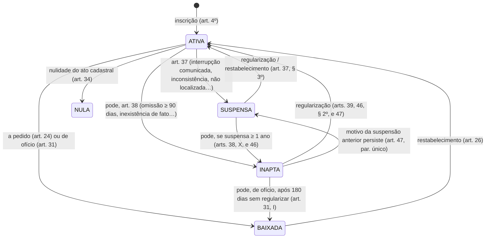

# Conceitos de negócio

> **Para quem:** quem usa a base (negócio, BI, quem escreve SQL) e quem mantém o projeto · **Quando ler:** antes de
> usar as métricas ou de interpretar um número: empresa × estabelecimento, situação cadastral, porte, MEI, fontes IBGE.

Este documento é a fonte única dos conceitos de negócio do projeto: o que os dados do CNPJ e do IBGE significam e o
ciclo de vida de um estabelecimento. Cada conceito abre com a sua **definição**, em destaque, seguida do que ela não
diz: a base legal, exemplos do dado e cuidados. A definição é gerada dos doc blocks do dbt
([`transform/models/docs/conceitos.md`](../transform/models/docs/conceitos.md)) e é o mesmo texto das descrições dos
modelos (`dbt docs` e [dicionário de dados](referencia/dicionario-dados.md)) e do catálogo do agente
([`catalogo.json`](referencia/golden_queries/catalogo.json)).

Toda regra legal ou de negócio tem a fonte entre colchetes, como [IN 2.119, art. 9º]; a lista, com link e data de
acesso, está em [Fontes](#6-fontes). Os números de exemplo vêm das **fixtures sintéticas do `make ci`**, salvo onde
está escrito "dado real". As regras que dá para conferir no dado estão no
[catálogo de regras](referencia/regras-negocio.md) (`RN-xx`), com o resultado do dado real no
[relatório de regras](relatorios/regras-negocio.md). Como consultar as métricas (`mf query`, com perguntas frequentes)
está na [referência da camada semântica](referencia/camada-semantica.md); como traduzir o vocabulário de quem
pergunta em colunas, no [glossário do guia de consulta](uso/consulta-agente.md#5-glossário-do-vocabulário-do-usuário-às-colunas).

**Sumário:** [1. As bases](#1-as-bases) · [2. Conceitos](#2-conceitos) · [3. Ciclo de vida](#3-ciclo-de-vida) ·
[4. Ontologia](#4-ontologia) · [5. Glossário](#5-glossário) · [6. Fontes](#6-fontes)

## 1. As bases

**Dados abertos do CNPJ (Receita Federal).** O CNPJ é o cadastro da RFB com as informações cadastrais das
pessoas jurídicas e de outras entidades de interesse das administrações tributárias. A RFB publica uma cópia em
dados abertos, com **atualização mensal** [Dados.gov.br]; cada mês é uma
[fotografia](#o-que-o-extrato-mensal-mostra) do cadastro. O projeto baixa os arquivos de cada mês
([ADR-0003](adr/0003-fonte-rfb-webdav.md)) e usa:

| Arquivo da RFB | Uma linha por | O que traz | Staging |
|---|---|---|---|
| Empresas | empresa (CNPJ básico) | razão social, natureza jurídica, qualificação do responsável, capital social, porte, ente federativo responsável | `stg_rfb__empresas` |
| Estabelecimentos | estabelecimento (CNPJ completo) | matriz/filial, nome fantasia, situação cadastral (data e motivo), início de atividade, CNAE principal e secundárias, endereço, município, situação especial | `stg_rfb__estabelecimentos` |
| Simples | empresa (CNPJ básico) | opção pelo Simples e pelo MEI, com as datas de opção e de exclusão | `stg_rfb__simples` |
| Domínios | código | CNAEs, municípios, naturezas jurídicas e motivos da situação cadastral (o leiaute descreve os três primeiros; o arquivo de motivos é publicado junto) | `stg_rfb__cnaes`, `stg_rfb__municipios`, `stg_rfb__naturezas`, `stg_rfb__motivos` |

O leiaute [RFB-Leiaute] também descreve o arquivo **Sócios** (quadro societário, com CPF parcialmente ocultado) e os
domínios de países e de qualificações. O projeto **não** ingere Sócios e descarta e-mail e telefones no staging
([ADR-0008](adr/0008-minimizacao-dados-pessoais.md)). Ninguém aqui responde "quem é dono de quê".

Os códigos de situação cadastral, porte e matriz/filial não têm arquivo de domínio na RFB: estão no leiaute e o
projeto os guarda nos seeds `dominio_situacao_cadastral`, `dominio_porte` e `dominio_matriz_filial`.

**Base dos Dados.** O portal Base dos Dados publica tabelas públicas já tratadas
([ADR-0015](adr/0015-enriquecimento-base-dos-dados.md)). O projeto usa:

- diretório de municípios (código IBGE, código RFB, UF, meso/microrregião, regiões intermediária e imediata,
  centroide): `stg_bd__municipios`;
- CNAE com a hierarquia completa: `stg_bd__cnaes`;
- população estimada (`stg_bd__populacao`) e PIB municipal (`stg_bd__pib`);
- incremento `enriquecimento_bd`: Censo 2022 por município (`stg_bd__censo_2022_municipio`), regiões
  metropolitanas (`stg_bd__regioes_metropolitanas`) e vizinhança entre municípios (`stg_bd__vizinhanca`).

Esses dados viram atributos de `dim_municipio` e `dim_cnae`. Na camada semântica, aparecem como dimensões
(`municipio__sigla_uf`, `cnae__descricao_secao`…), nunca como métricas (ver [limites da camada semântica](referencia/camada-semantica.md#7-limites-e-cuidados)).

**IBGE, direto da origem (incremento `enriquecimento_ibge`,
[ADR-0022](adr/0022-enriquecimento-fontes-gratuitas-ibge.md)).** Fontes gratuitas baixadas do próprio IBGE, sem
conta nem serviço pago, para o perfil de mercado de quem pensa em abrir um negócio:

- CEMPRE (Cadastro Central de Empresas) por município × classe CNAE: unidades locais, pessoal ocupado,
  assalariados e salários (`stg_ibge__cempre_municipio_classe`; o total do município em
  `stg_ibge__cempre_municipio_total`);
- rendimento domiciliar per capita do Censo 2022 (`stg_ibge__renda_municipio`);
- REGIC 2018, as Regiões de Influência das Cidades: hierarquia urbana (`stg_ibge__regic_hierarquia`), para onde os
  moradores de cada município vão comprar (`stg_ibge__regic_ligacoes`) e o índice de atração
  (`stg_ibge__regic_atracao`).

Elas viram atributos de `dim_municipio` (renda, hierarquia, polo de compras, total do CEMPRE), a ponte
`bridge_municipio_destino_compras` e o mart `mart_emprego_setor_municipio`, o único com métricas próprias
([métricas da camada semântica](referencia/camada-semantica.md#3-métricas)). O valor adicionado por atividade vem do PIB dos Municípios da Base dos Dados (`stg_bd__pib`)
e entrou no mesmo incremento. Para a pergunta de negócio que cada base responde, com consultas prontas e exemplos do
dado real, veja os [cenários de uso](uso/cenarios.md).

## 2. Conceitos

### CNPJ

O número de inscrição tem **14 posições** [RFB-Leiaute]:

| Parte | Posições | Nome no leiaute | Coluna no projeto |
|---|---|---|---|
| básico (raiz) | 1 a 8 | CNPJ BÁSICO | `cnpj_raiz` |
| ordem | 9 a 12 | CNPJ ORDEM ("número do estabelecimento") | `cnpj_ordem` |
| dígitos verificadores | 13 e 14 | CNPJ DV | `cnpj_dv` |

`cnpj_completo` é a concatenação das três partes. O básico identifica a **empresa**; o completo, o
**estabelecimento**.

**CNPJ alfanumérico.** Desde julho de 2026, as 12 primeiras posições podem ter letras maiúsculas (A a Z) além de
números; os 2 dígitos verificadores continuam numéricos, calculados pelo módulo 11 [IN 2.119, art. 2º, parágrafo
único; RFB-Alfanumérico]. O primeiro foi gerado em 31/07/2026 [RFB-Notícia]. Os CNPJs numéricos continuam válidos e
não mudam [RFB-Alfanumérico, perguntas 6 e 7]. Por isso:

- não trate o CNPJ como número (o projeto o guarda como texto);
- não use "ordem `0001`" como sinônimo de matriz: o que diz se é matriz é o identificador matriz/filial
  (`eh_matriz`).

O teste `cnpj_dv_valido` já confere os dígitos dos dois formatos (regra [RN-17](referencia/regras-negocio.md#rn-17)).

### Empresa × estabelecimento

É a distinção mais importante para usar as métricas.

<!-- definição: empresa (gerada do doc block por `make conceitos`; não edite à mão) -->
> **Empresa** é a entidade inscrita no CNPJ (sociedade, empresário individual, órgão público, associação…),
> identificada pelo **CNPJ básico** (os 8 primeiros caracteres) e com uma linha no arquivo Empresas da RFB. Natureza
> jurídica, porte, capital social e opção pelo Simples/MEI são atributos da empresa.
>
> O projeto não tem uma tabela de empresas no gold: os atributos da empresa são copiados para cada estabelecimento
> dela. Para contar empresas, conte as **matrizes** (uma por CNPJ básico).
<!-- fim da definição: empresa -->

<!-- definição: estabelecimento (gerada do doc block por `make conceitos`; não edite à mão) -->
> **Estabelecimento** é o local onde a empresa exerce suas atividades (IN RFB 2.119/2022, art. 5º): a matriz ou uma
> filial, cada um com um **CNPJ completo** de 14 posições e uma linha no arquivo Estabelecimentos. Uma empresa tem um
> ou mais estabelecimentos. Situação cadastral, CNAE, endereço, município e data de início de atividade são
> atributos do estabelecimento.
>
> O estabelecimento é o grão das fatos do projeto: as contagens padrão (estabelecimentos, ativos, MEI ativos) contam
> estabelecimentos, não empresas.
<!-- fim da definição: estabelecimento -->

A IN descreve esse local como "local privado ou público, edificado ou não, móvel ou imóvel, próprio ou de
terceiros, físico ou virtual, onde a entidade exerce suas atividades", e exige inscrição de toda entidade e de cada
um de seus estabelecimentos [IN 2.119, art. 4º]. A divisão dos atributos entre empresa e estabelecimento é a do
leiaute [RFB-Leiaute].

`qtd_estabelecimentos`, `qtd_ativos` e `qtd_ativos_mei` contam estabelecimentos; para empresas, use `qtd_matrizes`. Nas fixtures, em 2026-09, são 18 estabelecimentos e 16 matrizes: duas empresas têm uma filial cada.
Atributos da empresa repetidos nas filiais não se somam por estabelecimento (veja [Capital social](#capital-social)).

### Matriz × filial

<!-- definição: matriz_filial (gerada do doc block por `make conceitos`; não edite à mão) -->
> **Matriz e filial**: o identificador matriz/filial do leiaute vale 1 (matriz) ou 2 (filial). O projeto lê a
> inscrição da entidade como a da matriz, com as filiais em inscrição própria; a baixa da matriz implica a baixa de
> todas as filiais (IN RFB 2.119/2022, art. 24, § 2º).
>
> O que diz se é matriz é esse identificador, não a ordem "0001" do CNPJ (o CNPJ alfanumérico existe desde julho de
> 2026). Contar matrizes é contar empresas: no dado real, todo CNPJ básico tem matriz, e quase sempre uma só.
<!-- fim da definição: matriz_filial -->

Ler a inscrição da entidade como a da matriz é uma leitura, não texto expresso: o art. 9º fala da inscrição "da entidade ou do
estabelecimento filial" [IN 2.119, art. 9º], e o art. 4º, § 1º, inscreve os estados, o DF e os municípios "na
condição de estabelecimento matriz" [IN 2.119, art. 4º, § 1º]. A entidade pode transformar uma filial em matriz
[IN 2.119, art. 4º, § 3º]. A baixa das filiais junto com a matriz é a regra
[RN-14](referencia/regras-negocio.md#rn-14), e a matriz baixada, inapta ou nula também impede a inscrição de filial
[IN 2.119, art. 21, IV] ([RN-27](referencia/regras-negocio.md#rn-27)).

Contar empresas pelas matrizes supõe uma matriz por CNPJ básico. As fixtures cumprem isso, e no dado real de 2026-09
há 70.085.592 matrizes para 70.085.591 CNPJs básicos: só um (`08314885`) tem duas (conferência da RSEM no dado real
de 2026-09; regra [RN-16](referencia/regras-negocio.md#rn-16)).

### Razão social × nome fantasia

- **Razão social** é o "nome empresarial da pessoa jurídica" e está no arquivo Empresas [RFB-Leiaute]
  (`razao_social`). No empresário individual e no MEI, ela termina com o CPF do titular; o projeto mascara esse
  trecho no gold ([ADR-0008](adr/0008-minimizacao-dados-pessoais.md)).
- **Nome fantasia** é do estabelecimento (`nome_fantasia`) e pode vir vazio.

Nenhum dos dois é dimensão da camada semântica: são nomes, não categorias.

### Natureza jurídica

<!-- definição: natureza_juridica (gerada do doc block por `make conceitos`; não edite à mão) -->
> **Natureza jurídica** é a forma jurídica da empresa, com código de 4 dígitos da tabela CONCLA/IBGE, em cinco
> grupos: administração pública, entidades empresariais (como LTDA, S/A e empresário individual), entidades sem fins
> lucrativos, pessoas físicas e organizações internacionais.
>
> **MEI não é natureza jurídica**: quase todo MEI tem a natureza 2135 (Empresário Individual), mas para achar MEI use
> a opção pelo MEI, não a natureza.
<!-- fim da definição: natureza_juridica -->

O código está no arquivo Empresas e a descrição, no domínio Naturezas [RFB-Leiaute]. Exemplos de cada grupo da
CONCLA [CONCLA-NJ]:

| Grupo | Exemplos (código CONCLA – descrição) |
|---|---|
| 1. Administração Pública | 101-5 Órgão Público do Poder Executivo Federal; 103-1 Órgão Público do Poder Executivo Municipal; 124-4 Município |
| 2. Entidades Empresariais | 213-5 Empresário (Individual); 206-2 Sociedade Empresária Limitada; 205-4 Sociedade Anônima Fechada; 204-6 Sociedade Anônima Aberta |
| 3. Entidades sem Fins Lucrativos | 399-9 Associação Privada |
| 4. Pessoas Físicas | — |
| 5. Organizações Internacionais e Outras Instituições Extraterritoriais | — |

O ente federativo responsável só é preenchido para as naturezas do grupo 1XXX [RFB-Leiaute]
(`ente_federativo_responsavel`; regra [RN-20](referencia/regras-negocio.md#rn-20)). Nas fixtures do CI, o código
`2062` traz a descrição "Sociedade Empresária Limitada", a mesma do 206-2 da CONCLA.

**MEI e natureza.** Pela lei, o MEI é o empresário individual do art. 966 do Código Civil ou o empreendedor que
exerça atividades extrativistas, atividades autorizadas pelo CGSN ou atividades de industrialização, comercialização
e serviços no âmbito rural [LC 123, art. 18-A, § 1º, I a III, redação da LC 188/2021]. A CONCLA não associa o MEI a
uma natureza. No dado real, dos 17.527.414 estabelecimentos com `opcao_mei` em 2026-09, 17.526.176 (99,99 %) são
Empresário (Individual), 1.237 têm 2062 (Sociedade Empresária Limitada) e 1 tem 2070 (Sociedade Empresária em Nome
Coletivo). É observação do projeto, não regra (conferência da RSEM no dado real de 2026-09; contada por empresa na
[RN-08](referencia/regras-negocio.md#rn-08)). Já a natureza de sociedade contraria o § 1º, que só admite o empresário
individual ou o empreendedor ([RN-29](referencia/regras-negocio.md#rn-29)).

O resumo mensal não tem natureza jurídica: só a fato detalhada.

### Capital social

<!-- definição: capital_social (gerada do doc block por `make conceitos`; não edite à mão) -->
> **Capital social** é o capital declarado da **empresa**, no arquivo Empresas. Como o projeto copia os atributos da
> empresa para cada estabelecimento, o capital se repete nas filiais: some ou tire a média **só nas matrizes**.
> Capital social não é faturamento.
<!-- fim da definição: capital_social -->

O campo é do arquivo Empresas [RFB-Leiaute]. As métricas `capital_social_total` e `capital_social_medio` já somam só
as matrizes: o médio é por empresa.

### Porte

<!-- definição: porte (gerada do doc block por `make conceitos`; não edite à mão) -->
> **Porte** é o código do porte da empresa no leiaute: 00 não informado, 01 microempresa (ME, receita bruta anual
> até R$ 360 mil), 03 empresa de pequeno porte (EPP, até R$ 4,8 milhões) e 05 demais (LC 123/2006, art. 3º).
>
> O porte é **declarado** no registro, não medido: os dados abertos não trazem a receita. MEI não é porte, é uma
> opção de tributação. "Não informado" aparece de dois jeitos: o código 00 da RFB (rótulo N/A) e o membro -1 (NÃO
> INFORMADO) do modelo estrela.
<!-- fim da definição: porte -->

Os códigos do leiaute [RFB-Leiaute] e do seed `dominio_porte`:

| Leiaute | Seed (`codigo`, `rotulo`) | Significado |
|---|---|---|
| 00 – Não informado | 0, N/A | não informado |
| 01 – Micro empresa | 1, MICRO | microempresa (ME) [LC 123, art. 3º, I] |
| 03 – Empresa de pequeno porte | 3, PEQUENA | empresa de pequeno porte (EPP), acima do limite da ME [LC 123, art. 3º, II] |
| 05 – Demais | 5, DEMAIS | nem ME nem EPP |

Cuidados:

- O enquadramento como ME ou EPP é feito por declaração arquivada no registro (Junta Comercial) [Lei 8.934, art. 32,
  II, d]; com os dados abertos, não há como conferi-lo.
- O leiaute não tem código de porte para o MEI.
- Os limites da definição são os da LC 123 em vigor em 2026-10-10 (redação da LC 155/2016) [LC 123].
- O seed descreve "05 DEMAIS" como "Demais (médio e grande porte)". "Médio e grande porte" é um rótulo do projeto:
  o leiaute diz só "Demais".

Os valores MICRO, PEQUENA e DEMAIS estão em `rotulo_porte`; `descricao_porte` é o texto longo.

### Simples Nacional e MEI

<!-- definição: simples_nacional (gerada do doc block por `make conceitos`; não edite à mão) -->
> **Simples Nacional** é o regime unificado de arrecadação de tributos das microempresas e empresas de pequeno
> porte (LC 123/2006, art. 12). A opção é anual e o arquivo Simples da RFB traz, por CNPJ básico, a opção e as datas
> de opção e de exclusão.
>
> No projeto, a flag é a situação **no extrato** do mês; empresa sem registro no arquivo Simples vira falso.
<!-- fim da definição: simples_nacional -->

O nome legal é "Regime Especial Unificado de Arrecadação de Tributos e Contribuições devidos pelas Microempresas e
Empresas de Pequeno Porte". A opção é irretratável no ano-calendário [LC 123, art. 16] e, pela redação vigente em
2026-10-10, formalizada até o último dia útil de janeiro, com efeito desde 1º de janeiro [CGSN 140, art. 6º, § 1º].
No arquivo Simples, a opção vem como S, N ou em branco ("outros") [RFB-Leiaute].

O regime vale desde 1º de julho de 2007 [LC 123, art. 88] e o SIMEI, desde 1º de julho de 2009 [LC 128, art. 14, III]
([RN-25](referencia/regras-negocio.md#rn-25), [RN-26](referencia/regras-negocio.md#rn-26)). O prazo da opção muda
em 2027 (CGSN 190 e 194): veja [mudanças na lei do Simples e do MEI](referencia/regras-negocio.md#mudanças-na-lei-do-simples-e-do-mei).

<!-- definição: mei (gerada do doc block por `make conceitos`; não edite à mão) -->
> **MEI (microempreendedor individual)** é o optante pelo Simples Nacional que recolhe em valores fixos mensais, o
> SIMEI (LC 123/2006, art. 18-A): receita bruta anual de até R$ 81 mil em 2026, um único estabelecimento e no máximo
> um empregado (art. 18-C). Todo MEI é optante pelo Simples; o contrário não vale.
>
> MEI não é porte nem natureza jurídica: identifique-o pela opção pelo MEI. O dado real tem filiais de empresas MEI,
> por isso a contagem de MEI ativos (por estabelecimento) pode passar um pouco do número de empresas MEI.
<!-- fim da definição: mei -->

Quem pode ser MEI está em [Natureza jurídica](#natureza-jurídica). Os requisitos, em detalhe:

- o limite de receita é o do ano anterior [LC 123, art. 18-A, § 1º; CGSN 140, art. 100; Portal do Empreendedor].
  No ano de abertura, é de R$ 6.750,00 por mês de atividade [LC 123, art. 18-A, § 2º]. O transportador autônomo de
  cargas tem limite de R$ 251.600,00 [CGSN 140, art. 100, § 1º-A, I; Portal do Empreendedor];
- só as ocupações permitidas [CGSN 140, art. 100; Portal do Empreendedor];
- nenhuma participação em outra empresa como titular, sócio ou administrador; esta vedação e a do estabelecimento
  único estão no [LC 123, art. 18-A, § 4º, II e III]. As filiais de empresas com `opcao_mei` do dado real são 3.749
  (conferência da RSEM no dado real de 2026-09; regra [RN-05](referencia/regras-negocio.md#rn-05));
- o empregado recebe o salário mínimo ou o piso da categoria [CGSN 140, art. 105].

O MEI é modalidade de microempresa [LC 123, art. 18-E, § 3º] ([RN-07](referencia/regras-negocio.md#rn-07)), e "MEI
implica Simples" é a [RN-06](referencia/regras-negocio.md#rn-06). Sair do SIMEI (desenquadramento) não exclui a
empresa do Simples Nacional [CGSN 140, art. 115, § 1º].

Os limites foram conferidos em 2026-10-10 na LC 123, na CGSN 140 e no Portal do Empreendedor. Eles mudam por lei;
confira antes de citá-los num relatório.

O PLP 186/2026, que muda o teto e o número de empregados, ainda não está aprovado: veja
[mudanças na lei do Simples e do MEI](referencia/regras-negocio.md#mudanças-na-lei-do-simples-e-do-mei).

### Situação cadastral

<!-- definição: situacao_cadastral (gerada do doc block por `make conceitos`; não edite à mão) -->
> **Situação cadastral** é o estado da inscrição de cada estabelecimento no CNPJ (IN RFB 2.119/2022, art. 9º): 2
> ATIVA, 3 SUSPENSA, 4 INAPTA, 8 BAIXADA ou 1 NULA, com a data e o motivo do último evento. Os dados abertos trazem só
> a situação atual, não o histórico de eventos.
>
> A situação "da empresa" é lida como a da matriz: uma empresa ATIVA pode ter filiais baixadas.
<!-- fim da definição: situacao_cadastral -->

Os códigos são os do leiaute [RFB-Leiaute], iguais aos do seed `dominio_situacao_cadastral`. Quando cada situação
pode ocorrer:

| Código | Situação | Pode ocorrer quando (resumo) | Fonte |
|---|---|---|---|
| 2 | **ATIVA** | inscrição regular | a da definição |
| 3 | **SUSPENSA** | interrupção temporária das atividades comunicada pela entidade; inconsistência cadastral; não localização no endereço; indício de interposição fraudulenta de sócio; procedimento de inaptidão em curso; ordem judicial; entre outras | [IN 2.119, art. 37] |
| 4 | **INAPTA** | omissão de declarações por **90 dias ou mais** após o prazo; inexistência de fato (sem patrimônio ou capacidade operacional, não localizada, atividades paralisadas sem comunicação); irregularidade no comércio exterior; fraude; **suspensa há um ano ou mais**; entre outras | [IN 2.119, art. 38] |
| 8 | **BAIXADA** | a pedido: extinção (liquidação, incorporação, fusão, cisão total) ou fim da falência. De ofício: inapta não regularizada em **180 dias**, registro extinto no órgão de registro, ordem judicial, falência ou liquidação extrajudicial, óbito do MEI, decisão administrativa | [IN 2.119, arts. 24 e 31] |
| 1 | **NULA** | o ato cadastral foi declarado nulo: mais de um CNPJ para o mesmo estabelecimento, vício no ato ou inscrição de quem não devia ser inscrito. O efeito retroage ao início do ato | [IN 2.119, art. 34] |

Os arts. 31 e 38 dizem que a inscrição "**pode** ser baixada de ofício" e "**pode** ser declarada inapta": os
prazos da tabela (90 dias, 1 ano, 180 dias) são condições, não gatilhos automáticos.

<!-- definição: baixa_inaptidao (gerada do doc block por `make conceitos`; não edite à mão) -->
> **Baixa** é o encerramento definitivo da inscrição, a pedido (extinção da entidade) ou de ofício. **Inaptidão** é
> declarada pela RFB, por exemplo por omissão de declarações por 90 dias ou mais, e é reversível com a
> regularização. A inaptidão por omissão sai em lotes, por ato declaratório com uma lista de inscrições, e põe a
> mesma data da situação em milhões de estabelecimentos.
>
> Por isso "encerramento" (todo não ativo) não é "fechamento definitivo": para este, use as baixas.
<!-- fim da definição: baixa_inaptidao -->

O ato declaratório é o ADE [IN 2.119, art. 39]; o efeito dos lotes nos números está no
[ciclo de vida](#lotes-de-inaptidão-e-período-parcial).

<!-- definição: ativa_em_operacao (gerada do doc block por `make conceitos`; não edite à mão) -->
> **Ativa não quer dizer em operação.** As situações cadastrais "não se confundem com a condição de atividade ou
> inatividade para fins tributários" (IN RFB 2.119/2022, art. 9º, parágrafo único). Um estabelecimento parado segue
> ATIVO até ser suspenso, declarado inapto ou baixado.
>
> "Ativo" no projeto é a situação ATIVA no extrato do mês. Nos marts e nos modelos originais, "inativo" é toda
> situação diferente de ATIVA (inclui suspensa e inapta).
<!-- fim da definição: ativa_em_operacao -->

É a ressalva R3-19 do [guia Power BI](uso/power-bi.md). Outros pontos que mudam a leitura das métricas:

- **Motivo.** Cada situação tem um motivo codificado [RFB-Leiaute], descrito no arquivo de motivos da RFB. O projeto o
  guarda no staging (`motivo_situacao_codigo`, `stg_rfb__motivos`) e não o leva à estrela. O ATIVO tem o motivo 00
  (SEM MOTIVO): é a tradução de "ativa não tem encerramento" ([RN-10](referencia/regras-negocio.md#rn-10)).
- **Data da situação** é a "data do evento da situação cadastral" [RFB-Leiaute] (`dat_situacao`). Num ativo,
  costuma coincidir com a data de início de atividade (observação do projeto, sem fonte da RFB). Regras
  [RN-11](referencia/regras-negocio.md#rn-11) a [RN-13](referencia/regras-negocio.md#rn-13): o não ativo tem a data,
  ela não antecede o início de atividade e não passa do limite do extrato (o dia seguinte à data de referência).

Para a situação da empresa, filtre `eh_matriz`.

### Situação especial

É a "situação especial da empresa" e a "data em que a empresa entrou em situação especial", campos do arquivo
Estabelecimentos [RFB-Leiaute]. O leiaute não lista os valores possíveis. O projeto mantém os campos só no staging
(`situacao_especial`, `dat_situacao_especial`); os dois andam juntos ([RN-15](referencia/regras-negocio.md#rn-15)).

### Data de início de atividade

É a "data de início da atividade" do **estabelecimento** [RFB-Leiaute]. É a base da **idade** (só dos ativos, em
relação à data do extrato), das **aberturas** e das **coortes** de sobrevivência. Data ausente vira a chave `-1` e data anterior a 1900 vira `-2`. Nenhuma das duas gera evento nem coorte.

### CNAE principal e secundárias

<!-- definição: cnae_principal (gerada do doc block por `make conceitos`; não edite à mão) -->
> **CNAE** é a Classificação Nacional de Atividades Econômicas (CONCLA/IBGE, CNAE-Subclasses 2.3), em cinco níveis:
> seção, divisão, grupo, classe (5 dígitos) e subclasse (7 dígitos). Cada estabelecimento tem **um CNAE fiscal
> principal**.
>
> As contagens, os marts e as métricas do projeto recortam pelo CNAE principal, na subclasse de 7 dígitos (lojas de
> tintas = 4741500). O CEMPRE do IBGE usa a classe de 5 dígitos (47415).
<!-- fim da definição: cnae_principal -->

<!-- definição: cnae_secundario (gerada do doc block por `make conceitos`; não edite à mão) -->
> **CNAEs secundários** são as outras atividades do estabelecimento, zero ou mais, separadas por vírgula no arquivo
> da RFB. O projeto as guarda numa ponte muitos-para-muitos, fora das métricas: um estabelecimento que tem a
> atividade só como secundária não entra num recorte pelo CNAE principal. Depois de juntar a ponte, conte
> estabelecimentos distintos.
<!-- fim da definição: cnae_secundario -->

Os cinco níveis, no exemplo da pergunta-guia do projeto [CONCLA-CNAE]:

| Nível | Código | Exemplo |
|---|---|---|
| Seção | G | Comércio; reparação de veículos automotores e motocicletas |
| Divisão | 47 | Comércio varejista |
| Grupo | 47.4 | Comércio varejista de material de construção |
| Classe | 47.41-5 | Comércio varejista de tintas e materiais para pintura |
| Subclasse | 4741-5/00 | Comércio varejista de tintas e materiais para pintura |

O formato dos campos está no [RFB-Leiaute], e as regras são as [RN-01](referencia/regras-negocio.md#rn-01) a
[RN-04](referencia/regras-negocio.md#rn-04). Os secundários ficam fora da camada semântica (ver
[limites da camada semântica](referencia/camada-semantica.md#7-limites-e-cuidados)).

### Município: código RFB × código IBGE

<!-- definição: municipio (gerada do doc block por `make conceitos`; não edite à mão) -->
> **Município**: o arquivo Estabelecimentos traz o código do município da **tabela da RFB** (4 dígitos), que não é o
> código IBGE (7 dígitos). O projeto converte um no outro pelo diretório de municípios da Base dos Dados e usa o
> código IBGE como chave. Sem par, o estabelecimento fica no membro -1 (NÃO INFORMADO).
>
> Para achar um município pelo nome, use sempre a UF: há homônimos (Água Branca existe em AL, PB e PI).
<!-- fim da definição: municipio -->

O campo do leiaute é o "código do município de jurisdição onde se encontra o estabelecimento", do domínio Municípios
da RFB [RFB-Leiaute]. Todo código existe no domínio da RFB ([RN-19](referencia/regras-negocio.md#rn-19)); os casos sem par conhecidos estão
no seed `excecoes_conhecidas_municipio`: o código 9707 (EXTERIOR, UF `EX`) e municípios criados depois da base.

### CEMPRE: unidades locais e pessoal ocupado

<!-- definição: cempre (gerada do doc block por `make conceitos`; não edite à mão) -->
> **CEMPRE** é o Cadastro Central de Empresas do IBGE: empresas e organizações formais ativas e suas **unidades
> locais** (endereços de atuação), com pessoal ocupado, assalariados e salários, por município × classe CNAE, em
> 31/12 do ano do CEMPRE (hoje 2024). Não inclui MEI e conta o que tem sinal de atividade.
>
> A comparação justa com a RFB é de unidades locais com ativos sem MEI. Células que identificariam o informante vêm
> com sigilo: o pessoal e os salários ficam nulos, e somá-los dá um piso, não o total.
<!-- fim da definição: cempre -->

Desde o ano-base 2022, uma organização entra no CEMPRE se declarou o eSocial, se respondeu às pesquisas anuais do
IBGE ou se tem "situação cadastral ativa em 31.12 na Receita Federal" sem indicativo de inatividade nessas pesquisas
[IBGE-CEMPRE]. Entram unidades sem empregado: 71,6 % das empresas de 2024 não tinham assalariado em 31/12, e o
pessoal ocupado inclui sócios e proprietários.

**CEMPRE × RFB.** A RFB conta todo CNPJ em situação ATIVA, inclusive o MEI e quem não opera de fato. Em colunas, a
comparação justa é `ativos_rfb_sem_mei` × `unidades_locais_cempre`, em `mart_emprego_setor_municipio`
([RN-30](referencia/regras-negocio.md#rn-30)). No dado real de 2026-09, nos pares em que as duas bases têm o setor, o
CEMPRE 2024 conta 0,83 unidade local por ativo sem MEI. Nas classes do caso, a ordem de grandeza é a mesma: em Serra,
33 unidades de 47.41-5 no CEMPRE e 34 ativos sem MEI na RFB.

**Sigilo.** O IBGE publica `X` nas células sigilosas; as unidades locais nunca são sigilosas. O projeto não imputa:
a flag é `tem_sigilo`. **Ano:** a coluna é `ano_cempre`; a RFB é do mês do extrato.

### REGIC: hierarquia urbana e polo de compras

<!-- definição: regic_polo_compras (gerada do doc block por `make conceitos`; não edite à mão) -->
> **REGIC** (Regiões de Influência das Cidades, IBGE, 2018) classifica as cidades numa hierarquia urbana (Metrópole,
> Capital Regional, Centro Sub-Regional, Centro de Zona, Centro Local) e mede para onde os moradores de cada município
> vão comprar bens e usar serviços.
>
> O **polo de compras** do projeto é o destino com o maior percentual no tema móveis e eletroeletrônicos. O
> percentual divide os deslocamentos **entre os destinos de fora**: "45 % em Serra" é 45 % de quem compra fora, não de
> toda a compra. Os 67 municípios mais centrais não têm polo.
<!-- fim da definição: regic_polo_compras -->

Os níveis da hierarquia vão de 1 (Metrópole) a 5 (Centro Local), com subníveis A, B e C [IBGE-REGIC]. Em 5.503
municípios, três informantes locais (a prefeitura e, na falta, os Correios, o cartório…) indicaram de 1 a 5 municípios
procurados em cada tema e estimaram o percentual de cada um; o IBGE publica a média dos três. O próprio município não
podia ser destino. Os de maior centralidade não tiveram questionário, porque mais ofertam do que buscam: não têm
ligação de origem nem polo (no ES, Vitória, Vila Velha e Serra).

O tema do polo é a questão Q2, a melhor proxy de bem durável e material de construção (`id_municipio_polo_compras`,
`pct_compras_no_polo`). O destino "Outros" (lugares não listados) nunca é polo; empate fica com o menor código. O
percentual não diz quanto da demanda fica no município. A ponte `bridge_municipio_destino_compras` traz todos os
destinos de vestuário e calçados (Q1) e de móveis e eletroeletrônicos (Q2). A malha é a de 2018.

### Renda per capita (Censo 2022)

<!-- definição: renda_censo (gerada do doc block por `make conceitos`; não edite à mão) -->
> **Renda per capita** é o rendimento domiciliar per capita médio e mediano do município no Censo Demográfico 2022
> (IBGE, tabela SIDRA 10295), em reais nominais de 2022, sem correção. A média é puxada pelas rendas altas; a mediana
> descreve o domicílio típico. É renda do morador, não salário de quem trabalha no setor.
<!-- fim da definição: renda_censo -->

Exemplo: Vitória tem média de R$ 3.351,64 e mediana de R$ 1.750,00 [IBGE-SIDRA]. Na tabela publicada, os 5.570
municípios têm média e mediana numéricas; se o IBGE publicar um símbolo (`...`, não disponível), o valor fica NULL.
O `...` das fixtures só existe para provar esse tratamento.

### Valor adicionado por atividade

<!-- definição: valor_adicionado (gerada do doc block por `make conceitos`; não edite à mão) -->
> **Valor adicionado (VA)** é a abertura do PIB dos Municípios (IBGE, pela Base dos Dados) em agropecuária,
> indústria, serviços e administração pública. As aberturas saem depois do PIB total: hoje o PIB vai até 2023 e o VA
> até 2021. As participações somam 100, salvo quando o IBGE publica VA negativo.
<!-- fim da definição: valor_adicionado -->

No dado real, a indústria de Cachoeira Dourada/GO publicou VA negativo em 2021.

### Concorrência e área de mercado

<!-- definição: concorrencia_densidade (gerada do doc block por `make conceitos`; não edite à mão) -->
> **Concorrência** no projeto é o número de estabelecimentos **ativos** de um CNAE principal num município.
> **Densidade** é essa contagem relativa ao tamanho do mercado: ativos por 10 mil habitantes (população estimada) ou
> por mil domicílios (Censo 2022). "Muita concorrência" exige um critério explícito: ranking na UF, vizinhos ou área
> de mercado.
<!-- fim da definição: concorrencia_densidade -->

<!-- definição: area_mercado (gerada do doc block por `make conceitos`; não edite à mão) -->
> **Área de mercado** é o município somado aos seus vizinhos de fronteira. O projeto conta os ativos do CNAE no
> município, nos vizinhos e na região metropolitana, com a densidade da área por mil domicílios e por km², e marca os
> **vazios de mercado**: municípios sem estabelecimento local do CNAE, mas com ativos nos vizinhos ou na região
> metropolitana. Fronteira não é raio em km nem fluxo de compra: para o fluxo, veja o polo de compras da REGIC.
<!-- fim da definição: area_mercado -->

O modelo é `mart_concorrencia_area_mercado`; os [cenários de uso](uso/cenarios.md) mostram exemplos com o dado real.

## 3. Ciclo de vida

A RFB não publica "eventos": publica a **situação atual** de cada estabelecimento, com a data e o motivo dela. O
diagrama mostra as transições previstas na IN RFB 2.119/2022 [IN 2.119].

Notas:

- A suspensão pela interrupção comunicada e por ordem judicial só vira inaptidão depois de **5 anos** [IN 2.119,
  art. 46, § 1º].
- A baixa da matriz leva junto todas as filiais (veja [Matriz × filial](#matriz--filial)). A baixa não apaga dívidas:
  tributos ainda podem ser lançados e cobrados depois dela [IN 2.119, art. 24, § 4º].

### O que o extrato mensal mostra

<!-- definição: data_referencia (gerada do doc block por `make conceitos`; não edite à mão) -->
> **Data de referência** é a data do extrato mensal da RFB (por exemplo, 12/09/2026 no extrato de 2026-09). Idade,
> prazos e "ano corrente" são relativos a ela, nunca à data de hoje. O último mês e o último ano do extrato são
> parciais: o extrato vai só até a data de referência.
<!-- fim da definição: data_referencia -->

<!-- definição: fotografia_mensal (gerada do doc block por `make conceitos`; não edite à mão) -->
> **Fotografia mensal**: cada mês da RFB é um extrato completo do cadastro, não um registro de eventos. O mesmo
> estabelecimento ativo aparece em todos os meses em que segue ativo, então **não se somam meses**. Num período maior
> que o mês, vale o último mês do período (nas métricas, o último mês em que o recorte filtrado tem linhas).
>
> Comparando dois extratos se vê a variação líquida do estoque, não quem entrou e quem saiu. Só o resumo mensal
> guarda a série de meses; as outras tabelas do gold são do mês corrente.
<!-- fim da definição: fotografia_mensal -->

- O extrato mostra a **situação no dia do extrato** e a **data do último evento** de situação. Transições
  intermediárias entre dois extratos não aparecem: um estabelecimento suspenso e reativado no mesmo mês segue ATIVO.
- A variação líquida está em `qtd_ativos_mes_anterior` e `variacao_mensal_ativos`. Se um CNPJ deixar de constar no
  extrato, o projeto deixa de vê-lo.
- O cadastro guarda também o que já foi encerrado: as análises originais do MVP observaram que a base traz "todas
  as empresas que já foram abertas na história, incluindo as que foram fechadas"
  ([notebook 2.2](historico/referencia-original/2.2_Qualidade_dos_Dados_Empresas.md)). Por isso `qtd_estabelecimentos`
  inclui baixados; use `qtd_ativos` para o estoque ativo.

### Aberturas, encerramentos e sobrevivência

<!-- definição: abertura_encerramento (gerada do doc block por `make conceitos`; não edite à mão) -->
> **Abertura** e **encerramento** são eventos derivados pelo projeto, não publicados pela RFB. Abertura: o
> estabelecimento contado na data de início de atividade. Encerramento: todo estabelecimento **não ativo** (nulo,
> suspenso, inapto ou baixado) contado na data da situação. Baixa: só os BAIXADOS, na data da situação. Saldo =
> aberturas − encerramentos. Data ausente ou anterior a 1900 não gera evento.
>
> Como só existe a situação atual, um inativo reativado deixa de contar como encerramento. Lotes de inaptidão e o ano
> parcial do extrato distorcem os encerramentos e o saldo de um ano.
<!-- fim da definição: abertura_encerramento -->

<!-- definição: sobrevivencia (gerada do doc block por `make conceitos`; não edite à mão) -->
> **Sobrevivência a N anos** (1, 3 ou 5) é a fração dos elegíveis de uma coorte de abertura (o ano de início de
> atividade) que seguiam ativos N anos depois da abertura: **ativos hoje ou encerrados a partir do aniversário de N
> anos**. Não é "ainda ativo": um estabelecimento aberto em 2015 e baixado em 2024 sobrevive aos 3 e aos 5 anos.
>
> A coorte só é elegível quando inteira já completou N anos (31/12 do ano de abertura + N até a data de
> referência). A taxa soma elegíveis e sobreviventes dos estratos antes de dividir.
<!-- fim da definição: sobrevivencia -->

As métricas: `qtd_ativos` (ativos hoje; ativa ≠ em operação), `aberturas`, `encerramentos` (não só baixados),
`baixas` (fechou de vez), `saldo_aberturas_encerramentos` e `taxa_sobrevivencia_3a` (e 1a, 5a). A regra é a de
`mart_dinamica_mercado`, sobre o extrato corrente. Um suspenso conta como encerramento enquanto estiver suspenso.

### Lotes de inaptidão e período parcial

Dois efeitos distorcem `encerramentos` e o saldo de um ano:

- **Inaptidões em lote.** A inaptidão por omissão é declarada por ADE com uma lista de inscrições [IN 2.119, art.
  39] e pode ser revertida com a regularização [IN 2.119, arts. 39, parágrafo único, e 47]. No dado real de 2026-09,
  1.883.442 dos 4.243.776 encerramentos com data em 2026 (44 %) são INAPTA, contra 629 em 2025. O saldo de 2026 cai
  para 63.019, contra 2.270.025 em 2025, e o ano parece de mercado estagnado (conferência da RSEM no dado real de
  2026-09).
- **Ano e mês parciais.** O extrato vai até a data de referência. O de 2026-09 é de 12/09: setembro tem só 12
  dias de aberturas (179.463, contra 522.738 em agosto), e 2026 vai só até 12/09 (mesma fonte).

Para "fechamentos definitivos", use `baixas` ou quebre `encerramentos` por
`situacao_cadastral__rotulo_situacao_cadastral`. Compare anos completos, ou o mesmo período nos dois anos.

## 4. Ontologia

Os conceitos deste documento estão formalizados numa ontologia OWL
([`rfb_cnpj.ttl`](referencia/ontologia/rfb_cnpj.ttl)), que liga cada um às entidades, dimensões, métricas, modelos e
colunas do projeto; um teste confere a cobertura nos dois sentidos. O diagrama de classes, a tabela "onde cada
conceito está no projeto" e as regras de manutenção estão na [referência da ontologia](referencia/ontologia/README.md).

## 5. Glossário

Os termos com definição, em ordem alfabética:

<!-- INÍCIO do índice gerado por scripts/gerar_conceitos.py (make conceitos) a partir de transform/models/docs/conceitos.md: não edite à mão -->

[Abertura e encerramento](#def-abertura-encerramento) · [Área de mercado](#def-area-mercado) ·
[Ativa × em operação](#def-ativa-em-operacao) · [Baixa × inaptidão](#def-baixa-inaptidao) ·
[Capital social](#def-capital-social) · [CEMPRE](#def-cempre) · [CNAE principal](#def-cnae-principal) ·
[CNAEs secundários](#def-cnae-secundario) · [Concorrência e densidade](#def-concorrencia-densidade) ·
[Data de referência](#def-data-referencia) · [Empresa](#def-empresa) · [Estabelecimento](#def-estabelecimento) ·
[Fotografia mensal](#def-fotografia-mensal) · [Matriz e filial](#def-matriz-filial) · [MEI](#def-mei) ·
[Município (código RFB × IBGE)](#def-municipio) · [Natureza jurídica](#def-natureza-juridica) · [Porte](#def-porte) ·
[REGIC e polo de compras](#def-regic-polo-compras) · [Renda per capita (Censo 2022)](#def-renda-censo) ·
[Simples Nacional](#def-simples-nacional) · [Situação cadastral](#def-situacao-cadastral) ·
[Sobrevivência por coorte](#def-sobrevivencia) · [Valor adicionado](#def-valor-adicionado)

<!-- FIM do índice gerado -->

Outros termos: [CNPJ básico e completo](#cnpj) · [ME e EPP](#porte) · [unidade local e sigilo `X`](#cempre-unidades-locais-e-pessoal-ocupado)
· [membro `-1` (NÃO INFORMADO)](#município-código-rfb--código-ibge) · [município RFB](#município-código-rfb--código-ibge).
Para ir do vocabulário de quem pergunta ("loja", "fechou", "pequena empresa") às colunas, use o
[glossário do guia de consulta](uso/consulta-agente.md#5-glossário-do-vocabulário-do-usuário-às-colunas).

## 6. Fontes

Acessadas em **2026-10-10** (as do IBGE, em **2026-10-14**).

| Chave | Fonte | O que sustenta |
|---|---|---|
| RFB-Leiaute | Receita Federal, [Novo Layout dos Dados Abertos do CNPJ](https://www.gov.br/receitafederal/dados/cnpj-metadados.pdf) (PDF, 6 p.) | arquivos e campos (Empresas, Estabelecimentos, Simples, Sócios e os domínios de países, municípios, qualificações, naturezas e CNAEs); códigos de porte, matriz/filial, situação cadastral e opção Simples/MEI; ente federativo só no grupo 1XXX; CNAEs secundárias separadas por vírgula; CPF ocultado em Sócios |
| Dados.gov.br | Portal de Dados Abertos, [Cadastro Nacional da Pessoa Jurídica – CNPJ](https://dados.gov.br/dados/conjuntos-dados/cadastro-nacional-da-pessoa-juridica---cnpj) | o que é o CNPJ; atualização mensal |
| IN 2.119 | [Instrução Normativa RFB nº 2.119, de 6 de dezembro de 2022](http://normas.receita.fazenda.gov.br/sijut2consulta/link.action?idAto=127567), texto multivigente (alterações até a IN RFB nº 2.345/2026) | formato alfanumérico (art. 2º); inscrição (art. 4º); estabelecimento (art. 5º); situações e "não se confundem com atividade" (art. 9º); baixa (arts. 24, 26, 31); nulidade (art. 34); suspensão (art. 37); inaptidão (arts. 38, 39, 46, 47) |
| RFB-Alfanumérico | Receita Federal, [Perguntas e respostas: CNPJ alfanumérico](https://www.gov.br/receitafederal/pt-br/centrais-de-conteudo/publicacoes/perguntas-e-respostas/cnpj/cnpj-alfanumerico.pdf) | 14 posições, letras A–Z, DV por módulo 11; CNPJs atuais não mudam; os dois formatos coexistem |
| RFB-Notícia | Receita Federal, [Receita Federal gera o primeiro CNPJ em formato alfanumérico](https://www.gov.br/receitafederal/pt-br/assuntos/noticias/2026/julho/receita-federal-gera-o-primeiro-cnpj-em-formato-alfanumerico) (31/07/2026) | data do primeiro CNPJ alfanumérico |
| LC 123 | [Lei Complementar nº 123, de 14 de dezembro de 2006](https://www.planalto.gov.br/ccivil_03/leis/lcp/lcp123.htm), texto compilado do Planalto | limites de ME e EPP (art. 3º); Simples Nacional (art. 12); opção pelo Simples (art. 16); MEI: limite, estabelecimento único, sem outra empresa (art. 18-A); um empregado (art. 18-C); vigência do regime em 1º/7/2007 (art. 88) |
| LC 128 | [Lei Complementar nº 128, de 19 de dezembro de 2008](https://www.planalto.gov.br/ccivil_03/leis/lcp/lcp128.htm), Planalto (conferida em 2026-10-13) | os arts. 18-A a 18-C da LC 123 (SIMEI) produzem efeitos a partir de 1º/7/2009 (art. 14, III) |
| CGSN 140 | [Resolução CGSN nº 140, de 22 de maio de 2018](http://normas.receita.fazenda.gov.br/sijut2consulta/link.action?idAto=92278), texto multivigente | prazo da opção (art. 6º); MEI, ocupações e limite do transportador (art. 100); empregado do MEI (art. 105); desenquadramento do SIMEI não exclui do Simples (art. 115) |
| Lei 8.934 | [Lei nº 8.934, de 18 de novembro de 1994](https://www.planalto.gov.br/ccivil_03/leis/l8934.htm) | arquivamento das declarações de microempresa no registro (art. 32, II, d) |
| Portal do Empreendedor | gov.br, [O que você precisa saber antes de se tornar um MEI](https://www.gov.br/empresas-e-negocios/pt-br/empreendedor/quero-ser-mei/o-que-voce-precisa-saber-antes-de-se-tornar-um-mei) | requisitos do MEI; R$ 81.000,00 e R$ 251.600,00 |
| Câmara-PLP 186 | Câmara dos Deputados, [ficha de tramitação do PLP 186/2026](https://www.camara.leg.br/proposicoesWeb/fichadetramitacao?idProposicao=2635476) | autor, apresentação (29/06/2026), situação "Aguardando Despacho do Presidente da Câmara dos Deputados"; último andamento em 24/08/2026 (requerimento de apensação) |
| Câmara-Notícia | Agência Câmara, [Projeto do governo aumenta teto da receita de MEI para até R$ 140 mil em 2028](https://www.camara.leg.br/noticias/1286510-projeto-do-governo-aumenta-teto-da-receita-de-mei-para-ate-r-140-mil-em-2028/) (30/06/2026) | conteúdo do PLP: R$ 110 mil (2027), R$ 140 mil (2028), até dois empregados |
| MEMP-Teto | Ministério do Empreendedorismo, [Teto do MEI](https://www.gov.br/memp/pt-br/teto-do-mei) (modificado em 16/09/2026) | PLP "em tramitação", valores "ainda não estão em vigor", limite de R$ 81 mil válido |
| Planalto-LCP | Presidência da República, [quadro das leis complementares](https://www.planalto.gov.br/ccivil_03/leis/lcp/quadro_lcp.htm) | nenhuma LC de 2026 (até a LC 237, de 15/09/2026) altera o MEI |
| CONCLA-NJ | IBGE/CONCLA, [Tabela de Natureza Jurídica 2021](https://concla.ibge.gov.br/estrutura/natjur-estrutura/natureza-juridica-2021.html) | grupos e códigos de natureza jurídica |
| CONCLA-CNAE | IBGE/CONCLA, [busca online CNAE-Subclasses 2.3, subclasse 4741-5/00](https://concla.ibge.gov.br/busca-online-cnae.html?view=subclasse&tipo=cnae&versaosubclasse=10&subclasse=4741500) | hierarquia da CNAE e o exemplo de tintas |
| IBGE-CEMPRE | IBGE, [Estatísticas do Cadastro Central de Empresas 2024](https://agenciadenoticias.ibge.gov.br/media/com_mediaibge/arquivos/e1be87301fe780c6ccf8aeab200e71ea.pdf) (apresentação, "Notas técnicas") | fontes do CEMPRE; critérios de unidade ativa; MEI excluídos; quebra de série em 2022; empresas sem assalariado |
| IBGE-REGIC | IBGE, [Regiões de Influência das Cidades 2018](https://biblioteca.ibge.gov.br/visualizacao/livros/liv101728.pdf) (2020), "Notas técnicas" | hierarquia urbana; questionário em 5.503 municípios, três informantes, 1 a 5 destinos com percentual, média simples; 67 municípios sem questionário; índice de atração |
| IBGE-SIDRA | IBGE, [API SIDRA](https://apisidra.ibge.gov.br/), tabelas 9528 (CEMPRE por município e CNAE 2.0) e 10295 (Censo 2022, rendimento domiciliar per capita) | variáveis, classificações e os símbolos `-`, `X`, `..` e `...` |
