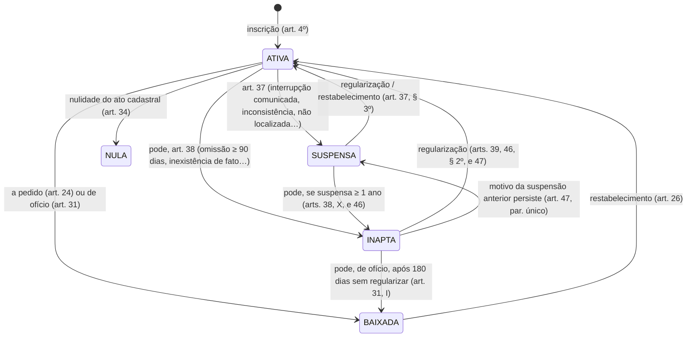
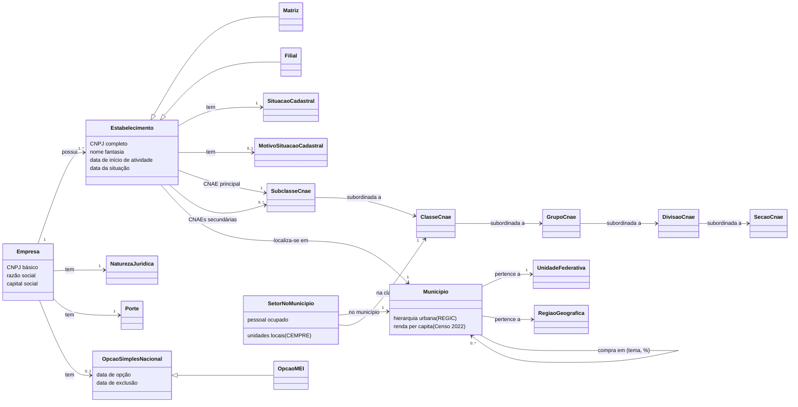

# Conceitos de negócio

> **Para quem:** quem usa a base (negócio, BI, quem escreve SQL) e quem mantém o projeto · **Quando ler:** antes de
> usar as métricas ou de interpretar um número: empresa × estabelecimento, situação cadastral, porte, MEI, fontes IBGE.

Este documento é a fonte única dos conceitos de negócio do projeto: o que os dados do CNPJ e do IBGE significam, o
ciclo de vida de um estabelecimento, a ontologia, um glossário e perguntas frequentes com `mf query`. As
**definições curtas** de cada conceito estão em doc blocks do dbt
([`transform/models/docs/conceitos.md`](../transform/models/docs/conceitos.md)) e aparecem iguais em três lugares:
na seção [Definições](#definições) abaixo, nas descrições dos modelos (`dbt docs` e
[dicionário de dados](referencia/dicionario-dados.md)) e no catálogo do agente
([`catalogo.json`](referencia/golden_queries/catalogo.json), campo `conceitos[].definicoes`).

Toda regra legal ou de negócio tem a fonte indicada entre colchetes, como [IN 2.119, art. 9º]. A lista completa,
com link e data de acesso, está em [Fontes](#7-fontes). Os números de exemplo vêm das **fixtures sintéticas do
`make ci`**, não do cadastro real, salvo onde está escrito "dado real". As regras que dá para conferir no dado estão
catalogadas em [regras de negócio](referencia/regras-negocio.md) (`RN-xx`), com o resultado do dado real no
[relatório de regras](relatorios/regras-negocio.md) ([ADR-0020](adr/0020-regras-de-negocio.md)). Como a camada
semântica é construída (arquivos, entidades, métricas, testes) está na
[referência técnica da camada semântica](referencia/camada-semantica.md); como traduzir o vocabulário do usuário em
colunas, no [glossário do guia de consulta](uso/consulta-agente.md#5-glossário-do-vocabulário-do-usuário-às-colunas).

**Sumário:** [Definições](#definições) · [1. As bases](#1-as-bases) · [2. Conceitos](#2-conceitos) ·
[3. Ciclo de vida](#3-ciclo-de-vida) · [4. Ontologia](#4-ontologia) · [5. Glossário](#5-glossário) ·
[6. Perguntas frequentes](#6-perguntas-frequentes) · [7. Fontes](#7-fontes)

## Definições

> Gerado por `scripts/gerar_conceitos.py` (`make conceitos`) a partir dos doc blocks — não edite à mão. Para mudar
> uma definição, edite o doc block e rode `make conceitos` e `make golden`.

<!-- INÍCIO do bloco gerado por scripts/gerar_conceitos.py (make conceitos) a partir de transform/models/docs/conceitos.md: não edite à mão -->

<a id="def-empresa"></a>
**Empresa** (`empresa`)

**Empresa** é a entidade inscrita no CNPJ (sociedade, empresário individual, órgão público, associação…),
identificada pelo **CNPJ básico** (os 8 primeiros caracteres) e com uma linha no arquivo Empresas da RFB. Natureza
jurídica, porte, capital social e opção pelo Simples/MEI são atributos da empresa.

O projeto não tem uma tabela de empresas no gold: os atributos da empresa são copiados para cada estabelecimento
dela. Para contar empresas, conte as **matrizes** (uma por CNPJ básico).

<a id="def-estabelecimento"></a>
**Estabelecimento** (`estabelecimento`)

**Estabelecimento** é o local onde a empresa exerce suas atividades (IN RFB 2.119/2022, art. 5º): a matriz ou uma
filial, cada um com um **CNPJ completo** de 14 posições e uma linha no arquivo Estabelecimentos. Uma empresa tem um
ou mais estabelecimentos. Situação cadastral, CNAE, endereço, município e data de início de atividade são
atributos do estabelecimento.

O estabelecimento é o grão das fatos do projeto: as contagens padrão (estabelecimentos, ativos, MEI ativos) contam
estabelecimentos, não empresas.

<a id="def-matriz-filial"></a>
**Matriz e filial** (`matriz_filial`)

**Matriz e filial**: o identificador matriz/filial do leiaute vale 1 (matriz) ou 2 (filial). O projeto lê a
inscrição da entidade como a da matriz, com as filiais em inscrição própria; a baixa da matriz implica a baixa de
todas as filiais (IN RFB 2.119/2022, art. 24, § 2º).

O que diz se é matriz é esse identificador, não a ordem "0001" do CNPJ (o CNPJ alfanumérico existe desde julho de
2026). Contar matrizes é contar empresas: no dado real, todo CNPJ básico tem matriz, e quase sempre uma só.

<a id="def-situacao-cadastral"></a>
**Situação cadastral** (`situacao_cadastral`)

**Situação cadastral** é o estado da inscrição de cada estabelecimento no CNPJ (IN RFB 2.119/2022, art. 9º): 2
ATIVA, 3 SUSPENSA, 4 INAPTA, 8 BAIXADA ou 1 NULA, com a data e o motivo do último evento. Os dados abertos trazem só
a situação atual, não o histórico de eventos.

A situação "da empresa" é lida como a da matriz: uma empresa ATIVA pode ter filiais baixadas.

<a id="def-ativa-em-operacao"></a>
**Ativa × em operação** (`ativa_em_operacao`)

**Ativa não quer dizer em operação.** As situações cadastrais "não se confundem com a condição de atividade ou
inatividade para fins tributários" (IN RFB 2.119/2022, art. 9º, parágrafo único). Um estabelecimento parado segue
ATIVO até ser suspenso, declarado inapto ou baixado.

"Ativo" no projeto é a situação ATIVA no extrato do mês. Nos marts e nos modelos originais, "inativo" é toda
situação diferente de ATIVA (inclui suspensa e inapta).

<a id="def-baixa-inaptidao"></a>
**Baixa × inaptidão** (`baixa_inaptidao`)

**Baixa** é o encerramento definitivo da inscrição, a pedido (extinção da entidade) ou de ofício. **Inaptidão** é
declarada pela RFB, por exemplo por omissão de declarações por 90 dias ou mais, e é reversível com a
regularização. A inaptidão por omissão sai em lotes, por ato declaratório com uma lista de inscrições, e põe a
mesma data da situação em milhões de estabelecimentos.

Por isso "encerramento" (todo não ativo) não é "fechamento definitivo": para este, use as baixas.

<a id="def-porte"></a>
**Porte** (`porte`)

**Porte** é o código do porte da empresa no leiaute: 00 não informado, 01 microempresa (ME, receita bruta anual
até R$ 360 mil), 03 empresa de pequeno porte (EPP, até R$ 4,8 milhões) e 05 demais (LC 123/2006, art. 3º).

O porte é **declarado** no registro, não medido: os dados abertos não trazem a receita. MEI não é porte, é uma
opção de tributação. "Não informado" aparece de dois jeitos: o código 00 da RFB (rótulo N/A) e o membro -1 (NÃO
INFORMADO) do modelo estrela.

<a id="def-natureza-juridica"></a>
**Natureza jurídica** (`natureza_juridica`)

**Natureza jurídica** é a forma jurídica da empresa, com código de 4 dígitos da tabela CONCLA/IBGE, em cinco
grupos: administração pública, entidades empresariais (como LTDA, S/A e empresário individual), entidades sem fins
lucrativos, pessoas físicas e organizações internacionais.

**MEI não é natureza jurídica**: quase todo MEI tem a natureza 2135 (Empresário Individual), mas para achar MEI use
a opção pelo MEI, não a natureza.

<a id="def-cnae-principal"></a>
**CNAE principal** (`cnae_principal`)

**CNAE** é a Classificação Nacional de Atividades Econômicas (CONCLA/IBGE, CNAE-Subclasses 2.3), em cinco níveis:
seção, divisão, grupo, classe (5 dígitos) e subclasse (7 dígitos). Cada estabelecimento tem **um CNAE fiscal
principal**.

As contagens, os marts e as métricas do projeto recortam pelo CNAE principal, na subclasse de 7 dígitos (lojas de
tintas = 4741500). O CEMPRE do IBGE usa a classe de 5 dígitos (47415).

<a id="def-cnae-secundario"></a>
**CNAEs secundários** (`cnae_secundario`)

**CNAEs secundários** são as outras atividades do estabelecimento, zero ou mais, separadas por vírgula no arquivo
da RFB. O projeto as guarda numa ponte muitos-para-muitos, fora das métricas: um estabelecimento que tem a
atividade só como secundária não entra num recorte pelo CNAE principal. Depois de juntar a ponte, conte
estabelecimentos distintos.

<a id="def-simples-nacional"></a>
**Simples Nacional** (`simples_nacional`)

**Simples Nacional** é o regime unificado de arrecadação de tributos das microempresas e empresas de pequeno
porte (LC 123/2006, art. 12). A opção é anual e o arquivo Simples da RFB traz, por CNPJ básico, a opção e as datas
de opção e de exclusão.

No projeto, a flag é a situação **no extrato** do mês; empresa sem registro no arquivo Simples vira falso.

<a id="def-mei"></a>
**MEI** (`mei`)

**MEI (microempreendedor individual)** é o optante pelo Simples Nacional que recolhe em valores fixos mensais, o
SIMEI (LC 123/2006, art. 18-A): receita bruta anual de até R$ 81 mil em 2026, um único estabelecimento e no máximo
um empregado. Todo MEI é optante pelo Simples; o contrário não vale.

MEI não é porte nem natureza jurídica: identifique-o pela opção pelo MEI. O dado real tem filiais de empresas MEI,
por isso a contagem de MEI ativos (por estabelecimento) pode passar um pouco do número de empresas MEI.

<a id="def-capital-social"></a>
**Capital social** (`capital_social`)

**Capital social** é o capital declarado da **empresa**, no arquivo Empresas. Como o projeto copia os atributos da
empresa para cada estabelecimento, o capital se repete nas filiais: some ou tire a média **só nas matrizes**.
Capital social não é faturamento.

<a id="def-municipio"></a>
**Município (código RFB × IBGE)** (`municipio`)

**Município**: o arquivo Estabelecimentos traz o código do município da **tabela da RFB** (4 dígitos), que não é o
código IBGE (7 dígitos). O projeto converte um no outro pelo diretório de municípios da Base dos Dados e usa o
código IBGE como chave. Sem par, o estabelecimento fica no membro -1 (NÃO INFORMADO).

Para achar um município pelo nome, use sempre a UF: há homônimos (Água Branca existe em AL, PB e PI).

<a id="def-data-referencia"></a>
**Data de referência** (`data_referencia`)

**Data de referência** é a data do extrato mensal da RFB (por exemplo, 12/09/2026 no extrato de 2026-09). Idade,
prazos e "ano corrente" são relativos a ela, nunca à data de hoje. O último mês e o último ano do extrato são
parciais: o extrato vai só até a data de referência.

<a id="def-fotografia-mensal"></a>
**Fotografia mensal** (`fotografia_mensal`)

**Fotografia mensal**: cada mês da RFB é um extrato completo do cadastro, não um registro de eventos. O mesmo
estabelecimento ativo aparece em todos os meses em que segue ativo, então **não se somam meses**. Num período maior
que o mês, vale o último mês do período (nas métricas, o último mês em que o recorte filtrado tem linhas).

Comparando dois extratos se vê a variação líquida do estoque, não quem entrou e quem saiu. Só o resumo mensal
guarda a série de meses; as outras tabelas do gold são do mês corrente.

<a id="def-abertura-encerramento"></a>
**Abertura e encerramento** (`abertura_encerramento`)

**Abertura** e **encerramento** são eventos derivados pelo projeto, não publicados pela RFB. Abertura: o
estabelecimento contado na data de início de atividade. Encerramento: todo estabelecimento **não ativo** (nulo,
suspenso, inapto ou baixado) contado na data da situação. Baixa: só os BAIXADOS, na data da situação. Saldo =
aberturas − encerramentos. Data ausente ou anterior a 1900 não gera evento.

Como só existe a situação atual, um inativo reativado deixa de contar como encerramento. Lotes de inaptidão e o ano
parcial do extrato distorcem os encerramentos e o saldo de um ano.

<a id="def-sobrevivencia"></a>
**Sobrevivência por coorte** (`sobrevivencia`)

**Sobrevivência a N anos** (1, 3 ou 5) é a fração dos elegíveis de uma coorte de abertura (o ano de início de
atividade) que seguiam ativos N anos depois da abertura: **ativos hoje ou encerrados a partir do aniversário de N
anos**. Não é "ainda ativo": um estabelecimento aberto em 2015 e baixado em 2024 sobrevive aos 3 e aos 5 anos.

A coorte só é elegível quando inteira já completou N anos (31/12 do ano de abertura + N até a data de
referência). A taxa soma elegíveis e sobreviventes dos estratos antes de dividir.

<a id="def-concorrencia-densidade"></a>
**Concorrência e densidade** (`concorrencia_densidade`)

**Concorrência** no projeto é o número de estabelecimentos **ativos** de um CNAE principal num município.
**Densidade** é essa contagem relativa ao tamanho do mercado: ativos por 10 mil habitantes (população estimada) ou
por mil domicílios (Censo 2022). "Muita concorrência" exige um critério explícito: ranking na UF, vizinhos ou área
de mercado.

<a id="def-area-mercado"></a>
**Área de mercado** (`area_mercado`)

**Área de mercado** é o município somado aos seus vizinhos de fronteira. O projeto conta os ativos do CNAE no
município, nos vizinhos e na região metropolitana, com a densidade da área por mil domicílios e por km², e marca os
**vazios de mercado**: municípios sem estabelecimento local do CNAE, mas com ativos nos vizinhos ou na região
metropolitana. Fronteira não é raio em km nem fluxo de compra: para o fluxo, veja o polo de compras da REGIC.

<a id="def-cempre"></a>
**CEMPRE** (`cempre`)

**CEMPRE** é o Cadastro Central de Empresas do IBGE: empresas e organizações formais ativas e suas **unidades
locais** (endereços de atuação), com pessoal ocupado, assalariados e salários, por município × classe CNAE, em
31/12 do ano do CEMPRE (hoje 2024). Não inclui MEI e conta o que tem sinal de atividade.

A comparação justa com a RFB é de unidades locais com ativos sem MEI. Células que identificariam o informante vêm
com sigilo: o pessoal e os salários ficam nulos, e somá-los dá um piso, não o total.

<a id="def-renda-censo"></a>
**Renda per capita (Censo 2022)** (`renda_censo`)

**Renda per capita** é o rendimento domiciliar per capita médio e mediano do município no Censo Demográfico 2022
(IBGE, tabela SIDRA 10295), em reais nominais de 2022, sem correção. A média é puxada pelas rendas altas; a mediana
descreve o domicílio típico. É renda do morador, não salário de quem trabalha no setor.

<a id="def-regic-polo-compras"></a>
**REGIC e polo de compras** (`regic_polo_compras`)

**REGIC** (Regiões de Influência das Cidades, IBGE, 2018) classifica as cidades numa hierarquia urbana (Metrópole,
Capital Regional, Centro Sub-Regional, Centro de Zona, Centro Local) e mede para onde os moradores de cada município
vão comprar bens e usar serviços.

O **polo de compras** do projeto é o destino com o maior percentual no tema móveis e eletroeletrônicos. O
percentual divide os deslocamentos **entre os destinos de fora**: "45 % em Serra" é 45 % de quem compra fora, não de
toda a compra. Os 67 municípios mais centrais não têm polo.

<a id="def-valor-adicionado"></a>
**Valor adicionado** (`valor_adicionado`)

**Valor adicionado (VA)** é a abertura do PIB dos Municípios (IBGE, pela Base dos Dados) em agropecuária,
indústria, serviços e administração pública. As aberturas saem depois do PIB total: hoje o PIB vai até 2023 e o VA
até 2021. As participações somam 100, salvo quando o IBGE publica VA negativo.

<!-- FIM do bloco gerado das definições -->

## 1. As bases

**Dados abertos do CNPJ (Receita Federal).** O CNPJ é o cadastro da RFB com as informações cadastrais das
pessoas jurídicas e de outras entidades de interesse das administrações tributárias. A RFB publica uma cópia em
dados abertos, com **atualização mensal** [Dados.gov.br]. Cada mês é um extrato completo do cadastro: uma
**fotografia**, não um registro de eventos. O projeto baixa os arquivos de cada mês
([ADR-0003](adr/0003-fonte-rfb-webdav.md)) e usa:

| Arquivo da RFB | Uma linha por | O que traz | Staging |
|---|---|---|---|
| Empresas | empresa (CNPJ básico) | razão social, natureza jurídica, qualificação do responsável, capital social, porte, ente federativo responsável | `stg_rfb__empresas` |
| Estabelecimentos | estabelecimento (CNPJ completo) | matriz/filial, nome fantasia, situação cadastral (data e motivo), início de atividade, CNAE principal e secundárias, endereço, município, situação especial | `stg_rfb__estabelecimentos` |
| Simples | empresa (CNPJ básico) | opção pelo Simples e pelo MEI, com as datas de opção e de exclusão | `stg_rfb__simples` |
| Domínios | código | CNAEs, municípios, naturezas jurídicas e motivos da situação cadastral (o leiaute descreve os três primeiros; o arquivo de motivos é publicado junto) | `stg_rfb__cnaes`, `stg_rfb__municipios`, `stg_rfb__naturezas`, `stg_rfb__motivos` |

O leiaute [RFB-Leiaute] também descreve o arquivo **Sócios** (quadro societário, com CPF parcialmente ocultado) e os
domínios de países e de qualificações. O projeto **não** ingere Sócios e descarta e-mail e telefones no staging
([ADR-0008](adr/0008-minimizacao-dados-pessoais.md)). Ninguém aqui responde "quem é dono de quê".

Os códigos de situação cadastral, porte e matriz/filial não têm arquivo de domínio na RFB: estão no leiaute e o
projeto os guarda nos seeds `dominio_situacao_cadastral`, `dominio_porte` e `dominio_matriz_filial`.

**Base dos Dados.** O portal Base dos Dados publica tabelas públicas já tratadas
([ADR-0015](adr/0015-enriquecimento-base-dos-dados.md)). O projeto usa:

- diretório de municípios (código IBGE, código RFB, UF, meso/microrregião, regiões intermediária e imediata,
  centroide): `stg_bd__municipios`;
- CNAE com a hierarquia completa: `stg_bd__cnaes`;
- população estimada (`stg_bd__populacao`) e PIB municipal (`stg_bd__pib`);
- incremento `enriquecimento_bd`: Censo 2022 por município (`stg_bd__censo_2022_municipio`), regiões
  metropolitanas (`stg_bd__regioes_metropolitanas`) e vizinhança entre municípios (`stg_bd__vizinhanca`).

Esses dados viram atributos de `dim_municipio` e `dim_cnae`. Na camada semântica, aparecem como dimensões
(`municipio__sigla_uf`, `cnae__descricao_secao`…), nunca como métricas (ver [limites da camada semântica](referencia/camada-semantica.md#7-limites-e-cuidados)).

**IBGE, direto da origem (incremento `enriquecimento_ibge`,
[ADR-0022](adr/0022-enriquecimento-fontes-gratuitas-ibge.md)).** Fontes gratuitas baixadas do próprio IBGE, sem
conta nem serviço pago, para o perfil de mercado de quem pensa em abrir um negócio:

- CEMPRE (Cadastro Central de Empresas) por município × classe CNAE: unidades locais, pessoal ocupado,
  assalariados e salários (`stg_ibge__cempre_municipio_classe`; o total do município em
  `stg_ibge__cempre_municipio_total`);
- rendimento domiciliar per capita do Censo 2022 (`stg_ibge__renda_municipio`);
- REGIC 2018, as Regiões de Influência das Cidades: hierarquia urbana (`stg_ibge__regic_hierarquia`), para onde os
  moradores de cada município vão comprar (`stg_ibge__regic_ligacoes`) e o índice de atração
  (`stg_ibge__regic_atracao`).

Elas viram atributos de `dim_municipio` (renda, hierarquia, polo de compras, total do CEMPRE), a ponte
`bridge_municipio_destino_compras` e o mart `mart_emprego_setor_municipio`, o único com métricas próprias
([métricas da camada semântica](referencia/camada-semantica.md#3-métricas)). O valor adicionado por atividade vem do PIB dos Municípios da Base dos Dados (`stg_bd__pib`)
e entrou no mesmo incremento. Para a pergunta de negócio que cada base responde, com consultas prontas e exemplos do
dado real, veja os [cenários de uso](uso/cenarios.md).

## 2. Conceitos

### CNPJ

O número de inscrição tem **14 posições** [RFB-Leiaute]:

| Parte | Posições | Nome no leiaute | Coluna no projeto |
|---|---|---|---|
| básico (raiz) | 1 a 8 | CNPJ BÁSICO | `cnpj_raiz` |
| ordem | 9 a 12 | CNPJ ORDEM ("número do estabelecimento") | `cnpj_ordem` |
| dígitos verificadores | 13 e 14 | CNPJ DV | `cnpj_dv` |

`cnpj_completo` é a concatenação das três partes. O básico identifica a **empresa**; o completo, o
**estabelecimento**.

**CNPJ alfanumérico.** Desde julho de 2026, as 12 primeiras posições podem ter letras maiúsculas (A a Z) além de
números; os 2 dígitos verificadores continuam numéricos, calculados pelo módulo 11 [IN 2.119, art. 2º, parágrafo
único; RFB-Alfanumérico]. O primeiro foi gerado em 31/07/2026 [RFB-Notícia]. Os CNPJs numéricos continuam válidos e
não mudam [RFB-Alfanumérico, perguntas 6 e 7]. Por isso:

- não trate o CNPJ como número (o projeto o guarda como texto);
- não use "ordem `0001`" como sinônimo de matriz: o que diz se é matriz é o identificador matriz/filial
  (`eh_matriz`).

O teste `cnpj_dv_valido` já confere os dígitos dos dois formatos (regra [RN-17](referencia/regras-negocio.md#rn-17)).

### Empresa × estabelecimento

É a distinção mais importante para usar as métricas.

- **Empresa** é a entidade inscrita no CNPJ (sociedade, empresário individual, órgão público, associação…). É
  identificada pelo **CNPJ básico** e tem uma linha no arquivo Empresas.
- **Estabelecimento** é o "local privado ou público, edificado ou não, móvel ou imóvel, próprio ou de terceiros,
  físico ou virtual, onde a entidade exerce suas atividades" [IN 2.119, art. 5º]. Toda entidade e cada um de seus
  estabelecimentos precisa de inscrição [IN 2.119, art. 4º]. Cada estabelecimento tem um CNPJ completo e uma
  linha no arquivo Estabelecimentos.

Uma empresa tem **um ou mais** estabelecimentos. Atributos ficam em lugares diferentes: natureza jurídica, porte,
capital social e opção pelo Simples/MEI são **da empresa**; situação cadastral, CNAE, endereço, município e data
de início de atividade são **do estabelecimento** [RFB-Leiaute].

No projeto, o grão das fatos é o **estabelecimento** (`fct_estabelecimentos`, entidade semântica
`estabelecimento`). Não há uma entidade semântica "empresa": os atributos da empresa foram copiados para cada
estabelecimento dela. Consequências:

- `qtd_estabelecimentos` e `qtd_ativos` contam **estabelecimentos**, não empresas;
- para contar **empresas**, conte as **matrizes** (`qtd_matrizes`). Nas fixtures, em 2026-09, são 18
  estabelecimentos e 16 matrizes: duas empresas têm uma filial cada;
- atributos da empresa repetidos (capital social) não podem ser somados por estabelecimento.

### Matriz × filial

O identificador matriz/filial vale 1 (matriz) ou 2 (filial) [RFB-Leiaute]; o projeto o guarda em
`matriz_filial_codigo` e na flag `eh_matriz`. O projeto lê a inscrição da entidade como a da matriz, com as
filiais em inscrição própria. É uma leitura, não texto expresso: o art. 9º fala da inscrição "da entidade ou do
estabelecimento filial" [IN 2.119, art. 9º], e o art. 4º, § 1º, inscreve os estados, o DF e os municípios "na
condição de estabelecimento matriz" [IN 2.119, art. 4º, § 1º]. A entidade pode transformar uma filial em matriz
[IN 2.119, art. 4º, § 3º], e a baixa da matriz implica a baixa de todas as filiais [IN 2.119, art. 24, § 2º]
(regra [RN-14](referencia/regras-negocio.md#rn-14)). A matriz baixada, inapta ou nula também impede a inscrição de filial
[IN 2.119, art. 21, IV] ([RN-27](referencia/regras-negocio.md#rn-27)).

Contar empresas pelas matrizes supõe uma matriz por CNPJ básico. As fixtures cumprem isso. No dado real de
2026-09 há 70.085.592 matrizes para 70.085.591 CNPJs básicos: todo básico tem matriz, e só um (`08314885`) tem
duas (conferência da RSEM no dado real de 2026-09; regra [RN-16](referencia/regras-negocio.md#rn-16)).

### Razão social × nome fantasia

- **Razão social** é o "nome empresarial da pessoa jurídica" e está no arquivo Empresas [RFB-Leiaute]
  (`razao_social`). No empresário individual e no MEI, ela termina com o CPF do titular; o projeto mascara esse
  trecho no gold ([ADR-0008](adr/0008-minimizacao-dados-pessoais.md)).
- **Nome fantasia** é do estabelecimento (`nome_fantasia`) e pode vir vazio.

Nenhum dos dois é dimensão da camada semântica: são nomes, não categorias.

### Natureza jurídica

É a forma jurídica da entidade, com código de 4 dígitos no arquivo Empresas e descrição no domínio Naturezas
[RFB-Leiaute]. A tabela oficial é a da CONCLA/IBGE, organizada em cinco grupos [CONCLA-NJ]:

| Grupo | Exemplos (código CONCLA – descrição) |
|---|---|
| 1. Administração Pública | 101-5 Órgão Público do Poder Executivo Federal; 103-1 Órgão Público do Poder Executivo Municipal; 124-4 Município |
| 2. Entidades Empresariais | 213-5 Empresário (Individual); 206-2 Sociedade Empresária Limitada; 205-4 Sociedade Anônima Fechada; 204-6 Sociedade Anônima Aberta |
| 3. Entidades sem Fins Lucrativos | 399-9 Associação Privada |
| 4. Pessoas Físicas | — |
| 5. Organizações Internacionais e Outras Instituições Extraterritoriais | — |

O ente federativo responsável só é preenchido para as naturezas do grupo 1XXX [RFB-Leiaute]
(`ente_federativo_responsavel`; regra [RN-20](referencia/regras-negocio.md#rn-20)). Nas fixtures do CI, o código `2062` traz a descrição "Sociedade Empresária
Limitada", a mesma do 206-2 da CONCLA.

**MEI não é natureza jurídica.** Pela lei, o MEI é o empresário individual do art. 966 do Código Civil ou o
empreendedor que exerça atividades extrativistas, atividades autorizadas pelo CGSN ou atividades de
industrialização, comercialização e serviços no âmbito rural [LC 123, art. 18-A, § 1º, I a III, redação da LC
188/2021]. A CONCLA não associa o MEI a uma natureza. No dado real, quase todo MEI tem a natureza 213-5
Empresário (Individual): dos 17.527.414 estabelecimentos com `opcao_mei` em 2026-09, 17.526.176 (99,99 %) têm
o código 2135, 1.237 têm 2062 (Sociedade Empresária Limitada) e 1 tem 2070 (Sociedade Empresária em Nome
Coletivo). É observação do projeto, não regra (conferência da RSEM no dado real de 2026-09; contada por empresa
na [RN-08](referencia/regras-negocio.md#rn-08)). Já a natureza de sociedade contraria o § 1º, que só admite o empresário
individual ou o empreendedor ([RN-29](referencia/regras-negocio.md#rn-29)). Para achar MEI, use
`opcao_mei`, não a natureza.

No projeto: `dim_natureza_juridica`, entidade `natureza_juridica`, dimensões
`natureza_juridica__descricao_natureza_juridica` e `natureza_juridica__codigo_natureza_juridica`. Só a fato
detalhada a tem: o resumo mensal não tem natureza jurídica.

### Capital social

É o "capital social da empresa", no arquivo Empresas [RFB-Leiaute]. O projeto o repete em cada estabelecimento de
`fct_estabelecimentos` (`capital_social`). Some **só nas matrizes**: é o que fazem `capital_social_total` e
`capital_social_medio` (capital por matriz, ou seja, por empresa).

### Porte

Código do porte da empresa [RFB-Leiaute], no seed `dominio_porte`:

| Leiaute | Seed (`codigo`, `rotulo`) | Significado | Limite de receita bruta anual |
|---|---|---|---|
| 00 – Não informado | 0, N/A | não informado | — |
| 01 – Micro empresa | 1, MICRO | microempresa (ME) | até R$ 360.000,00 [LC 123, art. 3º, I] |
| 03 – Empresa de pequeno porte | 3, PEQUENA | empresa de pequeno porte (EPP) | acima de R$ 360.000,00 e até R$ 4.800.000,00 [LC 123, art. 3º, II] |
| 05 – Demais | 5, DEMAIS | nem ME nem EPP | — |

Cuidados:

- **O porte é declarado, não medido.** O enquadramento como ME ou EPP é feito por declaração arquivada no registro
  (Junta Comercial) [Lei 8.934, art. 32, II, d; LC 123, art. 3º]. Os dados abertos não trazem a receita; não há
  como conferir o porte com eles.
- **MEI não é porte.** Não há código de porte para MEI no leiaute; o MEI é uma opção de tributação (veja abaixo).
- Os limites acima são os da LC 123 em vigor em 2026-10-10 (redação da LC 155/2016) [LC 123].
- O seed descreve "05 DEMAIS" como "Demais (médio e grande porte)". "Médio e grande porte" é um rótulo do projeto:
  o leiaute diz só "Demais".
- "Não informado" aparece de dois jeitos: o código 00 da RFB (rótulo `N/A`) e o membro `-1` (`NÃO INFORMADO`) do
  modelo estrela, para porte vazio ou fora do domínio.

No projeto: `dim_porte`, entidade `porte`, dimensões `porte__rotulo_porte` e `porte__codigo_porte`.

### Simples Nacional e MEI

**Simples Nacional** é o "Regime Especial Unificado de Arrecadação de Tributos e Contribuições devidos pelas
Microempresas e Empresas de Pequeno Porte" [LC 123, art. 12]. A opção é
anual, irretratável no ano-calendário [LC 123, art. 16] e, pela redação vigente em 2026-10-10, formalizada até o
último dia útil de janeiro, com efeito desde 1º de janeiro [CGSN 140, art. 6º, § 1º]. O arquivo Simples traz,
por CNPJ básico, a opção (S, N ou em branco), a data de opção e a data de exclusão [RFB-Leiaute].

**Mudança já publicada: Resolução CGSN nº 190/2026.** Com efeitos a partir de 1º de janeiro de 2027, ela muda o
art. 6º, § 1º: a opção passa a ser formalizada de 1º a 30 de setembro e vale a partir do ano-calendário
seguinte; um novo § 1º-B permite cancelá-la até 30 de novembro [CGSN 190, arts. 1º e 9º]. Para o ano-calendário
de 2027, a janela é de 1º de setembro a 15 de outubro de 2026 [CGSN 194, art. 1º, que dá nova redação ao art. 1º
da Resolução CGSN nº 186/2026]. Ou seja, quem opta pelo Simples para 2027 o faz ainda em 2026, e a data de opção
do arquivo Simples pode ser anterior ao início dos efeitos. No extrato de 2026-09, 10 opções têm data de
1º/1/2027: o campo guarda a data de efeito, e a [RN-13](referencia/regras-negocio.md#rn-13) aceita a opção até 1º de janeiro
seguinte. O regime vale desde 1º de julho de 2007 [LC 123, art. 88] e o SIMEI, desde 1º de julho de 2009 [LC 128,
art. 14, III] ([RN-25](referencia/regras-negocio.md#rn-25), [RN-26](referencia/regras-negocio.md#rn-26)).

**MEI (microempreendedor individual)** é o optante pelo Simples Nacional que recolhe em valores fixos mensais
(o SIMEI) [LC 123, art. 18-A]: o empresário individual ou o empreendedor das atividades listadas no § 1º (veja
[Natureza jurídica](#natureza-jurídica)). Para ser MEI:

- receita bruta anual de **até R$ 81.000,00** no ano anterior [LC 123, art. 18-A, § 1º; CGSN 140, art. 100;
  Portal do Empreendedor]. No ano de abertura, o limite é de R$ 6.750,00 por mês de atividade [LC 123, art. 18-A,
  § 2º]. O transportador autônomo de cargas tem limite de R$ 251.600,00 [CGSN 140, art. 100, § 1º-A, I; Portal
  do Empreendedor];
- só as ocupações permitidas [CGSN 140, art. 100; Portal do Empreendedor];
- **um único estabelecimento** e nenhuma participação em outra empresa como titular, sócio ou administrador
  [LC 123, art. 18-A, § 4º, II e III]. O dado real tem exceções: 3.749 **filiais** de empresas com `opcao_mei`
  (conferência da RSEM no dado real de 2026-09; regra [RN-05](referencia/regras-negocio.md#rn-05)). Como `qtd_ativos_mei`
  conta estabelecimentos, ela pode passar um pouco do número de empresas MEI;
- no máximo **um empregado**, com salário mínimo ou piso da categoria [LC 123, art. 18-C; CGSN 140, art. 105].

Todo MEI é optante pelo Simples ([RN-06](referencia/regras-negocio.md#rn-06)) e é modalidade de microempresa [LC 123, art.
18-E, § 3º] ([RN-07](referencia/regras-negocio.md#rn-07)); o contrário não vale. Sair do SIMEI (desenquadramento) não exclui a empresa do
Simples Nacional [CGSN 140, art. 115, § 1º]. O arquivo Simples traz a opção pelo MEI e suas datas [RFB-Leiaute].

Os limites de R$ 81.000,00 e R$ 251.600,00 foram conferidos em 2026-10-10 nas três fontes acima. Eles mudam por
lei; confira antes de citá-los num relatório.

**Mudança em discussão: PLP nº 186/2026.** O projeto, do Poder Executivo, foi apresentado em 29/06/2026. Ele
propõe subir o teto do MEI para R$ 110 mil em 2027 e R$ 140 mil em 2028 e permitir até **dois empregados**
[Câmara-Notícia]. Em 2026-10-10, **não está aprovado**:

- na Câmara, a situação é "Aguardando Despacho do Presidente da Câmara dos Deputados" [Câmara-PLP 186];
- o MEMP diz que os valores "ainda não estão em vigor" e que vale o limite de R$ 81 mil [MEMP-Teto];
- nenhuma lei complementar de 2026 publicada até então trata do MEI [Planalto-LCP], e o texto compilado da LC 123
  segue com R$ 81.000,00 e um empregado [LC 123].

A mesma página do MEMP diz, em outra resposta, que o MEI "agora" pode contratar dois funcionários, o que contradiz
a lei vigente. Valem a LC 123 e a tramitação.

No projeto:

- `opcao_simples` e `opcao_mei` (em `stg_rfb__simples` e em `fct_estabelecimentos`);
- empresa **sem registro** no arquivo Simples vira `false` nas duas flags. O leiaute também prevê o valor "em
  branco – outros";
- a fato tem um teste: MEI implica Simples (`not opcao_mei or opcao_simples`);
- a flag é a situação **no extrato**: as datas de opção e exclusão ficam no staging (`dat_opcao_mei`,
  `dat_exclusao_mei`, `dat_opcao_simples`, `dat_exclusao_simples`);
- métricas `qtd_ativos_mei` e `pct_mei_entre_ativos`; dimensões `resumo_mensal__opcao_mei` e
  `estabelecimento__opcao_mei`.

### Situação cadastral

A inscrição no CNPJ da entidade ou de cada filial está numa de cinco situações [IN 2.119, art. 9º]. Os códigos são
os do leiaute [RFB-Leiaute], iguais aos do seed `dominio_situacao_cadastral`:

| Código | Situação | Pode ocorrer quando (resumo) | Fonte |
|---|---|---|---|
| 2 | **ATIVA** | inscrição regular | [IN 2.119, art. 9º] |
| 3 | **SUSPENSA** | interrupção temporária das atividades comunicada pela entidade; inconsistência cadastral; não localização no endereço; indício de interposição fraudulenta de sócio; procedimento de inaptidão em curso; ordem judicial; entre outras | [IN 2.119, art. 37] |
| 4 | **INAPTA** | omissão de declarações por **90 dias ou mais** após o prazo; inexistência de fato (sem patrimônio ou capacidade operacional, não localizada, atividades paralisadas sem comunicação); irregularidade no comércio exterior; fraude; **suspensa há um ano ou mais**; entre outras | [IN 2.119, art. 38] |
| 8 | **BAIXADA** | a pedido: extinção (liquidação, incorporação, fusão, cisão total) ou fim da falência. De ofício: inapta não regularizada em **180 dias**, registro extinto no órgão de registro, ordem judicial, falência ou liquidação extrajudicial, óbito do MEI, decisão administrativa | [IN 2.119, arts. 24 e 31] |
| 1 | **NULA** | o ato cadastral foi declarado nulo: mais de um CNPJ para o mesmo estabelecimento, vício no ato ou inscrição de quem não devia ser inscrito. O efeito retroage ao início do ato | [IN 2.119, art. 34] |

Os arts. 31 e 38 dizem que a inscrição "**pode** ser baixada de ofício" e "**pode** ser declarada inapta": os
prazos da tabela (90 dias, 1 ano, 180 dias) são condições, não gatilhos automáticos. A inaptidão por omissão é
declarada por ato declaratório executivo (ADE) "com a relação das inscrições" [IN 2.119, art. 39]: chega em
lotes, numa data só (veja o cuidado na [ciclo de vida](#3-ciclo-de-vida)).

Pontos que mudam a leitura das métricas:

- **"Ativa" não quer dizer "em operação".** As situações cadastrais "não se confundem com a condição de atividade ou
  inatividade para fins tributários" [IN 2.119, art. 9º, parágrafo único]. Um estabelecimento parado segue ATIVO
  até ser suspenso, declarado inapto ou baixado (ressalva R3-19 do [guia Power BI](uso/power-bi.md)).
- **Motivo.** Cada situação tem um motivo codificado [RFB-Leiaute], descrito no arquivo de motivos da RFB. O projeto o guarda no
  staging (`motivo_situacao_codigo`, `stg_rfb__motivos`) e não o leva à estrela. O ATIVO tem o motivo 00 (SEM
  MOTIVO): é a tradução de "ativa não tem encerramento" ([RN-10](referencia/regras-negocio.md#rn-10)).
- **Data da situação** é a "data do evento da situação cadastral" [RFB-Leiaute] (`dat_situacao`). Num ativo,
  costuma coincidir com a data de início de atividade (observação do projeto, sem fonte da RFB). Regras
  [RN-11](referencia/regras-negocio.md#rn-11) a [RN-13](referencia/regras-negocio.md#rn-13): o não ativo tem a data, ela não antecede o
  início de atividade e não passa do limite do extrato (o dia seguinte à data de referência).

No projeto: `dim_situacao_cadastral`, entidade `situacao_cadastral`, dimensão
`situacao_cadastral__rotulo_situacao_cadastral` e a flag `eh_ativa` (código 2).

### Situação especial

É a "situação especial da empresa" e a "data em que a empresa entrou em situação especial", campos do arquivo
Estabelecimentos [RFB-Leiaute]. O leiaute não lista os valores possíveis. O projeto mantém os campos só no staging
(`situacao_especial`, `dat_situacao_especial`); os dois andam juntos ([RN-15](referencia/regras-negocio.md#rn-15)).

### Data de início de atividade

É a "data de início da atividade" do **estabelecimento** [RFB-Leiaute] (`dat_inicio_atividade`). No projeto:

- base da **idade** (`idade_anos`, só para ativos, em relação à data do extrato) e das métricas
  `idade_media_anos` e `soma_idade_anos_ativos`;
- base das **aberturas** (`aberturas`) e das **coortes** de sobrevivência (`mart_sobrevivencia_coorte`).

Data ausente vira a chave `-1` e data anterior a 1900 vira `-2`. Nenhuma das duas gera evento nem coorte.

### CNAE principal e secundárias

A **CNAE** (Classificação Nacional de Atividades Econômicas) é mantida pela CONCLA/IBGE, hoje na versão
CNAE-Subclasses 2.3. Tem cinco níveis, por exemplo para a pergunta-guia do projeto [CONCLA-CNAE]:

| Nível | Código | Exemplo |
|---|---|---|
| Seção | G | Comércio; reparação de veículos automotores e motocicletas |
| Divisão | 47 | Comércio varejista |
| Grupo | 47.4 | Comércio varejista de material de construção |
| Classe | 47.41-5 | Comércio varejista de tintas e materiais para pintura |
| Subclasse | 4741-5/00 | Comércio varejista de tintas e materiais para pintura |

Cada estabelecimento tem **um CNAE fiscal principal** e **zero ou mais secundários**, estes separados por vírgula
no arquivo [RFB-Leiaute] (regras [RN-01](referencia/regras-negocio.md#rn-01) a [RN-04](referencia/regras-negocio.md#rn-04)). No
projeto:

- o principal vira `cnae_principal` (7 dígitos, como `4741500`) e `sk_cnae`;
- `dim_cnae` traz os cinco níveis (dimensões `cnae__codigo_subclasse`, `cnae__descricao_secao` etc.), da Base dos
  Dados;
- os secundários ficam na ponte `bridge_estabelecimento_cnae_secundario`, fora da camada semântica (ver
  [limites da camada semântica](referencia/camada-semantica.md#7-limites-e-cuidados)).

As métricas usam **só o CNAE principal**: um estabelecimento que vende tintas como atividade secundária não entra
em `cnae__codigo_subclasse = '4741500'`.

### Município: código RFB × código IBGE

O arquivo Estabelecimentos traz a UF e o "código do município de jurisdição onde se encontra o estabelecimento"
[RFB-Leiaute]. Esse código é da **tabela da RFB** (domínio Municípios, 4 dígitos), **não é o código IBGE**
(7 dígitos). O projeto converte um no outro pelo diretório de municípios da Base dos Dados (`codigo_rfb` →
`id_municipio_ibge`) e usa o código IBGE como chave (`sk_municipio`).

Sem par, o estabelecimento fica no membro `-1` de `dim_municipio`. O código existe no domínio da RFB
([RN-19](referencia/regras-negocio.md#rn-19)). Os casos conhecidos estão no seed
`excecoes_conhecidas_municipio`: o código 9707 (EXTERIOR, UF `EX`) e municípios criados depois da base.

### CEMPRE: unidades locais e pessoal ocupado

O CEMPRE do IBGE reúne as empresas e outras organizações formais ativas e os endereços onde atuam, as **unidades
locais** [IBGE-CEMPRE]. Desde o ano-base 2022, uma organização entra se declarou o eSocial, se respondeu às
pesquisas anuais do IBGE ou se tem "situação cadastral ativa em 31.12 na Receita Federal" sem indicativo de
inatividade nessas pesquisas. Os **MEI ficam de fora**. Entram unidades sem empregado: 71,6 % das empresas de 2024
não tinham assalariado em 31/12, e o pessoal ocupado inclui sócios e proprietários.

**CEMPRE × RFB.** A RFB conta todo CNPJ em situação ATIVA, inclusive o MEI e quem não opera de fato; o CEMPRE conta
o que tem sinal de atividade, sem MEI. A comparação justa é `ativos_rfb_sem_mei` × `unidades_locais_cempre`, em
`mart_emprego_setor_municipio` ([RN-30](referencia/regras-negocio.md#rn-30)). No dado real de 2026-09, nos pares em que as
duas bases têm o setor, o CEMPRE 2024 conta 0,83 unidade local por ativo sem MEI. Nas classes do caso, a ordem de
grandeza é a mesma: em Serra, 33 unidades de 47.41-5 no CEMPRE e 34 ativos sem MEI na RFB.

**Sigilo.** Quando a célula identificaria um informante, o IBGE publica `X` no pessoal e nos salários. As unidades
locais nunca são sigilosas. O projeto não imputa: o valor fica NULL e `tem_sigilo` vale true. Por isso, somar
pessoal ocupado de vários municípios ou classes **subestima** o total. **Ano:** o CEMPRE é de 31/12 do `ano_cempre`
(hoje 2024); a RFB é do mês do extrato.

### REGIC: hierarquia urbana e polo de compras

A REGIC 2018 classifica as cidades numa hierarquia de cinco níveis (1 Metrópole, 2 Capital Regional, 3 Centro
Sub-Regional, 4 Centro de Zona, 5 Centro Local, com subníveis A, B e C) e mede para onde a população de cada
município vai em busca de bens e serviços [IBGE-REGIC]. Em 5.503 municípios, três informantes locais (a
prefeitura e, na falta, os Correios, o cartório…) indicaram de 1 a 5 municípios procurados em cada tema e estimaram
o percentual de cada um; o IBGE publica a média dos três. O próprio município não podia ser destino. Os 67
municípios de maior centralidade não tiveram questionário, porque mais ofertam do que buscam: não têm ligação de
origem nem polo (no ES, Vitória, Vila Velha e Serra).

O **polo de compras** do projeto é o destino com o maior percentual no tema "móveis e eletroeletrônicos" (Q2), a
melhor proxy de bem durável e material de construção (`id_municipio_polo_compras`, `pct_compras_no_polo`). O
destino "Outros" (lugares não listados) nunca é polo; empate fica com o menor código. **Como ler o percentual:** ele
divide os deslocamentos **entre os destinos de fora**; não diz quanto da demanda fica no município. "45 % em Serra"
quer dizer 45 % de quem compra fora, não 45 % de toda a compra de Fundão. A ponte `bridge_municipio_destino_compras`
traz todos os destinos de vestuário e calçados (Q1) e de móveis e eletroeletrônicos (Q2). A malha é a de 2018.

### Renda per capita (Censo 2022)

Rendimento domiciliar per capita médio e mediano por município, do Censo Demográfico 2022 (tabela SIDRA 10295)
[IBGE-SIDRA]. Valores em reais nominais de 2022, sem correção. A média é puxada pelas rendas altas; a mediana
descreve o domicílio típico (Vitória: média de R$ 3.351,64 e mediana de R$ 1.750,00). Na tabela 10295 publicada, os
5.570 municípios têm média e mediana numéricas; se o IBGE publicar um símbolo (`...`, não disponível), o
valor fica NULL. O `...` das fixtures só existe para provar esse tratamento.

### Valor adicionado por atividade

O PIB dos Municípios do IBGE (pela Base dos Dados) abre o valor adicionado em agropecuária, indústria, serviços e
administração pública. As aberturas saem depois do PIB total: hoje o PIB vai até 2023 (`ano_pib`), as aberturas até
2021 (`ano_va`). As participações (`pct_va_servicos`…) somam 100, salvo quando o IBGE publica VA negativo (no dado
real, a indústria de Cachoeira Dourada/GO em 2021).

## 3. Ciclo de vida

A RFB não publica "eventos": publica a **situação atual** de cada estabelecimento, com a data e o motivo dela. O
diagrama mostra as transições previstas na IN RFB 2.119/2022 [IN 2.119].



Notas:

- A suspensão pela interrupção comunicada e por ordem judicial só vira inaptidão depois de **5 anos** [IN 2.119,
  art. 46, § 1º].
- A baixa da matriz leva junto todas as filiais [IN 2.119, art. 24, § 2º]. A baixa não apaga dívidas: tributos
  ainda podem ser lançados e cobrados depois dela [IN 2.119, art. 24, § 4º].
- **Empresa × estabelecimento no ciclo de vida.** Nos dados abertos, a situação cadastral está no arquivo
  Estabelecimentos. Como o projeto lê a inscrição da entidade como a da matriz (veja
  [Matriz × filial](#matriz--filial)), lê também a "situação da empresa" como a da matriz: filtre `eh_matriz`. Uma empresa ATIVA pode
  ter filiais baixadas.

**O que o extrato mensal mostra, e o que não mostra.**

- Mostra a **situação no dia do extrato** e a **data do último evento** de situação. Transições intermediárias
  entre dois extratos não aparecem: um estabelecimento suspenso e reativado no mesmo mês segue ATIVO.
- Comparando dois extratos se vê a **variação líquida** do estoque (é o que fazem `qtd_ativos_mes_anterior` e
  `variacao_mensal_ativos`), não quem entrou e quem saiu. Se um CNPJ deixar de constar no extrato, o projeto deixa de vê-lo.
- O cadastro guarda também o que já foi encerrado: as análises originais do MVP observaram que a base traz "todas
  as empresas que já foram abertas na história, incluindo as que foram fechadas"
  ([notebook 2.2](historico/referencia-original/2.2_Qualidade_dos_Dados_Empresas.md)). Por isso `qtd_estabelecimentos`
  inclui baixados; use `qtd_ativos` para o estoque ativo.

**Ligação com as métricas.**

| Pergunta | Métrica | Regra do projeto |
|---|---|---|
| Quantos estão ativos hoje? | `qtd_ativos` | situação ATIVA no extrato do mês. **Ativa ≠ em operação** |
| Quantos abriram no período? | `aberturas` | estabelecimentos do extrato corrente pela **data de início de atividade** válida |
| Quantos encerraram no período? | `encerramentos` | estabelecimentos **não ativos** (nula, suspensa, inapta **ou** baixada, não só baixada) pela **data da situação** válida |
| Quantos fecharam de vez? | `baixas` | só os **BAIXADOS**, pela **data da situação** válida |
| Saldo | `saldo_aberturas_encerramentos` | aberturas − encerramentos |
| Quantos sobrevivem? | `taxa_sobrevivencia_3a` etc. | elegíveis da coorte de abertura que seguiam ativos N anos depois da abertura: **ativos hoje ou encerrados a partir do aniversário de N anos**. Não é "ainda ativo": um estabelecimento aberto em 2015 e baixado em 2024 sobrevive aos 3 e aos 5 anos |

Aberturas e encerramentos são **eventos derivados** pelo projeto (regra de `mart_dinamica_mercado`), não eventos
publicados pela RFB. Como só existe a situação atual, um inativo reativado deixa de contar como encerramento, e um
suspenso conta como encerramento enquanto estiver suspenso.

**Cuidado: lotes de inaptidão e período parcial.** Dois efeitos distorcem `encerramentos` e o saldo de um ano:

- **Inaptidões em lote.** A inaptidão por omissão é declarada por ADE com uma lista de inscrições [IN 2.119, art.
  39] e pode ser revertida com a regularização [IN 2.119, arts. 39, parágrafo único, e 47]. Um lote põe a mesma
  data da situação em milhões de estabelecimentos. No dado real de 2026-09, 1.883.442 dos 4.243.776 encerramentos
  com data em 2026 (44 %) são INAPTA, contra 629 em 2025. O saldo de 2026 cai para 63.019, contra 2.270.025 em
  2025, e o ano parece de mercado estagnado (conferência da RSEM no dado real de 2026-09).
- **Ano e mês parciais.** O extrato vai até a data de referência. O de 2026-09 é de 12/09: setembro tem só 12
  dias de aberturas (179.463, contra 522.738 em agosto), e 2026 vai só até 12/09 (mesma fonte).

Para "fechamentos definitivos", use `baixas` ou quebre `encerramentos` por
`situacao_cadastral__rotulo_situacao_cadastral`. Compare anos completos, ou o mesmo período nos dois anos.

## 4. Ontologia

A ontologia formal está em [`docs/referencia/ontologia/rfb_cnpj.ttl`](referencia/ontologia/rfb_cnpj.ttl) (OWL, Turtle). Ela define os
conceitos e as relações e anota em cada conceito a entidade semântica, as dimensões, as métricas, os modelos e as
colunas do projeto. O teste `tests/integration/test_ontologia.py` confere a cobertura nos dois sentidos: todo nome
anotado existe nos manifestos do dbt, e toda entidade semântica e toda métrica está mapeada.



Os conceitos analíticos do projeto (fotografia mensal, abertura, encerramento, baixa e coorte) estão na ontologia,
mas fora do diagrama: são regras do projeto, não conceitos da RFB. A hierarquia urbana, a relação "compra em" e o
setor no município vêm do IBGE (incremento `enriquecimento_ibge`). O teste também confere a **afinidade**: cada
métrica fica num conceito que anota o modelo semântico dela (pela entidade, pelo modelo, pela coluna ou pela
dimensão).

**Onde cada conceito está no projeto.** Colunas no formato modelo.coluna.

| Conceito | Staging | Estrela | Semântica (entidade / dimensão) | Métricas |
|---|---|---|---|---|
| Empresa | `stg_rfb__empresas.cnpj_raiz` | — (atributos copiados em `fct_estabelecimentos`) | — (sem entidade) | `qtd_matrizes` |
| Estabelecimento | `stg_rfb__estabelecimentos.cnpj_completo` | `fct_estabelecimentos.cnpj_completo` | `estabelecimento` | `qtd_estabelecimentos` |
| Matriz / filial | `stg_rfb__estabelecimentos.matriz_filial_codigo` | `fct_estabelecimentos.eh_matriz` | `estabelecimento__eh_matriz` | `qtd_matrizes` |
| Razão social | `stg_rfb__empresas.razao_social` | — | — | — |
| Nome fantasia | `stg_rfb__estabelecimentos.nome_fantasia` | — | — | — |
| Natureza jurídica | `stg_rfb__empresas.natureza_juridica_codigo` | `dim_natureza_juridica` | `natureza_juridica` / `natureza_juridica__descricao_natureza_juridica` | via `aberturas`, `encerramentos` |
| Capital social | `stg_rfb__empresas.capital_social` | `fct_estabelecimentos.capital_social` | — | `capital_social_total`, `capital_social_medio` |
| Porte | `stg_rfb__empresas.porte_codigo` | `dim_porte` | `porte` / `porte__rotulo_porte` | todas, como recorte |
| Simples Nacional | `stg_rfb__simples.opcao_simples` | `fct_estabelecimentos.opcao_simples` | `estabelecimento__opcao_simples` | — |
| MEI | `stg_rfb__simples.opcao_mei` | `fct_estabelecimentos.opcao_mei`, `fct_resumo_mensal.opcao_mei` | `resumo_mensal__opcao_mei`, `estabelecimento__opcao_mei` | `qtd_ativos_mei`, `pct_mei_entre_ativos` |
| Situação cadastral | `stg_rfb__estabelecimentos.situacao_codigo` | `dim_situacao_cadastral`, `fct_estabelecimentos.eh_ativa` | `situacao_cadastral` / `situacao_cadastral__rotulo_situacao_cadastral`, `estabelecimento__eh_ativa` | `qtd_ativos`, `pct_ativos` |
| Data da situação | `stg_rfb__estabelecimentos.dat_situacao` | `fct_estabelecimentos.sk_data_situacao` | `estabelecimento__data_situacao` | `encerramentos`, `baixas` |
| Motivo da situação | `stg_rfb__estabelecimentos.motivo_situacao_codigo` | — | — | — |
| Situação especial | `stg_rfb__estabelecimentos.situacao_especial` | — | — | — |
| Início de atividade | `stg_rfb__estabelecimentos.dat_inicio_atividade` | `fct_estabelecimentos.sk_data_inicio_atividade`, `fct_estabelecimentos.idade_anos` | `estabelecimento__data_inicio_atividade` | `aberturas`, `idade_media_anos`, `soma_idade_anos_ativos` |
| CNAE principal | `stg_rfb__estabelecimentos.cnae_principal` | `dim_cnae`, `fct_estabelecimentos.sk_cnae` | `cnae` / `cnae__codigo_subclasse` … `cnae__descricao_secao` | todas, como recorte |
| CNAEs secundárias | `stg_rfb__estabelecimentos.cnaes_secundarios_lista` | `bridge_estabelecimento_cnae_secundario` | — (fora da camada) | — |
| Município | `stg_rfb__estabelecimentos.municipio_rfb_codigo` | `dim_municipio` | `municipio` / `municipio__nome_municipio`, `municipio__sigla_uf`, `municipio__nome_regiao` … | todas, como recorte |
| Fotografia mensal | — | `fct_resumo_mensal` | `resumo_mensal` | `qtd_ativos_mes_anterior`, `variacao_mensal_ativos`, `variacao_mensal_ativos_pct` |
| Abertura / encerramento / baixa | — | `mart_dinamica_mercado` | `estabelecimento` | `aberturas`, `encerramentos`, `baixas`, `saldo_aberturas_encerramentos` |
| Coorte de abertura | — | `mart_sobrevivencia_coorte` | `coorte_sobrevivencia` | `elegiveis_3a`, `sobreviventes_3a`, `taxa_sobrevivencia_3a` (e 1a, 5a) |
| Hierarquia urbana (REGIC) | `stg_ibge__regic_hierarquia.codigo_hierarquia` | `dim_municipio.regic_hierarquia` | `municipio__regic_hierarquia`, `municipio__regic_hierarquia_codigo` | todas, como recorte |
| Compra em (destino de compras) | `stg_ibge__regic_ligacoes.pct_moveis_eletro` | `bridge_municipio_destino_compras`, `dim_municipio.id_municipio_polo_compras` | `municipio__nome_municipio_polo_compras`, `municipio__pct_compras_no_polo` | — |
| Renda per capita | `stg_ibge__renda_municipio.renda_per_capita_media` | `dim_municipio.renda_per_capita_media_2022` | `municipio__renda_per_capita_media_2022` | — |
| Setor no município (CEMPRE) | `stg_ibge__cempre_municipio_classe.unidades_locais` | `mart_emprego_setor_municipio` | `emprego_setor_municipio` | `unidades_locais_cempre`, `pessoal_ocupado_cempre`, `ativos_rfb` |

## 5. Glossário

Termos do cadastro e das fontes, em uma linha. Para ir do vocabulário de quem pergunta ("loja", "fechou", "pequena
empresa") às colunas, com as ambiguidades que mudam a resposta, use o
[glossário do guia de consulta](uso/consulta-agente.md#5-glossário-do-vocabulário-do-usuário-às-colunas): ele é a fonte
única desse mapeamento.

| Termo | Significado |
|---|---|
| CNPJ básico (raiz) | 8 primeiros caracteres do CNPJ; identifica a empresa (`cnpj_raiz`) |
| CNPJ completo | 14 posições; identifica o estabelecimento (`cnpj_completo`) |
| Empresa | entidade inscrita no CNPJ; no projeto, contada pelas matrizes |
| Estabelecimento | local onde a empresa atua (matriz ou filial); grão das fatos |
| Matriz / filial | identificador 1 / 2 do leiaute (`eh_matriz`) |
| ME / EPP | microempresa / empresa de pequeno porte, pela receita bruta anual (LC 123, art. 3º); no cadastro, declaradas |
| Simples Nacional | regime de tributação unificado da LC 123 para ME e EPP (`opcao_simples`) |
| MEI | empresário individual (ou empreendedor das atividades do art. 18-A, § 1º, da LC 123) no SIMEI, receita até R$ 81 mil/ano em 2026 (PLP 186/2026 propõe mudar) (`opcao_mei`); não é porte nem natureza jurídica |
| Situação cadastral | ATIVA, SUSPENSA, INAPTA, BAIXADA ou NULA, por estabelecimento |
| Ativo | situação ATIVA no extrato; não prova operação |
| Abertura | estabelecimento contado na data de início de atividade (regra do projeto) |
| Encerramento | estabelecimento não ativo contado na data da situação (regra do projeto) |
| Baixa | estabelecimento BAIXADO contado na data da situação (regra do projeto) |
| Sobrevivente a N anos | elegível da coorte ativo hoje ou encerrado a partir do aniversário de N anos (regra do projeto) |
| Fotografia mensal | o extrato de um mês; não se somam meses. Num período maior, vale o último mês em que o recorte filtrado tem linhas |
| CNAE | classificação de atividades da CONCLA/IBGE; seção → divisão → grupo → classe → subclasse |
| Município RFB | código de 4 dígitos da RFB, diferente do código IBGE |
| Membro `-1` | "NÃO INFORMADO": valor sem par na dimensão |
| CEMPRE | cadastro de empresas e organizações formais ativas do IBGE, sem MEI, por unidade local |
| Unidade local | endereço de atuação de uma organização no CEMPRE; nunca sigilosa |
| Sigilo (`X`) | célula do IBGE que identificaria o informante; no projeto, NULL com `tem_sigilo` |
| REGIC | Regiões de Influência das Cidades (IBGE, 2018): hierarquia urbana e deslocamentos para comprar e usar serviços |
| Polo de compras | destino com o maior % dos deslocamentos para comprar móveis e eletroeletrônicos (Q2 da REGIC) |

## 6. Perguntas frequentes

Os exemplos rodam em `transform/`, com `RAIZ_DADOS` apontando para os dados (no CI, `.tmp/ci/dados`). As saídas
e os números citados vêm das **fixtures do `make ci`** (meses 2026-08 e 2026-09), não do cadastro real. Os poucos
números que ficam na prosa são conferidos por `test_numeros_citados_na_doc_batem_com_as_fixtures`; para os
demais, veja a saída do comando.

**Quantos MEI ativos há em cada UF?**

```bash
uv run mf query --metrics qtd_ativos_mei,qtd_ativos,pct_mei_entre_ativos --group-by metric_time__month,municipio__sigla_uf
uv run mf query --metrics qtd_ativos_mei --group-by metric_time__month --where "{{ Dimension('municipio__sigla_uf') }} = 'ES'"
```

Recorte sem MEI sai vazio, não zero. Lembre que `qtd_ativos_mei` conta estabelecimentos (há MEI com filial no dado
real, veja [Simples Nacional e MEI](#simples-nacional-e-mei)).

**Quantas empresas há, e não estabelecimentos?**

```bash
uv run mf query --metrics qtd_matrizes,qtd_estabelecimentos --group-by metric_time__month
uv run mf query --metrics qtd_matrizes,qtd_estabelecimentos --group-by metric_time__month --where "{{ Dimension('situacao_cadastral__rotulo_situacao_cadastral') }} = 'ATIVA'"
```

Onde há filial, a saída tem mais estabelecimentos que matrizes. Com o filtro de ATIVA, a situação filtrada é a de
cada estabelecimento: conta a matriz ativa, não a empresa como um todo.

**Por que não posso somar os meses?**

Cada mês é uma fotografia do cadastro inteiro. O mesmo estabelecimento ativo aparece em todos os meses em que segue
ativo; somar 2026-08 (10) e 2026-09 (11) daria 21 ativos que não existem. As métricas de contagem do resumo
declaram `non_additive_dimension`: num período maior que o mês, vale o **último mês em que o recorte filtrado tem
linhas** (veja a próxima pergunta).

```bash
uv run mf query --metrics qtd_ativos --group-by metric_time__month
uv run mf query --metrics qtd_ativos --group-by metric_time__year
```

A segunda consulta devolve 11 para 2026 (o valor de 2026-09), não 21.

**Quantos há agora num recorte filtrado?**

Cuidado com o filtro. O MetricFlow escolhe o "último mês" **depois** de aplicar o `--where`: se o filtro não deixa
nenhuma linha no último mês, ele usa o mês mais recente que sobrou, e devolve uma fotografia velha em vez de zero
ou vazio. Vale para a consulta por ano e para a consulta sem tempo. Nas fixtures, uma filial de Água Branca/PB
estava SUSPENSA em 2026-08 e foi baixada antes do extrato de 2026-09:

```bash
uv run mf query --metrics qtd_estabelecimentos --group-by metric_time__year --where "{{ Dimension('municipio__sigla_uf') }} = 'PB' and {{ Dimension('situacao_cadastral__rotulo_situacao_cadastral') }} = 'SUSPENSA'"
```

A consulta devolve 1 para 2026 (a fotografia de 2026-08), embora em 2026-09 não haja nenhuma suspensa na PB.
Para o estoque atual:

- agrupe por `metric_time__month`, ou filtre `metric_time` no mês desejado (vazio quer dizer nenhum):

  ```bash
  uv run mf query --metrics qtd_estabelecimentos --group-by metric_time__month --where "{{ Dimension('municipio__sigla_uf') }} = 'PB' and {{ Dimension('situacao_cadastral__rotulo_situacao_cadastral') }} = 'SUSPENSA' and {{ TimeDimension('metric_time', 'month') }} = '2026-09-01'"
  ```

- não filtre a situação: agrupe por ela, ou use `qtd_ativos` em vez de `qtd_estabelecimentos` com filtro `ATIVA`.
  O resumo guarda as linhas das outras situações, então o recorte continua com linhas no último mês e a
  fotografia sai certa:

  ```bash
  uv run mf query --metrics qtd_estabelecimentos,qtd_ativos --group-by metric_time__year,situacao_cadastral__rotulo_situacao_cadastral --where "{{ Dimension('municipio__sigla_uf') }} = 'PB'"
  ```

O teste `test_fotografia_com_filtro_vale_o_ultimo_mes_em_que_o_recorte_tem_linhas` documenta esse comportamento.
No dado real ele aparece a partir do segundo mês da série.

**Como os estabelecimentos se distribuem por situação cadastral?**

```bash
uv run mf query --metrics qtd_estabelecimentos --group-by metric_time__month,situacao_cadastral__rotulo_situacao_cadastral
```

Em 2026-09, a saída mostra as situações ATIVA, INAPTA e BAIXADA; em 2026-08, também SUSPENSA.

**Qual a idade média dos ativos por porte num mês?**

```bash
uv run mf query --metrics qtd_ativos,idade_media_anos --group-by porte__rotulo_porte --where "{{ TimeDimension('metric_time', 'month') }} = '2026-09-01'"
```

Lembre que o porte é declarado e que `N/A` (código 00) e `NÃO INFORMADO` (membro `-1`) são coisas diferentes.

**Os encerramentos são só baixas?**

Não. Pela regra do projeto, encerramento é todo estabelecimento não ativo com data da situação válida. Para só
as baixas, use `baixas`:

```bash
uv run mf query --metrics encerramentos --group-by metric_time__year,situacao_cadastral__rotulo_situacao_cadastral
uv run mf query --metrics encerramentos,baixas --group-by metric_time__year
```

Nas fixtures, há encerramentos BAIXADA e INAPTA; o baixado sem data da situação não aparece. No dado real, a
diferença é grande no ano de um lote de inaptidão (veja a [ciclo de vida](#3-ciclo-de-vida)).

**Quantas aberturas houve por natureza jurídica, e por matriz ou filial?**

```bash
uv run mf query --metrics aberturas --group-by natureza_juridica__descricao_natureza_juridica
uv run mf query --metrics aberturas,encerramentos --group-by estabelecimento__eh_matriz
```

Natureza jurídica só existe na fato detalhada: combine-a com `aberturas` e `encerramentos`, não com as métricas do
resumo mensal.

**Quantos ativos há por seção da CNAE?**

```bash
uv run mf query --metrics qtd_ativos --group-by metric_time__month,cnae__descricao_secao --where "{{ TimeDimension('metric_time', 'month') }} = '2026-09-01'"
```

O recorte é pelo CNAE **principal**. O membro `NÃO INFORMADO` reúne CNAEs sem par na Base dos Dados.

**Quantas pessoas trabalham num setor, e quantos CNPJs ativos ele tem?**

```bash
uv run mf query --metrics unidades_locais_cempre,pessoal_ocupado_cempre,ativos_rfb --group-by emprego_setor_municipio__classe_cnae --where "{{ Dimension('municipio__nome_municipio') }} = 'Serra'"
```

As unidades e o pessoal são do CEMPRE (`ano_cempre`), os ativos da RFB (mês do gold). Sem MEI no CEMPRE, compare
com `ativos_rfb_sem_mei` em `mart_emprego_setor_municipio`; com sigilo, o pessoal da célula fica fora da soma. Mais
exemplos, com o dado real, nos [cenários de uso](uso/cenarios.md).

## 7. Fontes

Acessadas em **2026-10-10** (as do IBGE, em **2026-10-14**).

| Chave | Fonte | O que sustenta |
|---|---|---|
| RFB-Leiaute | Receita Federal, [Novo Layout dos Dados Abertos do CNPJ](https://www.gov.br/receitafederal/dados/cnpj-metadados.pdf) (PDF, 6 p.) | arquivos e campos (Empresas, Estabelecimentos, Simples, Sócios e os domínios de países, municípios, qualificações, naturezas e CNAEs); códigos de porte, matriz/filial, situação cadastral e opção Simples/MEI; ente federativo só no grupo 1XXX; CNAEs secundárias separadas por vírgula; CPF ocultado em Sócios |
| Dados.gov.br | Portal de Dados Abertos, [Cadastro Nacional da Pessoa Jurídica – CNPJ](https://dados.gov.br/dados/conjuntos-dados/cadastro-nacional-da-pessoa-juridica---cnpj) | o que é o CNPJ; atualização mensal |
| IN 2.119 | [Instrução Normativa RFB nº 2.119, de 6 de dezembro de 2022](http://normas.receita.fazenda.gov.br/sijut2consulta/link.action?idAto=127567), texto multivigente (alterações até a IN RFB nº 2.345/2026) | formato alfanumérico (art. 2º); inscrição (art. 4º); estabelecimento (art. 5º); situações e "não se confundem com atividade" (art. 9º); baixa (arts. 24, 26, 31); nulidade (art. 34); suspensão (art. 37); inaptidão (arts. 38, 39, 46, 47) |
| RFB-Alfanumérico | Receita Federal, [Perguntas e respostas: CNPJ alfanumérico](https://www.gov.br/receitafederal/pt-br/centrais-de-conteudo/publicacoes/perguntas-e-respostas/cnpj/cnpj-alfanumerico.pdf) | 14 posições, letras A–Z, DV por módulo 11; CNPJs atuais não mudam; os dois formatos coexistem |
| RFB-Notícia | Receita Federal, [Receita Federal gera o primeiro CNPJ em formato alfanumérico](https://www.gov.br/receitafederal/pt-br/assuntos/noticias/2026/julho/receita-federal-gera-o-primeiro-cnpj-em-formato-alfanumerico) (31/07/2026) | data do primeiro CNPJ alfanumérico |
| LC 123 | [Lei Complementar nº 123, de 14 de dezembro de 2006](https://www.planalto.gov.br/ccivil_03/leis/lcp/lcp123.htm), texto compilado do Planalto | limites de ME e EPP (art. 3º); Simples Nacional (art. 12); opção pelo Simples (art. 16); MEI: limite, estabelecimento único, sem outra empresa (art. 18-A); um empregado (art. 18-C); vigência do regime em 1º/7/2007 (art. 88) |
| LC 128 | [Lei Complementar nº 128, de 19 de dezembro de 2008](https://www.planalto.gov.br/ccivil_03/leis/lcp/lcp128.htm), Planalto (conferida em 2026-10-13) | os arts. 18-A a 18-C da LC 123 (SIMEI) produzem efeitos a partir de 1º/7/2009 (art. 14, III) |
| CGSN 140 | [Resolução CGSN nº 140, de 22 de maio de 2018](http://normas.receita.fazenda.gov.br/sijut2consulta/link.action?idAto=92278), texto multivigente | prazo da opção (art. 6º); MEI, ocupações e limite do transportador (art. 100); empregado do MEI (art. 105); desenquadramento do SIMEI não exclui do Simples (art. 115) |
| Lei 8.934 | [Lei nº 8.934, de 18 de novembro de 1994](https://www.planalto.gov.br/ccivil_03/leis/l8934.htm) | arquivamento das declarações de microempresa no registro (art. 32, II, d) |
| Portal do Empreendedor | gov.br, [O que você precisa saber antes de se tornar um MEI](https://www.gov.br/empresas-e-negocios/pt-br/empreendedor/quero-ser-mei/o-que-voce-precisa-saber-antes-de-se-tornar-um-mei) | requisitos do MEI; R$ 81.000,00 e R$ 251.600,00 |
| Câmara-PLP 186 | Câmara dos Deputados, [ficha de tramitação do PLP 186/2026](https://www.camara.leg.br/proposicoesWeb/fichadetramitacao?idProposicao=2635476) | autor, apresentação (29/06/2026), situação "Aguardando Despacho do Presidente da Câmara dos Deputados"; último andamento em 24/08/2026 (requerimento de apensação) |
| Câmara-Notícia | Agência Câmara, [Projeto do governo aumenta teto da receita de MEI para até R$ 140 mil em 2028](https://www.camara.leg.br/noticias/1286510-projeto-do-governo-aumenta-teto-da-receita-de-mei-para-ate-r-140-mil-em-2028/) (30/06/2026) | conteúdo do PLP: R$ 110 mil (2027), R$ 140 mil (2028), até dois empregados |
| MEMP-Teto | Ministério do Empreendedorismo, [Teto do MEI](https://www.gov.br/memp/pt-br/teto-do-mei) (modificado em 16/09/2026) | PLP "em tramitação", valores "ainda não estão em vigor", limite de R$ 81 mil válido |
| Planalto-LCP | Presidência da República, [quadro das leis complementares](https://www.planalto.gov.br/ccivil_03/leis/lcp/quadro_lcp.htm) | nenhuma LC de 2026 (até a LC 237, de 15/09/2026) altera o MEI |
| CONCLA-NJ | IBGE/CONCLA, [Tabela de Natureza Jurídica 2021](https://concla.ibge.gov.br/estrutura/natjur-estrutura/natureza-juridica-2021.html) | grupos e códigos de natureza jurídica |
| CONCLA-CNAE | IBGE/CONCLA, [busca online CNAE-Subclasses 2.3, subclasse 4741-5/00](https://concla.ibge.gov.br/busca-online-cnae.html?view=subclasse&tipo=cnae&versaosubclasse=10&subclasse=4741500) | hierarquia da CNAE e o exemplo de tintas |
| IBGE-CEMPRE | IBGE, [Estatísticas do Cadastro Central de Empresas 2024](https://agenciadenoticias.ibge.gov.br/media/com_mediaibge/arquivos/e1be87301fe780c6ccf8aeab200e71ea.pdf) (apresentação, "Notas técnicas") | fontes do CEMPRE; critérios de unidade ativa; MEI excluídos; quebra de série em 2022; empresas sem assalariado |
| IBGE-REGIC | IBGE, [Regiões de Influência das Cidades 2018](https://biblioteca.ibge.gov.br/visualizacao/livros/liv101728.pdf) (2020), "Notas técnicas" | hierarquia urbana; questionário em 5.503 municípios, três informantes, 1 a 5 destinos com percentual, média simples; 67 municípios sem questionário; índice de atração |
| IBGE-SIDRA | IBGE, [API SIDRA](https://apisidra.ibge.gov.br/), tabelas 9528 (CEMPRE por município e CNAE 2.0) e 10295 (Censo 2022, rendimento domiciliar per capita) | variáveis, classificações e os símbolos `-`, `X`, `..` e `...` |
