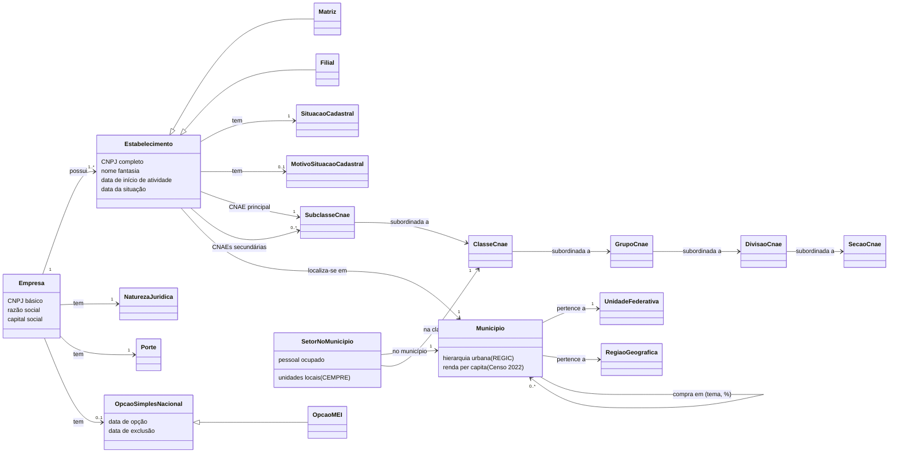

# Ontologia dos conceitos (OWL)

> **Para quem:** quem mantém a camada semântica ou liga um conceito de negócio a modelos, colunas e métricas ·
> **Quando ler:** ao acrescentar ou mudar um conceito, uma entidade ou uma métrica, ou para achar onde um conceito
> está no projeto.

Os conceitos em si (o que é empresa, estabelecimento, situação cadastral, MEI…) estão em
[conceitos de negócio](../../conceitos.md). Esta página é a referência técnica de como eles estão formalizados e
ligados ao projeto. Até a v1.4 ela era a §4 dos conceitos ([reorganização da v1.5.0](../../historico/reorganizacao-v1.5.0.md)).

## Diagrama e cobertura

A ontologia formal está em [`rfb_cnpj.ttl`](rfb_cnpj.ttl) (OWL, Turtle). Ela define os
conceitos e as relações e anota em cada conceito a entidade semântica, as dimensões, as métricas, os modelos e as
colunas do projeto. O teste `tests/integration/test_ontologia.py` confere a cobertura nos dois sentidos: todo nome
anotado existe nos manifestos do dbt, e toda entidade semântica e toda métrica está mapeada.

Os conceitos analíticos do projeto (fotografia mensal, abertura, encerramento, baixa e coorte) estão na ontologia,
mas fora do diagrama: são regras do projeto, não conceitos da RFB. A hierarquia urbana, a relação "compra em" e o
setor no município vêm do IBGE (incremento `enriquecimento_ibge`). O teste também confere a **afinidade**: cada
métrica fica num conceito que anota o modelo semântico dela (pela entidade, pelo modelo, pela coluna ou pela
dimensão).

## Onde cada conceito está no projeto

Colunas no formato modelo.coluna.

| Conceito | Staging | Estrela | Semântica (entidade / dimensão) | Métricas |
|---|---|---|---|---|
| Empresa | `stg_rfb__empresas.cnpj_raiz` | — (atributos copiados em `fct_estabelecimentos`) | — (sem entidade) | `qtd_matrizes` |
| Estabelecimento | `stg_rfb__estabelecimentos.cnpj_completo` | `fct_estabelecimentos.cnpj_completo` | `estabelecimento` | `qtd_estabelecimentos` |
| Matriz / filial | `stg_rfb__estabelecimentos.matriz_filial_codigo` | `fct_estabelecimentos.eh_matriz` | `estabelecimento__eh_matriz` | `qtd_matrizes` |
| Razão social | `stg_rfb__empresas.razao_social` | — | — | — |
| Nome fantasia | `stg_rfb__estabelecimentos.nome_fantasia` | — | — | — |
| Natureza jurídica | `stg_rfb__empresas.natureza_juridica_codigo` | `dim_natureza_juridica` | `natureza_juridica` / `natureza_juridica__descricao_natureza_juridica`, `natureza_juridica__codigo_natureza_juridica` | via `aberturas`, `encerramentos` |
| Capital social | `stg_rfb__empresas.capital_social` | `fct_estabelecimentos.capital_social` | — | `capital_social_total`, `capital_social_medio` |
| Porte | `stg_rfb__empresas.porte_codigo` | `dim_porte` | `porte` / `porte__rotulo_porte`, `porte__codigo_porte` | todas, como recorte |
| Simples Nacional | `stg_rfb__simples.opcao_simples` | `fct_estabelecimentos.opcao_simples` | `estabelecimento__opcao_simples` | — |
| MEI | `stg_rfb__simples.opcao_mei` | `fct_estabelecimentos.opcao_mei`, `fct_resumo_mensal.opcao_mei` | `resumo_mensal__opcao_mei`, `estabelecimento__opcao_mei` | `qtd_ativos_mei`, `pct_mei_entre_ativos` |
| Situação cadastral | `stg_rfb__estabelecimentos.situacao_codigo` | `dim_situacao_cadastral`, `fct_estabelecimentos.eh_ativa` | `situacao_cadastral` / `situacao_cadastral__rotulo_situacao_cadastral`, `estabelecimento__eh_ativa` | `qtd_ativos`, `pct_ativos` |
| Data da situação | `stg_rfb__estabelecimentos.dat_situacao` | `fct_estabelecimentos.sk_data_situacao` | `estabelecimento__data_situacao` | `encerramentos`, `baixas` |
| Motivo da situação | `stg_rfb__estabelecimentos.motivo_situacao_codigo` | — | — | — |
| Situação especial | `stg_rfb__estabelecimentos.situacao_especial` | — | — | — |
| Início de atividade | `stg_rfb__estabelecimentos.dat_inicio_atividade` | `fct_estabelecimentos.sk_data_inicio_atividade`, `fct_estabelecimentos.idade_anos` | `estabelecimento__data_inicio_atividade` | `aberturas`, `idade_media_anos`, `soma_idade_anos_ativos` |
| CNAE principal | `stg_rfb__estabelecimentos.cnae_principal` | `dim_cnae`, `fct_estabelecimentos.sk_cnae` | `cnae` / `cnae__codigo_subclasse` … `cnae__descricao_secao` | todas, como recorte |
| CNAEs secundárias | `stg_rfb__estabelecimentos.cnaes_secundarios_lista` | `bridge_estabelecimento_cnae_secundario` | — (fora da camada) | — |
| Município | `stg_rfb__estabelecimentos.municipio_rfb_codigo` | `dim_municipio` | `municipio` / `municipio__nome_municipio`, `municipio__sigla_uf`, `municipio__nome_regiao` … | todas, como recorte |
| Fotografia mensal | — | `fct_resumo_mensal` | `resumo_mensal` | `qtd_ativos_mes_anterior`, `variacao_mensal_ativos`, `variacao_mensal_ativos_pct` |
| Abertura / encerramento / baixa | — | `mart_dinamica_mercado` | `estabelecimento` | `aberturas`, `encerramentos`, `baixas`, `saldo_aberturas_encerramentos` |
| Coorte de abertura | — | `mart_sobrevivencia_coorte` | `coorte_sobrevivencia` | `elegiveis_3a`, `sobreviventes_3a`, `taxa_sobrevivencia_3a` (e 1a, 5a) |
| Hierarquia urbana (REGIC) | `stg_ibge__regic_hierarquia.codigo_hierarquia` | `dim_municipio.regic_hierarquia` | `municipio__regic_hierarquia`, `municipio__regic_hierarquia_codigo` | todas, como recorte |
| Compra em (destino de compras) | `stg_ibge__regic_ligacoes.pct_moveis_eletro` | `bridge_municipio_destino_compras`, `dim_municipio.id_municipio_polo_compras` | `municipio__nome_municipio_polo_compras`, `municipio__pct_compras_no_polo` | — |
| Renda per capita | `stg_ibge__renda_municipio.renda_per_capita_media` | `dim_municipio.renda_per_capita_media_2022` | `municipio__renda_per_capita_media_2022` | — |
| Setor no município (CEMPRE) | `stg_ibge__cempre_municipio_classe.unidades_locais` | `mart_emprego_setor_municipio` | `emprego_setor_municipio` | `unidades_locais_cempre`, `pessoal_ocupado_cempre`, `ativos_rfb` |
