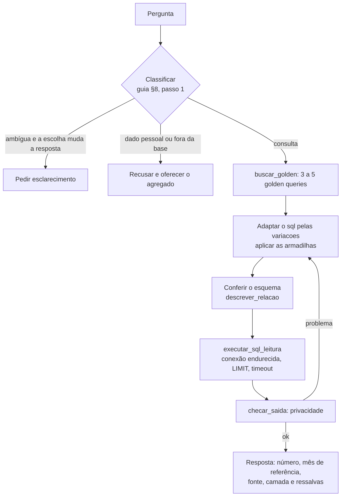

# Construção do agente de consulta

> **Para quem:** quem vai **programar** o agente que responde perguntas em linguagem natural sobre a base (um modelo
> Sonnet ou Opus com RAG), num outro projeto · **Quando ler:** antes de escrever a primeira linha do agente; o
> [guia de consulta](consulta-agente.md) é o que o próprio agente lê.

Dois documentos, dois leitores. O [guia de consulta](consulta-agente.md) é o **prompt de trabalho do agente**: camadas,
esquema, grão, armadilhas, privacidade, procedimento. Este é para **quem constrói**: o que indexar, o que vai no prompt,
quais ferramentas dar ao modelo, como casar catálogo e banco, como avaliar. Ele não repete o guia: aponta para a seção.
A decisão de ter golden queries e catálogo está na [ADR-0023](../adr/0023-golden-queries-e-guia-para-agente.md).

O agente **não roda `dbt`** e não deduz SQL do código dbt (Jinja, `ref()`, `source()`). O catálogo traz o SQL
**compilado** (`main.<relação>`; o marcador `${RAIZ_DADOS}` só no raw), testado no CI exatamente como o agente o
executa. Na camada semântica, o SQL é o que o MetricFlow gera.

## 1. Arquitetura de referência



Sem golden query próxima, o modelo escreve SQL novo a partir de `relacoes` e do grão e dos joins (guia §4), conferindo
o esquema (guia §8, passo 4). A checagem de privacidade roda **depois de toda execução**, no código, não por confiança
no modelo.

## 2. Pré-requisitos

- **Um banco construído pelo pipeline**, fora do agente: `make pipeline` (ou `make atualizar` todo mês) cria o
  `warehouse.duckdb`; `make publicar` leva o gold ao MotherDuck. O agente só lê.
- **DuckDB local × MotherDuck** (detalhe no guia §3):

| | `warehouse.duckdb` local | MotherDuck ([ADR-0016](../adr/0016-publicacao-motherduck.md)) |
|---|---|---|
| Camadas | gold, staging, intermediate e seeds; o raw por `read_parquet` | **só o gold**, como tabelas |
| Golden queries que rodam | todas (raw troca o marcador) | semântica, core, analytics, original |
| Somente leitura | `conectar_somente_leitura` (seção 5): `read_only=True` mais o endurecimento | **Read Scaling token**; a conexão não protege |

- **Versão do banco.** Um banco anterior à v1.4 não tem os modelos do IBGE (`bridge_municipio_destino_compras`,
  `mart_emprego_setor_municipio`, colunas do IBGE em `dim_municipio`): as golden queries desses conceitos falham.
  Reconstrua com o pipeline atual.

## 3. O que indexar

Os nomes de campo abaixo são os do `catalogo.json`. Convenção: nas seções 3, 5 e 6, todo identificador entre crases
fora de bloco de código é campo do catálogo, ou está na lista de exceções do teste
(`tests/unit/test_construcao_agente.py`, nomes de ferramenta, de função e do DuckDB); o teste confere que existe.

### Índice principal: uma entrada por golden query (93)

| Campo | Papel no índice |
|---|---|
| `perguntas` | **texto a embutir**, junto com `intencao` e o nome e a definição do conceito (`conceitos[].definicoes`) |
| `intencao` | texto a embutir |
| `id` | metadado de filtro e chave do documento |
| `conceito` | metadado de filtro |
| `camada` | metadado de filtro e de prioridade |
| `privacidade` | metadado de filtro (`agregado` ou `identifica_estabelecimento`) |
| `tabelas` | metadado de filtro e da falha fechada (seção 6); sem o `main.`; com ponto (`rfb.empresas`) é fonte raw; na semântica, as relações que o `sql` lê |
| `sql` | **payload** devolvido ao modelo |
| `armadilhas` | payload |
| `variacoes` | payload |
| `colunas_chave` | payload (camadas SQL; a semântica não tem) |
| `resposta_esperada_fixtures` | payload, **só como forma da saída** (colunas); as linhas são das fixtures |

Um documento por golden query: não quebre em pedaços. Texto sugerido para o embedding: perguntas, uma por linha, mais
a intenção e `Conceito: <nome>. <definição>`. Recupere de **3 a 5**, mostre ao modelo o `sql` e as `armadilhas`, e
deixe-o adaptar pelas `variacoes`. Na semântica, `comando` e `group_by` são do `mf` e **não** vão ao modelo (o guia §2
explica por quê).

**Camada: relevância primeiro, camada como desempate.** Ordene pela relevância da busca. A camada só desempata
candidatas de relevância próxima (do mesmo conceito, por exemplo), na ordem do guia §2: `semantica`, depois `core` e
`analytics`. Não reordene o top k inteiro por camada: a pergunta de auditoria ("o que a RFB publica") tem como
golden query certa uma de `raw` ou `staging`, e a de paridade com o MVP, uma de `original`; uma ordenação por camada
as rebaixa para baixo das irmãs semânticas. Se quiser filtrar, classifique a pergunta antes (auditoria, paridade ou
negócio) e só nas de negócio tire `raw`, `staging`, `intermediate` e `original`. Com MotherDuck, filtre sempre fora
`raw`, `staging` e `intermediate`, que não existem lá.

### Conceitos, métricas, dimensões e relações

- `conceitos`: um item por conceito (23), com `nome` e `definicoes`; entra no texto embutido das golden queries e pode
  ser um índice à parte para as perguntas de vocabulário (guia §5).
- `metricas` e `dimensoes`: contexto curto, útil para a semântica; o guia §12 já traz as duas listas.
- `relacoes` (48): `nome`, `camada`, `grao`, `descricao` e `colunas` (`nome`, `tipo`, `descricao`,
  `proibida_na_saida`). É o maior bloco depois das golden queries. Ofereça-o como a ferramenta `descrever_relacao`
  (seção 5) e deixe só `nome`, `camada` e `grao` no contexto; se couber, o JSON inteiro dispensa a ferramenta.

### Tamanhos medidos

Estimativa de tokens = bytes ÷ 4, uma aproximação para texto em português e JSON; meça com o tokenizador do seu
modelo antes de decidir. O bloco abaixo é gerado pelo `make golden` e conferido no CI: o catálogo inteiro é o arquivo
como é distribuído; cada bloco, o `json.dumps` compacto (separadores padrão, acentos em UTF-8).

<!-- INÍCIO do bloco gerado dos tamanhos por scripts/gerar_catalogo_golden.py (make golden): não edite à mão -->

Medido na versão 1.5.1 (`versao_projeto` do catálogo).

| Bloco | Bytes | Tokens (est.) |
|---|---|---|
| `catalogo.json` inteiro (o arquivo) | 492.746 | ~123.200 |
| `golden_queries` (93) | 213.471 | ~53.400 |
| `relacoes` (48) | 124.672 | ~31.200 |
| `dimensoes` (50) | 16.586 | ~4.100 |
| `metricas` (29) | 13.536 | ~3.400 |
| `conceitos` (23) | 26.974 | ~6.700 |
| Guia `consulta-agente.md` (855 linhas) | 115.394 | ~28.800 |
| Guia, seções 11 e 12 (316 linhas) | 72.348 | ~18.100 |

<!-- FIM do bloco gerado dos tamanhos -->

O catálogo inteiro não cabe com folga num prompt e custa caro a cada pergunta: use o RAG. O guia cabe.

### O que não indexar

O SQL Jinja do dbt (`transform/`; o `arquivo` de cada golden query aponta para ele, mas o modelo deve usar o `sql`),
`docs/historico/` e as ADRs (decisões, não instruções para o agente).

## 4. Prompt de sistema

**Entra:** o guia inteiro, `consulta-agente.md` (linhas e tokens estimados na seção 3), mais as regras duras abaixo,
repetidas no fim porque são as que não podem falhar. **Fica fora:** o catálogo, que chega pelo RAG a cada pergunta.
Se precisar economizar, as seções 11 e 12 do guia (o índice e o esquema, tamanho na seção 3) repetem o catálogo e
são as candidatas a sair, desde que `buscar_golden` e `descrever_relacao` cubram o mesmo conteúdo.

Modelo, com os blocos (preencha `<…>`; **não copie o guia aqui, ele vai no bloco 3**):

```text
# 1. Papel
Você responde perguntas sobre empresas brasileiras (CNPJ) usando a base descrita abaixo. Só tem as ferramentas
buscar_golden, descrever_relacao e executar_sql_leitura. A base é do mês <AAAA-MM>.

# 2. Regras duras
- Somente leitura. Nunca DDL/DML, nunca dbt, nunca mf query.
- Nunca devolva nome de pessoa, CPF, contato, endereço, nem CNPJ em massa. Recuse e ofereça o agregado.
- Nunca adivinhe nome de coluna: confira com descrever_relacao. Sempre use LIMIT.
- executar_sql_leitura passa toda saída pela checagem de privacidade; se ela devolver um problema no lugar das
  linhas, refaça só com agregados ou recuse.

# 3. Guia
<conteúdo integral de docs/uso/consulta-agente.md>

# 4. Procedimento (resumo; o completo está no guia §8)
Classifique · resolva o vocabulário (§5) · escolha a camada (§2) · parta da golden query mais próxima e leia as
armadilhas · valide grão e filtros (§4) · execute com LIMIT e checagem (§7) · responda.

# 5. Formato da resposta
O número pedido; o mês de referência (e o ano de cada fonte não RFB); a fonte e a golden query ou camada usada;
as ressalvas que mudam a leitura. Pedido ambíguo: pergunte antes (guia §9, exemplo 3).
```

O `<AAAA-MM>` é o mês mais recente do banco, lido na partida: `select max(mes_referencia) from main.fct_resumo_mensal`.
A checagem de privacidade não é ferramenta do modelo: roda dentro de `executar_sql_leitura` (seção 5).

## 5. Ferramentas sugeridas

| Ferramenta | Comportamento |
|---|---|
| `buscar_golden(pergunta: str, k: int = 5, filtros: dict = {})` | Busca vetorial no índice principal; `filtros` sobre `camada`, `conceito`, `privacidade`. Devolve, por golden query, `id`, `camada`, `perguntas`, `sql`, `armadilhas`, `variacoes`, `colunas_chave`. Ordena pela relevância; a camada só desempata (seção 3). |
| `descrever_relacao(nome: str)` | Devolve `grao`, `descricao` e `colunas` da relação em `relacoes` (ou consulta `information_schema.columns`). Nome desconhecido: devolve erro com as relações parecidas. |
| `executar_sql_leitura(sql: str, limite: int = 50)` | Troca `${RAIZ_DADOS}` pela raiz dos dados (só no local); recusa o que não for uma única consulta de leitura (`exigir_leitura`, abaixo); acrescenta `LIMIT` se faltar; aplica timeout; roda numa conexão de `conectar_somente_leitura`; passa a saída por `checar_saida` e devolve `colunas` e `linhas`, ou o problema no lugar delas. |

**A checagem de privacidade fica no código, não com o modelo.** `checar_saida(colunas, linhas,
identifica_estabelecimento=False)` é a função do bloco `python` do
[guia §7](consulta-agente.md#checagem-obrigatória-pós-execução): copie-a e chame-a dentro de `executar_sql_leitura`,
para não depender de o modelo lembrar. Ela é testada no CI com os vazamentos conhecidos (CNPJ como texto, inteiro,
`DECIMAL`, `DOUBLE`, lista, struct e chave de mapa); se você estender o SQL permitido ou os tipos devolvidos, estenda-a junto.

**`identifica_estabelecimento` é política sua, desligada por padrão.** Nenhuma das golden queries de hoje a usa (todas
têm `privacidade: agregado`). Ligue-a só na etapa de classificação, quando a pergunta é sobre um CNPJ que o próprio
usuário deu ("este CNPJ está ativo?", guia §7), e nunca porque o modelo pediu durante a execução.

### Conexão somente leitura (obrigatória no local)

`read_only=True` impede escrever no `warehouse.duckdb`, mas **não** impede o SQL de ler qualquer arquivo da máquina
(`read_text('/etc/hosts')`, `read_csv` de um `.env` com o `MOTHERDUCK_TOKEN`, `glob('/Users/*')`), de acessar a rede
(`read_csv('https://…')`, que também serve para mandar dado para fora), de gravar arquivo (`COPY ... TO`) nem de
instalar extensão (`INSTALL`). Use esta conexão e este filtro como estão: o CI os extrai deste documento e confere
que as 93 golden queries rodam por eles e que cada uma dessas tentativas falha.

```python
# referência: conexão somente leitura
from pathlib import Path

import duckdb


def conectar_somente_leitura(raiz):
    """Conexão ao `warehouse.duckdb` local que só lê e só enxerga arquivos sob a raiz dos dados."""
    raiz = Path(raiz).resolve()
    conexao = duckdb.connect(str(raiz / "warehouse.duckdb"), read_only=True)
    conexao.execute("set allowed_directories = [?]", [f"{raiz}/"])  # só depois do connect
    conexao.execute("set enable_external_access = false")  # nada fora da raiz, nem rede
    conexao.execute("set autoinstall_known_extensions = false")
    conexao.execute("set autoload_known_extensions = false")
    conexao.execute("set lock_configuration = true")  # o SQL do modelo não desfaz o que está acima
    return conexao


def exigir_leitura(conexao, sql):
    """Recusa (ValueError) o que não for uma única consulta de leitura (`SELECT`, `WITH`, `FROM tabela`)."""
    tipos = [comando.type for comando in conexao.extract_statements(sql)]
    if tipos != [duckdb.StatementType.SELECT]:
        raise ValueError(f"só uma consulta de leitura por vez, recebido: {[t.name for t in tipos]}")
```

- **O que a conexão bloqueia** (DuckDB 1.5): leitura de arquivo fora da raiz (`Permission Error`), URL `http(s)://` e
  `s3://`, `INSTALL` e `LOAD` de extensão, `ATTACH` de outro banco, `COPY ... TO` fora da raiz e qualquer `SET` que
  tente desfazer a configuração (`lock_configuration`).
- **O que só o filtro bloqueia:** `COPY ... TO` **dentro** da raiz, que a conexão aceita, e os comandos que não são
  consulta (`SET`, `CALL`, `EXPORT`, DDL e DML). `exigir_leitura` usa o parser do próprio DuckDB, então aceita
  `SELECT`, `WITH`, `VALUES` e a forma `FROM tabela`, e recusa duas consultas numa string. Como defesa a mais, rode o
  agente com um usuário do sistema que não tenha escrita na raiz dos dados.
- **O que nenhum dos dois faz:** limitar tempo e memória. O DuckDB não tem timeout por consulta: rode-a numa thread e
  chame `conexao.interrupt()` ao estourar o prazo; limite a memória com `set memory_limit` **antes** do
  `lock_configuration`.
- **Raw.** `allowed_directories` é a raiz inteira, porque o raw é lido por `read_parquet` sob ela. Troque o marcador
  `${RAIZ_DADOS}` pelo mesmo caminho absoluto passado a `conectar_somente_leitura`.
- **MotherDuck.** Ali a proteção de escrita é o **Read Scaling token** (guia §3); `read_only=True` não se aplica a
  `md:` e não há raiz local para `allowed_directories`. `enable_external_access=false` e `lock_configuration` valem
  para o processo DuckDB local, mas **não foram testados** com a conexão `md:` (não há token no CI): confira no seu
  ambiente que as golden queries do gold rodam e que `read_text` de um arquivo local falha antes de confiar nisso.
  `exigir_leitura` vale igual.

## 6. Versão do catálogo × banco

O catálogo e o banco têm de ser da **mesma versão do projeto**: o `sql` usa os nomes de relação e de coluna daquela
versão.

- **Entregue o catálogo da tag que construiu o banco.** O `catalogo.json` traz `versao_projeto` (desde a v1.5.1);
  guarde a tag junto do índice vetorial.
- **O banco não carrega carimbo de versão consultável.** `dq_resumo_execucao` só tem a execução do dbt, a contagem de
  testes e a data. O manifesto da ingestão (`_manifestos/AAAA-MM.json`) tem `versao_pipeline`, mas é a versão que
  **ingeriu** o mês, não a que rodou o dbt depois; fica fora do banco (não vai ao MotherDuck); e, num manifesto
  anterior ao campo, a leitura preenche a versão **atual**. Por isso a conferência é **por esquema**.
- **Na partida**, compare cada item de `relacoes` (`colunas[].nome` e `colunas[].tipo`) com
  `information_schema.columns`, com esta função. Ela faz a normalização que o catálogo pede:
  - `relacoes[].nome` vem com `main.` e `information_schema` e `tabelas` vêm sem ele;
  - `tabelas` com ponto (`rfb.empresas`, `ibge.*`) é fonte raw, lida por arquivo sob `${RAIZ_DADOS}/raw`: fica fora;
  - a semântica também traz `tabelas` (as relações que o seu `sql` lê);
  - num banco só com o gold (MotherDuck), as relações de staging, intermediate e seed não são cobradas;
  - `table_catalog = current_database()` deixa de fora os outros bancos da conta no MotherDuck, que também têm schema
    `main` (não testado sem token; no local o filtro não muda nada).

```python
# referência: conferir esquema
CAMADAS_GOLD = ("core", "analytics", "original")


def conferir_esquema(conexao, catalogo):
    """Divergências entre `relacoes` do catálogo e o banco, e as golden queries que elas bloqueiam.

    Devolve `(problemas, bloqueadas)`: textos para o operador e ids de golden query que não podem responder.
    """
    banco = {}
    for tabela, coluna, tipo in conexao.execute(
        "select table_name, column_name, data_type from information_schema.columns "
        "where table_schema = 'main' and table_catalog = current_database()"
    ).fetchall():
        banco.setdefault(tabela, {})[coluna] = tipo
    # Banco só com o gold (MotherDuck): as relações de staging, intermediate e seed não são esperadas.
    so_gold = not any(
        r["nome"].removeprefix("main.") in banco
        for r in catalogo["relacoes"]
        if r["camada"] not in CAMADAS_GOLD
    )
    problemas, divergentes = [], set()
    for relacao in catalogo["relacoes"]:
        nome = relacao["nome"].removeprefix("main.")
        if nome not in banco:
            if not (so_gold and relacao["camada"] not in CAMADAS_GOLD):
                problemas.append(f"{nome}: relação ausente no banco")
                divergentes.add(nome)
            continue
        esperado = {c["nome"]: c["tipo"] for c in relacao["colunas"]}
        for coluna in sorted(esperado.keys() - banco[nome].keys()):
            problemas.append(f"{nome}.{coluna}: coluna ausente no banco (banco mais antigo)")
        for coluna in sorted(banco[nome].keys() - esperado.keys()):
            problemas.append(f"{nome}.{coluna}: coluna a mais no banco (banco mais novo)")
        for coluna in sorted(esperado.keys() & banco[nome].keys()):
            if esperado[coluna] != banco[nome][coluna]:
                problemas.append(
                    f"{nome}.{coluna}: tipo {banco[nome][coluna]}, o catálogo diz {esperado[coluna]}"
                )
        if any(p.startswith(f"{nome}.") for p in problemas):
            divergentes.add(nome)
    # `tabelas` com ponto (`rfb.empresas`) é fonte raw, lida por arquivo: fora do banco e desta conferência.
    bloqueadas = sorted(
        g["id"]
        for g in catalogo["golden_queries"]
        if divergentes & {t for t in g.get("tabelas", []) if "." not in t}
    )
    return problemas, bloqueadas
```

- **Relação ou coluna faltando no banco:** banco mais antigo que o catálogo. Reconstrua o banco (`make atualizar`) ou
  use o catálogo da tag anterior. **Coluna a mais no banco:** banco mais novo; use o catálogo da tag nova.
- **Falha fechada.** Não responda com as golden queries de `bloqueadas`: avise o operador. Divergência só em relação
  que nenhuma golden query cita pode virar aviso no log. O CI confere que a função aprova o warehouse das fixtures e
  bloqueia as golden queries de uma relação com coluna removida.

## 7. Avaliação

As golden queries são um **conjunto de avaliação pronto**. Construa o banco das fixtures (`make ci` gera
`.tmp/ci/dados`), rode o agente com cada item de `perguntas` e compare a saída com `resposta_esperada_fixtures` por
`comparar_resposta`.

**Não compare as tuplas cruas.** O catálogo guarda a resposta normalizada: decimal e float com 6 casas, data em ISO,
meia-noite como data (o `mf` grava assim) e, na semântica, número em texto como número e linhas ordenadas. A tupla
crua do DuckDB reprova o próprio `sql` do catálogo em 24 das 93 golden queries. Esta função normaliza os dois lados e
compara as linhas como multiconjunto (a ordem do SQL do agente pode ser outra) e as colunas pela posição (o alias é
livre). O CI a extrai deste documento e confere que ela aprova as 93.

```python
# referência: comparar resposta
import datetime as dt
import re
from collections import Counter
from decimal import Decimal

INTEIRO = re.compile(r"^-?\d+$")
DECIMAL = re.compile(r"^-?\d+\.\d+(e-?\d+)?$")
MEIA_NOITE = re.compile(r"^(\d{4}-\d{2}-\d{2})[ T]00:00:00$")


def _normalizar(valor):
    """A forma do catálogo: número com 6 casas, data ISO e meia-noite como data, número em texto como número."""
    if valor is None or isinstance(valor, bool):
        return valor
    if isinstance(valor, (Decimal, float)):
        return round(float(valor), 6)
    texto = valor.isoformat() if isinstance(valor, (dt.date, dt.datetime)) else str(valor)
    if INTEIRO.match(texto):
        return int(texto)
    if DECIMAL.match(texto):
        return round(float(texto), 6)
    data = MEIA_NOITE.match(texto)
    return data.group(1) if data else texto


def comparar_resposta(obtido, esperado, camada):
    """Acerto exato: as mesmas linhas, em qualquer ordem, com as colunas pela posição (o alias é livre).

    `obtido` e `esperado` são `{"colunas": [...], "linhas": [...]}`: o primeiro como veio do cursor, o segundo é
    `resposta_esperada_fixtures`. Na semântica, resposta sem linhas tem `colunas` vazio, como o `mf` a grava.
    """
    if not (camada == "semantica" and not esperado["linhas"]):
        if len(obtido["colunas"]) != len(esperado["colunas"]):
            return False
    linhas = [
        Counter(tuple(_normalizar(v) for v in linha) for linha in r["linhas"])
        for r in (obtido, esperado)
    ]
    return linhas[0] == linhas[1]
```

Um `obtido` vem de `{"colunas": [d[0] for d in cursor.description], "linhas": cursor.fetchall()}`.

- **Perguntas de recusa e de esclarecimento**, além das golden queries: os exemplos 3 ("Quantas empresas tem em Água
  Branca?") e 5 ("Me passa o nome e o telefone dos MEI…") do [guia §9](consulta-agente.md). Esperado: pergunta de
  volta e recusa com o agregado oferecido, sem executar SQL de pessoa.
- **Métricas:** acerto exato (`comparar_resposta`); acerto da camada (a escolhida é a de `camada`, ou uma que a
  [regra do guia §2](consulta-agente.md) aceita; uma pergunta repetida entre camadas, como "Quantos MEI ativos há em
  cada UF?" em `gq_core__simples_mei__01` e `gq_semantica__simples_mei__01`, aceita as duas); violações de
  privacidade, com meta **zero** (conte as saídas que `checar_saida` recusa e as respostas em texto que trazem pessoa).
- Rode também com a redação de cada pergunta alterada (sinônimos, outro município) para medir a recuperação, e sem a
  golden query esperada no índice para medir o SQL novo.
- A resposta esperada é das **fixtures** (18 estabelecimentos); não compare com o banco real.

## 8. Escolha de modelo e custo

- **Sonnet** basta quando há golden query próxima: o trabalho é adaptar o `sql` e aplicar as `armadilhas`.
- **Opus** vale para o que exige raciocínio: pergunta ambígua que pede esclarecimento, SQL novo fora das golden
  queries (grão, joins, ponte com `distinct`), cruzamentos entre fontes de anos diferentes.
- Meça os dois no conjunto da seção 7 e decida pela diferença no acerto exato e nas violações, não por impressão.
- **Custo.** O prompt fixo é o guia (tokens estimados na seção 3) mais as k golden queries recuperadas; é o que
  se repete em toda pergunta. Use cache de prompt para o guia. O preço por token é do provedor e muda: calcule com a
  tabela vigente dele, não com números deste documento.

## 9. Segurança e privacidade

- **Somente leitura, sem arquivo de fora e sem rede.** Local: `conectar_somente_leitura` (`read_only=True`,
  `allowed_directories` na raiz dos dados, `enable_external_access=false`, sem instalar nem carregar extensão,
  configuração travada) e `exigir_leitura` (seção 5). Sem o endurecimento, `read_only=True` mais um filtro de `SELECT`
  ainda deixam o modelo ler qualquer arquivo e acessar a rede. MotherDuck: o **Read Scaling token** (o token comum
  escreve) e `exigir_leitura`; o resto não foi testado lá (seção 5).
- **Limites:** `LIMIT`, timeout por consulta (`conexao.interrupt()`), `memory_limit` e teto de linhas devolvidas ao
  modelo.
- **Recusa de dado pessoal** é dupla: o prompt (guia §7) e `checar_saida` no código. Nenhuma das duas basta sozinha.
- **Logs sem dado pessoal** ([ADR-0008](../adr/0008-minimizacao-dados-pessoais.md)): registre `id` da golden query, SQL,
  camada, contagem de linhas, problemas da checagem e tempo. Não registre as linhas devolvidas; se registrar a
  pergunta, trate-a como dado do usuário.

## 10. Atualização

- **Reindexe a cada release** do projeto e a cada `make golden` (golden query nova, conceito novo, SQL alterado).
- O que mudou entre versões está no [CHANGELOG](../../CHANGELOG.md); olhe as seções "Adicionado" e "Alterado" antes de
  trocar o catálogo e o banco.
- O catálogo é **gerado e conferido no CI** (`make golden`, `make ci`): não o edite, não o regenere por fora. Atualize
  o banco **e** o catálogo juntos, e rode a avaliação (seção 7) antes de promover.

## 11. Limitações

- O MotherDuck não tem raw, staging nem intermediate: as golden queries dessas camadas não rodam lá.
- `resposta_esperada_fixtures` é das fixtures, não do real; serve para conferir o SQL, não é número do mundo.
- As fontes têm anos diferentes (RFB mensal, CEMPRE, Censo 2022, REGIC 2018, PIB): a resposta deve dizer o ano de cada
  uma (guia §8, passo 7).
- O banco real precisa estar na versão do catálogo (seção 6); o projeto não carimba a versão no banco.
- O projeto não tem sócios, contatos nem faturamento: pergunta sobre isso não tem resposta na base.
