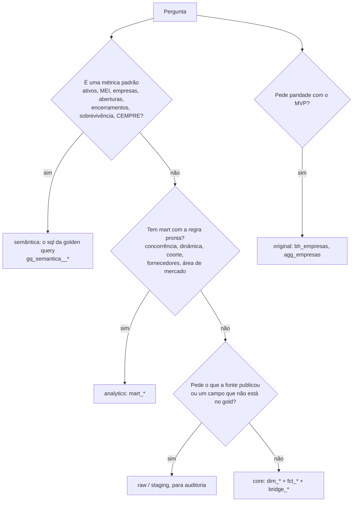
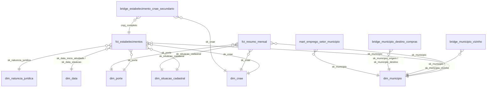

# Guia de consulta em linguagem natural

> **Para quem:** um agente (LLM) que responde perguntas livres sobre a base, e quem o configura · **Quando ler:**
> é o prompt de trabalho do agente, junto com o catálogo; pessoas leem os [conceitos](../conceitos.md) primeiro.

> **Adição** ([ADR-0023](../adr/0023-golden-queries-e-guia-para-agente.md)). Este guia é para um **agente** (LLM) que
> responde perguntas livres em português sobre a base de CNPJ do projeto. O agente recebe só três coisas:
> este guia, o catálogo [`golden_queries/catalogo.json`](../referencia/golden_queries/catalogo.json) e acesso **somente leitura**
> ao DuckDB local ou ao MotherDuck. Tudo o que ele precisa para escolher a tabela, montar o SQL, evitar as
> armadilhas do cadastro e respeitar a privacidade está aqui ou no catálogo. Pessoas também podem usá-lo; a
> explicação de negócio está em [conceitos](../conceitos.md), a das métricas na
> [camada semântica](../referencia/camada-semantica.md) e a de cada coluna no [dicionário](../referencia/dicionario-dados.md).

Convenções deste guia:

- **DEVE / NUNCA** são regras duras. "Prefira" é padrão que admite exceção explicada na resposta.
- `gq_<camada>__<conceito>__<nn>` é o id de uma golden query do catálogo: uma consulta testada no CI, com a resposta
  exata nas fixtures. Parta sempre da golden query mais próxima.
- Todo bloco SQL dos exemplos começa com `-- exemplo: <id>`: o CI executa cada um nas fixtures, somente leitura, e
  confere que todo `gq_*` citado neste guia existe no catálogo.
- Os números de exemplo vêm das **fixtures do CI** (cenário sintético: 18 estabelecimentos, meses 2026-08 e
  2026-09), salvo onde está escrito **dado real**.
- **O que cada conceito significa** (empresa, estabelecimento, situação cadastral, porte, MEI, CNAE, fotografia
  mensal, abertura e encerramento, sobrevivência, CEMPRE, REGIC…) está no catálogo, em `conceitos[].definicoes`:
  a definição curta de cada conceito, a mesma das descrições dos modelos. Este guia não a repete; ele diz como
  traduzir a pergunta em tabela, coluna e SQL.

## 1. O que há na base

- **Receita Federal (RFB), dados abertos do CNPJ:** um extrato completo por mês (uma **fotografia** do cadastro, não
  um registro de eventos): empresas, estabelecimentos, Simples/MEI e os domínios (CNAE, município, natureza jurídica,
  motivo da situação).
- **Base dos Dados:** diretório de municípios (código RFB ↔ código IBGE, hierarquia geográfica, centroide), CNAE com
  a hierarquia, população, PIB e valor adicionado, Censo 2022, regiões metropolitanas e vizinhança.
- **IBGE direto da origem:** CEMPRE (unidades locais e pessoal ocupado por município × classe CNAE), renda per capita
  do Censo 2022 e REGIC 2018 (hierarquia urbana e para onde os moradores vão comprar).

O projeto **não** tem sócios, contatos (e-mail, telefone) nem faturamento. Pergunta sobre isso não tem resposta na
base: diga isso.

## 2. Camadas e a regra de escolha

| Camada | O que é | Quando usar |
|---|---|---|
| **semântica** | métricas do MetricFlow, definidas uma vez; no catálogo, o **SQL que o MetricFlow gera** (campo `sql`) | **métrica de negócio padrão**: contagens de ativos, MEI, empresas, aberturas, encerramentos, sobrevivência, CEMPRE, por mês, UF, CNAE, porte, situação |
| **core** (gold) | modelo estrela: dimensões `dim_*`, fatos `fct_*`, pontes `bridge_*` | **pergunta ad hoc** que as métricas não cobrem: CNAE secundário, vizinhança, destinos de compra, natureza jurídica com o resumo, filtros e cruzamentos livres |
| **analytics** (gold) | marts `mart_*` com regra pronta | concorrência e densidade, dinâmica por CNAE × município, sobrevivência por coorte, fornecedores do caso, CEMPRE × RFB |
| **raw** | o Parquet como a fonte publicou (tudo texto) | **auditoria e linhagem**: "o que a RFB publicou", formato original, meses ingeridos |
| **staging** | o dado tipado do mês selecionado, sem as regras do modelo | auditoria; campos que não chegam ao gold (motivo da situação, datas de opção do Simples/MEI) |
| **intermediate** | junções entre staging e gold | linhagem: por que algo caiu no membro `-1` |
| **original** (gold) | `bh_empresas`, `agg_empresas`, do MVP | **só** paridade com o MVP. **NUNCA** para pergunta nova |



Se a semântica responde, **prefira-a**: a regra (fotografia mensal, capital só nas matrizes, ratios ponderados) já
está nela. Fora disso, prefira o gold (core e analytics). Raw e staging são para conferir a fonte, nunca para
responder uma pergunta de negócio.

**Como o agente usa a semântica (regra dura).** Execute o campo **`sql`** da golden query `gq_semantica__*`: é o SQL
que o MetricFlow gera para aquela consulta (`mf query --explain`), testado no CI numa conexão somente leitura. Ele só lê
`main.<relação>` e roda no DuckDB local e no MotherDuck, sem o repositório.

- **Adaptar.** O filtro aparece no SQL com o nome qualificado da dimensão como coluna
  (`where coorte_sobrevivencia__uf = 'ES' and cnae__codigo_subclasse = '4741500'`): troque o **valor** do filtro à
  vontade. Para outro agrupamento ou outro filtro de dimensão, escreva o SQL no gold a partir da definição da métrica
  (medida e filtro, na [lista de métricas](#12-métricas-dimensões-e-relações)) e da golden query de core ou analytics do
  mesmo conceito.
- **NUNCA rode `mf query`** no ambiente do agente. O comando (campo `comando`) é para quem tem o repositório: ele
  exige o projeto dbt e abre o `warehouse.duckdb` em modo de **escrita**, o que viola a seção 3 e bloqueia qualquer
  outra conexão ao arquivo.

## 3. Esquema físico consultável

### DuckDB local (`warehouse.duckdb`)

- Arquivo: `<RAIZ_DADOS>/warehouse.duckdb` (`RAIZ_DADOS` padrão: `dados/` na raiz do repositório). Schema `main`.
- Conexão **somente leitura**: em Python, `duckdb.connect("<RAIZ_DADOS>/warehouse.duckdb", read_only=True)`; na CLI,
  `duckdb -readonly <RAIZ_DADOS>/warehouse.duckdb`. **NUNCA** abra em modo de escrita, nem rode `dbt`, `CREATE`,
  `INSERT`, `UPDATE`, `DELETE`, `COPY ... TO` ou `ATTACH` de escrita.
- O gold (`dim_*`, `fct_*`, `bridge_*`, `mart_*`, `bh_empresas`, `agg_empresas`) são **views sobre Parquet** em
  `<RAIZ_DADOS>/gold/`. `fct_resumo_mensal` é uma view sobre **todas as partições** `gold/fct_resumo_mensal/
  mes_referencia=AAAA-MM/`: é a única relação com a série de meses.
- Staging (`stg_*`) são views; intermediate (`int_*`) e os seeds (`dominio_*`, `excecoes_conhecidas_municipio`) são
  tabelas dentro do arquivo.
- **Raw não é relação do warehouse**: leia o Parquet direto, como faz o SQL das golden queries de raw:
  `read_parquet('<RAIZ_DADOS>/raw/rfb/<entidade>/mes_referencia=*/*.parquet', hive_partitioning=false)` (RFB, com
  `_mes_referencia` como coluna), `read_parquet('<RAIZ_DADOS>/raw/bd/<tabela>/*.parquet')` e
  `read_parquet('<RAIZ_DADOS>/raw/ibge/<tabela>/*.parquet')`.
- O SQL do catálogo usa `main.<relação>` e o marcador `${RAIZ_DADOS}`: troque o marcador pela raiz dos dados antes
  de executar.

### MotherDuck (opcional, [ADR-0016](../adr/0016-publicacao-motherduck.md))

- Só o **gold** é publicado: `"<banco>".main.<tabela>`, uma **tabela** (não view) por arquivo de `gold/`, inclusive
  `fct_resumo_mensal` com todas as partições (a coluna `mes_referencia` vem da partição). Não há raw, staging,
  intermediate nem seeds: as golden queries dessas camadas não rodam lá.
- **Somente leitura vem do token, não da conexão.** Crie na interface do MotherDuck um **Read Scaling token**
  ([doc oficial](https://motherduck.com/docs/key-tasks/authenticating-and-connecting-to-motherduck/read-scaling/)):
  ele só permite leitura (`SELECT`) e recusa escrita, criação de banco e `ATTACH`/`DETACH`. O token comum do
  MotherDuck é de leitura **e escrita**: não o use. O `read_only=True` da seção acima **não** se aplica ao `md:`.
- Conecte com o token em `MOTHERDUCK_TOKEN` (ou `motherduck_token`,
  [autenticação](https://motherduck.com/docs/key-tasks/authenticating-and-connecting-to-motherduck/authenticating-to-motherduck/)):
  em Python, `duckdb.connect("md:<banco>")`; na CLI, `duckdb "md:<banco>"`. Numa sessão DuckDB já aberta, a forma é
  `ATTACH 'md:<banco>'; USE <banco>;`, mas com o Read Scaling token o banco precisa já estar no catálogo da conta
  (a publicação do projeto o deixa lá), porque o token não permite `ATTACH` de banco novo. Depois do `USE`, o SQL do
  catálogo roda como está (`main.<tabela>`). Só `SELECT`.
- O `sql` das golden queries semânticas roda no MotherDuck como no local: só lê `main.<tabela>` do gold. O
  `mf query` não roda lá (nem no ambiente do agente, seção 2).

### Target `ci` × dado real

| | CI (`make ci`, fixtures sintéticas) | Real (`make pipeline`) |
|---|---|---|
| `RAIZ_DADOS` | `.tmp/ci/dados` | `dados/` (ou `s3://…`) |
| Meses no raw e no resumo | 2026-08 e 2026-09 | os meses ingeridos (hoje 2026-09) |
| Volume | 18 estabelecimentos, 8 municípios | ~73 milhões de estabelecimentos, 5.570 municípios |
| IBGE | fixtures do IBGE | fontes reais do IBGE, a partir do gold da v1.4 (um warehouse da v1.3 não tem `bridge_municipio_destino_compras`, `mart_emprego_setor_municipio` nem as colunas do IBGE em `dim_municipio` até ser reconstruído) |

A resposta esperada de cada golden query no catálogo é a das **fixtures**: serve para conferir o SQL, não é número
do mundo real.

## 4. Grão das tabelas e caminhos de join

| Relação | Grão (uma linha por) | Chaves | Mês |
|---|---|---|---|
| `fct_estabelecimentos` | estabelecimento (`cnpj_completo`) | `sk_municipio`, `sk_cnae`, `sk_natureza_juridica`, `sk_porte`, `sk_situacao_cadastral`, `sk_data_inicio_atividade`, `sk_data_situacao` | só o mês corrente do gold |
| `fct_resumo_mensal` | mês × município × CNAE × porte × situação × MEI | `mes_referencia`, `sk_mes_referencia`, `sk_municipio`, `sk_cnae`, `sk_porte`, `sk_situacao_cadastral`, `opcao_mei` | **todos os meses** |
| `dim_municipio` | município IBGE (+ membro `-1`) | `sk_municipio` = código IBGE inteiro | — |
| `dim_cnae` | subclasse CNAE (+ `-1`) | `sk_cnae` = subclasse inteira | — |
| `dim_natureza_juridica`, `dim_porte`, `dim_situacao_cadastral` | código (+ `-1`) | `sk_*` | — |
| `dim_data` | dia de 1900-01-01 até a data de referência (+ `-1`, `-2`) | `sk_data` = AAAAMMDD | — |
| `bridge_estabelecimento_cnae_secundario` | estabelecimento × CNAE secundário | `cnpj_completo`, `sk_cnae`, `codigo_cnae_secundario` | corrente |
| `bridge_municipio_vizinho` | par de municípios vizinhos (simétrico) | `sk_municipio`, `sk_municipio_vizinho` | — |
| `bridge_municipio_destino_compras` | origem × destino × tema (REGIC 2018) | `sk_municipio_origem`, `sk_municipio_destino` (`-1` = "Outros") | — |
| `mart_concorrencia_municipio` | CNAE principal × município com estabelecimento | `sk_cnae`, `sk_municipio` | corrente |
| `mart_concorrencia_area_mercado` | CNAE × município (inclui vazios de mercado) | `sk_cnae`, `sk_municipio` | corrente |
| `mart_dinamica_mercado` | ano × CNAE × município com evento | `ano`, `sk_cnae`, `sk_municipio` | corrente |
| `mart_sobrevivencia_coorte` | coorte (ano de abertura) × CNAE × porte × UF | `ano_coorte`, `sk_cnae`, `sk_porte`, `uf` | corrente |
| `mart_fornecedores_proximos` | fornecedor (estabelecimento) do caso configurado | `cnpj_completo`, `sk_municipio` | corrente |
| `mart_emprego_setor_municipio` | município × classe CNAE (5 dígitos) | `sk_municipio`, `classe_cnae` | CEMPRE `ano_cempre`, RFB `mes_referencia_rfb` |
| `bh_empresas`, `agg_empresas` (original) | estabelecimento; agregado de 10 dimensões | — | corrente |



Regras de join:

- **Membros `-1` e `-2`.** Toda chave `sk_*` da fato tem par na dimensão: o que não tem par vai para `-1`
  ("NÃO INFORMADO"); data anterior a 1900 vai para `-2` ("DATA INVÁLIDA"). Use `inner join` com as dimensões sem
  medo de perder linhas, e lembre que `-1`/`-2` aparecem como valores nos agrupamentos. Em `dim_data`, `-1` e `-2` têm
  `ano` NULL: filtre `ano is not null` em contagem de eventos.
- **dim_data tem papel duplo:** junte por `sk_data_inicio_atividade` (abertura) **ou** por `sk_data_situacao` (data do
  último evento de situação), com aliases distintos.
- **Pontes são muitos-para-muitos:** depois de juntar uma ponte, conte `distinct cnpj_completo`.
- **Município pelo nome:** sempre com a UF. `dim_municipio.nome_municipio` tem acento ("Fundão"); os originais usam
  MAIÚSCULAS ("FUNDÃO") e o domínio da RFB, maiúsculas sem acento ("FUNDAO").
- `cnpj_raiz` não está na fato: é `left(cnpj_completo, 8)`.

## 5. Glossário: do vocabulário do usuário às colunas

Este glossário é a fonte única do mapeamento vocabulário → coluna. A definição de cada conceito está no catálogo
(`conceitos[].definicoes`); a explicação completa, para pessoas, em [conceitos](../conceitos.md).

| Termo do usuário | Tradução | Ambiguidade a resolver (pergunte ou declare a escolha) |
|---|---|---|
| empresa | matriz: `eh_matriz` (uma por CNPJ básico) ou `count(distinct left(cnpj_completo, 8))`; métrica `qtd_matrizes` | o usuário quer empresas ou estabelecimentos/lojas? "Quantas empresas de tinta" quase sempre quer estabelecimentos do CNAE. A golden query cuja pergunta diz "empresa" e que conta estabelecimentos traz a armadilha `Empresa × estabelecimento:`: leia-a e declare a escolha |
| estabelecimento, CNPJ, loja, unidade, filial | linha de `fct_estabelecimentos` (`cnpj_completo`); métricas `qtd_estabelecimentos`, `qtd_ativos` | "CNPJ" sozinho = estabelecimento; "filial" = `not eh_matriz` |
| empresa aberta, ativa, funcionando | `eh_ativa` (situação 2, ATIVA) | "aberta" pode ser **ativa hoje** ou **aberta no período** (`aberturas`). Ativa não prova que opera (IN 2.119, art. 9º) |
| abriu, nova empresa, abertura | `aberturas` (data de início de atividade) | qual período? o ano do extrato é parcial |
| fechou, encerrou, quebrou | `encerramentos` (todo não ativo pela data da situação) × `baixas` (só BAIXADA) | baixa é definitiva; inaptidão e suspensão são reversíveis e vêm em lotes. Pergunte ou mostre a quebra por situação |
| pequena empresa, micro, pequeno negócio | porte (`dim_porte.rotulo_porte`: `MICRO`, `PEQUENA`, `DEMAIS`; `descricao_porte` é o texto longo), Simples ou MEI | porte declarado × regime tributário; mostre a quebra (`gq_core__simples_mei__02`) |
| MEI, microempreendedor | `opcao_mei`; métricas `qtd_ativos_mei`, `pct_mei_entre_ativos` | nunca por natureza 2135 nem por porte |
| tipo de empresa, LTDA, S/A, empresário individual | natureza jurídica (`dim_natureza_juridica`) | — |
| setor, ramo, atividade, segmento | CNAE principal (`dim_cnae`) | qual nível: seção, divisão, grupo, classe, subclasse? Incluir quem tem a atividade como **secundária**? Ache o código pela descrição (`gq_core__cnae_principal__02`, que traz o volume de estabelecimentos e de ativos de cada subclasse). Quando houver mais de uma candidata, **mostre as candidatas com o volume e pergunte** qual vale (ou some as aceitas); nunca escolha só pelo nome. A atividade popular pode estar em fabricação (padaria = 1091102, não só 4721102), e a subclasse quase sem estabelecimento costuma ser obsoleta |
| cidade, município | `dim_municipio` (nome + `sigla_uf`) | homônimos: Água Branca existe em AL, PB e PI. Sem UF, pergunte |
| estado | `sigla_uf` | — |
| população, habitantes, tamanho da cidade, PIB, PIB per capita, perfil do município | `dim_municipio`: `populacao` (estimativa do `ano_populacao`), `populacao_censo_2022`, `pib` (R$, `ano_pib`), `domicilios_2022`, `area_km2`, `densidade_hab_km2`, indicadores do Censo (`gq_core__perfil_municipio__01`, `__02`) | duas populações (estimativa × Censo 2022): diga qual e o ano. PIB per capita não é coluna: `pib / populacao` mistura anos, então é aproximado. Município pelo nome **e** UF |
| região | grande região (`nome_regiao`), região metropolitana, intermediária, imediata, meso ou microrregião | pergunte qual, ou declare a escolha |
| região metropolitana, Grande X | `nome_regiao_metropolitana` | 'NÃO PERTENCE' = fora de RM |
| vizinho, ao redor, entorno | `bridge_municipio_vizinho` (fronteira) | fronteira × raio em km × fluxo de compra (REGIC) |
| quanta gente trabalha, empregos, funcionários | CEMPRE: `pessoal_ocupado_cempre` (`mart_emprego_setor_municipio`, total em `dim_municipio`) | ano do CEMPRE (2024) ≠ mês da RFB; sem MEI; sigilo vira NULL e a soma é um piso. A RFB não tem número de empregados |
| renda, poder de compra, quanto o pessoal ganha | `renda_per_capita_media_2022` / `_mediana_2022` | média × mediana; reais nominais de 2022. "Quanto ganha quem trabalha no setor X" é **salário** (linha abaixo), não renda do morador |
| salário, remuneração, quanto se paga, quanto ganha um empregado | CEMPRE (`mart_emprego_setor_municipio`): salário médio mensal ≈ `salarios_mil_reais * 1000 / pessoal_assalariado_cempre / 13` (mil reais no ano, 13 salários), `gq_analytics__cempre_setor__03` | ano do CEMPRE (2024), nominal; por classe (5 dígitos); sem MEI; do assalariado, não do pessoal ocupado. Sigilo: célula com salário NULL fica fora do numerador **e** do denominador; diga quantas ficaram fora |
| onde o pessoal compra, polo, para onde vão comprar | REGIC: `bridge_municipio_destino_compras`, `nome_municipio_polo_compras` | % entre destinos de fora; tema (móveis × vestuário); 2018 |
| concorrência, concorrentes | ativos do CNAE no município (`mart_concorrencia_municipio`), densidade por 10 mil hab. | "muita" exige um critério: ranking na UF, vizinhos, área de mercado |
| fornecedor | `mart_fornecedores_proximos` (só o caso configurado) ou CNAEs de fornecedor por município | qual CNAE fornece? qual raio? |
| capital, tamanho da empresa | `capital_social` (declarado, só matrizes) ou porte | capital ≠ faturamento |
| hoje, atual, agora | o mês mais recente do gold | diga o mês de referência na resposta |
| sobrevive, dura, quanto tempo fica aberta | `taxa_sobrevivencia_{1,3,5}a` | horizonte (1, 3 ou 5 anos) |
| idade da empresa | `idade_anos` (só ativos, relativa à data de referência) | idade do estabelecimento, não da empresa |
| economia do município | VA por atividade (`pct_va_*`, `ano_va`) | ano do VA |
| crescimento | variação mensal de ativos (fotografia) × saldo de aberturas e encerramentos | são medidas diferentes; diga qual usou |

## 6. Armadilhas

Cada armadilha tem um exemplo e a golden query que faz o certo.

1. **Fotografia mensal; não some meses.** Cada mês é o cadastro inteiro. Errado: `sum(qtd_ativos)` em
   `fct_resumo_mensal` sem filtrar o mês (nas fixtures daria 21; o certo para 2026-09 é 11). Certo:
   `gq_core__data_calendario__01`, `gq_semantica__empresa_estabelecimento__01`.
2. **`data_referencia` × `now()`.** Idade, prazo e "ano corrente" são relativos à data do extrato
   (`_data_referencia`, 2026-09-12 nas fixtures e no real), nunca à data de hoje. O último mês e o último ano são
   parciais. Certo: `gq_staging__data_calendario__01`.
3. **Só o mês corrente fora do resumo.** `fct_estabelecimentos`, os marts e os originais são do mês corrente do gold;
   série histórica só em `fct_resumo_mensal`.
4. **Capital social repetido.** O capital é da empresa e se repete em cada estabelecimento: some só as matrizes.
   Certo: `gq_core__capital_social__01`, `gq_semantica__capital_social__01`.
5. **Membros `-1`/`-2`.** "NÃO INFORMADO" e "DATA INVÁLIDA" são valores, não nulos; não os confunda com porte `N/A`
   (código 00). Certo: `gq_core__regras_qualidade__01`, `gq_core__porte__01`.
6. **Sigilo do CEMPRE.** Pessoal e salários com `X` ficam NULL e `tem_sigilo` true. **NUNCA** impute (zero, média,
   interpolação). Numa agregação (UF, várias classes ou municípios), a soma de pessoal é uma **subestimativa
   declarada**: diga "pelo menos N" e quantas células ficaram fora. `tem_sigilo` é da linha inteira (qualquer variável
   com `X`), e um salário pode vir NULL sem ele: numa razão (salário médio, pessoal por unidade), numerador e
   denominador vêm das **mesmas** células, as que têm os dois campos. Certo: `gq_analytics__cempre_setor__02`,
   `gq_analytics__cempre_setor__03`.
7. **CEMPRE sem MEI.** Compare `unidades_locais_cempre` com `ativos_rfb_sem_mei`, não com `ativos_rfb` (RN-30).
   Certo: `gq_analytics__cempre_setor__01`.
8. **Anos diferentes entre as fontes.** RFB: mês do extrato; CEMPRE: 31/12 do `ano_cempre` (2024); renda: Censo
   2022; REGIC: 2018; VA: `ano_va` (2021); PIB: `ano_pib` (2023). Cite o ano de cada número.
9. **VA até 2021.** As aberturas por atividade saem depois do PIB total. Certo: `gq_staging__valor_adicionado__01`,
   `gq_core__valor_adicionado__01`.
10. **% da REGIC.** O percentual divide os deslocamentos **entre os destinos de fora**: "45 % em Serra" não é 45 % de
    toda a compra de Fundão. Os 67 municípios mais centrais não têm polo. Certo: `gq_core__regic_polo_compras__01`.
11. **"Outros" na ponte de compras.** O destino "Outros" tem `sk_municipio_destino` = -1 e `eh_outros`; ele fecha a
    soma em ~100, nunca é polo e não é o município "NÃO INFORMADO". Certo: `gq_core__regic_polo_compras__01`.
12. **CNAE de 7 dígitos × classe de 5.** A RFB e `dim_cnae.codigo_subclasse` usam a subclasse (`4741500`); o CEMPRE e
    `mart_emprego_setor_municipio` usam a classe (`47415`, `dim_cnae.codigo_classe`). Certo:
    `gq_core__cnae_principal__02`, `gq_analytics__cempre_setor__01`.
13. **Ativos × inativos (regra do original).** Nos marts e nos originais, "inativo" é toda situação diferente de ATIVA
    (inclui inapta e suspensa). "Ativa" não quer dizer "em operação". Certo: `gq_core__situacao_cadastral__02`.
14. **Datas inválidas.** Data ausente vira `-1`, anterior a 1900 vira `-2`: não geram evento nem coorte. Certo:
    `gq_staging__regras_qualidade__01`, `gq_core__dinamica_mercado__01`.
15. **Limite do MetricFlow: `MAX(mes)` depois do filtro (RSEM-01).** Numa consulta por ano ou sem tempo, a métrica
    de fotografia usa o último mês **em que o recorte filtrado tem linhas**: com um filtro que esvazia o último mês, ela
    devolve uma fotografia velha em vez de zero. No `sql` gerado, isso é o `INNER JOIN` com `MAX(mes__month)`: ao
    trocar o filtro, mantenha o mês no agrupamento (`metric_time__month`) ou filtre o mês. Certo:
    `gq_semantica__situacao_cadastral__02`, `gq_semantica__situacao_cadastral__01`.
16. **MotherDuck × local.** No MotherDuck só existe o gold, como tabela; as golden queries de raw, staging e
    intermediate rodam só no local. O `sql` do gold e da semântica roda nos dois, com o nome `main.<tabela>`.
17. **CNAE secundário fora da semântica.** "Quem trabalha com X" pode incluir o secundário; só a ponte responde.
    Certo: `gq_core__cnae_secundario__01`.
18. **Duas populações e PIB per capita.** `dim_municipio.populacao` é a estimativa do `ano_populacao` (2025 no dado real);
    `populacao_censo_2022` é a contagem do Censo; a densidade é do Censo. O PIB per capita não é coluna, e
    `pib / populacao` divide o PIB de `ano_pib` pela população de outro ano: diga "aproximado" e os anos. Certo:
    `gq_core__perfil_municipio__01`; série da estimativa em `gq_staging__perfil_municipio__01`.
19. **Fornecedores parametrizados.** `mart_fornecedores_proximos` só vale para o caso das vars do build (Fundão/ES,
    CNAEs de tinta, 100 km). Outro município ou CNAE exige outra consulta. Certo: `gq_analytics__fornecedores_proximos__01`.
20. **Média de médias.** Coluna que já é média, taxa ou percentual (`media_idade` de `agg_empresas`, `pct_*`, `taxa_*`,
    `*_por_10k_hab`, renda per capita) não se reagrega com `avg`: pondere pelo tamanho de cada linha (`sum(media_idade *
    qtd_empresas) / sum(qtd_empresas) filter (where media_idade is not null)`) ou some numerador e denominador antes de
    dividir. Errado: `avg(media_idade)`, que pesa igual um estrato de 1 e um de 1000 estabelecimentos. Certo:
    `gq_original__porte__01`, `gq_core__renda__02`, `gq_analytics__sobrevivencia_coorte__01`.
21. **Falta de dado não é categoria.** Num `CASE` que escolhe a maior participação (`greatest`), cada ramo testa a sua
    categoria e não há `else '<categoria>'`: sem dado, nenhum ramo casa e sai NULL ("sem VA"), não "administração
    pública". Diga o empate e a regra de desempate. Certo: `gq_core__valor_adicionado__01`.

## 7. Privacidade (regra dura, [ADR-0008](../adr/0008-minimizacao-dados-pessoais.md))

- **NUNCA** devolva CPF, nome de empresário individual ou de MEI, nome de sócio, e-mail, telefone ou endereço
  (logradouro, número, complemento, bairro, CEP). A base não tem sócios nem contatos; o endereço só existe no staging
  e no raw e **não** deve ser lido.
- O nome no gold (`bh_empresas.nome`, `mart_fornecedores_proximos.nome`) já vem com o CPF mascarado, mas continua
  sendo o nome de uma pessoa quando a natureza é empresário individual (2135) ou a empresa é MEI. **Não** o devolva.
- **Agregados por padrão.** Responda com contagens, somas, médias e taxas por município, UF, CNAE, porte ou
  situação.
- **CNPJ só quando a pergunta pede um estabelecimento identificado** (ex.: "este CNPJ está ativo?"), e então só dado
  cadastral público: situação, CNAE, município, porte, data de início. Nunca liste CNPJs em massa (ex.: "todos os MEI
  de Fundão"). Nenhuma golden query devolve CNPJ (`privacidade: identifica_estabelecimento` é o marcador para quando
  uma precisar).
- Recuse e reformule pedidos de dado pessoal, oferecendo o agregado equivalente (exemplo 5, abaixo).
- **Colunas proibidas na saída** (as em negrito na seção 12): `nome`, `razao_social`, `nome_fantasia`, `cpf*`,
  `email`, `telefone*`, `ddd*`, `fax`, `logradouro`, `numero`, `complemento`, `bairro`, `cep`, `socio*` e, salvo
  estabelecimento identificado, `cnpj*` e `*_raiz` (CNPJ completo e básico). `nome_municipio`, `nome_uf` e os outros
  `nome_<lugar>` são permitidos.
- **Derivada também é proibida.** A regra vale para qualquer expressão que saia de uma coluna proibida, com qualquer
  alias: `min(nome) as titular`, `string_agg(nome, ', ')`, `left(cnpj_completo, 8) as raiz`,
  `max(cnpj_completo::bigint)`. Uma coluna proibida só pode aparecer dentro de `count(...)` /
  `count(distinct ...)`, num teste `is [not] null` ou em `where`/`join`.
- O CI garante isso nas golden queries: nenhuma coluna proibida na saída, nenhuma saída derivada de uma (pela
  linhagem do SQL), nenhum valor com cara de CPF ou CNPJ (em texto, mascarado ou como número).

### Checagem obrigatória pós-execução

Antes de responder, **DEVE** passar o resultado por esta função (ou por uma checagem equivalente): colunas da saída
e linhas como vieram do banco. Se ela devolver qualquer problema, **não** mostre o resultado: refaça o SQL só com
agregados ou recuse (exemplo 5). Ela não substitui a regra da derivada acima, porque um nome com alias e sem CPF
mascarado não tem cara de nada; as duas valem juntas.

```python
# checagem: privacidade
import re

COLUNA_PROIBIDA = re.compile(
    r"(^|_)(nome|razao_social|nome_fantasia|cpf|email|correio|telefone|tel|ddd|ddd_fax|fax|logradouro|"
    r"tipo_logradouro|numero|complemento|bairro|cep|socio|socios)\d*(_|$)"
)
COLUNA_CNPJ = re.compile(r"(^|_)(cnpj|raiz)(_|$)")
NOME_PERMITIDO = re.compile(
    r"^nome_(municipio|uf|regiao|mesorregiao|microrregiao|regiao_intermediaria|regiao_imediata|"
    r"regiao_metropolitana|municipio_polo_compras|municipio_vizinho|municipio_origem|municipio_destino|"
    r"mes|classe_cnae)$|^dia_semana_numero$"
)
CPF_MASCARADO = re.compile(r"\*{3}\.?[\d*]{3}\.?[\d*]{3}-?\*{2}")
OITO_DIGITOS = re.compile(r"\d{8,}")
DATA_ISO = re.compile(r"^\d{4}-\d{2}(-\d{2})?$")


def _dv_ok(digitos: str) -> bool:
    """CPF (11) ou CNPJ (14) com dígitos verificadores válidos (módulo 11)."""
    if len(set(digitos)) == 1:
        return False
    for posicao in (len(digitos) - 2, len(digitos) - 1):
        if len(digitos) == 11:
            pesos = range(posicao + 1, 1, -1)
        else:
            pesos = [*range(posicao - 7, 1, -1), *range(9, 1, -1)]
        resto = sum(int(d) * p for d, p in zip(digitos, pesos)) % 11
        if int(digitos[posicao]) != (0 if resto < 2 else 11 - resto):
            return False
    return True


def checar_saida(colunas, linhas, identifica_estabelecimento=False):
    """Problemas de privacidade (ADR-0008) num resultado; lista vazia = pode responder."""
    problemas = []
    for coluna in colunas:
        nome = coluna.lower().rsplit("__", 1)[-1]
        if COLUNA_PROIBIDA.search(nome) and not NOME_PERMITIDO.match(nome):
            problemas.append(f"coluna proibida: {coluna}")
        elif COLUNA_CNPJ.search(nome) and not identifica_estabelecimento:
            problemas.append(f"coluna de CNPJ: {coluna}")
    for linha in linhas:
        for valor in linha:
            if isinstance(valor, str) and CPF_MASCARADO.search(valor):
                problemas.append(f"nome de pessoa (CPF mascarado): {valor!r}")
            if identifica_estabelecimento:
                continue
            if isinstance(valor, str) and not DATA_ISO.match(valor):
                if OITO_DIGITOS.search(re.sub(r"(?<=\d)[./-](?=\d)", "", valor)):
                    problemas.append(f"texto com cara de CPF/CNPJ: {valor!r}")
            if isinstance(valor, int) and not isinstance(valor, bool):
                texto = str(abs(valor))
                if (12 <= len(texto) <= 14 and _dv_ok(texto.zfill(14))) or (
                    9 <= len(texto) <= 11 and _dv_ok(texto.zfill(11))
                ):
                    problemas.append(f"número com cara de CPF/CNPJ: {valor!r}")
    return problemas
```

## 8. Procedimento: da pergunta à resposta

1. **Classifique a pergunta:** métrica padrão (contagem, taxa, série) · ad hoc (cruzamento, filtro livre, ponte) ·
   auditoria ("o que a RFB publicou") · paridade com o MVP · fora da base (sócios, contatos, faturamento) · pedido de
   dado pessoal.
2. **Ache cada termo no glossário (seção 5)** e, se precisar do significado, a definição do conceito no catálogo
   (`conceitos[].definicoes`). Resolva as ambiguidades: se a escolha muda a resposta (empresa ×
   estabelecimento, baixa × inaptidão, município homônimo), **pergunte**; se não muda muito, escolha o padrão e
   **declare** a escolha na resposta.
3. **Escolha a camada (seção 2).**
4. **Parta da golden query mais próxima** no catálogo (`conceito`, `camada`, `perguntas`) e adapte o campo `sql`
   dela com as `variacoes`. Leia as `armadilhas` da golden query antes de mudar o SQL. Na semântica, as `variacoes`
   falam em `--group-by`/`--where` do `mf`: no `sql`, troque só o valor do filtro; o resto vira SQL no gold (seção 2).
   **Antes de escrever SQL novo** ou de usar uma coluna que a golden query não usa, confira que ela existe e o tipo:
   `describe main.<relação>` ou
   `select column_name, data_type from information_schema.columns where table_name = '<relação>'`. Os nomes das
   métricas, das dimensões (`<entidade>__<dimensão>`) e das colunas do gold estão na seção 12; os de staging e
   intermediate, em `relacoes` no catálogo. Nunca adivinhe um nome de coluna.
5. **Valide o grão e os filtros:** o que uma linha representa? conta estabelecimentos ou empresas? filtrou o mês (no
   resumo)? município com UF? CNAE no nível certo (7 × 5 dígitos)? `distinct` depois de ponte?
6. **Execute com `LIMIT`** (ex.: `LIMIT 50`) e faça as checagens: resultado vazio é zero ou filtro errado? totais
   plausíveis (o Brasil tem ~73 milhões de estabelecimentos, ~28 milhões ativos em 2026-09)? E **sempre** a
   [checagem pós-execução](#checagem-obrigatória-pós-execução) da seção 7.
7. **Responda** com o número e:
   - o **mês de referência** (e o ano de cada fonte não RFB);
   - a **fonte** (RFB, CEMPRE, Censo, REGIC) e a camada/golden query usada;
   - as **ressalvas** que mudam a leitura (ativa ≠ em operação, sigilo, ano parcial, % da REGIC).

## 9. Exemplos de ponta a ponta

### Exemplo 1 — "Quantas lojas de tinta tem em Fundão?"

- **Raciocínio.** "Loja" = estabelecimento; "tinta" = CNAE: `gq_core__cnae_principal__02` mostra três subclasses
  (fabricação 2071100, atacado 4679601, varejo 4741500); "loja" é varejo, **4741500**. "Tem" = ativas hoje.
  Fundão só existe no ES. Métrica padrão, mas o recorte por município e CNAE é direto no gold.
- **Golden query de partida:** `gq_core__empresa_estabelecimento__02` (ou `gq_semantica__concorrencia_densidade__01`).
- **SQL final:**

  ```sql
  -- exemplo: exemplo_1_lojas_tinta_fundao
  select count(*) filter (where fct.eh_ativa) as ativos, count(*) filter (where not fct.eh_ativa) as nao_ativos
  from main.fct_estabelecimentos as fct
  inner join main.dim_cnae as cnae on fct.sk_cnae = cnae.sk_cnae
  inner join main.dim_municipio as mun on fct.sk_municipio = mun.sk_municipio
  where cnae.codigo_subclasse = '4741500' and mun.nome_municipio = 'Fundão' and mun.sigla_uf = 'ES'
  limit 50;
  ```

- **Resposta (dado real, 2026-09):** "Em setembro de 2026 (extrato da RFB de 12/09), Fundão/ES não tem nenhuma loja
  de tintas (CNAE 4741-5/00) ativa; 5 estabelecimentos do CNAE constam como não ativos (baixados ou inaptos).
  Contei estabelecimentos pelo CNAE principal; quem vende tinta como atividade secundária não entra."

### Exemplo 2 — "Vale a pena abrir uma loja de tintas em Fundão?"

- **Raciocínio.** Juízo de valor: o agente não decide, mostra os fatos que pesam. Quatro consultas: concorrência
  local, área de mercado, polo de compras e renda.
- **Golden queries de partida:** `gq_analytics__concorrencia_densidade__01`, `gq_analytics__area_mercado_vizinhanca__01`,
  `gq_core__regic_polo_compras__01`, `gq_core__renda__01`.
- **SQL final (o polo e os ativos do CNAE nele, numa consulta):**

  ```sql
  -- exemplo: exemplo_2_polo_e_concorrencia
  select municipio, ativos, ativos_vizinhos, nome_municipio_polo_compras, pct_compras_no_polo, ativos_no_polo
  from main.mart_concorrencia_area_mercado
  where cnae_principal = '4741500' and municipio = 'Fundão' and uf = 'ES'
  limit 50;
  ```

- **Forma da resposta:** "Não há loja de tintas ativa em Fundão (2026-09). Quem sai de Fundão para comprar bens
  duráveis vai principalmente a Serra (45 % dos deslocamentos para fora, REGIC 2018), que tem 45 lojas ativas. A
  renda per capita média de Fundão é R$ 1.406,78 (Censo 2022, nominal). Leitura: há demanda local, mas boa parte já
  é atendida no polo; isso é sinal para investigar, não uma recomendação." Fonte de cada número e ano.

### Exemplo 3 — pedido de esclarecimento: "Quantas empresas tem em Água Branca?"

- **Raciocínio.** `gq_core__municipio_geografia__02` mostra **três** Água Branca (AL, PB, PI). "Empresas" também é
  ambíguo (empresas × estabelecimentos), mas o município muda mais a resposta.
- **Resposta:** "Há três municípios chamados Água Branca: em Alagoas, na Paraíba e no Piauí. De qual deles você quer
  saber? Posso também mostrar os três lado a lado." Se o usuário pedir os três: SQL da golden query, com as contagens
  de estabelecimentos e ativos (dado real 2026-09: AL 1.704 estabelecimentos, 497 ativos; PB 1.280 e 452; PI 4.017 e
  1.505), dizendo que são estabelecimentos.

### Exemplo 4 — "Quantas pessoas trabalham no comércio de tintas no Espírito Santo?"

- **Raciocínio.** "Pessoas que trabalham" = CEMPRE (`pessoal_ocupado_cempre`); a RFB não tem empregados. Classe
  47.41-5 (`47415`). Há sigilo: o total é um piso.
- **Golden query de partida:** `gq_analytics__cempre_setor__02`.
- **SQL final:**

  ```sql
  -- exemplo: exemplo_4_pessoal_cempre_es
  select sum(unidades_locais_cempre) as unidades_locais, sum(pessoal_ocupado_cempre) as pessoal_sem_sigilo,
         count(*) filter (where tem_sigilo) as celulas_com_sigilo, any_value(ano_cempre) as ano_cempre
  from main.mart_emprego_setor_municipio
  where uf = 'ES' and classe_cnae = '47415'
  limit 50;
  ```

- **Resposta (dado real):** "Pelo CEMPRE 2024 do IBGE, o comércio varejista de tintas do ES tinha 281 unidades locais
  e **pelo menos** 1.207 pessoas ocupadas em 31/12/2024: em 30 municípios o IBGE não divulga o pessoal (sigilo), então
  o total real é maior. O CEMPRE não conta MEI."

### Exemplo 5 — recusa por privacidade: "Me passa o nome e o telefone dos MEI de lojas de tinta em Serra."

- **Raciocínio.** Nome de MEI é nome de pessoa; telefone é contato. A base nem tem telefone (descartado no staging),
  e o nome não pode ser devolvido (ADR-0008).
- **Resposta:** "Não posso fornecer nomes nem contatos de microempreendedores: são dados pessoais, e esta base não
  guarda telefones. Posso dizer quantos MEI ativos há nesse ramo em Serra, a idade média deles ou como esse número
  mudou mês a mês." Se aceitar: `gq_core__simples_mei__01` com o filtro de CNAE e município.

### Exemplo 6 — "Loja de tinta costuma fechar rápido no ES?"

- **Raciocínio.** "Fechar rápido" → sobrevivência; métrica padrão `taxa_sobrevivencia_3a`, por UF e CNAE.
- **Golden queries de partida:** `gq_semantica__sobrevivencia_coorte__02` (ou `gq_analytics__sobrevivencia_coorte__01`).
- **SQL final:** o `sql` de `gq_semantica__sobrevivencia_coorte__02` como está no catálogo (o filtro já é ES e
  4741500; para outra UF ou CNAE, troque os valores em `coorte_sobrevivencia__uf = 'ES'` e
  `cnae__codigo_subclasse = '4741500'`, que aparecem duas vezes). Quem tem o repositório obtém o mesmo com o campo
  `comando` (`uv run mf query --metrics elegiveis_3a,…`).
- **Resposta (dado real, extrato de 2026-09):** "Das 686 lojas de tintas do ES abertas em coortes que já completaram 3
  anos, 83,4 % sobreviveram aos 3 anos (78,7 % aos 5 anos, 588 elegíveis). Sobreviver = seguir ativa ou ter encerrado
  só depois do aniversário de 3 anos." A semântica e o mart dão o mesmo número.

## 10. Resultados do dado real (amostra conferida)

Agregados do extrato da RFB de 2026-09 (data de referência 12/09/2026), CEMPRE 2024, Censo 2022 e REGIC 2018,
rodados em 2026-10-14 e 2026-10-15 sobre uma cópia do warehouse real com o gold do IBGE reconstruído:

| Golden query | Resultado |
|---|---|
| `gq_core__empresa_estabelecimento__02` | Fundão/ES, CNAE 4741500: 0 ativos, 5 não ativos |
| `gq_core__regic_polo_compras__01` | Fundão compra móveis e eletroeletrônicos em Serra (45,0 %), Vitória (38,3 %) e Aracruz (16,7 %) |
| `gq_analytics__cempre_setor__02` | ES, classe 47.41-5: 281 unidades locais, pelo menos 1.207 pessoas ocupadas (30 células em sigilo), 303 ativos sem MEI na RFB |
| `gq_core__cnae_principal__02` com '%padaria%' | 1091102 (fabricação): 457.872 estabelecimentos, 206.541 ativos; 4721102 (revenda): 289.460 e 86.816; 4721101: 4 e 0 (obsoleta). Aberturas em Vitória/ES em 2025: 107 em 1091102 e 30 em 4721102, 137 no total |
| `gq_core__perfil_municipio__01` com Fundão/ES | estimativa 18.898 (2025), Censo 2022 17.951, PIB R$ 595,4 milhões (2023), PIB per capita aproximado R$ 31.506,77 (anos diferentes), 62,55 hab./km² |
| `gq_analytics__cempre_setor__03` | ES, classe 47.41-5: salário médio mensal aproximado R$ 2.589,72 (CEMPRE 2024), com 983 assalariados de 14 das 55 células; as outras 41 não têm salário publicado ou não têm assalariado |

## 11. Índice do catálogo

A matriz conceito × camada, os motivos das células sem golden query e o índice abaixo são gerados por
`scripts/gerar_catalogo_golden.py` (`make golden`) a partir de `transform/analyses/golden/`,
[`golden_queries/semantica.yml`](../referencia/golden_queries/semantica.yml) e [`golden_queries/matriz.yml`](../referencia/golden_queries/matriz.yml).
O catálogo legível por máquina, com o SQL de cada golden query e a resposta nas fixtures, é
[`golden_queries/catalogo.json`](../referencia/golden_queries/catalogo.json).

<!-- INÍCIO do bloco gerado por scripts/gerar_catalogo_golden.py (make golden): não edite à mão -->

**93** golden queries em **23** conceitos: raw 12, staging 9, intermediate 3, core 28, analytics 13, original 8, semantica 20. Cada célula tem as golden queries (número = sufixo `__nn`) ou um traço, com o motivo na lista abaixo da tabela.

| Conceito | raw | staging | intermediate | core | analytics | original | semantica |
|---|---|---|---|---|---|---|---|
| `empresa_estabelecimento` Empresa × estabelecimento (CNPJ básico × completo) | [01](../../transform/analyses/golden/gq_raw__empresa_estabelecimento__01.sql) | [01](../../transform/analyses/golden/gq_staging__empresa_estabelecimento__01.sql) | [01](../../transform/analyses/golden/gq_intermediate__empresa_estabelecimento__01.sql) | [01](../../transform/analyses/golden/gq_core__empresa_estabelecimento__01.sql) [02](../../transform/analyses/golden/gq_core__empresa_estabelecimento__02.sql) | — | [01](../../transform/analyses/golden/gq_original__empresa_estabelecimento__01.sql) | [01](../referencia/golden_queries/semantica.yml) |
| `matriz_filial` Matriz × filial | [01](../../transform/analyses/golden/gq_raw__matriz_filial__01.sql) | [01](../../transform/analyses/golden/gq_staging__matriz_filial__01.sql) | — | [01](../../transform/analyses/golden/gq_core__matriz_filial__01.sql) | — | — | [01](../referencia/golden_queries/semantica.yml) |
| `situacao_cadastral` Situação cadastral (ativa × em operação; baixa × inaptidão) | [01](../../transform/analyses/golden/gq_raw__situacao_cadastral__01.sql) | [01](../../transform/analyses/golden/gq_staging__situacao_cadastral__01.sql) | — | [01](../../transform/analyses/golden/gq_core__situacao_cadastral__01.sql) [02](../../transform/analyses/golden/gq_core__situacao_cadastral__02.sql) | — | [01](../../transform/analyses/golden/gq_original__situacao_cadastral__01.sql) | [01](../referencia/golden_queries/semantica.yml) [02](../referencia/golden_queries/semantica.yml) |
| `porte` Porte | [01](../../transform/analyses/golden/gq_raw__porte__01.sql) | — | — | [01](../../transform/analyses/golden/gq_core__porte__01.sql) | — | [01](../../transform/analyses/golden/gq_original__porte__01.sql) | [01](../referencia/golden_queries/semantica.yml) |
| `natureza_juridica` Natureza jurídica | [01](../../transform/analyses/golden/gq_raw__natureza_juridica__01.sql) | — | — | [01](../../transform/analyses/golden/gq_core__natureza_juridica__01.sql) | — | [01](../../transform/analyses/golden/gq_original__natureza_juridica__01.sql) | [01](../referencia/golden_queries/semantica.yml) |
| `cnae_principal` CNAE principal e hierarquia | [01](../../transform/analyses/golden/gq_raw__cnae_principal__01.sql) | — | [01](../../transform/analyses/golden/gq_intermediate__cnae_principal__01.sql) | [01](../../transform/analyses/golden/gq_core__cnae_principal__01.sql) [02](../../transform/analyses/golden/gq_core__cnae_principal__02.sql) | — | — | [01](../referencia/golden_queries/semantica.yml) |
| `cnae_secundario` CNAE secundário | [01](../../transform/analyses/golden/gq_raw__cnae_secundario__01.sql) | — | — | [01](../../transform/analyses/golden/gq_core__cnae_secundario__01.sql) | — | — | — |
| `simples_mei` Simples Nacional e MEI | [01](../../transform/analyses/golden/gq_raw__simples_mei__01.sql) | [01](../../transform/analyses/golden/gq_staging__simples_mei__01.sql) | — | [01](../../transform/analyses/golden/gq_core__simples_mei__01.sql) [02](../../transform/analyses/golden/gq_core__simples_mei__02.sql) | — | — | [01](../referencia/golden_queries/semantica.yml) |
| `capital_social` Capital social | [01](../../transform/analyses/golden/gq_raw__capital_social__01.sql) | — | — | [01](../../transform/analyses/golden/gq_core__capital_social__01.sql) | — | — | [01](../referencia/golden_queries/semantica.yml) |
| `municipio_geografia` Município e hierarquia geográfica | [01](../../transform/analyses/golden/gq_raw__municipio_geografia__01.sql) | [01](../../transform/analyses/golden/gq_staging__municipio_geografia__01.sql) | — | [01](../../transform/analyses/golden/gq_core__municipio_geografia__01.sql) [02](../../transform/analyses/golden/gq_core__municipio_geografia__02.sql) | — | — | [01](../referencia/golden_queries/semantica.yml) |
| `perfil_municipio` Perfil do município (população, PIB, Censo 2022) | — | [01](../../transform/analyses/golden/gq_staging__perfil_municipio__01.sql) | — | [01](../../transform/analyses/golden/gq_core__perfil_municipio__01.sql) [02](../../transform/analyses/golden/gq_core__perfil_municipio__02.sql) | — | — | — |
| `data_calendario` Data, calendário, fotografia mensal e data de referência | [01](../../transform/analyses/golden/gq_raw__data_calendario__01.sql) | [01](../../transform/analyses/golden/gq_staging__data_calendario__01.sql) | — | [01](../../transform/analyses/golden/gq_core__data_calendario__01.sql) [02](../../transform/analyses/golden/gq_core__data_calendario__02.sql) | — | — | [01](../referencia/golden_queries/semantica.yml) [02](../referencia/golden_queries/semantica.yml) |
| `dinamica_mercado` Abertura, encerramento e saldo (dinâmica) | — | — | — | [01](../../transform/analyses/golden/gq_core__dinamica_mercado__01.sql) | [01](../../transform/analyses/golden/gq_analytics__dinamica_mercado__01.sql) | — | [01](../referencia/golden_queries/semantica.yml) [02](../referencia/golden_queries/semantica.yml) |
| `sobrevivencia_coorte` Sobrevivência por coorte de abertura | — | — | — | — | [01](../../transform/analyses/golden/gq_analytics__sobrevivencia_coorte__01.sql) [02](../../transform/analyses/golden/gq_analytics__sobrevivencia_coorte__02.sql) | — | [01](../referencia/golden_queries/semantica.yml) [02](../referencia/golden_queries/semantica.yml) |
| `concorrencia_densidade` Concorrência e densidade | — | — | — | — | [01](../../transform/analyses/golden/gq_analytics__concorrencia_densidade__01.sql) [02](../../transform/analyses/golden/gq_analytics__concorrencia_densidade__02.sql) | [01](../../transform/analyses/golden/gq_original__concorrencia_densidade__01.sql) | [01](../referencia/golden_queries/semantica.yml) |
| `area_mercado_vizinhanca` Área de mercado e vizinhança | — | — | — | [01](../../transform/analyses/golden/gq_core__area_mercado_vizinhanca__01.sql) | [01](../../transform/analyses/golden/gq_analytics__area_mercado_vizinhanca__01.sql) [02](../../transform/analyses/golden/gq_analytics__area_mercado_vizinhanca__02.sql) | — | — |
| `fornecedores_proximos` Fornecedores próximos | — | — | — | — | [01](../../transform/analyses/golden/gq_analytics__fornecedores_proximos__01.sql) | [01](../../transform/analyses/golden/gq_original__fornecedores_proximos__01.sql) | — |
| `cempre_setor` CEMPRE (tamanho real do setor) | [01](../../transform/analyses/golden/gq_raw__cempre_setor__01.sql) | — | — | [01](../../transform/analyses/golden/gq_core__cempre_setor__01.sql) | [01](../../transform/analyses/golden/gq_analytics__cempre_setor__01.sql) [02](../../transform/analyses/golden/gq_analytics__cempre_setor__02.sql) [03](../../transform/analyses/golden/gq_analytics__cempre_setor__03.sql) | — | [01](../referencia/golden_queries/semantica.yml) |
| `renda` Renda per capita (Censo 2022) | — | — | — | [01](../../transform/analyses/golden/gq_core__renda__01.sql) [02](../../transform/analyses/golden/gq_core__renda__02.sql) | [01](../../transform/analyses/golden/gq_analytics__renda__01.sql) | — | [01](../referencia/golden_queries/semantica.yml) |
| `regic_polo_compras` REGIC, hierarquia urbana e polo de compras | — | — | — | [01](../../transform/analyses/golden/gq_core__regic_polo_compras__01.sql) [02](../../transform/analyses/golden/gq_core__regic_polo_compras__02.sql) | [01](../../transform/analyses/golden/gq_analytics__regic_polo_compras__01.sql) | — | [01](../referencia/golden_queries/semantica.yml) |
| `valor_adicionado` Valor adicionado (VA) por atividade | — | [01](../../transform/analyses/golden/gq_staging__valor_adicionado__01.sql) | — | [01](../../transform/analyses/golden/gq_core__valor_adicionado__01.sql) | — | — | — |
| `regras_qualidade` Regras de negócio e qualidade | — | [01](../../transform/analyses/golden/gq_staging__regras_qualidade__01.sql) | [01](../../transform/analyses/golden/gq_intermediate__regras_qualidade__01.sql) | [01](../../transform/analyses/golden/gq_core__regras_qualidade__01.sql) | — | — | — |
| `modelos_originais` Modelos originais do MVP (bh_empresas, agg_empresas) | — | — | — | — | — | [01](../../transform/analyses/golden/gq_original__modelos_originais__01.sql) [02](../../transform/analyses/golden/gq_original__modelos_originais__02.sql) | — |

#### Células sem golden query

- `empresa_estabelecimento` × `analytics`: os marts contam estabelecimentos por CNAE × município, sem separar empresa; ver gq_analytics__concorrencia_densidade__01 e, para empresas, gq_core__empresa_estabelecimento__01
- `matriz_filial` × `intermediate`: int_estabelecimentos__enriquecidos só copia `matriz_filial_codigo` do staging; use gq_staging__matriz_filial__01 (auditoria) ou gq_core__matriz_filial__01
- `matriz_filial` × `analytics`: nenhum mart separa matriz e filial; use gq_core__matriz_filial__01
- `matriz_filial` × `original`: bh_empresas e agg_empresas não têm matriz/filial (o MVP não usou o campo)
- `situacao_cadastral` × `intermediate`: int_estabelecimentos__enriquecidos só copia `situacao_codigo` do staging; use gq_staging__situacao_cadastral__01 ou gq_core__situacao_cadastral__01
- `situacao_cadastral` × `analytics`: os marts usam ativo × inativo (regra do original, `eh_ativa`), sem a situação; ver gq_analytics__concorrencia_densidade__01 e gq_core__situacao_cadastral__02
- `porte` × `staging`: o staging só tipa o código (`porte_codigo`); o que a RFB publicou está em gq_raw__porte__01 e o rótulo em gq_core__porte__01
- `porte` × `intermediate`: int_estabelecimentos__enriquecidos só copia `porte_codigo` do staging; use gq_core__porte__01
- `porte` × `analytics`: o porte é recorte de mart_sobrevivencia_coorte; ver gq_analytics__sobrevivencia_coorte__02
- `natureza_juridica` × `staging`: stg_rfb__naturezas é o domínio do raw tipado; use gq_raw__natureza_juridica__01 (o publicado) ou gq_core__natureza_juridica__01
- `natureza_juridica` × `intermediate`: int_estabelecimentos__enriquecidos só copia `natureza_juridica_codigo`; use gq_core__natureza_juridica__01
- `natureza_juridica` × `analytics`: nenhum mart tem natureza jurídica (só a fato detalhada); use gq_core__natureza_juridica__01
- `cnae_principal` × `staging`: a hierarquia da CNAE (stg_bd__cnaes) chega inteira em dim_cnae; use gq_core__cnae_principal__02 para achar o código pela descrição
- `cnae_principal` × `analytics`: os marts recortam por CNAE principal; ver gq_analytics__concorrencia_densidade__01
- `cnae_principal` × `original`: bh_empresas traz o CNAE em texto maiúsculo só para paridade; ver gq_original__modelos_originais__01
- `cnae_secundario` × `staging`: a lista `cnaes_secundarios_lista` vira a ponte do core; use gq_core__cnae_secundario__01
- `cnae_secundario` × `intermediate`: int_cnaes_secundarios__explodidos é a mesma lista que bridge_estabelecimento_cnae_secundario, sem `sk_cnae`; use gq_core__cnae_secundario__01
- `cnae_secundario` × `analytics`: o secundário só entra em mart_fornecedores_proximos (`via` = 'secundario'); ver gq_analytics__fornecedores_proximos__01
- `cnae_secundario` × `original`: bh_empresas guarda a string `cnaes_secundarios` como no MVP; para pergunta nova use a ponte (gq_core__cnae_secundario__01)
- `cnae_secundario` × `semantica`: a ponte muitos-para-muitos fica fora da camada semântica (camada-semantica.md, seção 7)
- `simples_mei` × `intermediate`: int_estabelecimentos__enriquecidos só aplica `coalesce(..., false)` às flags; use gq_core__simples_mei__01
- `simples_mei` × `analytics`: o MEI só aparece em `ativos_rfb_sem_mei` de mart_emprego_setor_municipio; ver gq_analytics__cempre_setor__01
- `simples_mei` × `original`: o MVP não usou o arquivo Simples: bh_empresas e agg_empresas não têm Simples nem MEI
- `capital_social` × `staging`: o staging só converte a vírgula decimal (`capital_social`); o publicado está em gq_raw__capital_social__01
- `capital_social` × `intermediate`: int_estabelecimentos__enriquecidos só copia `capital_social`; use gq_core__capital_social__01
- `capital_social` × `analytics`: nenhum mart tem capital social; use gq_core__capital_social__01
- `capital_social` × `original`: bh_empresas e agg_empresas não têm capital social
- `municipio_geografia` × `intermediate`: int_municipios__conformados chega inteiro a dim_municipio; use gq_core__municipio_geografia__01
- `municipio_geografia` × `analytics`: os marts trazem município e UF como recorte; ver gq_analytics__concorrencia_densidade__01
- `municipio_geografia` × `original`: agg_empresas traz município, micro e mesorregião em maiúsculas só para paridade; ver gq_original__modelos_originais__02
- `perfil_municipio` × `raw`: o raw da Base dos Dados (`populacao`, `pib`, `censo_2022`) chega tipado e sem regra ao staging; para auditoria use gq_staging__perfil_municipio__01
- `perfil_municipio` × `intermediate`: int_municipios__conformados e int_municipios__perfil_ibge chegam inteiros a dim_municipio; use gq_core__perfil_municipio__01
- `perfil_municipio` × `analytics`: os marts usam a população só como denominador da densidade (`ativos_por_10k_hab`); o perfil está em dim_municipio, gq_core__perfil_municipio__01; ver gq_analytics__concorrencia_densidade__01
- `perfil_municipio` × `original`: os modelos originais do MVP não têm população, PIB nem Censo
- `perfil_municipio` × `semantica`: não há métrica de população nem de PIB, e essas colunas não são dimensões da semântica; use gq_core__perfil_municipio__01
- `data_calendario` × `intermediate`: o intermediate guarda `_mes_referencia` e `_data_referencia` do staging; use gq_staging__data_calendario__01
- `data_calendario` × `analytics`: os marts são do mês corrente do gold, sem série; a série está em gq_core__data_calendario__01
- `data_calendario` × `original`: os originais não têm mês: `idade_atual` é relativa à data de referência (ADR-0004); ver gq_staging__data_calendario__01
- `dinamica_mercado` × `raw`: a RFB não publica eventos, só a situação atual; abertura e encerramento são derivados pelo projeto no gold
- `dinamica_mercado` × `staging`: idem raw: os eventos são derivados no gold (fct_estabelecimentos × dim_data); use gq_core__dinamica_mercado__01
- `dinamica_mercado` × `intermediate`: nenhum intermediate deriva eventos; use gq_core__dinamica_mercado__01 ou gq_analytics__dinamica_mercado__01
- `dinamica_mercado` × `original`: o MVP não calculou aberturas nem encerramentos
- `sobrevivencia_coorte` × `raw`: a coorte é regra do projeto, calculada no gold
- `sobrevivencia_coorte` × `staging`: a coorte é regra do projeto, calculada no gold
- `sobrevivencia_coorte` × `intermediate`: a coorte é regra do projeto, calculada no gold
- `sobrevivencia_coorte` × `core`: a regra (elegibilidade por coorte, sobrevivência a N anos) está pronta em mart_sobrevivencia_coorte; refazê-la no core arrisca divergir; use gq_analytics__sobrevivencia_coorte__01
- `sobrevivencia_coorte` × `original`: o MVP não calculou sobrevivência
- `concorrencia_densidade` × `raw`: densidade é regra do projeto, calculada no gold
- `concorrencia_densidade` × `staging`: densidade é regra do projeto, calculada no gold
- `concorrencia_densidade` × `intermediate`: densidade é regra do projeto, calculada no gold
- `concorrencia_densidade` × `core`: a densidade por 10 mil habitantes e o ranking na UF estão prontos em mart_concorrencia_municipio; use gq_analytics__concorrencia_densidade__01 (a contagem simples está em gq_core__empresa_estabelecimento__02)
- `area_mercado_vizinhanca` × `raw`: a vizinhança do raw é a da Base dos Dados com todos os anos; o gold usa o ano mais recente, simétrico (bridge_municipio_vizinho)
- `area_mercado_vizinhanca` × `staging`: stg_bd__vizinhanca tem todos os anos e um só sentido; use gq_core__area_mercado_vizinhanca__01
- `area_mercado_vizinhanca` × `intermediate`: nenhum intermediate de vizinhança; use gq_core__area_mercado_vizinhanca__01
- `area_mercado_vizinhanca` × `original`: o MVP não usou vizinhança
- `area_mercado_vizinhanca` × `semantica`: a ponte de vizinhança fica fora da camada semântica (camada-semantica.md, seção 7)
- `fornecedores_proximos` × `raw`: a busca por raio é regra do projeto (haversine entre centroides), calculada no gold
- `fornecedores_proximos` × `staging`: a busca por raio é regra do projeto, calculada no gold
- `fornecedores_proximos` × `intermediate`: a busca por raio é regra do projeto, calculada no gold
- `fornecedores_proximos` × `core`: o cálculo de distância e a escolha da via (principal × secundário) estão prontos em mart_fornecedores_proximos; use gq_analytics__fornecedores_proximos__01
- `fornecedores_proximos` × `semantica`: fornecedores são uma lista por estabelecimento, sem métrica na camada semântica
- `cempre_setor` × `staging`: stg_ibge__cempre_municipio_classe só pivota as variáveis e marca o sigilo; o publicado está em gq_raw__cempre_setor__01 e o tratado em gq_analytics__cempre_setor__01
- `cempre_setor` × `intermediate`: int_municipios__perfil_ibge só leva o total do CEMPRE a dim_municipio; use gq_core__cempre_setor__01
- `cempre_setor` × `original`: o MVP não usou o CEMPRE
- `renda` × `raw`: o raw da SIDRA é longo (variável × município); o staging trata os símbolos (`...`); use gq_core__renda__01
- `renda` × `staging`: stg_ibge__renda_municipio chega inteiro a dim_municipio; use gq_core__renda__01
- `renda` × `intermediate`: int_municipios__perfil_ibge só renomeia a renda para dim_municipio; use gq_core__renda__01
- `renda` × `original`: o MVP não usou renda
- `regic_polo_compras` × `raw`: o raw da REGIC tem os dez temas e códigos de 6 dígitos; use gq_core__regic_polo_compras__01 (temas de compra, código IBGE)
- `regic_polo_compras` × `staging`: o staging só converte os códigos e os percentuais; use gq_core__regic_polo_compras__01
- `regic_polo_compras` × `intermediate`: int_regic__destinos_compras chega a bridge_municipio_destino_compras com `sk_*`; use gq_core__regic_polo_compras__01
- `regic_polo_compras` × `original`: o MVP não usou a REGIC
- `valor_adicionado` × `raw`: o raw do PIB tem os mesmos valores do staging, em texto; use gq_staging__valor_adicionado__01
- `valor_adicionado` × `intermediate`: int_municipios__perfil_ibge escolhe o `ano_va` e calcula as participações, que chegam a dim_municipio; use gq_core__valor_adicionado__01
- `valor_adicionado` × `analytics`: nenhum mart tem VA; use gq_core__valor_adicionado__01
- `valor_adicionado` × `original`: o MVP não usou o VA
- `valor_adicionado` × `semantica`: o VA não é dimensão nem métrica da camada semântica (atributo numérico de dim_municipio)
- `regras_qualidade` × `raw`: as regras rodam sobre o staging e o intermediate (analyses `rn_*`); o raw é o que a fonte publicou, sem regra
- `regras_qualidade` × `analytics`: a qualidade de cada execução fica em dq_resumo_execucao (observabilidade): os números mudam a cada build; veja docs/referencia/qualidade-dados.md e `rfb regras`
- `regras_qualidade` × `original`: a paridade do original é teste do build (`paridade_bh_empresas`), não consulta
- `regras_qualidade` × `semantica`: regras de negócio não são métricas; use `rfb regras` e docs/relatorios/regras-negocio.md
- `modelos_originais` × `raw`: os modelos originais são do gold; a linhagem deles está no dicionário (docs/referencia/dicionario-dados.md)
- `modelos_originais` × `staging`: os modelos originais são do gold; a linhagem deles está no dicionário
- `modelos_originais` × `intermediate`: os modelos originais leem o staging direto, sem intermediate
- `modelos_originais` × `core`: o equivalente no modelo estrela de cada pergunta do MVP está nas golden queries do core de cada conceito
- `modelos_originais` × `analytics`: idem core: os marts analíticos são adições, não originais
- `modelos_originais` × `semantica`: os originais não são modelos semânticos; as métricas equivalentes estão em gq_semantica__concorrencia_densidade__01

#### Índice

| Golden query | Camada | Conceito | Pergunta típica | Intenção |
|---|---|---|---|---|
| [`gq_raw__capital_social__01`](../../transform/analyses/golden/gq_raw__capital_social__01.sql) | raw | `capital_social` | Em que formato a RFB publica o capital social? | Auditoria do raw: formato do CAPITAL SOCIAL DA EMPRESA (texto com vírgula decimal) e a conversão que o staging aplica. |
| [`gq_raw__cempre_setor__01`](../../transform/analyses/golden/gq_raw__cempre_setor__01.sql) | raw | `cempre_setor` | O que o IBGE publicou do CEMPRE para lojas de tintas no ES? | Auditoria do raw: os valores publicados pela API SIDRA (tabela 9528) para a classe 47.41-5, inclusive o símbolo X de sigilo. |
| [`gq_raw__cnae_principal__01`](../../transform/analyses/golden/gq_raw__cnae_principal__01.sql) | raw | `cnae_principal` | Como a RFB descreve o CNAE 4741500? | Auditoria do raw: a descrição de uma subclasse no domínio CNAEs da RFB, no mês mais recente. |
| [`gq_raw__cnae_secundario__01`](../../transform/analyses/golden/gq_raw__cnae_secundario__01.sql) | raw | `cnae_secundario` | Quantos estabelecimentos a RFB publicou com algum CNAE secundário preenchido? | Auditoria do raw: quantas linhas do mês mais recente têm o campo CNAE FISCAL SECUNDÁRIA preenchido e quantos códigos ele lista. |
| [`gq_raw__data_calendario__01`](../../transform/analyses/golden/gq_raw__data_calendario__01.sql) | raw | `data_calendario` | Que meses de extrato da RFB já foram ingeridos? | Auditoria do raw: os meses ingeridos e a data de referência (data do extrato) de cada um. |
| [`gq_raw__empresa_estabelecimento__01`](../../transform/analyses/golden/gq_raw__empresa_estabelecimento__01.sql) | raw | `empresa_estabelecimento` | Quantas linhas de estabelecimentos e quantos CNPJs básicos a RFB publicou em cada mês? | Auditoria do raw: linhas e CNPJs básicos distintos do arquivo Estabelecimentos por mês publicado. |
| [`gq_raw__matriz_filial__01`](../../transform/analyses/golden/gq_raw__matriz_filial__01.sql) | raw | `matriz_filial` | Que valores de identificador matriz/filial a RFB publicou no mês? | Auditoria do raw: distribuição do campo IDENTIFICADOR MATRIZ/FILIAL (1 matriz, 2 filial) no mês mais recente. |
| [`gq_raw__municipio_geografia__01`](../../transform/analyses/golden/gq_raw__municipio_geografia__01.sql) | raw | `municipio_geografia` | Qual o código RFB do município de Fundão? | Auditoria do raw: o domínio Municípios da RFB (código de 4 dígitos, nome em maiúsculas), que NÃO é o código IBGE. |
| [`gq_raw__natureza_juridica__01`](../../transform/analyses/golden/gq_raw__natureza_juridica__01.sql) | raw | `natureza_juridica` | O que a RFB publicou como descrição da natureza jurídica 2135? | Auditoria do raw: a descrição publicada no domínio Naturezas para um código, no mês mais recente. |
| [`gq_raw__porte__01`](../../transform/analyses/golden/gq_raw__porte__01.sql) | raw | `porte` | Que códigos de porte a RFB publicou no arquivo Empresas? | Auditoria do raw: códigos de PORTE DA EMPRESA no mês mais recente (00 não informado, 01 micro, 03 pequena, 05 demais; vazio vira NULL). |
| [`gq_raw__simples_mei__01`](../../transform/analyses/golden/gq_raw__simples_mei__01.sql) | raw | `simples_mei` | Quantas empresas a RFB publicou como optantes pelo Simples e pelo MEI? | Auditoria do raw: combinação de OPÇÃO PELO SIMPLES e OPÇÃO PELO MEI no mês mais recente. |
| [`gq_raw__situacao_cadastral__01`](../../transform/analyses/golden/gq_raw__situacao_cadastral__01.sql) | raw | `situacao_cadastral` | Que códigos de situação cadastral a RFB publicou em cada mês? | Auditoria do raw: códigos de SITUAÇÃO CADASTRAL por mês, como publicados (01 nula, 02 ativa, 03 suspensa, 04 inapta, 08 baixada). |
| [`gq_staging__data_calendario__01`](../../transform/analyses/golden/gq_staging__data_calendario__01.sql) | staging | `data_calendario` | De que mês é o gold atual e qual a data do extrato? | O mês selecionado no build (o do gold corrente) e a data de referência do extrato, usada no lugar de now() (ADR-0004). |
| [`gq_staging__empresa_estabelecimento__01`](../../transform/analyses/golden/gq_staging__empresa_estabelecimento__01.sql) | staging | `empresa_estabelecimento` | No mês selecionado, quantos estabelecimentos e quantas empresas distintas há no staging? | Auditoria do staging: estabelecimentos, CNPJs completos e CNPJs básicos distintos do mês selecionado, depois da tipagem. |
| [`gq_staging__matriz_filial__01`](../../transform/analyses/golden/gq_staging__matriz_filial__01.sql) | staging | `matriz_filial` | Há empresa com mais de uma matriz no extrato? | Auditoria do staging: por CNPJ básico, quantas matrizes e filiais há, resumido em faixas (base da regra RN-16). |
| [`gq_staging__municipio_geografia__01`](../../transform/analyses/golden/gq_staging__municipio_geografia__01.sql) | staging | `municipio_geografia` | Qual o código IBGE de Fundão e o código RFB correspondente? | Linhagem: o diretório de municípios da Base dos Dados, que liga o código RFB (4 dígitos) ao código IBGE (7 dígitos). |
| [`gq_staging__perfil_municipio__01`](../../transform/analyses/golden/gq_staging__perfil_municipio__01.sql) | staging | `perfil_municipio` | A população de Fundão cresceu nos últimos anos? | Auditoria: a série anual da estimativa de população de um município na Base dos Dados (o gold guarda só o `ano_populacao`). |
| [`gq_staging__regras_qualidade__01`](../../transform/analyses/golden/gq_staging__regras_qualidade__01.sql) | staging | `regras_qualidade` | Há datas inválidas ou futuras no cadastro? | Qualidade das datas no staging: início de atividade e data da situação ausentes, anteriores a 1900 ou depois do dia seguinte à data de referência (RN-13). |
| [`gq_staging__simples_mei__01`](../../transform/analyses/golden/gq_staging__simples_mei__01.sql) | staging | `simples_mei` | Em que anos as empresas optaram pelo MEI? | Auditoria do staging: empresas por ano da data de opção pelo MEI, com quantas já têm data de exclusão (as datas não chegam ao gold). |
| [`gq_staging__situacao_cadastral__01`](../../transform/analyses/golden/gq_staging__situacao_cadastral__01.sql) | staging | `situacao_cadastral` | Por que os estabelecimentos fecharam? Qual o motivo da situação cadastral? | Auditoria do staging: situação cadastral × motivo (com a descrição do domínio de motivos), que não chega ao gold. |
| [`gq_staging__valor_adicionado__01`](../../transform/analyses/golden/gq_staging__valor_adicionado__01.sql) | staging | `valor_adicionado` | Até que ano há PIB municipal e até que ano há valor adicionado por atividade? | Linhagem: por ano do PIB dos Municípios, quantos municípios têm PIB e quantos têm as quatro aberturas do VA. |
| [`gq_intermediate__cnae_principal__01`](../../transform/analyses/golden/gq_intermediate__cnae_principal__01.sql) | intermediate | `cnae_principal` | Que CNAEs principais do cadastro não existem na tabela CNAE da Base dos Dados? | Linhagem: CNAEs principais sem par na CNAE da Base dos Dados (viram `sk_cnae` -1 no gold), com o número de estabelecimentos. |
| [`gq_intermediate__empresa_estabelecimento__01`](../../transform/analyses/golden/gq_intermediate__empresa_estabelecimento__01.sql) | intermediate | `empresa_estabelecimento` | Quantos estabelecimentos ficam sem par de empresa, natureza, CNAE ou município? | Linhagem: as flags `tem_*` do intermediate, que dizem quantos estabelecimentos vão para o membro -1 de cada dimensão no gold. |
| [`gq_intermediate__regras_qualidade__01`](../../transform/analyses/golden/gq_intermediate__regras_qualidade__01.sql) | intermediate | `regras_qualidade` | Há MEI com mais de um estabelecimento? | Regra RN-05 ad hoc: empresas com opção pelo MEI por número de estabelecimentos não baixados no extrato. |
| [`gq_core__area_mercado_vizinhanca__01`](../../transform/analyses/golden/gq_core__area_mercado_vizinhanca__01.sql) | core | `area_mercado_vizinhanca` | Quais são os municípios vizinhos de Fundão? | Vizinhos de um município (bridge_municipio_vizinho) e os ativos de um CNAE em cada vizinho. |
| [`gq_core__capital_social__01`](../../transform/analyses/golden/gq_core__capital_social__01.sql) | core | `capital_social` | Qual o capital social total e médio das empresas de cada UF? | Capital social somado só nas matrizes (uma por empresa), total e médio por empresa, por UF da matriz. |
| [`gq_core__cempre_setor__01`](../../transform/analyses/golden/gq_core__cempre_setor__01.sql) | core | `cempre_setor` | Quantas pessoas trabalham em empresas formais em Fundão? | O total do CEMPRE por município (todas as atividades): unidades locais e pessoal ocupado, com o ano do CEMPRE, ao lado dos ativos da RFB. |
| [`gq_core__cnae_principal__01`](../../transform/analyses/golden/gq_core__cnae_principal__01.sql) | core | `cnae_principal` | Quantos estabelecimentos ativos há em cada setor (seção da CNAE)? | Ativos por seção e divisão da CNAE do CNAE principal (hierarquia de dim_cnae). |
| [`gq_core__cnae_principal__02`](../../transform/analyses/golden/gq_core__cnae_principal__02.sql) | core | `cnae_principal` | Qual o código CNAE de loja de tintas? | Achar as subclasses CNAE candidatas (e a hierarquia) a partir de um termo da descrição, com o volume de estabelecimentos e de ativos de cada uma, antes de filtrar a fato. |
| [`gq_core__cnae_secundario__01`](../../transform/analyses/golden/gq_core__cnae_secundario__01.sql) | core | `cnae_secundario` | Quantos estabelecimentos ativos trabalham com o CNAE 4679699, como principal ou secundário? | Ativos que têm um CNAE como principal ou como secundário (ponte bridge_estabelecimento_cnae_secundario), sem contar o mesmo estabelecimento duas vezes. |
| [`gq_core__data_calendario__01`](../../transform/analyses/golden/gq_core__data_calendario__01.sql) | core | `data_calendario` | Como evoluiu o número de estabelecimentos ativos mês a mês? | Série mensal da fotografia (fct_resumo_mensal): ativos e total por mês de referência, com a variação para o mês anterior. |
| [`gq_core__data_calendario__02`](../../transform/analyses/golden/gq_core__data_calendario__02.sql) | core | `data_calendario` | Quantos estabelecimentos abriram em cada mês desde 2022? | Aberturas por mês a partir de 2022 (até o mês do extrato, que é parcial), usando dim_data no papel de data de início de atividade. |
| [`gq_core__dinamica_mercado__01`](../../transform/analyses/golden/gq_core__dinamica_mercado__01.sql) | core | `dinamica_mercado` | Quantas empresas abriram e quantas fecharam por ano? | Aberturas (data de início), encerramentos (não ativos pela data da situação) e baixas por ano, com o saldo, como na regra de mart_dinamica_mercado. |
| [`gq_core__empresa_estabelecimento__01`](../../transform/analyses/golden/gq_core__empresa_estabelecimento__01.sql) | core | `empresa_estabelecimento` | Quantas empresas e quantos estabelecimentos existem? | Contagem de estabelecimentos (CNPJ completo) e de empresas (matrizes, uma por CNPJ básico), no total e só ativos, no mês do gold. |
| [`gq_core__empresa_estabelecimento__02`](../../transform/analyses/golden/gq_core__empresa_estabelecimento__02.sql) | core | `empresa_estabelecimento` | Quantas lojas de tinta tem em Fundão? | Estabelecimentos de um CNAE principal (subclasse) num município, ativos e não ativos, no mês do gold. |
| [`gq_core__matriz_filial__01`](../../transform/analyses/golden/gq_core__matriz_filial__01.sql) | core | `matriz_filial` | Quantas matrizes e quantas filiais ativas há em cada UF? | Estabelecimentos ativos por UF separados em matriz e filial. |
| [`gq_core__municipio_geografia__01`](../../transform/analyses/golden/gq_core__municipio_geografia__01.sql) | core | `municipio_geografia` | Quantos estabelecimentos ativos há em cada região e UF? | Ativos por região, UF e região metropolitana (atributos de dim_municipio). |
| [`gq_core__municipio_geografia__02`](../../transform/analyses/golden/gq_core__municipio_geografia__02.sql) | core | `municipio_geografia` | Quantas empresas tem em Água Branca? | Desambiguação de município homônimo: o mesmo nome em várias UFs, com código IBGE e estabelecimentos de cada um. |
| [`gq_core__natureza_juridica__01`](../../transform/analyses/golden/gq_core__natureza_juridica__01.sql) | core | `natureza_juridica` | Quantos estabelecimentos ativos há por natureza jurídica? | Ativos por natureza jurídica (código e descrição de dim_natureza_juridica). |
| [`gq_core__perfil_municipio__01`](../../transform/analyses/golden/gq_core__perfil_municipio__01.sql) | core | `perfil_municipio` | Qual a população e o PIB de Água Branca, em Alagoas? | Perfil de um município (identificado por nome E UF): as duas populações, PIB, PIB per capita aproximado, domicílios, área e densidade, com o ano de cada fonte. |
| [`gq_core__perfil_municipio__02`](../../transform/analyses/golden/gq_core__perfil_municipio__02.sql) | core | `perfil_municipio` | Quais os municípios mais populosos do Espírito Santo? | Municípios de uma UF ordenados pela população do Censo 2022, com a estimativa mais recente e indicadores do Censo. |
| [`gq_core__porte__01`](../../transform/analyses/golden/gq_core__porte__01.sql) | core | `porte` | Quantos estabelecimentos ativos há por porte, e qual a idade média? | Ativos por porte da empresa (rótulo de dim_porte) e idade média em anos na data de referência. |
| [`gq_core__regic_polo_compras__01`](../../transform/analyses/golden/gq_core__regic_polo_compras__01.sql) | core | `regic_polo_compras` | Onde o pessoal de Fundão vai comprar? | Destinos de compra de um município na REGIC 2018 (bridge_municipio_destino_compras), por tema, com o percentual e o destino 'Outros'. |
| [`gq_core__regic_polo_compras__02`](../../transform/analyses/golden/gq_core__regic_polo_compras__02.sql) | core | `regic_polo_compras` | Quantos municípios há em cada nível da hierarquia urbana? | Municípios e ativos por nível da hierarquia urbana da REGIC 2018 (atributo de dim_municipio). |
| [`gq_core__regras_qualidade__01`](../../transform/analyses/golden/gq_core__regras_qualidade__01.sql) | core | `regras_qualidade` | Quantos estabelecimentos caem no NÃO INFORMADO de cada dimensão? | Cobertura do gold: estabelecimentos nos membros -1 (sem par) e -2 (data inválida) de cada chave da fato. |
| [`gq_core__renda__01`](../../transform/analyses/golden/gq_core__renda__01.sql) | core | `renda` | Qual a renda per capita de Fundão? | Rendimento domiciliar per capita médio e mediano do Censo 2022 por município de uma UF. |
| [`gq_core__renda__02`](../../transform/analyses/golden/gq_core__renda__02.sql) | core | `renda` | Qual a renda média do Espírito Santo? | Renda média per capita da UF ponderada pelos moradores (a média simples dos municípios estaria errada). |
| [`gq_core__simples_mei__01`](../../transform/analyses/golden/gq_core__simples_mei__01.sql) | core | `simples_mei` | Quantos MEI ativos há em cada UF? | Ativos por UF com MEI, optantes do Simples e a participação do MEI, no mês do gold. |
| [`gq_core__simples_mei__02`](../../transform/analyses/golden/gq_core__simples_mei__02.sql) | core | `simples_mei` | Quantas pequenas empresas ativas existem? | Ativos por porte × regime (MEI, Simples sem MEI, fora do Simples): 'pequena empresa' pode ser porte ou regime. |
| [`gq_core__situacao_cadastral__01`](../../transform/analyses/golden/gq_core__situacao_cadastral__01.sql) | core | `situacao_cadastral` | Quantos estabelecimentos há em cada situação cadastral? | Estabelecimentos do mês do gold por situação cadastral (rótulo da dimensão). |
| [`gq_core__situacao_cadastral__02`](../../transform/analyses/golden/gq_core__situacao_cadastral__02.sql) | core | `situacao_cadastral` | Quantas empresas fecharam por ano? Foram baixas ou inaptidões? | Estabelecimentos não ativos pelo ano da data da situação, separando baixada (fechou de vez) de inapta, suspensa e nula. |
| [`gq_core__valor_adicionado__01`](../../transform/analyses/golden/gq_core__valor_adicionado__01.sql) | core | `valor_adicionado` | Fundão vive de quê: serviços, indústria ou agro? | Participação do valor adicionado por atividade (agro, indústria, serviços, adm. pública) e a atividade predominante, com o ano do VA. |
| [`gq_analytics__area_mercado_vizinhanca__01`](../../transform/analyses/golden/gq_analytics__area_mercado_vizinhanca__01.sql) | analytics | `area_mercado_vizinhanca` | Quantas lojas de tintas há em Fundão e nos municípios vizinhos? | Concorrência na área de mercado (município + vizinhos + região metropolitana) de um CNAE, com densidades por mil domicílios e por km². |
| [`gq_analytics__area_mercado_vizinhanca__02`](../../transform/analyses/golden/gq_analytics__area_mercado_vizinhanca__02.sql) | analytics | `area_mercado_vizinhanca` | Em que municípios não há nenhuma loja de tintas, mas há nos vizinhos? | Vazios de mercado: municípios sem estabelecimento local do CNAE, mas com ativos nos vizinhos ou na região metropolitana. |
| [`gq_analytics__cempre_setor__01`](../../transform/analyses/golden/gq_analytics__cempre_setor__01.sql) | analytics | `cempre_setor` | Quantas pessoas trabalham em lojas de tintas no ES, por município? | CEMPRE (unidades locais, pessoal ocupado, sigilo) ao lado dos ativos da RFB com e sem MEI, para uma classe CNAE numa UF. |
| [`gq_analytics__cempre_setor__02`](../../transform/analyses/golden/gq_analytics__cempre_setor__02.sql) | analytics | `cempre_setor` | Quantas pessoas trabalham no comércio de tintas no ES inteiro? | Totais de uma classe CNAE numa UF, com o número de células em sigilo que deixam a soma do pessoal subestimada. |
| [`gq_analytics__cempre_setor__03`](../../transform/analyses/golden/gq_analytics__cempre_setor__03.sql) | analytics | `cempre_setor` | Quanto se paga de salário no comércio de tintas no ES? | Salário médio mensal aproximado (CEMPRE) por classe CNAE numa UF, somando só as células com salário e assalariados publicados, e quantas ficaram fora. |
| [`gq_analytics__concorrencia_densidade__01`](../../transform/analyses/golden/gq_analytics__concorrencia_densidade__01.sql) | analytics | `concorrencia_densidade` | Fundão tem muita concorrência de loja de tintas? | Ativos, inativos, densidade por 10 mil habitantes e ranking na UF de um CNAE num município (mart_concorrencia_municipio). |
| [`gq_analytics__concorrencia_densidade__02`](../../transform/analyses/golden/gq_analytics__concorrencia_densidade__02.sql) | analytics | `concorrencia_densidade` | Quais municípios do ES têm mais lojas de tintas por habitante? | Ranking de densidade de um CNAE entre os municípios de uma UF. |
| [`gq_analytics__dinamica_mercado__01`](../../transform/analyses/golden/gq_analytics__dinamica_mercado__01.sql) | analytics | `dinamica_mercado` | Quantas lojas de tintas abriram e fecharam em Fundão por ano? | Aberturas, encerramentos e saldo por ano de um CNAE num município, com a regra pronta de mart_dinamica_mercado. |
| [`gq_analytics__fornecedores_proximos__01`](../../transform/analyses/golden/gq_analytics__fornecedores_proximos__01.sql) | analytics | `fornecedores_proximos` | Há fornecedores de tinta perto de Fundão? | Fornecedores ativos do caso (CNAEs e raio das vars do projeto) por município, via (principal × secundário) e distância. |
| [`gq_analytics__regic_polo_compras__01`](../../transform/analyses/golden/gq_analytics__regic_polo_compras__01.sql) | analytics | `regic_polo_compras` | O pessoal de Fundão compra em Serra; quantas lojas de tintas tem lá? | Para cada município da UF, o polo de compras (REGIC 2018), o % dos deslocamentos que vão a ele e os ativos do CNAE no município e no polo. |
| [`gq_analytics__renda__01`](../../transform/analyses/golden/gq_analytics__renda__01.sql) | analytics | `renda` | Onde há renda alta e pouca concorrência de lojas de tintas no ES? | Renda per capita (Censo 2022) ao lado da densidade de concorrência de um CNAE, por município da UF. |
| [`gq_analytics__sobrevivencia_coorte__01`](../../transform/analyses/golden/gq_analytics__sobrevivencia_coorte__01.sql) | analytics | `sobrevivencia_coorte` | Qual a taxa de sobrevivência de lojas de tintas no ES em 1, 3 e 5 anos? | Taxas de sobrevivência a 1, 3 e 5 anos de um CNAE numa UF, somando os estratos antes de dividir. |
| [`gq_analytics__sobrevivencia_coorte__02`](../../transform/analyses/golden/gq_analytics__sobrevivencia_coorte__02.sql) | analytics | `sobrevivencia_coorte` | Empresa maior sobrevive mais? Taxa de sobrevivência em 3 anos por porte. | Taxa de sobrevivência a 3 anos por porte, no Brasil (todos os CNAEs), somando os estratos. |
| [`gq_original__concorrencia_densidade__01`](../../transform/analyses/golden/gq_original__concorrencia_densidade__01.sql) | original | `concorrencia_densidade` | Quantos concorrentes de loja de tintas há em Fundão, pelo modelo original do MVP? | Paridade com o MVP (notebook 4, Q1): concorrentes do CNAE do caso no município, ATIVA × INATIVA, em agg_empresas. |
| [`gq_original__empresa_estabelecimento__01`](../../transform/analyses/golden/gq_original__empresa_estabelecimento__01.sql) | original | `empresa_estabelecimento` | Quantos estabelecimentos e empresas o bh_empresas do MVP tem? | Paridade com o MVP: estabelecimentos e CNPJs básicos em bh_empresas (que descarta por inner join quem não tem par). |
| [`gq_original__fornecedores_proximos__01`](../../transform/analyses/golden/gq_original__fornecedores_proximos__01.sql) | original | `fornecedores_proximos` | Quantos fabricantes de tinta há na microrregião de Fundão, como o MVP buscava? | Paridade com o MVP (notebook 4, Q4): fornecedores ativos (CNAE principal) do caso por microrregião e mesorregião em bh_empresas. |
| [`gq_original__modelos_originais__01`](../../transform/analyses/golden/gq_original__modelos_originais__01.sql) | original | `modelos_originais` | O resultado do estudo de caso bate com o notebook do MVP? | Paridade com o MVP: o estudo de caso (CNAE 4741500 em Fundão/ES) lido de bh_empresas, ATIVA × INATIVA, com idade média e grupo CNAE. |
| [`gq_original__modelos_originais__02`](../../transform/analyses/golden/gq_original__modelos_originais__02.sql) | original | `modelos_originais` | Quantos estabelecimentos ativos há por microrregião no agg_empresas? | Paridade com o MVP: agg_empresas somado por UF, mesorregião e microrregião, só ATIVA. |
| [`gq_original__natureza_juridica__01`](../../transform/analyses/golden/gq_original__natureza_juridica__01.sql) | original | `natureza_juridica` | Quantos estabelecimentos por natureza jurídica há no agg_empresas? | Paridade com o MVP: estabelecimentos por natureza jurídica (descrição em maiúsculas) em agg_empresas. |
| [`gq_original__porte__01`](../../transform/analyses/golden/gq_original__porte__01.sql) | original | `porte` | Qual o porte e a idade média das lojas de tintas ativas em Fundão, como no notebook 4? | Paridade com o MVP (notebook 4, Q2/Q3): estabelecimentos e idade média por porte e situação, para o caso, em agg_empresas (média ponderada por `qtd_empresas`). |
| [`gq_original__situacao_cadastral__01`](../../transform/analyses/golden/gq_original__situacao_cadastral__01.sql) | original | `situacao_cadastral` | Quantas empresas ATIVA e INATIVA o agg_empresas mostra no Brasil? | Paridade com o MVP: a situação reduzida a ATIVA × INATIVA (regra do original) em agg_empresas. |
| [`gq_semantica__capital_social__01`](../referencia/golden_queries/semantica.yml) | semantica | `capital_social` | Qual o capital social total e médio das empresas por mês? | Capital social total e médio por empresa (só matrizes) por mês. |
| [`gq_semantica__cempre_setor__01`](../referencia/golden_queries/semantica.yml) | semantica | `cempre_setor` | Quantas unidades e pessoas trabalham em cada setor em Serra? | Unidades locais e pessoal ocupado do CEMPRE e ativos da RFB por classe CNAE num município. |
| [`gq_semantica__cnae_principal__01`](../referencia/golden_queries/semantica.yml) | semantica | `cnae_principal` | Quantos ativos há por seção da CNAE no mês mais recente? | Ativos por seção da CNAE (CNAE principal) num mês. |
| [`gq_semantica__concorrencia_densidade__01`](../referencia/golden_queries/semantica.yml) | semantica | `concorrencia_densidade` | Quantas lojas de tintas há em Fundão por mês e porte? | Consulta salva `estudo_caso_fundao_tintas`: estabelecimentos, ativos e idade média de lojas de tintas em Fundão/ES por mês e porte. |
| [`gq_semantica__data_calendario__01`](../referencia/golden_queries/semantica.yml) | semantica | `data_calendario` | Quantos ativos a mais há em relação ao mês anterior? | Ativos, ativos do mês anterior e variação mensal por mês. |
| [`gq_semantica__data_calendario__02`](../referencia/golden_queries/semantica.yml) | semantica | `data_calendario` | Qual a série mensal de ativos por UF? | Consulta salva `serie_mensal_ativos_por_uf`: ativos, % de ativos e idade média por mês e UF. |
| [`gq_semantica__dinamica_mercado__01`](../referencia/golden_queries/semantica.yml) | semantica | `dinamica_mercado` | Quantas empresas abriram, fecharam e foram baixadas por ano? | Aberturas, encerramentos, baixas e saldo por ano. |
| [`gq_semantica__dinamica_mercado__02`](../referencia/golden_queries/semantica.yml) | semantica | `dinamica_mercado` | Quantas aberturas e encerramentos por ano em cada seção da CNAE? | Consulta salva `dinamica_anual_por_secao_cnae`. |
| [`gq_semantica__empresa_estabelecimento__01`](../referencia/golden_queries/semantica.yml) | semantica | `empresa_estabelecimento` | Quantas empresas e quantos estabelecimentos há por mês? | Empresas (matrizes), estabelecimentos e ativos por mês de referência, pelas métricas padrão do resumo mensal. |
| [`gq_semantica__matriz_filial__01`](../referencia/golden_queries/semantica.yml) | semantica | `matriz_filial` | Quantas aberturas e encerramentos foram de matriz e quantos de filial? | Aberturas e encerramentos (todos os anos do extrato) separados por matriz e filial. |
| [`gq_semantica__municipio_geografia__01`](../referencia/golden_queries/semantica.yml) | semantica | `municipio_geografia` | Quantos ativos e qual o % de ativos em cada UF do Sudeste? | Ativos e % de ativos por mês e UF, filtrando uma grande região. |
| [`gq_semantica__natureza_juridica__01`](../referencia/golden_queries/semantica.yml) | semantica | `natureza_juridica` | Quantas aberturas houve por natureza jurídica? | Aberturas (todos os anos do extrato) por natureza jurídica. |
| [`gq_semantica__porte__01`](../referencia/golden_queries/semantica.yml) | semantica | `porte` | Qual a idade média dos ativos por porte no mês mais recente? | Ativos e idade média por porte num mês. |
| [`gq_semantica__regic_polo_compras__01`](../referencia/golden_queries/semantica.yml) | semantica | `regic_polo_compras` | Para onde os moradores de cada município do ES vão comprar, e quantas lojas de tintas há lá? | Consulta salva `polo_compras_concorrencia_caso`: ativos de lojas de tintas por mês e município do ES, com o polo de compras, o % que vai a ele, a hierarquia e a renda. |
| [`gq_semantica__renda__01`](../referencia/golden_queries/semantica.yml) | semantica | `renda` | Quantos ativos há em cada município do ES, com a renda per capita? | Ativos por município de uma UF no mês, com a renda per capita média do Censo 2022 como dimensão. |
| [`gq_semantica__simples_mei__01`](../referencia/golden_queries/semantica.yml) | semantica | `simples_mei` | Quantos MEI ativos há em cada UF? | MEI ativos, ativos e % de MEI por mês e UF. |
| [`gq_semantica__situacao_cadastral__01`](../referencia/golden_queries/semantica.yml) | semantica | `situacao_cadastral` | Quantos estabelecimentos há em cada situação cadastral por mês? | Estabelecimentos por mês e situação cadastral, agrupando (não filtrando) a situação. |
| [`gq_semantica__situacao_cadastral__02`](../referencia/golden_queries/semantica.yml) | semantica | `situacao_cadastral` | Quantas suspensas há na Paraíba hoje? | Estoque atual com filtro de situação, feito do jeito certo: filtrando também o mês (vazio = nenhum). |
| [`gq_semantica__sobrevivencia_coorte__01`](../referencia/golden_queries/semantica.yml) | semantica | `sobrevivencia_coorte` | Qual a taxa de sobrevivência em 1, 3 e 5 anos por coorte e porte? | Consulta salva `sobrevivencia_por_coorte_e_porte`. |
| [`gq_semantica__sobrevivencia_coorte__02`](../referencia/golden_queries/semantica.yml) | semantica | `sobrevivencia_coorte` | Qual a taxa de sobrevivência em 3 anos de lojas de tintas no ES? | Taxa de sobrevivência a 3 anos (e os elegíveis) de um CNAE numa UF, todas as coortes somadas. |

<!-- FIM do bloco gerado -->

## 12. Métricas, dimensões e relações

As listas abaixo são geradas por `scripts/gerar_catalogo_golden.py` (`make golden`) a partir do
`semantic_manifest.json` (métricas e dimensões do MetricFlow) e do `catalog.json` do dbt (colunas e tipos reais no
DuckDB). No catálogo estão em `metricas`, `dimensoes` e `relacoes`, com a descrição de cada item. Use-as para achar o
nome exato antes de escrever SQL (seção 8, passo 4).

<!-- INÍCIO do bloco gerado do esquema por scripts/gerar_catalogo_golden.py (make golden): não edite à mão -->

#### Métricas (29)

Toda métrica aceita `metric_time` (`metric_time__day`, `__week`, `__month`, `__quarter`, `__year`) e as dimensões das entidades listadas. A medida diz o que somar no gold quando o `sql` da semântica não basta.

| Métrica | Tipo | Natureza | Medida | Filtro | Entidades | Descrição |
|---|---|---|---|---|---|---|
| `aberturas` | simple | evento do extrato corrente, pela data de início ou da situação; soma entre anos | `count(cnpj_completo) em fct_estabelecimentos` | `{{ TimeDimension('estabelecimento__data_inicio_atividade', 'day') }} is not null` | cnae, estabelecimento, municipio, natureza_juridica, porte, situacao_cadastral | Estabelecimentos do extrato corrente pela data de início de atividade (`metric_time` = início), só com data válida (as chaves -1 e -2 não geram evento), como `mart_dinamica_mercado`. |
| `ativos_rfb` | simple | CEMPRE: 31/12 do `ano_cempre`, por classe CNAE; sigilo vira NULL | `sum(ativos_rfb) em mart_emprego_setor_municipio` | — | emprego_setor_municipio, municipio | Estabelecimentos ativos na RFB (mês do gold) cuja subclasse principal é da classe, nos pares do mart CEMPRE × RFB; inclui MEI. Mesmo número de `qtd_ativos` somado por classe no mês corrente. |
| `baixas` | simple | evento do extrato corrente, pela data de início ou da situação; soma entre anos | `count(cnpj_completo) em fct_estabelecimentos` | `{{ Dimension('situacao_cadastral__rotulo_situacao_cadastral') }} = 'BAIXADA'`<br/>`{{ TimeDimension('estabelecimento__data_situacao', 'day') }} is not null` | cnae, estabelecimento, municipio, natureza_juridica, porte, situacao_cadastral | Estabelecimentos BAIXADOS pela data da situação cadastral (`metric_time` = data da situação), só com data válida: o fechamento definitivo, sem as inaptidões, suspensões e nulidades de `encerramentos` (a inaptidão chega em lotes administrativos e pode ser revertida). |
| `capital_social_medio` | ratio | fotografia mensal: um mês é o cadastro inteiro; nunca some meses | `capital_social_total / qtd_matrizes` | — | cnae, municipio, porte, resumo_mensal, situacao_cadastral | Capital social médio por empresa (matriz). |
| `capital_social_total` | simple | fotografia mensal: um mês é o cadastro inteiro; nunca some meses | `sum(soma_capital_social_matrizes) em fct_resumo_mensal` | — | cnae, municipio, porte, resumo_mensal, situacao_cadastral | Capital social somado só nas matrizes, para contar cada empresa uma vez. |
| `elegiveis_1a` | simple | coorte: ano de abertura; elegíveis e sobreviventes somam entre recortes | `sum(elegiveis_1a) em mart_sobrevivencia_coorte` | — | cnae, coorte_sobrevivencia, porte | Estabelecimentos da coorte elegíveis ao horizonte de 1 ano(s). |
| `elegiveis_3a` | simple | coorte: ano de abertura; elegíveis e sobreviventes somam entre recortes | `sum(elegiveis_3a) em mart_sobrevivencia_coorte` | — | cnae, coorte_sobrevivencia, porte | Estabelecimentos da coorte elegíveis ao horizonte de 3 ano(s). |
| `elegiveis_5a` | simple | coorte: ano de abertura; elegíveis e sobreviventes somam entre recortes | `sum(elegiveis_5a) em mart_sobrevivencia_coorte` | — | cnae, coorte_sobrevivencia, porte | Estabelecimentos da coorte elegíveis ao horizonte de 5 ano(s). |
| `encerramentos` | simple | evento do extrato corrente, pela data de início ou da situação; soma entre anos | `count(cnpj_completo) em fct_estabelecimentos` | `not {{ Dimension('estabelecimento__eh_ativa') }}`<br/>`{{ TimeDimension('estabelecimento__data_situacao', 'day') }} is not null` | cnae, estabelecimento, municipio, natureza_juridica, porte, situacao_cadastral | Estabelecimentos não ativos (`not eh_ativa`: baixados, suspensos, inaptos, nulos) pela data da situação cadastral (`metric_time` = data da situação), só com data válida; regra de `mart_dinamica_mercado`. |
| `idade_media_anos` | ratio | fotografia mensal: um mês é o cadastro inteiro; nunca some meses | `soma_idade_anos_ativos / qtd_ativos` | — | cnae, municipio, porte, resumo_mensal, situacao_cadastral | Idade média dos estabelecimentos ativos, em anos. |
| `pct_ativos` | ratio | fotografia mensal: um mês é o cadastro inteiro; nunca some meses | `qtd_ativos / qtd_estabelecimentos` | — | cnae, municipio, porte, resumo_mensal, situacao_cadastral | Ativos / estabelecimentos. |
| `pct_mei_entre_ativos` | ratio | fotografia mensal: um mês é o cadastro inteiro; nunca some meses | `qtd_ativos_mei / qtd_ativos` | — | cnae, municipio, porte, resumo_mensal, situacao_cadastral | Participação do MEI entre os ativos. |
| `pessoal_ocupado_cempre` | simple | CEMPRE: 31/12 do `ano_cempre`, por classe CNAE; sigilo vira NULL | `sum(pessoal_ocupado_cempre) em mart_emprego_setor_municipio` | — | emprego_setor_municipio, municipio | Pessoal ocupado total em 31/12 do `ano_cempre` (CEMPRE/IBGE). Células com sigilo ficam fora da soma (nunca imputadas): o total de vários municípios ou classes subestima o real. |
| `qtd_ativos` | simple | fotografia mensal: um mês é o cadastro inteiro; nunca some meses | `sum(qtd_ativos) em fct_resumo_mensal` | — | cnae, municipio, porte, resumo_mensal, situacao_cadastral | Estabelecimentos com situação cadastral ATIVA no mês (fotografia; não soma meses). |
| `qtd_ativos_mei` | simple | fotografia mensal: um mês é o cadastro inteiro; nunca some meses | `sum(qtd_ativos) em fct_resumo_mensal` | `{{ Dimension('resumo_mensal__opcao_mei') }}` | cnae, municipio, porte, resumo_mensal, situacao_cadastral | Ativos de empresas optantes pelo MEI no mês. |
| `qtd_ativos_mes_anterior` | derived | fotografia mensal: um mês é o cadastro inteiro; nunca some meses | `ativos_mes_anterior (de qtd_ativos)` | — | cnae, municipio, porte, resumo_mensal, situacao_cadastral | Ativos no mês anterior ao de `metric_time`. |
| `qtd_estabelecimentos` | simple | fotografia mensal: um mês é o cadastro inteiro; nunca some meses | `sum(qtd_estabelecimentos) em fct_resumo_mensal` | — | cnae, municipio, porte, resumo_mensal, situacao_cadastral | Estabelecimentos no mês (fotografia: em períodos maiores que o mês vale o último mês, não a soma). |
| `qtd_matrizes` | simple | fotografia mensal: um mês é o cadastro inteiro; nunca some meses | `sum(qtd_matrizes) em fct_resumo_mensal` | — | cnae, municipio, porte, resumo_mensal, situacao_cadastral | Matrizes no mês (uma por empresa); denominador do capital social médio. |
| `saldo_aberturas_encerramentos` | derived | evento do extrato corrente, pela data de início ou da situação; soma entre anos | `coalesce(aberturas, 0) - coalesce(encerramentos, 0) (de aberturas, encerramentos)` | — | cnae, estabelecimento, municipio, natureza_juridica, porte, situacao_cadastral | Aberturas menos encerramentos no mesmo período de `metric_time` (o `saldo` de `mart_dinamica_mercado`); período com eventos só de um lado conta o outro como 0. |
| `sobreviventes_1a` | simple | coorte: ano de abertura; elegíveis e sobreviventes somam entre recortes | `sum(sobreviventes_1a) em mart_sobrevivencia_coorte` | — | cnae, coorte_sobrevivencia, porte | Elegíveis que seguiam ativos 1 ano(s) depois da abertura: ativos no extrato ou encerrados a partir do aniversário de 1 ano(s) da abertura. Não é "ainda ativo". |
| `sobreviventes_3a` | simple | coorte: ano de abertura; elegíveis e sobreviventes somam entre recortes | `sum(sobreviventes_3a) em mart_sobrevivencia_coorte` | — | cnae, coorte_sobrevivencia, porte | Elegíveis que seguiam ativos 3 ano(s) depois da abertura: ativos no extrato ou encerrados a partir do aniversário de 3 ano(s) da abertura. Não é "ainda ativo". |
| `sobreviventes_5a` | simple | coorte: ano de abertura; elegíveis e sobreviventes somam entre recortes | `sum(sobreviventes_5a) em mart_sobrevivencia_coorte` | — | cnae, coorte_sobrevivencia, porte | Elegíveis que seguiam ativos 5 ano(s) depois da abertura: ativos no extrato ou encerrados a partir do aniversário de 5 ano(s) da abertura. Não é "ainda ativo". |
| `soma_idade_anos_ativos` | simple | fotografia mensal: um mês é o cadastro inteiro; nunca some meses | `sum(soma_idade_anos) em fct_resumo_mensal` | — | cnae, municipio, porte, resumo_mensal, situacao_cadastral | Soma da idade (anos) dos ativos; numerador de `idade_media_anos`. |
| `taxa_sobrevivencia_1a` | ratio | coorte: ano de abertura; elegíveis e sobreviventes somam entre recortes | `sobreviventes_1a / elegiveis_1a` | — | cnae, coorte_sobrevivencia, porte | Sobreviventes / elegíveis a 1 ano(s), somando os estratos antes de dividir (não é a média das taxas). Sobrevivente = ativo no extrato ou encerrado a partir do aniversário de 1 ano(s), não só "ainda ativo". |
| `taxa_sobrevivencia_3a` | ratio | coorte: ano de abertura; elegíveis e sobreviventes somam entre recortes | `sobreviventes_3a / elegiveis_3a` | — | cnae, coorte_sobrevivencia, porte | Sobreviventes / elegíveis a 3 ano(s), somando os estratos antes de dividir (não é a média das taxas). Sobrevivente = ativo no extrato ou encerrado a partir do aniversário de 3 ano(s), não só "ainda ativo". |
| `taxa_sobrevivencia_5a` | ratio | coorte: ano de abertura; elegíveis e sobreviventes somam entre recortes | `sobreviventes_5a / elegiveis_5a` | — | cnae, coorte_sobrevivencia, porte | Sobreviventes / elegíveis a 5 ano(s), somando os estratos antes de dividir (não é a média das taxas). Sobrevivente = ativo no extrato ou encerrado a partir do aniversário de 5 ano(s), não só "ainda ativo". |
| `unidades_locais_cempre` | simple | CEMPRE: 31/12 do `ano_cempre`, por classe CNAE; sigilo vira NULL | `sum(unidades_locais_cempre) em mart_emprego_setor_municipio` | — | emprego_setor_municipio, municipio | Unidades locais de empresas e outras organizações formais (CEMPRE/IBGE, `ano_cempre`) na classe e no município. Nunca sigilosas: a soma é exata. |
| `variacao_mensal_ativos` | derived | fotografia mensal: um mês é o cadastro inteiro; nunca some meses | `qtd_ativos - ativos_mes_anterior (de qtd_ativos)` | — | cnae, municipio, porte, resumo_mensal, situacao_cadastral | Ativos no mês menos ativos no mês anterior. |
| `variacao_mensal_ativos_pct` | derived | fotografia mensal: um mês é o cadastro inteiro; nunca some meses | `(qtd_ativos - ativos_mes_anterior) / nullif(ativos_mes_anterior, 0) (de qtd_ativos)` | — | cnae, municipio, porte, resumo_mensal, situacao_cadastral | Variação relativa dos ativos frente ao mês anterior; nula sem ativos no mês anterior. |

#### Dimensões por entidade (50)

Nome qualificado `<entidade>__<dimensão>`, como no `--group-by` e no `Dimension(...)` do `mf` e como coluna no `sql` gerado. Dimensão de tempo leva o grão (`resumo_mensal__mes__month`).

| Entidade | Relação | Dimensões |
|---|---|---|
| `cnae` | `main.dim_cnae` | `cnae__codigo_classe`, `cnae__codigo_divisao`, `cnae__codigo_grupo`, `cnae__codigo_secao`, `cnae__codigo_subclasse`, `cnae__descricao_classe`, `cnae__descricao_divisao`, `cnae__descricao_grupo`, `cnae__descricao_secao`, `cnae__descricao_subclasse` |
| `coorte_sobrevivencia` | `main.mart_sobrevivencia_coorte` | `coorte_sobrevivencia__coorte` (tempo, year), `coorte_sobrevivencia__uf` |
| `emprego_setor_municipio` | `main.mart_emprego_setor_municipio` | `emprego_setor_municipio__ano_cempre`, `emprego_setor_municipio__classe_cnae`, `emprego_setor_municipio__descricao_classe`, `emprego_setor_municipio__mes_rfb` (tempo, month), `emprego_setor_municipio__tem_sigilo`, `emprego_setor_municipio__uf` |
| `estabelecimento` | `main.fct_estabelecimentos` | `estabelecimento__data_inicio_atividade` (tempo, day), `estabelecimento__data_situacao` (tempo, day), `estabelecimento__eh_ativa`, `estabelecimento__eh_matriz`, `estabelecimento__opcao_mei`, `estabelecimento__opcao_simples` |
| `municipio` | `main.dim_municipio` | `municipio__id_municipio_ibge`, `municipio__nome_mesorregiao`, `municipio__nome_microrregiao`, `municipio__nome_municipio`, `municipio__nome_municipio_polo_compras`, `municipio__nome_regiao`, `municipio__nome_regiao_imediata`, `municipio__nome_regiao_intermediaria`, `municipio__nome_regiao_metropolitana`, `municipio__nome_uf`, `municipio__pct_compras_no_polo`, `municipio__regic_arranjo_populacional`, `municipio__regic_hierarquia`, `municipio__regic_hierarquia_codigo`, `municipio__regic_regiao_influencia`, `municipio__renda_per_capita_media_2022`, `municipio__renda_per_capita_mediana_2022`, `municipio__sigla_uf` |
| `natureza_juridica` | `main.dim_natureza_juridica` | `natureza_juridica__codigo_natureza_juridica`, `natureza_juridica__descricao_natureza_juridica` |
| `porte` | `main.dim_porte` | `porte__codigo_porte`, `porte__rotulo_porte` |
| `resumo_mensal` | `main.fct_resumo_mensal` | `resumo_mensal__mes` (tempo, month), `resumo_mensal__opcao_mei` |
| `situacao_cadastral` | `main.dim_situacao_cadastral` | `situacao_cadastral__codigo_situacao_cadastral`, `situacao_cadastral__rotulo_situacao_cadastral` |

#### Colunas das relações do gold (19)

Nome e tipo no DuckDB, como `describe main.<relação>` mostra. **Negrito** = coluna proibida na saída (seção 7). As relações de staging, intermediate e seeds, com a descrição de cada coluna, estão em `relacoes` no catálogo.

| Relação | Camada | Grão | Colunas |
|---|---|---|---|
| `main.bridge_estabelecimento_cnae_secundario` | core | estabelecimento e CNAE secundário (`cnpj_completo`, `codigo_cnae_secundario`) | **`cnpj_completo`** varchar, `sk_cnae` integer, `codigo_cnae_secundario` varchar |
| `main.bridge_municipio_destino_compras` | core | origem × destino × tema (`sk_municipio_origem`, `sk_municipio_destino`, `tema`) | `sk_municipio_origem` integer, `sk_municipio_destino` integer, `eh_outros` boolean, `tema` varchar, `pct` double, `posto` bigint |
| `main.bridge_municipio_vizinho` | core | par de municípios vizinhos do ano mais recente, nos dois sentidos (`sk_municipio`, `sk_municipio_vizinho`) | `sk_municipio` integer, `sk_municipio_vizinho` integer |
| `main.dim_cnae` | core | subclasse CNAE (`sk_cnae`), mais o membro `-1` | `sk_cnae` integer, `codigo_secao` varchar, `descricao_secao` varchar, `codigo_divisao` varchar, `descricao_divisao` varchar, `codigo_grupo` varchar, `descricao_grupo` varchar, `codigo_classe` varchar, `descricao_classe` varchar, `codigo_subclasse` varchar, `descricao_subclasse` varchar |
| `main.dim_data` | core | dia do calendário (`sk_data`), mais os membros `-1` e `-2` | `sk_data` integer, `data` date, `ano` integer, `semestre` integer, `trimestre` integer, `mes` integer, `nome_mes` varchar, `ano_mes` varchar, `dia` integer, `dia_semana_numero` integer, `dia_semana` varchar |
| `main.dim_municipio` | core | município (`sk_municipio`), mais o membro `-1` | `sk_municipio` integer, `id_municipio_ibge` varchar, `codigo_rfb` varchar, `nome_municipio` varchar, `sigla_uf` varchar, `nome_uf` varchar, `nome_regiao` varchar, `id_mesorregiao` varchar, `nome_mesorregiao` varchar, `id_microrregiao` varchar, `nome_microrregiao` varchar, `id_regiao_intermediaria` varchar, `nome_regiao_intermediaria` varchar, `id_regiao_imediata` varchar, `nome_regiao_imediata` varchar, `latitude` double, `longitude` double, `ano_populacao` integer, `populacao` bigint, `ano_pib` integer, `pib` double, `populacao_censo_2022` bigint, `domicilios_2022` bigint, `area_km2` double, `densidade_hab_km2` double, `taxa_alfabetizacao` double, `idade_mediana` double, `indice_envelhecimento` double, `razao_sexo` double, `nome_regiao_metropolitana` varchar, `renda_per_capita_media_2022` decimal(12,2), `renda_per_capita_mediana_2022` decimal(12,2), `moradores_renda_2022` bigint, `ano_va` integer, `va_agropecuaria` double, `va_industria` double, `va_servicos` double, `va_adm_publica` double, `pct_va_agropecuaria` double, `pct_va_industria` double, `pct_va_servicos` double, `pct_va_adm_publica` double, `regic_hierarquia_codigo` varchar, `regic_hierarquia` varchar, `regic_arranjo_populacional` varchar, `regic_regiao_influencia` varchar, `regic_indice_atracao` double, `id_municipio_polo_compras` varchar, `nome_municipio_polo_compras` varchar, `pct_compras_no_polo` double, `ano_cempre` integer, `unidades_locais_cempre` bigint, `pessoal_ocupado_cempre` bigint |
| `main.dim_natureza_juridica` | core | natureza jurídica (`sk_natureza_juridica`), mais o membro `-1` | `sk_natureza_juridica` integer, `codigo_natureza_juridica` varchar, `descricao_natureza_juridica` varchar |
| `main.dim_porte` | core | porte da empresa (`sk_porte`), mais o membro `-1` | `sk_porte` integer, `codigo_porte` varchar, `rotulo_porte` varchar, `descricao_porte` varchar |
| `main.dim_situacao_cadastral` | core | situação cadastral (`sk_situacao_cadastral`), mais o membro `-1` | `sk_situacao_cadastral` integer, `codigo_situacao_cadastral` varchar, `rotulo_situacao_cadastral` varchar, `descricao_situacao_cadastral` varchar |
| `main.fct_estabelecimentos` | core | estabelecimento (`cnpj_completo`) | **`cnpj_completo`** varchar, `sk_municipio` integer, `sk_cnae` integer, `sk_natureza_juridica` integer, `sk_porte` integer, `sk_situacao_cadastral` integer, `sk_data_inicio_atividade` integer, `sk_data_situacao` integer, `idade_anos` double, `opcao_simples` boolean, `opcao_mei` boolean, `capital_social` decimal(18,2), `eh_matriz` boolean, `eh_ativa` boolean |
| `main.fct_resumo_mensal` | core | mês × município × CNAE × porte × situação cadastral × opção MEI (`mes_referencia`, `sk_municipio`, `sk_cnae`, `sk_porte`, `sk_situacao_cadastral`, `opcao_mei`) | `sk_mes_referencia` integer, `sk_municipio` integer, `sk_cnae` integer, `sk_porte` integer, `sk_situacao_cadastral` integer, `opcao_mei` boolean, `qtd_estabelecimentos` bigint, `qtd_ativos` bigint, `soma_idade_anos` double, `qtd_matrizes` bigint, `soma_capital_social_matrizes` decimal(18,2), `mes_referencia` varchar |
| `main.mart_concorrencia_area_mercado` | analytics | CNAE principal × município (`sk_cnae`, `sk_municipio`), incluindo os vazios de mercado | `sk_cnae` integer, `cnae_principal` varchar, `desc_cnae_principal` varchar, `sk_municipio` integer, `municipio` varchar, `uf` varchar, `nome_regiao_metropolitana` varchar, `domicilios_2022` bigint, `area_km2` double, `tem_estabelecimento_local` boolean, `ativos` bigint, `inativos` bigint, `qtd_vizinhos` bigint, `ativos_vizinhos` bigint, `inativos_vizinhos` bigint, `ativos_regiao_metropolitana` bigint, `inativos_regiao_metropolitana` bigint, `ativos_por_mil_domicilios` double, `ativos_por_km2` double, `ativos_area_por_mil_domicilios` double, `ativos_area_por_km2` double, `id_municipio_polo_compras` varchar, `nome_municipio_polo_compras` varchar, `pct_compras_no_polo` double, `ativos_no_polo` bigint |
| `main.mart_concorrencia_municipio` | analytics | CNAE principal × município (`cnae_principal`, `sk_municipio`) | `sk_cnae` integer, `cnae_principal` varchar, `desc_cnae_principal` varchar, `sk_municipio` integer, `municipio` varchar, `uf` varchar, `populacao` bigint, `ativos` bigint, `inativos` bigint, `ativos_por_10k_hab` double, `ranking_uf` bigint |
| `main.mart_dinamica_mercado` | analytics | ano × CNAE principal × município (`ano`, `sk_cnae`, `sk_municipio`) | `ano` integer, `sk_cnae` integer, `sk_municipio` integer, `cnae_principal` varchar, `desc_cnae_principal` varchar, `municipio` varchar, `uf` varchar, `aberturas` bigint, `encerramentos` bigint, `saldo` bigint |
| `main.mart_emprego_setor_municipio` | analytics | município × classe CNAE de 5 dígitos (`sk_municipio`, `classe_cnae`) | `sk_municipio` integer, `id_municipio_ibge` varchar, `municipio` varchar, `uf` varchar, `classe_cnae` varchar, `descricao_classe` varchar, `ano_cempre` integer, `unidades_locais_cempre` bigint, `pessoal_ocupado_cempre` bigint, `pessoal_assalariado_cempre` bigint, `salarios_mil_reais` decimal(18,3), `tem_sigilo` boolean, `ativos_rfb` bigint, `ativos_rfb_sem_mei` bigint, `pessoal_por_unidade` double, `razao_unidades_cempre_ativos_rfb` double, `mes_referencia_rfb` varchar |
| `main.mart_fornecedores_proximos` | analytics | estabelecimento fornecedor (`cnpj_completo`) | **`cnpj_completo`** varchar, **`nome`** varchar, `sk_cnae` integer, `cnae_fornecido` varchar, `via` varchar, `sk_municipio` integer, `municipio` varchar, `uf` varchar, `distancia_km` double |
| `main.mart_sobrevivencia_coorte` | analytics | coorte × CNAE principal × porte × UF (`ano_coorte`, `sk_cnae`, `sk_porte`, `uf`) | `ano_coorte` bigint, `sk_cnae` integer, `cnae_principal` varchar, `sk_porte` integer, `porte` varchar, `uf` varchar, `estabelecimentos` bigint, `elegiveis_1a` bigint, `sobreviventes_1a` bigint, `taxa_1a` double, `elegiveis_3a` bigint, `sobreviventes_3a` bigint, `taxa_3a` double, `elegiveis_5a` bigint, `sobreviventes_5a` bigint, `taxa_5a` double |
| `main.agg_empresas` | original | combinação das 10 dimensões do original (`municipio`, `microrregiao_municipio`, `mesorregiao_municipio`, `uf`, `cnae_principal`, `desc_cnae_principal`, `grupo_cnae_principal`, `natureza_juridica`, `porte`, `situacao`) | `municipio` varchar, `microrregiao_municipio` varchar, `mesorregiao_municipio` varchar, `uf` varchar, `cnae_principal` varchar, `desc_cnae_principal` varchar, `grupo_cnae_principal` varchar, `natureza_juridica` varchar, `porte` varchar, `situacao` varchar, `qtd_empresas` bigint, `media_idade` double |
| `main.bh_empresas` | original | estabelecimento (`cnpj_completo`) com par em todos os domínios (inner joins do original) | **`cnpj_raiz`** varchar, **`cnpj_completo`** varchar, **`nome`** varchar, `natureza_juridica` varchar, `porte` varchar, `cnae_principal` varchar, `desc_cnae_principal` varchar, `grupo_cnae_principal` varchar, `cnaes_secundarios` varchar, `municipio` varchar, `microrregiao_municipio` varchar, `mesorregiao_municipio` varchar, `uf` varchar, `situacao` varchar, `idade_atual` double |

<!-- FIM do bloco gerado do esquema -->
